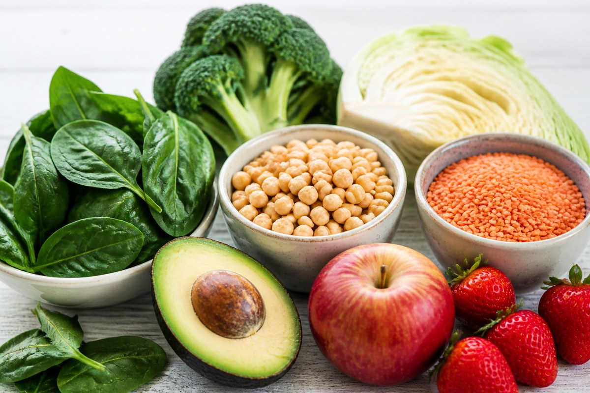

*▲ GI가 낮은 식재료는 대부분 식이섬유와 수분이 많고 전분이 적습니다. 같은 재료도 굽느냐 삶느냐에 따라 GI가 두 배 가까이 달라집니다.*

한 줄 결론 혈당을 가장 완만하게 올리는 것은 <strong>시금치·브로콜리·아보카도(GI 15)</strong>입니다. 탄수화물을 실제로 먹는 식재료 중에서는 <strong>병아리콩(GI 28)·렌틸콩(GI 32)</strong>이 가장 낮고, 밥 대신 선택할 수 있는 <strong>삶은 고구마(GI 45~55)</strong>는 구우면 80~90까지 치솟습니다.

혈당지수(GI, Glycemic Index)는 탄수화물 50g을 먹었을 때 혈당이 오르는 속도를 포도당(100)과 비교한 값입니다. 55 이하를 저GI, 56~69를 중간, 70 이상을 고GI로 나눕니다. 당뇨 관리와 체중 감량, 식후 졸음 개선을 위해 흔히 쓰이는 지표입니다.

다만 GI는 "속도"만 말하고 "양"은 말하지 않습니다. 수박은 GI가 72로 높지만 한 조각에 든 탄수화물이 적어 실제 혈당 상승 폭은 크지 않습니다. 그래서 GI에 1회 섭취량의 탄수화물 양을 곱한 **GL(혈당부하)**를 함께 봐야 합니다. 이 글의 표는 둘 다 적었습니다.

아래 순위는 국제 GI 데이터베이스(2008)와 USDA 영양 성분을 기준으로, 블로그에서 이미 다룬 식재료 10종을 같은 방식으로 비교한 것입니다. GI는 조리법·품종·숙성도에 따라 달라지므로 절대값이 아니라 상대 순위로 읽어 주세요.

---

## 1. 혈당 낮추는 음식 순위는? (GI·GL 비교표)

| 식재료 (100g 기준) | GI | GL (100g당, 약) |
| :--- | :--- | :--- |
| **1위 시금치** | 15 | 0.5 |
| **2위 브로콜리** | 15 | 1.0 |
| **3위 아보카도** | 15 | 1.3 |
| **4위 양배추** | 15~20 | 1.0 |
| **5위 병아리콩 (삶은 것)** | 28 | 7.7 |
| **6위 렌틸콩 (삶은 100g)** | 32 | 6.4 |
| **7위 사과** | 36 | 5.0 |
| **8위 딸기** | 40 | 3.1 |
| **9위 키위 (그린)** | 39~47 | 6.9 |
| **10위 고구마 (삶은 것)** | 45~55 | 10.7 |

GL은 "GI × 100g당 탄수화물 ÷ 100"으로 계산했습니다. GL 10 이하를 저부하, 11~19를 중간, 20 이상을 고부하로 봅니다.

## 2. GI와 GL은 무엇이 다른가?

- **GI는 속도, GL은 총량입니다.** 시금치는 GI 15에 탄수화물이 3.6g뿐이라 GL이 0.5로 사실상 혈당을 거의 올리지 않습니다. 반면 고구마는 GI가 45~55로 중간이지만 탄수화물이 20g이라 GL은 10.7로 열 배 이상입니다.
- **GL 20 이상은 한 끼에 피하는 편이 좋습니다.** 밥 한 공기(210g, 탄수화물 약 65g)의 GL은 약 46입니다. 같은 양의 삶은 렌틸콩(210g)은 GL이 약 13으로, 밥의 4분의 1 수준입니다.
- **저GI 식품도 많이 먹으면 고GL이 됩니다.** 아보카도는 GI 15지만 한 통(200g)을 먹으면 GL이 2.6으로 여전히 낮고, 견과류처럼 지방이 많은 식품은 포만감 대비 혈당 부하가 작습니다. 문제는 GI가 낮아도 총열량이 높은 식품을 대량 섭취하는 경우입니다.

## 3. 조리법이 GI를 바꾸는 이유는?

- **고구마는 삶으면 45~55, 구우면 80~90입니다.** 굽는 과정에서 베타-아밀라아제 효소가 전분을 맥아당으로 분해해 단맛과 함께 GI가 급등합니다. 찌거나 삶고, 식혀서 먹으면 저항성 전분이 늘어 혈당 반응이 더 완만해집니다.
- **콩류는 삶아도 GI가 낮습니다.** 병아리콩(28)·렌틸콩(32)은 전분이 아밀로스 비율이 높고 세포벽이 단단해 소화 효소가 접근하기 어렵습니다. 통조림 병아리콩도 GI는 비슷하지만 나트륨이 많으므로 물에 헹궈 쓰세요.
- **과일은 익을수록 GI가 올라갑니다.** 덜 익은 바나나(GI 약 42)가 완숙 바나나(GI 62)보다 낮고, 딸기·사과처럼 껍질째 먹는 과일은 섬유질이 당 흡수를 늦춥니다. 주스로 갈면 섬유질이 파괴되어 GI가 올라갑니다.
- **식초와 단백질을 곁들이면 식후 혈당이 완만해집니다.** 식사 전 식초 한 스푼이나 단백질 반찬을 먼저 먹는 순서는 식후 혈당 곡선을 낮춘다는 연구가 있습니다. 다만 효과 크기는 개인차가 큽니다.

## 4. 혈당 스파이크를 막는 식사 순서는?

| 순서 | 먼저 먹을 것 | 이유 |
| :--- | :--- | :--- |
| 1 | 채소(시금치·브로콜리·양배추) 먼저 | 식이섬유가 위 배출을 늦추고 전분 분해 속도를 낮춤 |
| 2 | 단백질(두부·계란·생선) | 위 배출 지연과 포만감으로 이후 탄수화물 섭취량 감소 |
| 3 | 탄수화물(밥·고구마) 마지막 | 같은 양의 탄수화물도 혈당 피크가 완만해짐 |

이 순서는 같은 식단에서 식후 혈당 상승 폭을 줄였다는 소규모 연구들을 참고한 것입니다. 약물 치료 중인 당뇨 환자는 식사 순서만으로 약을 대체해서는 안 됩니다.

## 5. 저GI 식품을 고를 때 주의할 점은?

- **신장 질환이 있으면 칼륨을 확인하세요.** 시금치(558mg)·아보카도(485mg)는 100g당 칼륨이 높습니다. 만성 신부전으로 칼륨 제한을 받는다면 섭취량을 조절해야 합니다.
- **와파린 복용자는 비타민K를 일정하게.** 시금치·브로콜리·케일은 비타민K가 많아 섭취량이 들쭉날쭉하면 INR이 흔들립니다. 양을 고정하는 것이 핵심입니다.
- **저GI는 '무제한'이 아닙니다.** 견과류·아보카도는 열량이 높고, 콩류는 과량 섭취 시 복부 팽만이 생깁니다. 하루 콩류 1회(삶은 것 100~150g) 정도가 무난합니다.
- **혈당측정기로 본인 반응을 확인하세요.** 같은 식품도 사람마다 혈당 반응이 다르다는 연구(2015, Cell)가 있습니다. GI 표는 출발점이고, 최종 기준은 식후 2시간 혈당입니다.

## 6. 함께 읽으면 좋은 식재료 가이드

- **[시금치](/posts/spinach-nutrition-benefits/)** — GI 15, 100g당 23kcal에 식이섬유 2.2g입니다.
- **[브로콜리](/posts/broccoli-nutrition-benefits/)** — GI 15, 비타민C 89.2mg과 설포라판 전구체를 함께 줍니다.
- **[아보카도](/posts/avocado-nutrition-benefits/)** — GI 15, 식이섬유 6.7g과 칼륨 485mg입니다.
- **[양배추](/posts/cabbage-nutrition-benefits/)** — GI 15~20, 식이섬유 2.5g과 비타민U를 담았습니다.
- **[병아리콩](/posts/chickpea-nutrition-benefits/)** — GI 28, 식이섬유 7.6g으로 콩류 중 혈당 부하가 낮습니다.
- **[렌틸콩](/posts/lentil-nutrition-benefits/)** — GI 32, 저항성 전분과 단백질을 동시에 제공합니다.
- **[사과](/posts/apple-nutrition-benefits/)** — GI 36, 껍질의 펙틴이 당 흡수를 늦춥니다.
- **[딸기](/posts/strawberry-nutrition-benefits/)** — GI 40, 100g당 당류가 4.9g으로 낮습니다.
- **[키위](/posts/kiwi-nutrition-benefits/)** — 그린키위 GI 39~47, 식이섬유 3.0g입니다.
- **[고구마](/posts/sweet-potato-nutrition-benefits/)** — 삶으면 GI 45~55, 구우면 80~90으로 올라갑니다.
- **[귤 (Tangerine)](/posts/tangerine-nutrition-benefits/):** GI 42·GL 3.4로 낮아 당뇨 식단의 디저트로 안전한 과일입니다.
- **[체리 (Cherry)](/posts/cherry-nutrition-benefits/):** GI 22로 이 순위표에서도 손꼽히게 낮은 과일입니다.
- **[감 (Persimmon)](/posts/persimmon-nutrition-benefits/):** 단감은 곶감(당류 29.8g/100g)보다 혈당 부담이 훨씬 낮으니 생과로 드세요.

## 7. 자주 묻는 질문 (FAQ)

**Q1. 혈당을 가장 빨리 낮추는 음식은 무엇인가요?**
음식이 혈당을 "낮추는" 것이 아니라 상승을 완만하게 만드는 것입니다. 시금치·브로콜리·아보카도처럼 GI 15, GL 1 내외인 식재료를 먼저 먹고 탄수화물을 뒤로 미루는 것이 가장 확실합니다.

**Q2. 과일은 당뇨에 나쁜가요?**
GI와 GL이 낮은 과일(딸기 3.1, 사과 5.0, 키위 6.9)은 하루 1~2회, 100~150g 정도면 문제가 되는 경우가 적습니다. 문제는 주스·건과일처럼 섬유질이 줄고 당이 농축된 형태입니다.

**Q3. 밥을 먹어야 한다면 무엇과 함께 먹는 게 좋나요?**
잡곡밥으로 바꾸고, 채소 반찬과 단백질 반찬을 먼저 먹은 뒤 밥을 먹으세요. 같은 양의 밥이라도 식후 혈당 피크가 낮아집니다. 렌틸콩이나 병아리콩을 밥에 30% 섞는 방법도 GI를 낮춥니다.

