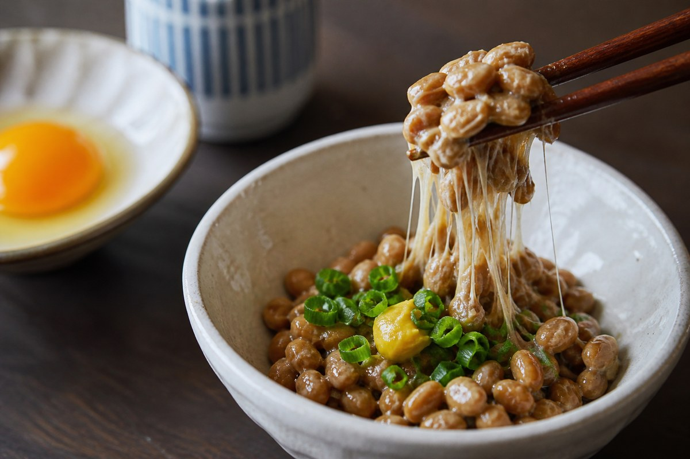

*▲ 낫토 100g은 212kcal, 단백질 17.72g, 식이섬유 5.4g입니다. 시판 1팩(약 50g)은 106kcal·단백질 8.9g이고, 비타민K2(MK-7)는 470~550µg으로 비타민K 충분섭취량(성인 남 75µg·여 65µg)의 6~8배가 한 팩에 들어 있습니다.*

한 줄 결론 <strong>낫토 100g은 212kcal, 단백질 17.72g, 식이섬유 5.4g이며 비타민K2(메나퀴논-7)가 939~1,103µg 들어 있습니다.</strong> 한 팩(50g)은 106kcal·단백질 8.9g로 단백질 식품으로 쓸 만하고, MK-7은 골밀도 임상시험에 쓰인 용량(180µg)을 한 팩으로 넘습니다. 다만 와파린 복용자는 반드시 의사와 상의해야 합니다.

2026년 장 건강 트렌드의 중심은 **발효식품과 마이크로바이옴**입니다. 그중에서도 **낫토(Natto, 納豆)** 는 삶은 콩을 바실러스 서브틸리스 낫토균으로 발효시켜 만든 일본 전통 식품으로, **단백질·식이섬유·비타민K2·나토키나아제·프로바이오틱스**를 한 팩에 겹쳐 담고 있습니다.

가장 많이 검색되는 질문은 **"낫토 하루에 얼마나 먹어야 하나"**, **"나토키나아제가 정말 혈전을 녹이나"**, **"낫토가 와파린과 상극이라던데"** 입니다. 결론부터 말하면 **낫토는 단백질·비타민K2 공급원으로 근거가 확실하고, 나토키나아제는 소규모 임상에서 긍정적 신호가 있으나 치료제가 아닙니다.** 와파린 복용자에게는 비타민K 과잉이 실제 문제가 되므로 섭취량을 일정하게 유지해야 합니다.

아래에서는 USDA FoodData Central과 식약처 식품영양성분 DB 수치를 기준으로 낫토 100g·1팩 영양, 나토키나아제·MK-7·낫토균의 작용 기전과 임상 근거, 냄새와 끈적임을 줄이는 섭취법, 그리고 와파린·통풍·콩 알레르기 주의사항을 정리했습니다.

---

## 1. 낫토 칼로리와 영양성분은? (1팩 106kcal·단백질 8.9g)

아래 수치는 **낫토(발효 콩, 생것) 100g** 기준입니다. 시판 제품은 45~55g 팩에 간장 타레와 겨자가 붙어 나오므로, 실제 한 끼 섭취량은 팩 단위로 계산하는 편이 정확합니다.

| 영양 성분 (Nutrient) | 함량 (100g당) | 1일 권장 섭취량 비율 (한국인 성인 기준) |
| :--- | :--- | :--- |
| **열량 (Energy)** | 212 kcal | 10.6% |
| **수분 (Water)** | 55.0 g | 별도 표기¹ |
| **탄수화물 (Carbohydrates)** | 12.68 g | 3.9% |
| - 총 당류 (Total Sugars) | 4.89 g | 4.9% |
| - 식이섬유 (Dietary Fiber) | 5.40 g | 21.6% |
| **단백질 (Protein)** | 17.72 g | 32.2% |
| **지방 (Total Fat)** | 11.00 g | 20.4% |
| - 포화지방 (Saturated Fat) | 1.59 g | 10.6% |
| - 콜레스테롤 (Cholesterol) | 0.00 mg | 0.0% |
| **비타민K2 (MK-7)** | 939~1,103 µg | 별도 표기¹ |
| **비타민K1 (Phylloquinone)** | 23.1 µg | 19.3% |
| **칼슘 (Calcium)** | 217 mg | 31.0% |
| **철분 (Iron)** | 8.60 mg | 71.7% |
| **마그네슘 (Magnesium)** | 115 mg | 28.8% |
| **칼륨 (Potassium)** | 729 mg | 20.8% |
| **아연 (Zinc)** | 1.90 mg | 19.0% |
| **나트륨 (Sodium)** | 7 mg | 0.4% |
| **나토키나아제 (Nattokinase)** | 20~40 FU/g (1팩 1,000~2,000 FU) | 기준치 없음 |

**표 읽는 법:** 열량·탄수화물·단백질·지방·나트륨 %는 식품 표시용 1일 영양성분 기준치(2,000kcal) 대비, 비타민·무기질 %는 한국인 영양소 섭취기준 성인 권장량 대비입니다. ¹수분·MK-7은 1일 기준치가 없어 절대량만 적었습니다. 비타민K2는 100g당 939µg(일본 분석 연구)에서 1,103µg(식약처 DB)까지 보고되며, **MK-7 1µg은 비타민K1 1µg보다 혈중 반감기가 약 3일로 길어** 하루 한 팩으로도 혈중 농도가 안정적으로 유지됩니다. 나토키나아제 활성(FU)은 제품·발효 기간에 따라 5~10배 차이가 납니다.

<strong>출처:</strong> 식품의약품안전처·농촌진흥청 국가표준식품성분표(K-FIND) · <a href="https://fdc.nal.usda.gov/" rel="nofollow noopener" target="_blank">USDA FoodData Central</a> · <a href="https://pubmed.ncbi.nlm.nih.gov/" rel="nofollow noopener" target="_blank">PubMed 문헌</a>

---

## 2. 낫토의 4가지 건강 포인트와 근거 수준

### H3. 낫토 1팩은 단백질을 얼마나 채워주나?

한 팩(50g)에 단백질 8.9g이 들어 있어, 달걀 1.5개분입니다. 하루 60g 목표의 15%를 106kcal로 채웁니다.

낫토 단백질은 라이신이 풍부해 곡물 위주의 식사에서 부족하기 쉬운 아미노산을 보완합니다. 같은 무게의 두부(단백질 8.1g/100g)보다 2배 이상 많습니다. 콩 단백질은 메타분석에서 **LDL 콜레스테롤을 3~5% 낮추는** 결과가 보고되었고, 이 효과는 콩 단백질이 하루 단백질의 상당 부분을 차지할 때 관찰된 것입니다. 육류 단백질을 일부 대체하는 식단 수준에서도 지질에 유리한 방향으로 작용할 수 있습니다.

### H3. 나토키나아제는 정말 혈전을 녹이나?

실험실에서는 강력한 섬유소 용해 활성을 보이지만, 사람을 대상으로 한 임상은 소규모입니다. 항혈전제를 대체할 수 없고 보조 식품으로 보는 것이 정확합니다.

나토키나아제는 낫토 발효 중 생성되는 세린 프로테아제로, 시험관 실험에서 피브린(혈전의 주성분)을 분해하고 혈전용해 인자(t-PA) 생성을 촉진하는 기전이 보고되었습니다. 1980년 일본에서 발견된 이후 소규모 무작위 시험에서 **나토키나아제 2,000FU를 12주간 섭취했을 때 혈전 표지자(D-dimer)와 혈류 개선**이 관찰됐습니다.

그러나 연구 규모가 수십 명 수준이고, 낫토 1팩의 활성(1,000~2,000FU)과 시험 용량이 비슷하다는 점은 **식품으로서 의미 있는 수준**이라는 근거이지, 아스피린·와파린 같은 항혈전제를 대신할 수 있다는 뜻은 아닙니다. 혈전 질환 병력이 있다면 약물 치료를 우선하고 낫토는 식사로만 드세요.

### H3. 비타민K2(MK-7)는 뼈와 혈관에 어떤 작용을 하나?

MK-7 180µg을 3년간 섭취한 무작위 시험에서 폐경 후 여성의 골밀도 유지와 동맥 경직도 개선이 보고됐습니다. 낫토 1팩이 이 용량을 3배 이상 넘깁니다.

비타민K는 혈액응고에만 쓰이는 것이 아니라 **오스테오칼신과 기질 Gla 단백질(MGP)을 활성화**합니다. 오스테오칼신은 칼슘을 뼈에 결합시키고, MGP는 칼슘이 혈관벽에 침착하는 것을 막습니다. 즉 같은 비타민K가 뼈에는 칼슘을 넣고 혈관에는 넣지 않도록 조율합니다.

네덜란드 연구팀의 3년 무작위 대조시험에서 **MK-7 180µg/일군은 위약군보다 요추 골밀도와 동맥 경직도 지표가 유의하게 개선**됐습니다. 한국인 영양소 섭취기준의 비타민K 충분섭취량(성인 남 75µg, 여 65µg)을 낫토 1팩이 6~8배 넘습니다. 뼈 건강을 위한 MK-7 섭취량은 확립된 기준이 없으므로, 낫토를 주 3~4회 먹는다고 '충분한 양을 보장한다'고 말할 수는 없습니다.

### H3. 낫토균은 진짜 프로바이오틱스인가?

네. 바실러스 서브틸리스 낫토균은 포자를 형성해 위산을 통과하며, 장내 유익균 증식과 변비 개선을 보고한 소규모 연구가 있습니다.

유산균과 달리 낫토균은 **내열성 포자**를 만들어 위산과 담즙을 견디는 특성이 있습니다. 일본의 소규모 연구에서는 낫토 섭취 후 장내 세균 구성과 변 상태가 달라졌다는 결과가 보고되었지만, 대규모 임상으로 확인된 프로바이오틱스 효과는 아닙니다.

낫토의 식이섬유 5.4g/100g도 프리바이오틱스로 작용해 장내 유익균의 먹이가 됩니다. **프로바이오틱스(균)와 프리바이오틱스(먹이)를 동시에 담은 식품**이라는 점이 발효식품 중에서도 낫토의 특징입니다.

---

## 3. 낫토 섭취 가이드: 양·조합·주의사항

- **차갑게 먹지 말고 체온 정도로 데우세요.** 냉장 낫토는 끈적임이 굳어 맛이 떨어집니다. 전자레인지 20~30초 또는 따뜻한 밥 위에 올리면 효소 활성과 향이 살아납니다.
- **타레(간장 소스)는 절반만.** 기본 타레 한 봉에는 나트륨이 300~500mg 들어 있습니다. 낫토 자체 나트륨은 7mg/100g으로 낮으므로, 간장을 줄이고 겨자·파·김가루로 간을 보완하면 나트륨을 절반으로 줄일 수 있습니다.
- **100번 이상 젓지 마세요.** 과도하게 저으면 공기와 섞여 끈적임(γ-PGA)이 뭉치고 향이 날아갑니다. 20~30회 정도가 적당합니다.
- **생달걀 대신 반숙란·아보카도·김치와.** 날달걀은 살모넬라 위험이 있고 비오틴 흡수를 방해합니다(흰자 아비딘). 반숙란이나 아보카도를 곁들이면 지용성 비타민K 흡수도 좋아집니다.
- **매일보다 주 3~4회.** MK-7은 반감기가 길어 매일 먹지 않아도 혈중 농도가 유지됩니다. 냉동 보관하면 1개월까지 보관 가능하며, 해동 후 바로 드세요.

---

## 4. 섭취 시 주의사항 및 부작용

- **와파린(쿠마딘) 복용자는 필수 상담.** 와파린은 비타민K의 혈액응고 작용을 차단하는 약이라, 비타민K가 많은 낫토를 갑자기 먹기 시작하면 INR이 떨어져 약효가 줄어듭니다. 반대로 먹던 낫토를 갑자기 끊어도 INR이 흔들립니다. **섭취량을 일정하게 유지하는 것**이 원칙이며, 시작 전 반드시 처방 의사와 상의하세요.
- **수술 전 2주는 중단.** 나토키나아제의 섬유소 용해 작용과 비타민K 영향 때문에, 수술·시술 전에는 보충제와 낫토 섭취를 중단하도록 권고됩니다.
- **통풍·고요산혈증:** 콩 발효식품은 퓨린이 중간~높은 편입니다. 급성 통풍 발작기에는 하루 1팩 이하로 줄이고, 물을 충분히 마시세요.
- **콩 알레르기:** 대두 단백질 알레르기가 있으면 낫토도 피해야 합니다. 두드러기·입안 가려움이 나타나면 즉시 중단하세요.
- **신장질환:** 칼륨 729mg/100g으로 높습니다. 칼륨 제한 식이 중이라면 한 팩도 절반으로 나눠 드세요.
- **냄새가 부담스러우면:** 낫토 특유의 냄새는 발효 중 생성되는 암모니아·디아세틸 화합물 때문입니다. 파·생강·들깨를 더하면 냄새가 크게 줄어듭니다.

---

## 5. 자주 묻는 질문 (FAQ)

**Q1. 낫토는 하루에 몇 팩 먹어야 하나요?**  
**하루 1팩(50g)** 이면 비타민K2·단백질·식이섬유를 충분히 확보합니다. MK-7은 반감기가 약 3일이라 주 3~4회만 먹어도 혈중 농도가 유지됩니다. 단백질 보충이 목적이라면 2팩(212kcal·단백질 17.7g)까지 늘려도 무리가 없습니다.

**Q2. 나토키나아제는 혈전 용해제를 대신할 수 있나요?**  
아니요. 소규모 임상에서 긍정적 신호가 있었을 뿐, 아스피린·와파린·DOAC 같은 항혈전제를 대체할 근거는 없습니다. 혈전 질환이 있거나 항혈전제를 복용 중이라면 낫토는 식사 수준으로만 드시고, 약 복용을 임의로 조절하지 마세요.

**Q3. 낫토를 먹으면 와파린 효과가 떨어지나요?**  
네, 실제로 INR이 낮아질 수 있습니다. 낫토 100g의 비타민K는 600~1,100µg으로 충분섭취량의 8~15배입니다. 와파린 복용자는 낫토를 새로 시작하거나 끊지 말고, 먹는다면 **매주 같은 양을 일정하게** 먹으면서 INR을 모니터링해야 합니다.

---

## 6. 낫토와 함께 먹으면 좋은 음식

- **[두부 (Tofu)](/posts/tofu-nutrition-benefits/):** 두부의 칼슘(100g당 74mg)과 낫토의 비타민K2가 함께 뼈에 칼슘을 붙이는 방향으로 작용합니다. 콩 단백질을 두 가지 형태로 나눠 먹는 것도 장점입니다.
- **[병아리콩 (Chickpea)](/posts/chickpea-nutrition-benefits/):** 병아리콩의 식이섬유와 낫토의 단백질을 함께 섭취할 수 있습니다. 샐러드에 낫토와 병아리콩을 얹으면 1회 단백질 15g을 넘길 수 있습니다.
- **[김 (Laver)](/posts/laver-nutrition-benefits/):** 김의 철분(8.48mg/100g)과 낫토의 비타민C·단백질을 함께 먹으면 낫토밥 한 그릇이 철분·단백질·요오드 균형 식사가 됩니다.
- **[시금치 (Spinach)](/posts/spinach-nutrition-benefits/):** 시금치의 비타민K1과 낫토의 비타민K2가 각각 혈액응고·뼈 대사 경로를 채웁니다. 다만 항응고제 복용자는 두 식품 모두 섭취량을 일정하게 유지하세요.

  
📌 관련 순위 가이드

  <ul>
    <li><a href="/posts/high-protein-foods-ranking/">고단백 음식 TOP 10: 100g당 단백질 순위</a></li>
    <li><a href="/posts/heart-blood-pressure-cholesterol-foods/">혈압·혈관 건강 음식 TOP 10: 콜레스테롤·중성지방 관리</a></li>
    <li><a href="/posts/liver-immunity-fatigue-recovery-foods/">간·면역·피로 회복 음식 TOP 10</a></li>
  </ul>

---

## 7. 낫토 핵심 요약

- **열량·단백질: 1팩(50g) 106kcal, 단백질 8.9g, 식이섬유 2.7g.** 가성비 좋은 단백질 공급원입니다.
- **비타민K2: 100g에 939~1,103µg.** 뼈·혈관 임상 용량(180µg)을 한 팩으로 넘깁니다.
- **나토키나아제는 보조.** 소규모 임상 신호는 있으나 항혈전제를 대신할 수 없습니다.
- **와파린 복용자는 반드시 상의.** 섭취량을 일정하게 유지하는 것이 핵심입니다.
- **데워서, 타레는 절반만, 주 3~4회.** 나트륨과 냄새를 줄이는 실전 팁입니다.

