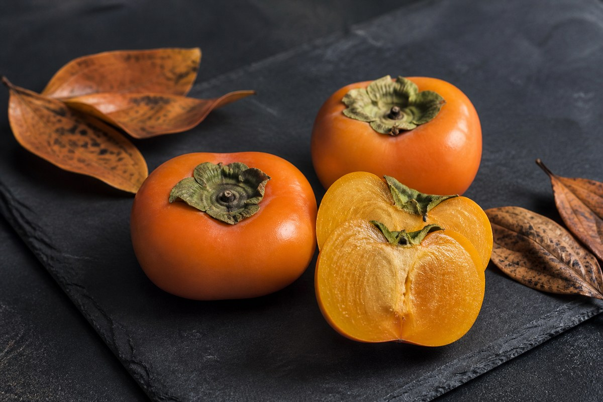

*▲ 단감 100g은 57kcal, 비타민C 28.84mg(권장량의 29%), 식이섬유 1.9g입니다. 중간 크기 1개(껍질 제외 약 170g)는 약 97kcal로, 사과 1개와 비슷한 열량에 비타민C는 14배 많습니다.*

한 줄 결론 <strong>단감 100g은 57kcal, 비타민C 28.84mg, 식이섬유 1.9g이며 1개(가식부 170g)는 약 97kcal입니다.</strong> "감 먹으면 변비"라는 말은 떫은감의 수용성 탄닌에서 나온 이야기로, 수용성 탄닌이 거의 없는 단감(부유 등)에는 해당 근거가 약합니다. 다만 공복에 떫은감·곶감을 다량 먹으면 위석 위험이 있어 주의가 필요합니다.

10월 말부터 11월까지가 절정인 **감(단감, *Diospyros kaki*)** 은 한국 가을 과일의 상징입니다. 단단한 단감, 말랑하게 익힌 홍시, 말린 곶감까지 같은 과일이 전혀 다른 식품처럼 변하는 것도 특징입니다.

검색창에 가장 많이 올라오는 질문은 **"감 먹으면 변비 생기나요?"**, **"감은 공복에 먹어도 되나요?"**, **"단감과 홍시 중 뭐가 더 좋나요?"** 입니다. 결론부터 말하면 **단감의 식이섬유는 1.9g으로 사과(1.8g)와 비슷하고, 사람을 대상으로 '감=변비'를 확인한 연구는 없습니다.** 문제가 되는 것은 떫은맛이 강한 떫은감과 곶감을 공복에 다량 먹는 경우입니다.

아래에서는 농촌진흥청 국가표준식품성분표와 USDA FoodData Central 수치를 기준으로 단감·홍시·곶감의 영양 차이, 탄닌과 변비 논란의 실제 근거, 베타카로틴·칼륨·비타민C의 효능, 그리고 위석·당뇨 환자 주의사항을 정리했습니다.

---

## 1. 감 칼로리와 영양성분은? (단감 100g 57kcal)

아래 수치는 **단감(생것, 껍질 제외) 100g** 기준입니다. 같은 감이라도 숙성·건조 상태에 따라 열량과 당 농도가 크게 달라지므로 표 아래에서 함께 비교했습니다.

| 영양 성분 (Nutrient) | 함량 (100g당) | 1일 권장 섭취량 비율 (한국인 성인 기준) |
| :--- | :--- | :--- |
| **열량 (Energy)** | 57 kcal | 2.9% |
| **수분 (Water)** | 84.1 g | 별도 표기¹ |
| **탄수화물 (Carbohydrates)** | 15.13 g | 4.7% |
| - 총 당류 (Total Sugars) | 11.42 g | 11.4% |
| - 식이섬유 (Dietary Fiber) | 1.90 g | 7.6% |
| - 불용성 식이섬유 (Insoluble Fiber) | 1.50 g | 별도 표기¹ |
| **단백질 (Protein)** | 0.38 g | 0.7% |
| **지방 (Total Fat)** | 0.12 g | 0.2% |
| - 콜레스테롤 (Cholesterol) | 0.00 mg | 0.0% |
| **비타민C (Vitamin C)** | 28.84 mg | 28.8% |
| **베타카로틴 (Beta-carotene)** | 72 µg | 별도 표기¹ |
| **비타민A (Vitamin A, RAE)** | 6 µg RAE | 0.9% |
| **엽산 (Folate)** | 26 µg DFE | 6.5% |
| **칼륨 (Potassium)** | 157 mg | 4.5% |
| **망간 (Manganese)** | 0.38 mg | 13.0% |
| **칼슘 (Calcium)** | 8 mg | 1.1% |
| **나트륨 (Sodium)** | 1 mg | 0.1% |
| **수용성 탄닌 (Soluble Tannin)** | 단감 0.1% 미만 · 떫은감 1% 내외 | 기준치 없음 |

**표 읽는 법:** 열량·탄수화물·단백질·지방·나트륨 %는 식품 표시용 1일 영양성분 기준치(2,000kcal) 대비, 비타민C·엽산·칼륨·칼슘·망간 %는 한국인 영양소 섭취기준 성인 권장량 대비입니다. ¹수분·베타카로틴·불용성 식이섬유·탄닌은 1일 기준치가 없어 절대량만 적었습니다. 망간 13%는 하루 필요량의 8분의 1을 감 한 개 남짓으로 채운다는 뜻으로, 뼈 형성과 항산화 효소(MnSOD) 작동에 쓰입니다.

<strong>출처:</strong> 식품의약품안전처·농촌진흥청 국가표준식품성분표(K-FIND) · <a href="https://fdc.nal.usda.gov/" rel="nofollow noopener" target="_blank">USDA FoodData Central</a> · <a href="https://pubmed.ncbi.nlm.nih.gov/" rel="nofollow noopener" target="_blank">PubMed 문헌</a>

### 단감·홍시·곶감은 얼마나 다른가?

| 종류 | 100g당 열량 | 당류 | 식이섬유 | 비타민C | 한 개 기준 |
| :--- | :--- | :--- | :--- | :--- | :--- |
| 단감(생것) | 57 kcal | 11.42 g | 1.9 g | 28.84 mg | 1개(170g) 약 97 kcal |
| 홍시(연시) | 68 kcal | 12.3 g | 2.8 g | 17.5 mg | 1개(150g) 약 102 kcal |
| 곶감(반건시) | 201 kcal | 29.8 g | 8.5 g | 2.7 mg | 1개(40g) 약 80 kcal |

건조 과정에서 수분이 빠지면 당과 식이섬유가 같은 무게에 농축됩니다. **곶감 100g의 당류 29.8g은 단감의 2.6배**이므로, 혈당을 관리한다면 '곶감 3개'는 단감 3개와 전혀 다른 섭취가 됩니다.

---

## 2. 과학적으로 입증된 4대 건강 효능

### H3. 감을 먹으면 정말 변비가 생기나?

단감에는 근거가 약합니다. 단감의 식이섬유는 1.9g으로 사과와 비슷하고, 사람을 대상으로 감 섭취와 변비를 연결한 연구는 확인되지 않았습니다.

'감=변비'설의 출처는 **수용성 탄닌(시부올)** 입니다. 떫은감은 수확 시 수용성 탄닌이 1% 내외로 많아 침 속 단백질과 엉겨 붙고, 위에서 단백질과 뭉쳐 소화가 더뎌집니다. 반면 부유 같은 단감 품종은 열매가 어릴 때 탄닌 축적이 끝나 **수용성 탄닌이 0.1% 미만**이며, 딴 직후에도 떫지 않습니다.

식이섬유 측면에서도 단감(1.9g)은 사과(1.8g)와 차이가 없습니다. 오히려 **펙틴과 불용성 섬유가 장 통과 시간을 조절**해, 물을 충분히 마시면 배변을 규칙적으로 만드는 방향으로 작용합니다. 변비가 생기는 경우는 대개 **떫은감을 공복에 여러 개 먹거나, 곶감을 습관적으로 다량 먹는 경우**입니다.

### H3. 감은 공복에 먹어도 되나?

단감은 괜찮지만, 떫은감과 곶감은 공복에 피하는 편이 안전합니다. 공복 위산 환경에서 수용성 탄닌이 단백질과 응집해 위석(위 속 돌)을 만든 사례가 보고됐습니다.

위석(phytobezoar)은 소화되지 않는 탄닌-단백질 덩어리로, 위 배출구를 막아 복통·구토·식욕 부진을 일으킵니다. 국내외 증례 보고는 대부분 **공복에 떫은감이나 곶감을 장기간 다량 섭취한 경우**, 특히 **위 절제 수술을 받았거나 위 운동이 느린 사람**에게 집중됩니다.

건강한 사람이 식후 디저트로 단감 1~2개를 먹는 수준에서는 위석 위험이 보고되지 않았습니다. 탄닌이 걱정된다면 **껍질을 벗기고, 단단한 단감을 완전히 익혀 먹고, 우유·요구르트 같은 단백질 식품과 함께** 먹으면 결합 위험이 줄어듭니다.

### H3. 베타카로틴과 비타민C는 얼마나 들어 있나?

단감 100g에 비타민C 28.84mg(권장량의 29%)과 베타카로틴 72µg이 들어 있습니다. 홍시는 비타민C가 절반으로 줄지만 베타카로틴은 4배로 늘어납니다.

단감의 비타민C 28.84mg은 사과(2.03mg)의 약 14배, 부유 품종(41.91mg)은 21배 수준입니다. "감은 귤의 3배"라는 말은 성분표로 확인되지 않으며, 귤(30.69mg)과 거의 같습니다.

숙성 과정에서 비타민C는 줄고 카로티노이드는 늘어납니다. **홍시 100g의 베타카로틴 284µg은 단감의 약 4배**로, 주황색이 진해지는 이유가 여기에 있습니다. 베타카로틴은 지용성이라 견과류·참기름과 함께 먹을 때 흡수율이 높아집니다.

### H3. 칼륨과 망간은 어떤 역할을 하나?

단감 1개에는 칼륨 267mg과 망간 0.65mg이 들어 있어, 나트륨 배출과 뼈·항산화 효소 작동을 돕습니다.

칼륨은 신장에서 나트륨 재흡수를 억제해 혈압을 낮추는 방향으로 작용합니다. 짠 국물 요리가 많은 한국 식단에서 과일로 칼륨을 보충하는 것은 혈압 관리에 실질적인 도움이 됩니다.

망간은 뼈 형성에 관여하는 효소와 미토콘드리아 항산화 효소(MnSOD)의 필수 구성 성분입니다. 단감 1개로 하루 필요량의 약 20%를 채웁니다.

---

## 3. 흡수율을 높이는 조리·섭취 가이드

- **단감은 껍질을 벗겨 드세요.** 껍질에는 탄닌이 과육보다 많이 남아 있어 떫은맛이 강하고 소화가 느려집니다. 특히 떫은감 계열은 반드시 벗기세요.
- **떫은감은 숙성으로 떫기를 빼세요.** 쌀통이나 사과와 함께 밀봉해 두면 에틸렌 가스가 수용성 탄닌을 불용성으로 바꿔 3~5일 만에 부드러운 홍시가 됩니다.
- **곶감은 하루 1~2개로 제한하세요.** 곶감 1개(40g)는 80kcal·당류 12g으로, 단감 반 개 분량의 당이 응축돼 있습니다.
- **식후 디저트로, 단백질과 함께.** 공복 대신 식사 후 30분 이내에 먹으면 탄닌-단백질 응집 위험이 줄고 혈당 상승도 완만해집니다.
- **보관은 단감·홍시 모두 냉장(0~5℃).** 단감은 키친타월로 감싸 비닐에 느슨히 담고, 홍시는 익은 뒤 냉장으로 옮겨 3~4일 안에 드세요. 곶감은 냉동 보관하면 6개월 이상 보관됩니다.

---

## 4. 섭취 시 주의사항 및 부작용

- **위석 위험군:** 위 절제술·위 우회술을 받았거나 당뇨병성 위마비가 있는 사람은 떫은감·곶감을 공복에 먹지 마세요. 복통·구토가 반복되면 위석을 의심해야 합니다.
- **당뇨·혈당 관리:** 홍시와 곶감은 수분이 빠져 당 농도가 높습니다. 단감 1개(97kcal)는 괜찮지만 곶감 3개(240kcal·당류 36g)는 혈당을 크게 올립니다. 당뇨가 있다면 **단감 반 개 또는 홍시 1개**로 제한하세요.
- **만성신장질환:** 칼륨 157mg/100g은 과일 중 중간 수준이지만, 홍시·곶감은 더 높습니다(곶감 551mg/100g). 칼륨 제한 식이 중이라면 단감 1개 이하로 조절하세요.
- **과민성 대장증후군(IBS):** 감에는 프룩탄·만니톨 계열 당알코올이 있어 소수에서 복부 팽만·가스를 유발할 수 있습니다. 증상이 있으면 한 번에 1개로 줄여보세요.
- **변비약과의 간섭:** 탄닌은 철분·칼슘 흡수를 일부 방해합니다. 철결핍성 빈혈로 철분제를 복용 중이라면 감과 철분제를 2시간 이상 떨어뜨려 드세요.

---

## 5. 자주 묻는 질문 (FAQ)

**Q1. 감을 먹으면 변비가 생기나요?**  
단감은 아닙니다. 단감의 식이섬유는 1.9g/100g으로 사과(1.8g)와 비슷하고 수용성 탄닌이 0.1% 미만이라, 사람을 대상으로 변비를 확인한 연구가 없습니다. 변비가 생기는 경우는 **떫은감이나 곶감을 공복에 다량 먹는 습관**과 물 섭취 부족이 겹칠 때입니다. 물을 충분히 마시면 오히려 배변을 규칙적으로 만드는 데 도움이 됩니다.

**Q2. 감은 하루에 몇 개까지 먹어도 되나요?**  
단감 기준 **하루 1~2개(97~194kcal)** 가 적당합니다. 곶감은 1~2개, 홍시는 1개까지가 무난합니다. 당뇨가 있으면 단감 반 개 또는 홍시 1개로 줄이고, 식사 직후에 드세요.

**Q3. 홍시와 단감 중 어느 쪽이 더 건강한가요?**  
목적에 따라 다릅니다. **비타민C는 단감(28.84mg)**, **베타카로틴과 식이섬유는 홍시(284µg·2.8g)** 가 우세합니다. 열량은 단감 57kcal, 홍시 68kcal로 큰 차이가 없지만, 홍시는 당이 더 농축돼 있어 혈당을 관리한다면 단감이 유리합니다.

---

## 6. 감과 함께 먹으면 좋은 음식

- **[시금치 (Spinach)](/posts/spinach-nutrition-benefits/):** 감의 비타민C 28.84mg은 시금치의 비헴철 흡수를 돕습니다. 다만 시금치의 옥살산과 감의 탄닌이 함께 신장결석 위험을 높일 수 있으니, 결석 병력이 있다면 같은 식사에 몰아 먹지 마세요.
- **[두부 (Tofu)](/posts/tofu-nutrition-benefits/):** 감의 탄닌은 단백질과 결합하므로, 위석이 걱정된다면 두부·우유 같은 단백질을 함께 먹어 결합을 미리 포화시키는 편이 안전합니다.
- **[고구마 (Sweet Potato)](/posts/sweet-potato-nutrition-benefits/):** 고구마의 베타카로틴과 감의 비타민C가 지용성·수용성 항산화 방어를 함께 채웁니다. 가을 간식 조합으로 열량은 1회 200kcal 이내로 맞추세요.
- **[키위 (Kiwi)](/posts/kiwi-nutrition-benefits/):** 변비가 걱정된다면 감보다 키위가 근거가 확실합니다. 그린키위 2개를 먹은 임상시험에서 배변 횟수가 증가했습니다.

  
📌 관련 순위 가이드

  <ul>
    <li><a href="/posts/low-gi-foods-blood-sugar-guide/">혈당 낮추는 음식 TOP 10: 저혈당 지수(GI) 순위표</a></li>
    <li><a href="/posts/antioxidant-anti-aging-foods-guide/">항산화·노화 방지 음식 TOP 10: 비타민C·폴리페놀 비교</a></li>
    <li><a href="/posts/heart-blood-pressure-cholesterol-foods/">혈압·혈관 건강 음식 TOP 10: 칼륨·콜레스테롤 관리</a></li>
  </ul>

---

## 7. 감 하루 얼마나 먹을까? 핵심 요약

- **열량: 단감 100g 57kcal, 1개(170g) 약 97kcal·당류 19g.** 하루 1~2개가 적정량입니다.
- **변비 논란은 떫은감 이야기.** 단감은 식이섬유 1.9g, 수용성 탄닌 0.1% 미만으로 근거가 약합니다.
- **공복 섭취는 떫은감·곶감만 주의.** 위 절제술 환자는 공복 섭취를 피하세요.
- **비타민C는 단감, 베타카로틴은 홍시.** 목적에 따라 선택하면 됩니다.
- **곶감은 당 농축 식품.** 1개 80kcal·당류 12g으로 단감과 다르게 계산하세요.

