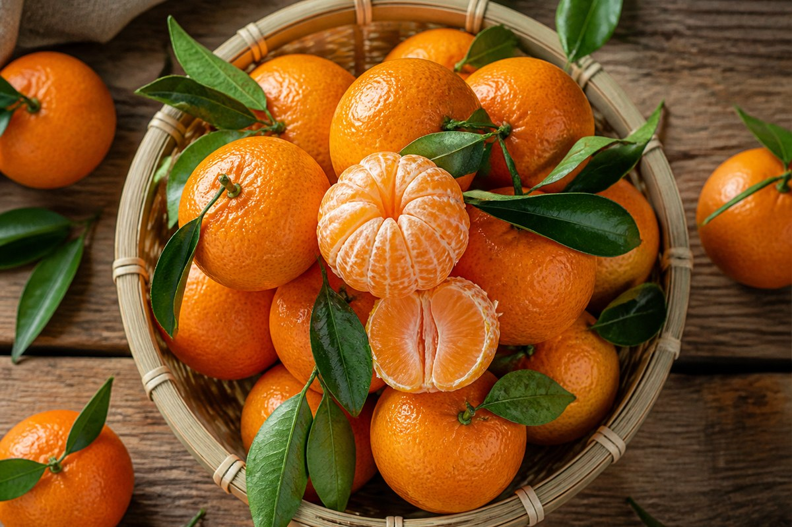

*▲ 귤 100g은 39kcal, 비타민C 30.69mg입니다. 중간 크기 1개(껍질 제외 약 80g)는 31kcal로, 하루 2~3개(60~90kcal)가 혈당과 열량을 함께 지키는 적정량입니다.*

한 줄 결론 <strong>귤 100g은 39kcal, 비타민C 30.69mg, 식이섬유 1.0g이고 혈당지수(GI)는 42~52로 낮은 편입니다.</strong> 중간 크기 1개(껍질 제외 80g)는 31kcal·당류 7g이므로 건강한 성인은 하루 2~3개, 당뇨가 있으면 1~2개를 한 번에 몰아 먹지 말고 나눠 먹는 것이 안전합니다.

11월부터 이듬해 2월까지가 절정인 **귤(감귤, 온주밀감, *Citrus unshiu*)** 은 한국인 겨울 과일 소비의 절반 이상을 차지하는 대표 과일입니다. 손쉽게 까 먹을 수 있고 열량이 낮아 밤에 먹어도 부담이 적다는 점이 강점입니다.

가장 자주 검색되는 질문은 **"귤 하루에 몇 개까지 먹어도 되나?"**, **"귤이 당이 높아서 당뇨에 나쁘지 않나?"**, **"귤 먹으면 살찌나?"** 세 가지입니다. 결론부터 정리하면 **귤 1개는 31kcal·당류 7g에 불과하고 GI 42~52·혈당부하지수(GL) 3.4로 저혈당 식품군**에 들어갑니다. 문제는 귤 자체가 아니라 **한 자리에서 5~6개를 까 먹는 습관**입니다.

아래에서는 식약처 국가표준식품성분표와 USDA FoodData Central 수치를 기준으로 귤 100g·1개 기준 영양 성분, 비타민C·헤스페리딘·칼륨의 과학적 근거, 혈당을 지키는 섭취 순서, 그리고 카로틴혈증·위산 역류 같은 주의사항을 정리했습니다.

---

## 1. 귤 칼로리와 영양성분은? (100g 39kcal·1개 31kcal)

아래 수치는 **귤(온주밀감, 생것) 껍질을 제외한 가식부 100g** 기준입니다. 참고로 미국산 탠저린(Dancy 품종)은 100g당 53kcal로 국내 감귤보다 열량이 높은데, 이는 품종과 당도 차이 때문입니다.

| 영양 성분 (Nutrient) | 함량 (100g당) | 1일 권장 섭취량 비율 (한국인 성인 기준) |
| :--- | :--- | :--- |
| **열량 (Energy)** | 39 kcal | 2.0% |
| **수분 (Water)** | 87.2 g | 별도 표기¹ |
| **탄수화물 (Carbohydrates)** | 10.1 g | 3.1% |
| - 총 당류 (Total Sugars) | 8.6 g | 8.6% |
| - 식이섬유 (Dietary Fiber) | 1.00 g | 4.0% |
| **단백질 (Protein)** | 0.7 g | 1.3% |
| **지방 (Total Fat)** | 0.10 g | 0.2% |
| - 포화지방 (Saturated Fat) | 0.02 g | 0.1% |
| - 콜레스테롤 (Cholesterol) | 0.00 mg | 0.0% |
| **비타민C (Vitamin C)** | 30.69 mg | 30.7% |
| **베타카로틴 (Beta-carotene)** | 52 µg | 별도 표기¹ |
| **엽산 (Folate)** | 16 µg DFE | 4.0% |
| **칼륨 (Potassium)** | 152 mg | 4.3% |
| **칼슘 (Calcium)** | 16 mg | 2.3% |
| **헤스페리딘 (Hesperidin)** | 20~30 mg | 기준치 없음 |
| **나트륨 (Sodium)** | 2 mg | 0.1% |

**표 읽는 법:** 열량·탄수화물·단백질·지방·나트륨의 %는 식품 표시용 1일 영양성분 기준치(2,000kcal) 대비이고, 비타민C·엽산·칼륨·칼슘의 %는 한국인 영양소 섭취기준 성인 권장량(비타민C 100mg, 엽산 400µg DFE, 칼륨 3,500mg, 칼슘 700mg) 대비입니다. ¹수분·베타카로틴·헤스페리딘은 1일 기준치가 설정되지 않은 성분으로, 절대량만 표기했습니다. 헤스페리딘은 과육보다 껍질과 흰 속껍질(알베도)에 3~5배 많아 편차가 큽니다.

*※ 데이터 기준: 표의 수치는 국내 국가표준식품성분표(식약처 식품영양성분 DB)의 귤(온주밀감), 생것, 껍질 제외 분석값입니다. 같은 식품의 [USDA FoodData Central FDC 169105](https://fdc.nal.usda.gov/food-details/169105/nutrients) — Tangerines, (mandarin oranges), raw (SR Legacy)는 100g당 53 kcal·단백질 0.81 g입니다. 이 글의 39 kcal는 국내 감귤 품종(온주밀감) 값이고, USDA 값은 미국에서 유통되는 Dancy 품종입니다.*

<strong>출처:</strong> 식품의약품안전처 국가표준식품성분표(농촌진흥청 국립식량과학원 분석) · <a href="https://various.foodsafetykorea.go.kr/" rel="nofollow noopener" target="_blank">K-FIND 식품영양성분 DB</a> · <a href="https://fdc.nal.usda.gov/" rel="nofollow noopener" target="_blank">USDA FoodData Central</a>

### 실생활 환산: 귤 1개·2개·한 줌은 몇 kcal인가?

| 섭취 기준 | 중량(가식부) | 열량과 핵심 수치 |
| :--- | :--- | :--- |
| 소과 1개 | 약 60 g | 23 kcal · 비타민C 18.4 mg |
| 중과 1개 | 약 80 g | **31 kcal** · 당류 6.9 g · 비타민C 24.6 mg |
| 대과 1개 | 약 100 g | 39 kcal · 당류 8.6 g |
| 하루 권장 2~3개 | 160~240 g | 62~94 kcal · 비타민C 49~74 mg |
| 귤주스 200 ml | 귤 3~4개분 | 120~160 kcal · 식이섬유 거의 없음 |

귤 하나로 하루 비타민C 권장량(100mg)의 약 25%를 채웁니다. **2개면 50%, 3개면 74%**로, 같은 열량의 과자·음료와 비교하면 영양 밀도가 압도적으로 높습니다.

---

## 2. 과학적으로 입증된 4대 건강 효능

### H3. 귤 1개로 비타민C 하루 권장량을 채울 수 있나?

아니요. 귤 1개(80g)는 비타민C 24.6mg으로 권장량의 25% 수준이며, 하루 3~4개를 먹어야 100mg을 채웁니다.

귤의 비타민C 30.69mg은 100g당 사과(2.03mg)의 약 15배입니다. 비타민C는 콜라겐 합성의 조효소로 작용해 **피부·혈관·잇몸 점막 유지**에 직접 관여하고, 호중구(백혈구) 기능을 지원해 상기도 감염 기간을 줄인다는 메타분석 결과가 있습니다.

다만 비타민C는 수용성이라 체내 저장량이 2~3시간 안에 소변으로 빠져나갑니다. 한 번에 5개를 먹는 것보다 **아침·점심·저녁에 1~2개씩 나눠 먹는 편**이 혈중 농도 유지에 유리합니다.

### H3. 당뇨가 있어도 귤을 먹어도 되나?

네, 가능합니다. 귤의 GI는 42, 1개당 GL은 약 3.4로 저혈당 식품군에 속하며, 핵심은 개수와 타이밍입니다.

혈당지수(GI) 42~52는 낮음(55 이하) 구간입니다. 혈당부하지수(GL)는 1회 섭취량의 실제 당질량을 반영하는데, 귤 1개(당질 약 8g)는 **GL 3.4**로 10 이하의 '낮음'에 해당합니다.

주의할 것은 **주스와 통조림**입니다. 귤주스 200ml는 귤 3~4개분의 당을 식이섬유 없이 한 번에 넣기 때문에 GL이 12~15까지 올라갑니다. 당뇨가 있다면 **생귤 1~2개를 식사 후 30분 이내 디저트로** 먹는 방식이 혈당 스파이크를 가장 완만하게 만듭니다. 공복에 3개 이상을 먹으면 혈당이 빠르게 오른 뒤 급격히 떨어져 오히려 허기가 커질 수 있습니다.

### H3. 헤스페리딘은 혈관과 콜레스테롤에 실제로 도움이 되나?

임상 근거는 '보조적' 수준입니다. 헤스페리딘 500mg/일 보충제 연구에서 혈관 내피 기능과 중성지방 개선이 보고됐지만, 귤 2~3개(헤스페리딘 40~90mg)로 같은 효과를 기대하기는 어렵습니다.

헤스페리딘은 귤·오렌지 등 감귤류 플라보노이드로, 모세혈관 투과성을 낮추고 산화된 LDL 콜레스테롤 생성을 억제하는 기전이 알려져 있습니다. 미국·유럽의 무작위 대조시험에서는 **헤스페리딘 500mg과 비타민C를 6주간 병용했을 때 혈관 내피 기능 지표(FMD)가 개선**됐습니다.

귤 과육 100g의 헤스페리딘은 20~30mg 수준이지만, **흰 속껍질(알베도)과 껍질에는 3~5배 농축**되어 있습니다. 귤을 깔 때 흰 속껍질을 최대한 남기고, 껍질은 잘 씻어 귤피차로 우려 마시면 같은 과일에서 플라보노이드 섭취를 크게 늘릴 수 있습니다.

### H3. 칼륨과 베타카로틴은 어떤 역할을 하나?

귤 1개에 칼륨 122mg이 들어 있어 나트륨 배출을 돕고, 베타카로틴 42µg은 눈 점막과 피부 각질 형성을 지원합니다.

칼륨은 신장에서 나트륨 재흡수를 억제해 혈압을 낮추는 방향으로 작용합니다. 한국인은 나트륨 섭취가 권장량의 2배 수준이어서, 국물 음식이 많은 식사에 귤 1~2개를 더하는 것만으로도 칼륨·나트륨 균형이 개선됩니다.

베타카로틴은 체내에서 필요할 때 비타민A로 전환되는 전구체입니다. 지용성이므로 **우유·견과류처럼 지방이 조금 있는 식사와 함께** 먹으면 흡수율이 올라갑니다. 다만 흡연자는 고용량 베타카로틴 보충제(20mg 이상)를 피해야 하며, 이는 귤 섭취와는 무관합니다.

---

## 3. 흡수율을 높이는 조리·섭취 가이드

- **흰 속껍질을 남기세요.** 헤스페리딘과 식이섬유가 가장 많은 부위입니다. 깔끔하게 벗기려고 알베도를 전부 제거하면 플라보노이드의 3분의 1을 버리는 셈입니다.
- **껍질은 베이킹소다로 씻어 활용하세요.** 물 1L에 베이킹소다 1큰술을 풀고 5분간 담갔다가 흐르는 물에 헹구면 농약 잔류와 왁스가 줄어듭니다. 얇게 채 썰어 말린 뒤 끓는 물에 우려내면 카페인 없는 저녁차가 됩니다.
- **식사 후 디저트로 드세요.** 공복보다 식후 30분 이내가 혈당 상승폭이 완만합니다. 단백질·지방이 섞인 식사라면 더욱 안정적입니다.
- **주스 대신 생과일을 드세요.** 주스 한 잔(200ml)은 귤 3~4개분의 당을 담고 식이섬유는 대부분 사라집니다. 같은 단맛을 원한다면 귤을 냉동실에 30분 넣어 차갑게 먹는 편이 포만감이 큽니다.
- **보관은 통풍이 되는 서늘한 곳(5~10℃)에.** 3~4주까지 보관되며, 비닐봉지에 밀봉하면 곰팡이가 빨리 생깁니다. 냉장 보관 시에는 키친타월로 감싸 습기를 조절하세요.

---

## 4. 섭취 시 주의사항 및 부작용

- **카로틴혈증:** 하루 귤 10개 이상을 몇 주간 먹으면 손바닥과 발바닥이 노랗게 변할 수 있습니다. 베타카로틴이 피하 지방에 축적되는 것으로, 황달(눈 흰자위가 노래짐)과 달리 **섭취를 줄이면 2~6주에 회복**되는 양성 현상입니다.
- **위산 역류·속쓰림:** 귤의 구연산은 위식도 역류질환(GERD)·위염이 있는 사람에게 속쓰림을 유발할 수 있습니다. 이 경우 식후 즉시보다 식사 중간에 먹거나, 한 번에 1개로 줄이세요.
- **신장 기능 저하:** 칼륨 배출이 어려운 만성신장질환자는 하루 1개 이하로 제한해야 합니다. 투석 환자는 칼륨 152mg/100g도 누적되므로 담당 의사와 상의하세요.
- **약물 상호작용은 자몽보다 훨씬 낮습니다.** 자몽·스위티는 CYP3A4를 억제해 스타틴·칼슘채널차단제의 혈중 농도를 올리지만, **귤에는 푸라노쿠마린이 거의 없어** 같은 위험이 보고되지 않았습니다. 다만 칼륨 보충제나 칼륨 저류 이뇨제를 복용 중이라면 총 칼륨량을 확인하세요.
- **치아 법랑질:** 산도가 높아 먹은 직후 바로 양치하면 마모가 빨라집니다. 물로 입을 헹구고 20~30분 뒤에 양치하세요.

---

## 5. 자주 묻는 질문 (FAQ)

**Q1. 귤은 하루에 몇 개까지 먹어도 되나요?**  
건강한 성인은 **하루 2~3개(60~94kcal, 당류 17~26g)** 가 적당합니다. 세계보건기구(WHO)는 첨가당을 하루 열량의 10% 이내로 권고하는데, 과일의 내재당은 여기에 포함되지 않습니다. 다만 당뇨·비만·고중성지방혈증이 있다면 **1~2개**로 줄이고, 먹는 시간을 식사 직후로 모으세요.

**Q2. 귤을 먹으면 살이 찌나요?**  
귤 1개는 31kcal로, 같은 무게의 과자(약 500kcal/100g)의 6% 수준입니다. 체중 증가의 원인은 귤 자체보다 **한 번에 5~6개씩 먹는 습관**과 **주스 형태로 당을 농축해 마시는 것**입니다. 생귤 2~3개는 오히려 식이섬유와 수분으로 포만감을 높여 다음 식사량을 줄이는 데 도움이 됩니다.

**Q3. 귤과 자몽은 약물 상호작용이 똑같나요?**  
아니요. 자몽의 푸라노쿠마린이 장내 CYP3A4를 억제해 약물 농도를 높이는 것과 달리, **귤(감귤)에는 이 성분이 거의 없어** 스타틴·혈압약 복용자도 일반적인 양(하루 2~3개)에서는 문제가 보고되지 않았습니다. 다만 와파린 복용자는 비타민K 섭취를 일정하게 유지해야 하므로 급격한 섭취량 변화는 피하세요.

---

## 6. 귤과 함께 먹으면 좋은 음식

- **[오렌지 (Orange)](/posts/orange-nutrition-benefits/):** 오렌지는 비타민C 53.2mg/100g으로 귤의 1.7배이며, 헤스페리딘과 함께 혈관 건강 지표를 개선한 임상 연구의 주인공입니다. 겨울에는 귤, 여름에는 오렌지로 비타민C 섭취를 이어가세요.
- **[딸기 (Strawberry)](/posts/strawberry-nutrition-benefits/):** 딸기의 안토시아닌과 귤의 헤스페리딘이 서로 다른 항산화 경로를 채워, 같은 열량으로 더 넓은 항산화 방어망을 만듭니다.
- **[시금치 (Spinach)](/posts/spinach-nutrition-benefits/):** 시금치의 비헴철(2.71mg/100g)은 흡수율이 낮지만, 귤의 비타민C가 철분을 환원 상태로 유지해 흡수율을 2~3배 높입니다. 나물에 귤 한 쪽을 곁들이는 조합이 대표적입니다.
- **[아보카도 (Avocado)](/posts/avocado-nutrition-benefits/):** 귤의 베타카로틴은 지용성이라 아보카도의 단일불포화지방과 함께 먹으면 흡수율이 올라갑니다.

  
📌 관련 순위 가이드

  <ul>
    <li><a href="/posts/low-gi-foods-blood-sugar-guide/">혈당 낮추는 음식 TOP 10: 저혈당 지수(GI) 순위표</a></li>
    <li><a href="/posts/antioxidant-anti-aging-foods-guide/">항산화·노화 방지 음식 TOP 10: 비타민C·폴리페놀 비교</a></li>
    <li><a href="/posts/low-calorie-high-satiety-foods/">저칼로리 포만감 다이어트 음식 TOP 10: 100g 비교</a></li>
  </ul>

---

## 7. 귤 하루 얼마나 먹을까? 핵심 요약

- **열량·당: 귤 1개(80g) 31kcal·당류 6.9g, GI 42~52·GL 3.4로 저혈당 식품**입니다. 하루 2~3개가 적정량입니다.
- **비타민C: 100g당 30.69mg(권장량의 31%).** 하루 3~4개 또는 오렌지·딸기와 섞어 100mg을 채우세요.
- **헤스페리딘은 흰 속껍질에 집중.** 알베도를 남기고 까면 플라보노이드 섭취가 크게 늘어납니다.
- **당뇨·신장질환자는 개수와 타이밍 조절.** 당뇨는 1~2개를 식후에, 만성신장질환은 하루 1개 이하로 제한하세요.
- **주스보다 생귤.** 주스 200ml는 귤 3~4개분의 당을 식이섬유 없이 담습니다.

