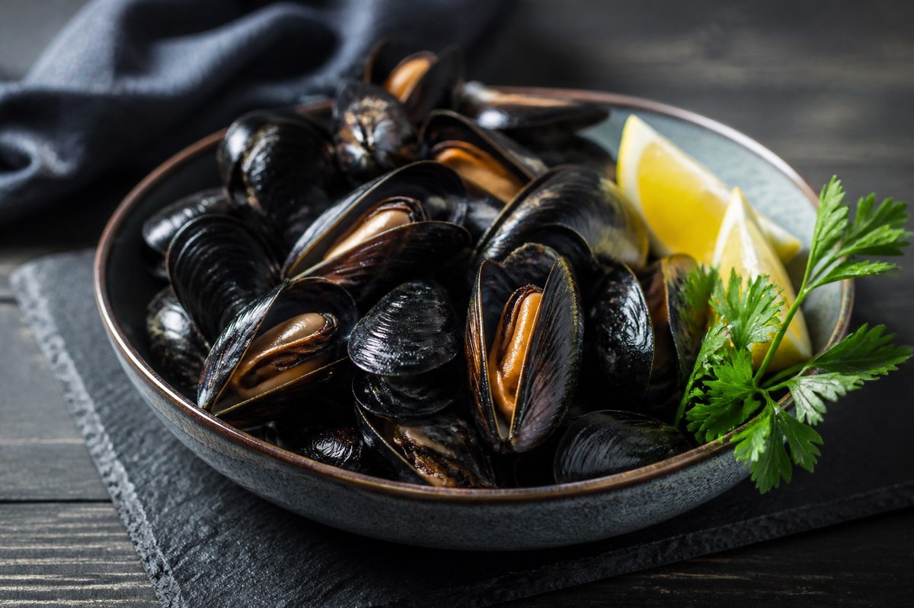

*▲ One hundred grams of raw mussel meat carries 86 calories, 12 µg of vitamin B12 and 44.8 µg of selenium. A whole kilogram of mussels in the shell yields only 200–250 g of meat — roughly 200 calories.*

Quick answer <strong>Raw mussel meat provides 86 calories, 11.9 g protein, 3.95 mg iron, 12 µg vitamin B12 and 44.8 µg selenium per 100 g.</strong> That is five times the daily B12 requirement and 81% of the selenium requirement in a single small serving, which makes mussels one of the most nutrient-dense proteins per calorie. The catch is sodium at 286 mg per 100 g, so broth-based dishes need a light hand with salt.

Blue mussels (*Mytilus edulis*) are the glossy dark shellfish sold by the kilogram in winter markets. They filter seawater for plankton, which is why they accumulate trace minerals at concentrations no land animal reaches, and why food safety authorities treat them as a product that must be bought live and cooked thoroughly.

The three questions readers ask most are **whether shellfish are fattening**, **how many mussels make a portion**, and **whether purines make them off-limits for gout**. The short answers: 86 calories per 100 g of meat, ten to twenty mussels per serving, and moderate purine content that is fine outside an acute flare.

---

## 1. How Many Calories Are in Mussels? (86 kcal per 100 g)

The values below describe **raw blue mussel meat**, as published in USDA FoodData Central. Cooking drives off water and roughly doubles the density: 100 g of cooked mussels is about 172 calories with 23.8 g protein.

| Nutrient | Per 100 g | U.S. %DV |
| :--- | :--- | :--- |
| **Energy** | 86 kcal | 4.3% |
| **Water** | 80.58 g | No DV |
| **Carbohydrates** | 3.69 g | 1.3% |
| - Total Sugars | 0.00 g | No DV |
| - Dietary Fiber | 0.00 g | 0.0% |
| **Protein** | 11.90 g | 23.8% |
| **Total Fat** | 2.24 g | 2.9% |
| - Saturated Fat | 0.42 g | 2.1% |
| - Cholesterol | 28 mg | 9.3% |
| **Vitamin B12** | 12.0 µg | 500% |
| **Selenium** | 44.8 µg | 81.5% |
| **Iron** | 3.95 mg | 21.9% |
| **Zinc** | 1.60 mg | 14.5% |
| **Copper** | 0.094 mg | 10.4% |
| **Phosphorus** | 197 mg | 15.8% |
| **Potassium** | 320 mg | 6.8% |
| **Magnesium** | 34 mg | 8.1% |
| **Riboflavin (B2)** | 0.21 mg | 16.2% |
| **Folate** | 42 µg DFE | 10.5% |
| **Omega-3 (EPA+DHA)** | 300–500 mg | No DV |
| **Sodium** | 286 mg | 12.4% |

**How to read the table:** percentages use the U.S. Daily Values printed on food labels, based on a 2,000-calorie reference diet. ¹Water, total sugars and omega-3 fatty acids carry no Daily Value, so absolute amounts are listed. Omega-3 content swings widely with season, water temperature and the plankton the mussels fed on, which is why a range is shown.

*※ Source: [USDA FoodData Central FDC 174216](https://fdc.nal.usda.gov/food-details/174216/nutrients) — Mollusks, mussel, blue, raw (SR Legacy). The 86 kcal and 11.9 g protein per 100 g in the table above are this entry’s values; a different cooking state changes them.*

<strong>Sources:</strong> <a href="https://fdc.nal.usda.gov/" rel="nofollow noopener" target="_blank">USDA FoodData Central</a> (Mollusks, mussel, blue, raw and cooked) · Korea Ministry of Oceans and Fisheries, "Seafood of the Month" bulletins · <a href="https://pubmed.ncbi.nlm.nih.gov/" rel="nofollow noopener" target="_blank">PubMed</a> bivalve nutrition literature

### Real-world portions: what a bowl of mussels actually delivers

| Portion | Edible weight | Calories and key nutrients |
| :--- | :--- | :--- |
| 1 medium mussel | about 6 g | **5 kcal** · 0.7 µg vitamin B12 |
| 10 mussels | about 60 g | **52 kcal** · 7.1 g protein · 2.4 mg iron |
| 20 mussels (one serving) | about 120 g | 103 kcal · 14.4 µg vitamin B12 |
| 1 kg in shell | 200–250 g | 170–215 kcal · 24–30 g protein |
| Cooked meat, 100 g | cooked | 172 kcal · 23.8 g protein · 24 µg B12 |

A kilogram bag bought at a winter market feeds two people a full protein course for under 220 calories total. That ratio — 24–30 g of complete protein for the calories of a small pastry — is why mussels appear on almost every cheap-and-healthy protein list.

---

## 2. Four Evidence-Backed Health Benefits

### H3. How significant is 12 µg of vitamin B12 in mussels?

It is five times the 2.4 µg daily requirement; three or four mussels cover a full day.

Vitamin B12 is required for red blood cell maturation, myelin maintenance and DNA synthesis. It occurs naturally almost exclusively in animal foods, which is why vegans are the group most often deficient. At 12 µg per 100 g, mussels carry 4.6 times the B12 of beef (2.6 µg) and 13 times that of egg (0.9 µg).

Absorption depends on intrinsic factor from the stomach, so people who have had gastric surgery or take long-term proton pump inhibitors can become deficient despite adequate intake.

### H3. Is the iron in mussels absorbed better than plant iron?

Yes. Shellfish iron is mostly heme iron, absorbed at 15–35% versus 2–5% for the non-heme iron in spinach.

Mussels supply 3.95 mg of iron per 100 g, more than double the amount in an equivalent portion of chicken. Because it arrives as heme iron, the effective absorbed dose is three to five times higher than the same number of milligrams from a plant source.

Premenopausal women lose iron each month and have a higher requirement, which is precisely where a 120 g portion (4.7 mg) helps. Pairing mussels with a vitamin C source — a tomato salad, a squeeze of lemon, cabbage kimchi — adds another 2–3 fold to non-heme iron uptake from the rest of the meal.

### H3. Do the omega-3 fatty acids and taurine in mussels help the heart?

Modestly. At 300–500 mg EPA+DHA per 100 g, mussels support triglyceride and blood pressure goals without the calorie load of oily fish.

Mussels are only 2.2% fat, but a large share of that fat is long-chain omega-3. The American Heart Association recommends two servings of fish or shellfish weekly for lipid management; mussels are lower in absolute EPA+DHA than salmon (2,150 mg per 100 g) but higher per calorie, which makes them easier to eat often.

Taurine is water-soluble, so it leaches into cooking liquid — a reason to keep the broth if you are not watching sodium, and to skip it if you are.

### H3. What do selenium and zinc contribute?

Selenium at 44.8 µg covers 81% of the daily requirement and supports thyroid hormone conversion; zinc at 1.6 mg supports immune cell function.

Selenium is a structural component of the deiodinase enzymes that convert thyroxine (T4) into active triiodothyronine (T3). Small trials in Hashimoto's thyroiditis have reported lower antibody titers with selenium supplementation, which is why the mineral appears in thyroid nutrition guidance.

Mussels are not iodine-rich the way kelp or laver is, so a normal 100 g serving does not risk iodine excess in thyroid patients. Zinc deserves a note in the other direction: chronic high-dose zinc supplementation interferes with copper absorption, and copper is already only 0.094 mg per 100 g here.

---

## 3. How to Clean and Cook Mussels for Maximum Benefit

- **De-beard and scrub under running water.** Pull the fibrous byssal threads away from the shell and rub the shells against each other under running water. Soaking in salted water adds sodium without cleaning anything.
- **Check that they are alive.** A mussel that closes when touched, or closes after a tap when gaping, is alive. Discard cracked shells and any that stay open.
- **Steam three to five minutes, no more.** Mussels open quickly; beyond that the meat toughens and water-soluble nutrients go into the liquid. Add them once the liquid boils and pull them as the shells open.
- **Throw away any that stay shut after cooking.** A closed shell after cooking means the mussel died before cooking. This rule has no exceptions.
- **Season with garlic, scallion and pepper — not salt.** Mussels already carry 286 mg of sodium per 100 g, and typical restaurant broth reaches 700–900 mg per bowl. Aromatics deliver the savoriness that salt would otherwise supply.
- **Store live mussels damp and cold, and cook them the day you buy them.** Wrap in a damp towel in the refrigerator.

---

## 4. Cautions and Side Effects

- **Sodium in broth is the real risk.** Mussels themselves are moderate at 286 mg per 100 g, but a bowl of mussel soup can reach 700–900 mg. People with hypertension or kidney disease should eat the meat and limit the liquid.
- **Shellfish allergy.** Mussels contain tropomyosin, a major shellfish allergen that can cause urticaria, lip swelling or breathing difficulty. Start with a small amount if you have never eaten them.
- **Cook them — no raw service.** Bivalves can carry norovirus and *Vibrio* species even in cold months. Pregnant women, older adults and immunocompromised people should eat only thoroughly cooked mussels.
- **Gout and hyperuricemia.** Shellfish purines run 100–150 mg per 100 g, lower than oily fish and organ meats but not negligible. Avoid during an acute flare, and note that purines concentrate in the cooking liquid.
- **Potassium restriction.** At 320 mg per 100 g, mussels are comparable to a banana. Dialysis patients should keep portions near 50 g and check with their clinician.
- **Cholesterol is a minor issue.** The 28 mg per 100 g is one-fifth of shrimp (152 mg), and saturated fat is only 0.42 g, so mussels fit comfortably in a lipid-lowering diet.

---

## 5. Frequently Asked Questions

**Q1. How many mussels should I eat in one serving?**  
Plan on **10–20 mussels, about 60–120 g of meat**, which supplies 7–14 g of protein and a full day of vitamin B12 for 52–103 calories. Keep total intake under about 200 g a day, since sodium adds up quickly, and treat mussels as a two-to-three-times-a-week protein rather than a daily staple.

**Q2. Can I drink the broth from steamed mussels?**  
Yes, in a measured amount. The broth holds taurine, amino acids and the sea's savoriness, but also most of the added sodium. One or two ladles (about 100 ml) is a reasonable limit, and seasoning at the end rather than the start keeps the total lower.

**Q3. Are mussels bad for gout?**  
They sit in the middle. Shellfish purines are lower than those in mackerel or organ meat, and a 100 g portion outside a flare is generally tolerated. During an acute attack, skip them, and avoid the cooking liquid, where purines concentrate.

---

## 6. Synergistic Food Pairings

- **[Oysters](/en/posts/oyster-nutrition-benefits/):** Oysters carry 16.6 mg zinc per 100 g, ten times the mussel figure. A winter seafood stew with both covers zinc, iron and B12 in one bowl.
- **[Laver / Nori](/en/posts/laver-nutrition-benefits/):** A sheet of laver adds iodine, iron and glutamate for four calories. Crumbled into mussel broth it deepens flavor and lets you cut the salt.
- **[Salmon](/en/posts/salmon-nutrition-benefits/):** Salmon delivers 2,150 mg omega-3 per 100 g, four to seven times the mussel figure. Using mussels for protein and salmon for EPA/DHA makes a week of seafood both affordable and complete.
- **[Garlic](/en/posts/garlic-nutrition-benefits/):** Allicin masks the briny edge of shellfish and has its own vascular research behind it, which lets you leave the salt out of the pot.

  
📌 Related rankings

  <ul>
    <li><a href="/en/posts/high-protein-foods-ranking/">Top 10 High-Protein Foods: Grams per 100 g and 100 kcal</a></li>
    <li><a href="/en/posts/heart-blood-pressure-cholesterol-foods/">Top 10 Foods for Blood Pressure, Cholesterol &amp; Heart</a></li>
  </ul>

---

## 7. Bottom Line

- Mussels are **86 calories and 11.9 g protein per 100 g of raw meat**, with 12 µg vitamin B12, 44.8 µg selenium and 3.95 mg heme iron.
- A serving of **10–20 mussels (60–120 g)** covers a day of B12 for 52–103 calories; keep daily intake near 200 g because of sodium.
- **Sodium is the limiting factor**, and it comes mostly from the broth — season with garlic and scallion, and limit the liquid to a ladle or two.
- **Discard any mussel that stays closed after cooking**, and never serve them raw.
- With gout, avoid mussels during a flare and skip the broth; otherwise a 100 g portion two or three times a week fits well.

