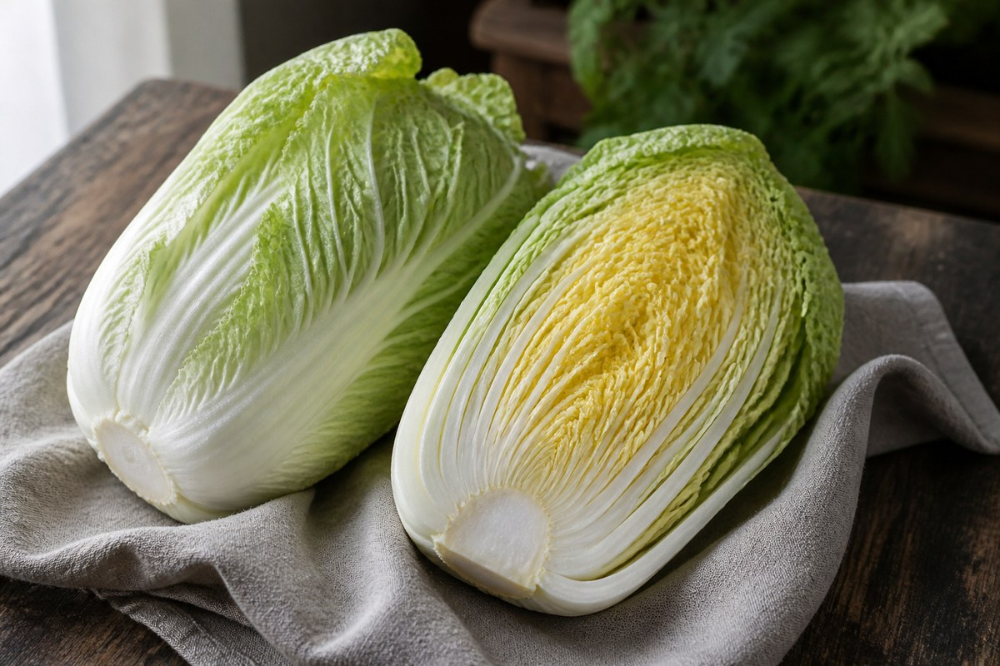

*▲ One hundred grams of raw napa cabbage delivers 16 calories and 27 mg of vitamin C (30% of the U.S. Daily Value). A whole 2 kg head is only about 320 calories, but kimchi made from it carries roughly 700 mg of sodium per 100 g.*

Quick answer <strong>Raw napa cabbage provides 16 calories, 3.2 g carbohydrate, 1.2 g fiber and 27 mg vitamin C per 100 g, with 45.5 µg of vitamin K and 59 mg calcium.</strong> Because it is 95% water it fills a plate at almost no calorie cost, so 200–300 g a day (five to eight leaves) suits most adults. The variable that actually matters is how you eat it: fresh cabbage is low in sodium, while kimchi carries about 700 mg of sodium per 100 g.

Napa cabbage (*Brassica rapa* subsp. *pekinensis*) is the pale, crinkly-leaved brassica that becomes kimchi across Korea and fills dumplings and hot pots across East Asia. Its autumn crop, harvested from late October and sold through November and December as *kimjang* cabbage, is the version with the firmest ribs and the sweetest core.

The three questions readers bring to this vegetable are **how a vegetable can have only 16 calories**, **whether kimchi delivers the same nutrition as fresh cabbage**, and **whether eating cabbage every day affects the thyroid**. The short answers: it is mostly water, kimchi trades vitamin C for probiotics and sodium, and normal amounts are safe for people without iodine deficiency.

---

## 1. How Many Calories Are in Napa Cabbage? (16 kcal per 100 g)

The values below describe **raw napa cabbage, edible portion**, as listed in USDA FoodData Central.

| Nutrient | Per 100 g | U.S. %DV |
| :--- | :--- | :--- |
| **Energy** | 16 kcal | 0.8% |
| **Water** | 95.03 g | No DV |
| **Carbohydrates** | 3.21 g | 1.2% |
| - Total Sugars | 0.78 g | No DV |
| - Dietary Fiber | 1.20 g | 4.3% |
| **Protein** | 1.20 g | 2.4% |
| **Total Fat** | 0.20 g | 0.3% |
| - Saturated Fat | 0.04 g | 0.2% |
| - Cholesterol | 0.00 mg | 0.0% |
| **Vitamin C** | 27.0 mg | 30.0% |
| **Vitamin K** | 45.5 µg | 37.9% |
| **Folate** | 76 µg DFE | 19.0% |
| **Calcium** | 59 mg | 4.5% |
| **Potassium** | 238 mg | 5.1% |
| **Magnesium** | 9 mg | 2.1% |
| **Iron** | 0.40 mg | 2.2% |
| **Vitamin B6** | 0.11 mg | 6.5% |
| **Manganese** | 0.17 mg | 7.4% |
| **Glucosinolates** | 30–50 mg | No DV |
| **Sodium** | 9 mg | 0.4% |

**How to read the table:** percentages follow the U.S. Daily Values used on food labels, based on a 2,000-calorie reference diet. ¹Water, total sugars and glucosinolates have no established Daily Value, so only absolute amounts are shown. Glucosinolate content varies widely with cultivar, season and growing region, which is why a range appears instead of a single figure.

*※ Source: [USDA FoodData Central FDC 169979](https://fdc.nal.usda.gov/food-details/169979/nutrients) — Cabbage, chinese (pe-tsai), raw (SR Legacy). The 16 kcal and 1.2 g protein per 100 g in the table above are this entry’s values; a different cooking state changes them.*

<strong>Sources:</strong> <a href="https://fdc.nal.usda.gov/" rel="nofollow noopener" target="_blank">USDA FoodData Central</a> (Cabbage, napa, raw) · Korea Ministry of Food and Drug Safety, National Food Composition Table (K-FIND) · <a href="https://pubmed.ncbi.nlm.nih.gov/" rel="nofollow noopener" target="_blank">PubMed</a> glucosinolate and Brassica literature

### Real-world portions: what one serving actually delivers

| Portion | Weight | Calories and key nutrients |
| :--- | :--- | :--- |
| 1 large outer leaf | about 40 g | **6 kcal** · 10.8 mg vitamin C |
| 1 cup shredded | about 70 g | 11 kcal · 19 mg vitamin C · 32 µg vitamin K |
| 5 leaves (one side dish) | about 200 g | **32 kcal** · 54 mg vitamin C |
| 1 whole head | 1.5–2.5 kg | 240–400 kcal · 405–675 mg vitamin C |
| Kimchi, 100 g | ~70 g cabbage + seasoning | about 33 kcal · **~700 mg sodium** |

A cup of shredded napa cabbage covers 21% of daily vitamin C for 11 calories. No other food category does that at this calorie density except other watery brassicas, and that is the practical reason the vegetable appears in nearly every weight-loss meal plan built on volume.

---

## 2. Four Evidence-Backed Health Benefits

### H3. Does napa cabbage deliver meaningful vitamin C?

Yes. One hundred grams supplies 27 mg, 30% of the U.S. Daily Value, and five leaves cover more than half a day's requirement.

At 27 mg per 100 g, napa cabbage sits close to orange (53 mg) in density but far above apple (4.6 mg). Because the vegetable is eaten in volume rather than in slices, the practical intake is high: a 200 g portion delivers 54 mg, more than half of the 90 mg adult requirement.

Vitamin C is water-soluble and heat-labile, so blanching for more than a minute or two leaches 30–50% into cooking water. Fresh *geotjeori*-style salads and quick stir-fries added at the end of cooking preserve the most.

### H3. Do the glucosinolates in napa cabbage do anything in humans?

Partly. Their breakdown products induce phase II detoxification enzymes in cell and animal studies; human evidence for cabbage specifically is early and modest.

When the vegetable is chopped or chewed, the enzyme myrosinase converts glucosinolates into isothiocyanates and indole-3-carbinol. These compounds activate Nrf2-mediated antioxidant pathways and, in animal models, shift estrogen metabolism toward less reactive forms.

Most human trials have used broccoli sprouts, which carry 10–100 times more sulforaphane precursor than napa cabbage, so results cannot be transferred one-to-one. The defensible claim is that **regular intake of cruciferous vegetables, 100–200 g a day, is consistently associated with favorable outcomes in observational studies** — not that cabbage treats any condition.

### H3. Is kimchi as nutritious as fresh napa cabbage?

No, it is a different food. Kimchi adds probiotics and B vitamins but loses 20–40% of its vitamin C and multiplies sodium roughly 70-fold.

Fermentation converts sugars to lactic acid, lowers pH, and produces *Lactobacillus* species that survive in refrigerated kimchi. Those bacteria are the reason kimchi appears in gut-health research, and a 2024 Korean cohort study linked moderate kimchi intake with lower body weight and waist circumference.

The trade-off is sodium. Fresh napa cabbage holds 9 mg per 100 g; typical kimchi holds 600–900 mg, which is 26–39% of the 2,300 mg daily limit in a single small serving. Treating kimchi as the vegetable serving itself, rather than as a condiment beside a fresh cabbage dish, is where most people overshoot.

### H3. What do the fiber and potassium in napa cabbage accomplish?

Fiber is only 1.2 g per 100 g, but at 16 calories that is a high ratio; potassium at 238 mg supports sodium excretion and blood pressure control.

The fiber figure looks unimpressive next to cabbage (1.9 g) or kale (3.6 g), yet per calorie napa cabbage is among the highest-volume choices available: 1.2 g of fiber per 16 kcal is roughly 17 times the ratio of cooked white rice. That volume, plus 95% water, is what makes a cabbage-heavy meal filling without calorie counting.

Potassium works in the kidney to promote sodium excretion and relax vascular tone, which matters in a country where sodium intake runs near twice the recommendation.

---

## 3. How to Prepare Napa Cabbage for Maximum Absorption

- **Remove two or three outer leaves.** Food safety authorities in Korea advise discarding the outer leaves of cabbage before washing, because soil and pesticide residue concentrate there. Wash the remaining head leaf by leaf under running water.
- **Chop, then wait 10 minutes.** Myrosinase needs time to convert glucosinolates into isothiocyanates. Mixing a dressing and letting it sit before serving costs nothing and preserves more of the active compounds.
- **Blanch 30–60 seconds, not three minutes.** Brief blanching keeps vitamin C loss under 30%; longer boiling pushes it past 50% and leaches potassium into the water, which matters if you are cooking for someone on a potassium restriction.
- **Add cabbage at the end of soups.** Three to four minutes before serving keeps both texture and vitamin C. Long-simmered cabbage turns soft and loses the crisp rib that makes the vegetable pleasant.
- **Store the head wrapped in newspaper, upright and cool.** Napa cabbage keeps two to four weeks at 0–5 °C.

---

## 4. Cautions and Side Effects

- **Sodium in kimchi is the main risk.** At 600–900 mg per 100 g, two generous servings exceed half the daily limit. People with hypertension or chronic kidney disease should keep kimchi to 50–70 g and rely on fresh cabbage for the vegetable portion.
- **Thyroid medication and raw juice.** Glucosinolate breakdown products can compete with iodine uptake when iodine intake is low. Normal dietary amounts (200–300 g) have not been shown to impair thyroid function in iodine-sufficient populations, but daily juicing of several hundred milliliters of raw cabbage is not advisable for anyone with hypothyroidism.
- **Potassium restriction in advanced kidney disease.** At 238 mg per 100 g, napa cabbage is moderate, but soup concentrates potassium in the broth. Boil and discard the water when cooking for stage 4–5 CKD.
- **Warfarin and vitamin K consistency.** With 45.5 µg per 100 g, a large bowl of cabbage can move INR. The goal is a steady daily intake rather than avoidance, and your clinician should know your typical portion.

---

## 5. Frequently Asked Questions

**Q1. How much napa cabbage should I eat per day?**  
Most adults do well with **200–300 g, roughly five to eight leaves**, which supplies 32–48 calories and 54–81 mg of vitamin C. If you also eat kimchi, count it separately and keep total kimchi to about 100 g a day so sodium stays under 700 mg from that source.

**Q2. Is kimchi healthier than fresh napa cabbage?**  
They are not substitutes. Fresh cabbage is the better source of vitamin C and potassium with almost no sodium; kimchi supplies live lactic acid bacteria and additional B vitamins but carries 70 times the sodium. A meal with both — fresh cabbage salad plus a small portion of kimchi — covers more ground than either alone.

**Q3. Can eating napa cabbage every day affect my thyroid?**  
Not at ordinary intakes. Concern applies to people with low iodine intake who consume large volumes of raw cruciferous juice daily, and to those taking thyroid hormone, who should prefer cooked cabbage and keep intake steady. If you take levothyroxine, separating the dose from large cabbage meals by a few hours is a reasonable habit.

---

## 6. Synergistic Food Pairings

- **[Cabbage (green)](/en/posts/cabbage-nutrition-benefits/):** Green cabbage adds vitamin U (S-methylmethionine), studied for gastric mucosal protection. Using both cabbages in one soup delivers two distinct brassica profiles in a single bowl.
- **[Oysters](/en/posts/oyster-nutrition-benefits/):** Oysters carry 16.6 mg of zinc per 100 g, more than double the daily requirement. Oyster and cabbage salad is a classic Korean winter pairing that combines zinc with vitamin C in one plate.
- **[Laver / Nori](/en/posts/laver-nutrition-benefits/):** A sheet of laver adds iodine, iron and umami for four calories. Crumbled into cabbage soup, it lets you reduce the broth volume — and the sodium that comes with it — without losing flavor.
- **[Spinach](/en/posts/spinach-nutrition-benefits/):** Spinach supplies non-heme iron at 2.71 mg per 100 g, absorbed poorly on its own. The vitamin C in napa cabbage keeps that iron in its reduced form and can double uptake when the two are eaten together.

  
📌 Related rankings

  <ul>
    <li><a href="/en/posts/low-calorie-high-satiety-foods/">Top 10 Low-Calorie, High-Satiety Foods: 100 g Comparison</a></li>
    <li><a href="/en/posts/heart-blood-pressure-cholesterol-foods/">Top 10 Foods for Blood Pressure, Cholesterol &amp; Heart</a></li>
  </ul>

---

## 7. Bottom Line

- Raw napa cabbage is **16 calories per 100 g with 27 mg vitamin C, 45.5 µg vitamin K and 1.2 g fiber** — one of the highest-volume foods available per calorie.
- A daily **200–300 g** supplies 32–48 calories and more than half the vitamin C requirement.
- **Kimchi is a different food**: it adds probiotics but brings roughly 700 mg sodium per 100 g, so keep it to about 100 g and let fresh cabbage carry the vegetable serving.
- Chop and wait 10 minutes for glucosinolates, blanch under a minute for vitamin C, and add cabbage late in soups.
- People on warfarin, thyroid hormone or a potassium-restricted diet should keep portions steady and prefer cooked cabbage over daily raw juice.

