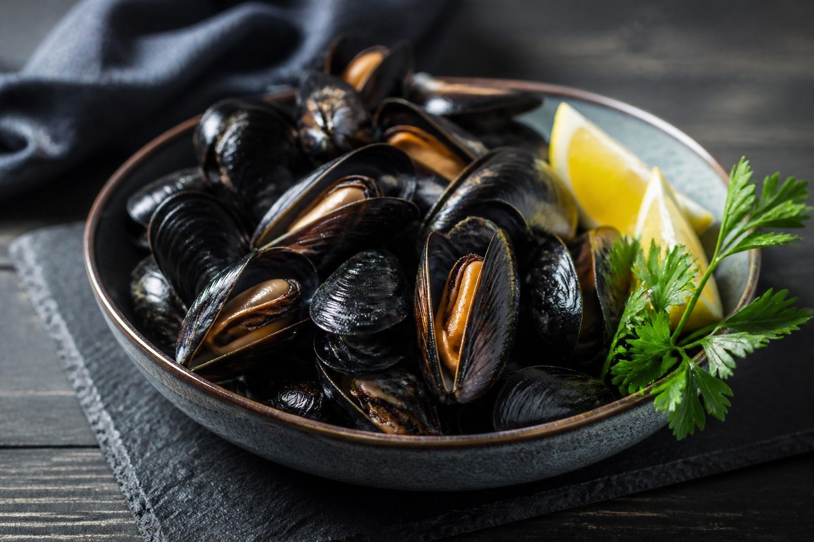

*▲ 홍합 가식부 100g은 86kcal, 비타민B12 12µg, 셀레늄 44.8µg입니다. 껍질째 1kg을 사면 실제 먹는 살은 200~250g으로, 170~215kcal에 불과합니다.*

한 줄 결론 <strong>홍합 가식부 100g은 86kcal, 단백질 11.9g, 철분 3.9mg, 비타민B12 12µg, 셀레늄 44.8µg입니다.</strong> 비타민B12는 하루 권장량의 5배, 셀레늄은 81%를 한 번에 채우는 겨울철 고밀도 단백질 식품입니다. 다만 나트륨이 286mg 있어 홍합탕 국물은 1~2국자로 제한하는 편이 좋습니다.

11월부터 이듬해 2월까지가 제철인 **홍합(진주담치)** 은 찬 바람이 불면 살이 오르고 감칠맛이 진해지는 조개류입니다. 올해 11월 홍합 1kg 가격은 지난해보다 10% 넘게 떨어져 3,600원대로, 굴·가리비와 함께 가장 부담 없는 겨울 수산물로 꼽힙니다.

가장 많이 검색되는 질문은 **"홍합 칼로리와 단백질이 얼마나 되나?"**, **"홍합 하루 몇 마리까지 먹어도 되나?"**, **"통풍이나 콜레스테롤에 나쁘지 않나?"** 세 가지입니다. 결론부터 말하면 **홍합은 저열량 고단백 패류이고, 문제는 살이 아니라 국물의 나트륨**입니다.

아래에서는 USDA FoodData Central과 식약처 수산물 성분 자료를 기준으로 홍합 100g과 1마리의 영양, 비타민B12·셀레늄·철분의 근거, 손질과 조리법, 통풍·알레르기 주의사항을 정리했습니다.

---

## 1. 홍합 칼로리와 영양성분은? (100g 86kcal)

아래 수치는 **홍합(생것, 껍질 제외 가식부) 100g** 기준입니다. 조리 후에는 수분이 빠져 100g당 열량이 172kcal로 올라가지만, 단백질 밀도도 함께 높아집니다.

| 영양 성분 (Nutrient) | 함량 (100g당) | 1일 권장 섭취량 비율 (한국인 성인 기준) |
| :--- | :--- | :--- |
| **열량 (Energy)** | 86 kcal | 4.3% |
| **수분 (Water)** | 80.6 g | 별도 표기¹ |
| **탄수화물 (Carbohydrates)** | 3.7 g | 1.1% |
| - 총 당류 (Total Sugars) | 0.0 g | 0.0% |
| - 식이섬유 (Dietary Fiber) | 0.0 g | 0.0% |
| **단백질 (Protein)** | 11.9 g | 21.6% |
| **지방 (Total Fat)** | 2.2 g | 4.1% |
| - 포화지방 (Saturated Fat) | 0.4 g | 2.8% |
| - 콜레스테롤 (Cholesterol) | 28 mg | 9.3% |
| **비타민B12 (Vitamin B12)** | 12.0 µg | 500% |
| **셀레늄 (Selenium)** | 44.8 µg | 81.5% |
| **철분 (Iron)** | 3.95 mg | 39.5% |
| **아연 (Zinc)** | 1.6 mg | 16.0% |
| **칼륨 (Potassium)** | 320 mg | 9.1% |
| **인 (Phosphorus)** | 197 mg | 28.1% |
| **마그네슘 (Magnesium)** | 34 mg | 10.6% |
| **칼슘 (Calcium)** | 26 mg | 3.7% |
| **오메가-3 (EPA+DHA)** | 300~500 mg | 기준치 없음 |
| **나트륨 (Sodium)** | 286 mg | 14.3% |

**표 읽는 법:** 열량·탄수화물·단백질·지방·나트륨의 %는 식품 표시용 1일 영양성분 기준치(2,000kcal) 대비이고, 나머지 미량 영양소의 %는 한국인 영양소 섭취기준 성인 권장량(비타민B12 2.4µg, 셀레늄 55µg, 철분 10mg, 아연 10mg, 칼륨 3,500mg, 인 700mg, 마그네슘 340mg, 칼슘 700mg) 대비입니다. ¹수분과 오메가-3는 1일 기준치가 설정되지 않아 절대량만 표기했으며, 오메가-3는 계절과 서식지에 따라 편차가 큽니다. 조리 후 수치는 수분 손실로 100g당 열량·단백질이 2배 가까이 높아집니다.

<strong>출처:</strong> <a href="https://fdc.nal.usda.gov/" rel="nofollow noopener" target="_blank">USDA FoodData Central</a>(Mollusks, mussel, blue, raw) · 식품의약품안전처 국가표준식품성분표 · 해양수산부 「이달의 수산물」 자료

### 실생활 환산: 홍합 10마리, 홍합탕 한 그릇은 몇 kcal인가?

| 섭취 기준 | 가식부 중량 | 열량과 핵심 수치 |
| :--- | :--- | :--- |
| 홍합 1마리(중간 크기) | 약 6 g | **5 kcal** · 비타민B12 0.7 µg |
| 홍합 10마리 | 약 60 g | **52 kcal** · 단백질 7.1 g · 철분 2.4 mg |
| 홍합 20마리(1인분) | 약 120 g | 103 kcal · 비타민B12 14.4 µg |
| 홍합탕 1그릇 | 홍합 100 g + 국물 | 86 kcal + **국물 나트륨 700~900 mg** |
| 홍합 1kg(껍질 포함) | 200~250 g | 170~215 kcal · 단백질 24~30 g |

껍질째 1kg을 사도 실제 먹는 살은 20~25%입니다. 홍합 1kg 한 봉지로 두 사람이 단백질 15g씩을 채우고도 열량은 200kcal 아래라는 뜻이라, 다이어트 식단에서 단백질 공급원으로 효율이 높습니다.

---

## 2. 과학적으로 입증된 4대 건강 효능

### H3. 홍합 비타민B12 12µg은 얼마나 많은 양인가?

하루 권장량 2.4µg의 5배입니다. 홍합 3~4마리(가식부 20g)만으로 하루 필요량을 채웁니다.

비타민B12는 적혈구 성숙과 신경 수초(미엘린) 유지에 필수인데, 식물성 식품에는 사실상 없어 채식주의자에게 결핍이 흔합니다. 홍합 100g의 12µg은 같은 무게의 소고기(2.6µg)의 4.6배, 달걀(0.9µg)의 13배입니다.

흡수는 위 내인자(Intrinsic factor)에 의존하므로 위 절제술을 받았거나 만성 위축성 위염이 있는 경우에는 섭취량과 별개로 결핍이 생길 수 있습니다. 이런 경우에는 경구 보충제나 주사가 필요할 수 있으니 검사 결과와 함께 판단해야 합니다.

### H3. 홍합 철분 3.9mg은 흡수가 잘 되는 철분인가?

네. 조개류의 철분은 흡수율이 높은 헴철 형태여서, 같은 양의 시금치보다 실제 흡수량이 3~5배 많습니다.

철분은 헴철(동물성)과 비헴철(식물성)로 나뉘며, 비헴철 흡수율은 2~5%, 헴철은 15~35%입니다. 홍합의 3.95mg은 대부분 헴철이어서 실제 흡수되는 양이 시금치 2.71mg(비헴철)보다 훨씬 많습니다.

여성은 월경으로 매달 철분을 잃기 때문에 권장량이 남성(10mg)보다 높습니다. 홍합 20마리(120g)면 철분 4.7mg을 얻어, 생리 중이거나 헌혈 후 회복기에 좋은 선택입니다. 비타민C가 풍부한 채소(배추겉절이·파프리카)를 곁들이면 흡수가 한 번 더 올라갑니다.

### H3. 오메가-3와 타우린은 심혈관에 실제로 도움이 되나?

보조적 수준입니다. 홍합 100g에 EPA+DHA 300~500mg과 타우린이 들어 있어 중성지방·혈압 지표에 유리한 방향으로 작용합니다.

홍합의 지방은 2.2g에 불과하지만 그중 상당 부분이 EPA·DHA입니다. 미국심장협회는 지질 관리 목적으로 주 2회 어패류 섭취를 권고하며, 홍합은 연어(2,150mg/100g)보다 함량은 낮지만 열량당 비율이 높아 자주 먹기 좋습니다.

타우린은 담즙산 결합과 삼투압 조절에 관여하고, 동물 실험에서 혈압 강하 효과가 보고됐습니다. 다만 **삶으면 수용성인 타우린이 국물로 빠져나갑니다.** 홍합탕을 끓일 때 국물까지 먹으면 타우린을 함께 얻지만 나트륨도 함께 들어오므로, 국물은 1~2국자로 제한하는 편이 균형적입니다.

### H3. 셀레늄과 아연은 어떤 역할을 하나?

셀레늄 44.8µg은 하루 권장량의 81%로 갑상선 호르몬 전환 효소에 필요하고, 아연 1.6mg은 면역 세포 기능을 지원합니다.

셀레늄은 요오드화티로닌 탈요오드화효소(Deiodinase)의 구성 성분으로, 갑상선 호르몬 T4를 활성형 T3로 바꾸는 반응에 직접 관여합니다. 갑상선 질환이 있는 사람이 셀레늄을 충분히 섭취하면 항체 수치가 개선됐다는 소규모 임상 연구(하시모토 갑상선염)도 있습니다.

홍합은 요오드 함량이 김·다시마만큼 높지는 않아 갑상선 환자도 일반적인 양(1회 100g)에서 요오드 과잉 걱정은 적습니다. 다만 아연은 과잉 섭취 시 구리 흡수를 방해하므로, 아연 보충제를 따로 먹는 사람은 홍합 섭취량을 의식할 필요가 있습니다.

---

## 3. 흡수율을 높이는 손질·조리 가이드

- **수염(족사)을 떼고 문질러 씻으세요.** 껍데기 밖으로 나온 섬유질 수염을 잡아당겨 제거하고, 소금물이 아닌 흐르는 물에 껍데기끼리 비벼 이물질을 털어냅니다. 소금물에 담그면 짠맛만 더해집니다.
- **살아 있는지 확인하세요.** 건드리면 닫히거나, 껍데기가 벌어져 있어도 두드리면 닫히면 살아 있는 것입니다. 깨진 껍데기와 이미 열려 닫히지 않는 것은 버리세요.
- **3~5분만 삶으세요.** 오래 끓이면 살이 질겨지고 수용성 영양소가 국물로 빠져나갑니다. 국물이 끓기 시작한 뒤 넣고 입이 벌어지면 바로 꺼내는 것이 기준입니다.
- **익힌 뒤에도 열리지 않은 것은 버리세요.** 조리 전에 살아 있었더라도 익힌 후 닫힌 채인 홍합은 먹지 않는 것이 안전합니다.
- **국물은 소금 대신 마늘·대파·후추로 간하세요.** 홍합 자체의 나트륨이 286mg 있어 소금을 더하면 한 그릇에 1,000mg을 넘기기 쉽습니다. 마늘과 대파만으로도 충분히 감칠맛이 납니다.
- **남은 홍합은 삶아서 살만 발라 냉동하세요.** 익힌 살은 냉동 보관 1개월, 생홍합은 사온 날 먹는 것이 원칙입니다. 하루 이틀 두려면 젖은 키친타월을 덮어 냉장실에 두세요.

---

## 4. 섭취 시 주의사항 및 부작용

- **국물의 나트륨이 가장 큰 변수입니다.** 홍합 가식부의 나트륨은 286mg이지만, 홍합탕 국물 한 그릇에는 700~900mg이 들어 있습니다. 고혈압·만성신장질환자는 건더기 위주로 드시고 국물은 1국자 이내로 제한하세요.
- **패류 알레르기가 있다면 금해야 합니다.** 홍합은 조개류 알레르기(트로포미오신)의 주요 원인 중 하나로, 두드러기·입술 부종·호흡곤란이 나타날 수 있습니다. 처음 먹는 경우 소량으로 시작하세요.
- **생식은 피하고 반드시 익혀 드세요.** 겨울 패류에도 노로바이러스·비브리오균이 있을 수 있고, 특히 면역력이 낮은 사람·임산부·노약자는 완전히 익힌 것만 섭취해야 합니다.
- **통풍·고요산혈증:** 조개류는 퓨린이 100g당 100~150mg으로 중간 수준입니다. 급성 통풍 발작기에는 피하고, 평소에는 1회 100g 이내로 제한하세요. 특히 **국물에 퓨린이 녹아 나오므로** 국물 섭취는 더 주의해야 합니다.
- **칼륨 제한 환자:** 홍합 100g의 칼륨은 320mg으로 바나나(358mg)와 비슷합니다. 투석 환자는 1회 50g 이내로 조절하고 담당 의사와 상의하세요.
- **콜레스테롤 28mg은 새우(152mg)의 5분의 1 수준입니다.** 조개류의 콜레스테롤은 혈중 콜레스테롤에 미치는 영향이 크지 않고, 포화지방도 0.4g에 불과해 지질 관리 식단에서도 무리 없는 단백질 공급원입니다.

---

## 5. 자주 묻는 질문 (FAQ)

**Q1. 홍합은 하루 몇 마리까지 먹어도 되나요?**  
가식부 기준으로 **1회 60~120g(10~20마리), 하루 200g 이내**가 적당합니다. 열량은 86kcal/100g으로 낮지만 나트륨이 286mg 있어, 하루 200g을 넘기면 국물과 다른 반찬의 나트륨까지 더해져 1일 기준을 넘기기 쉽습니다. 단백질 공급원으로 매일 먹기보다 **주 2~3회, 1회 100g 전후**가 균형적입니다.

**Q2. 홍합탕 국물도 마셔도 되나요?**  
마실 수 있지만 양을 정하는 것이 좋습니다. 국물에는 타우린·아미노산이 녹아 있어 맛과 영양이 있지만, 소금·액젓으로 간을 하면 나트륨이 700~900mg까지 올라갑니다. **국물 1~2국자(약 100ml)** 로 제한하고, 간은 마지막에 최소한으로 하세요.

**Q3. 홍합은 통풍에 나쁜가요?**  
중간 정도입니다. 조개류의 퓨린은 100g당 100~150mg으로 등푸른 생선(200~300mg)보다 낮고 육류 내장(300mg 이상)보다도 낮습니다. **급성 발작기에는 피하고, 평소에는 1회 100g 이내로 제한**하면 큰 문제는 없습니다. 다만 퓨린은 국물에 녹아 나오므로 국물은 피하세요.

---

## 6. 홍합과 함께 먹으면 좋은 음식

- **[굴 (Oyster)](/posts/oyster-nutrition-benefits/):** 굴은 아연 16.6mg/100g으로 홍합의 10배입니다. 겨울철 굴과 홍합을 함께 넣은 해물탕은 아연·철분·비타민B12를 한 그릇에 담는 조합입니다.
- **[김 (Laver)](/posts/laver-nutrition-benefits/):** 김 1장(2g)은 4kcal에 요오드와 철분을 담고 있습니다. 홍합탕에 김을 부숴 넣으면 감칠맛이 살아나 소금을 줄이는 데도 도움이 됩니다.
- **[연어 (Salmon)](/posts/salmon-nutrition-benefits/):** 연어는 오메가-3가 2,150mg/100g으로 홍합의 4~7배입니다. 홍합으로 단백질을, 연어로 EPA·DHA를 채우는 식사 구성이 효율적입니다.
- **[마늘 (Garlic)](/posts/garlic-nutrition-benefits/):** 마늘의 알리신은 홍합 특유의 비린 향을 잡아 주고, 혈관 건강 지표에 대한 연구도 있습니다. 홍합탕에 마늘을 넉넉히 넣으면 소금 없이도 간이 맞습니다.

  
📌 관련 순위 가이드

  <ul>
    <li><a href="/posts/high-protein-foods-ranking/">단백질 많은 음식 TOP 10: 100g당 함량과 흡수율 비교</a></li>
    <li><a href="/posts/heart-blood-pressure-cholesterol-foods/">혈압·혈관 건강 음식 TOP 10: 콜레스테롤·중성지방 관리</a></li>
  </ul>

---

## 7. 홍합 하루 얼마나 먹을까? 핵심 요약

- 홍합 가식부 100g은 **86kcal에 단백질 11.9g, 철분 3.9mg, 비타민B12 12µg, 셀레늄 44.8µg**이 담긴 고밀도 겨울 패류입니다.
- **1회 10~20마리(60~120g)** 로 단백질 7~14g과 비타민B12 하루치를 채우고, 하루 200g을 넘기지 않는 것이 적당합니다.
- **나트륨 286mg**은 살보다 국물에서 문제가 되므로, 홍합탕 국물은 1~2국자로 제한하고 소금 대신 마늘·대파로 간하세요.
- **익힌 뒤 열리지 않은 홍합은 버리고**, 생식은 피하는 것이 안전합니다.
- 통풍·고요산혈증이 있다면 급성 발작기에는 피하고, 평소 1회 100g 이내로 조절하세요.

