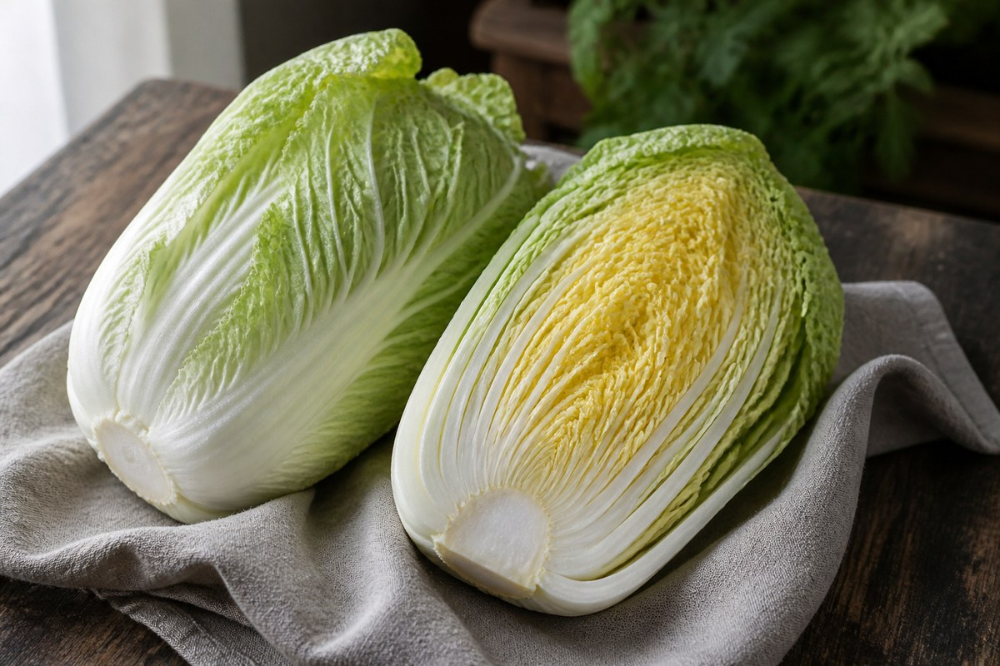

*▲ 배추 100g은 15kcal, 비타민C 27mg입니다. 11월 김장배추 한 포기(2~3kg)는 300~450kcal에 불과하지만, 김치로 담그면 양념의 나트륨이 붙습니다.*

한 줄 결론 <strong>생배추 100g은 15kcal, 비타민C 27mg, 식이섬유 1.2g, 칼륨 238mg입니다.</strong> 열량이 거의 없어 하루 200~300g(잎 5~8장)을 먹어도 50kcal가 안 되지만, 김치로 먹을 때는 나트륨이 문제이므로 하루 김치 100g(나트륨 약 700mg)을 넘기지 않는 것이 핵심입니다.

11월 중순부터 12월 중순까지가 절정인 **김장배추(가을배추)** 는 한국인 겨울 식탁의 절반을 차지하는 채소입니다. 100g에 15kcal밖에 되지 않는데 부피와 씹는 맛이 커서, 다이어트 식단에서 "배불리 먹어도 되는 채소"의 대표로 꼽힙니다.

가장 많이 검색되는 질문은 **"배추 칼로리가 정말 15kcal인가?"**, **"김치로 먹으면 영양이 달라지나?"**, **"배추즙을 매일 마셔도 되나?"** 세 가지입니다. 결론부터 말하면 **생배추 자체는 열량·나트륨 부담이 거의 없고, 문제는 배추에 붙는 양념과 섭취 형태**입니다.

아래에서는 식약처 국가표준식품성분표와 USDA FoodData Central 수치를 기준으로 배추 100g의 영양 성분, 비타민C·글루코시놀레이트의 근거, 김치 나트륨을 줄이는 조리법, 갑상선·신장 질환자의 주의사항을 정리했습니다.

---

## 1. 배추 칼로리와 영양성분은? (100g 15kcal)

아래 수치는 **배추(생것, 가식부) 100g** 기준입니다. 미국산 나파배추(Napa cabbage)는 100g당 16kcal로 국내 배추와 거의 같고, 잎이 더 연한 품종이라 수분이 1~2% 높습니다.

| 영양 성분 (Nutrient) | 함량 (100g당) | 1일 권장 섭취량 비율 (한국인 성인 기준) |
| :--- | :--- | :--- |
| **열량 (Energy)** | 15 kcal | 0.8% |
| **수분 (Water)** | 94.4 g | 별도 표기¹ |
| **탄수화물 (Carbohydrates)** | 2.7 g | 0.8% |
| - 총 당류 (Total Sugars) | 0.8 g | 0.8% |
| - 식이섬유 (Dietary Fiber) | 1.20 g | 4.8% |
| **단백질 (Protein)** | 1.2 g | 2.2% |
| **지방 (Total Fat)** | 0.20 g | 0.4% |
| - 포화지방 (Saturated Fat) | 0.05 g | 0.3% |
| - 콜레스테롤 (Cholesterol) | 0.00 mg | 0.0% |
| **비타민C (Vitamin C)** | 27.0 mg | 27.0% |
| **비타민K (Vitamin K)** | 45.5 µg | 60.7% |
| **엽산 (Folate)** | 76 µg DFE | 19.0% |
| **칼슘 (Calcium)** | 59 mg | 8.4% |
| **칼륨 (Potassium)** | 238 mg | 6.8% |
| **철분 (Iron)** | 0.40 mg | 4.0% |
| **글루코시놀레이트 (Glucosinolates)** | 30~50 mg | 기준치 없음 |
| **나트륨 (Sodium)** | 9 mg | 0.5% |

**표 읽는 법:** 열량·탄수화물·단백질·지방·나트륨의 %는 식품 표시용 1일 영양성분 기준치(2,000kcal) 대비이고, 비타민C·엽산·칼슘·칼륨·철분의 %는 한국인 영양소 섭취기준 성인 권장량(비타민C 100mg, 엽산 400µg DFE, 칼슘 700mg, 칼륨 3,500mg, 철분 10mg) 대비입니다. 비타민K는 충분섭취량 75µg 기준입니다. ¹수분과 글루코시놀레이트는 1일 기준치가 설정되지 않은 성분으로 절대량만 표기했고, 글루코시놀레이트는 품종·재배지에 따라 20~70mg까지 편차가 큽니다.

*※ 데이터 기준: 표의 수치는 국내 국가표준식품성분표(식약처 식품영양성분 DB)의 배추, 생것, 가식부 분석값입니다. 같은 식품의 [USDA FoodData Central FDC 169979](https://fdc.nal.usda.gov/food-details/169979/nutrients) — Cabbage, chinese (pe-tsai), raw (SR Legacy)는 100g당 16 kcal·단백질 1.2 g입니다. 이 글의 15 kcal는 국내 배추 값으로, 1 kcal 차이는 품종과 수분 함량에서 옵니다.*

<strong>출처:</strong> 식품의약품안전처 국가표준식품성분표(농촌진흥청 국립식량과학원 분석) · <a href="https://various.foodsafetykorea.go.kr/" rel="nofollow noopener" target="_blank">K-FIND 식품영양성분 DB</a> · <a href="https://fdc.nal.usda.gov/" rel="nofollow noopener" target="_blank">USDA FoodData Central</a>

### 실생활 환산: 배추 잎 한 장, 김치 한 접시는 몇 kcal인가?

| 섭취 기준 | 중량 | 열량과 핵심 수치 |
| :--- | :--- | :--- |
| 잎 1장(큰 겉잎) | 약 40 g | **6 kcal** · 비타민C 10.8 mg |
| 잎 5장(일반 1인 반찬) | 약 200 g | **30 kcal** · 비타민C 54 mg |
| 김장배추 1포기 | 2~3 kg | 300~450 kcal · 비타민C 540~810 mg |
| 배추 겉절이 1접시 | 배추 100 g + 양념 | 15 kcal + 양념 45~75 kcal |
| 김치 100 g | 배추 약 70 g + 양념 | 약 33 kcal · **나트륨 700 mg 내외** |

같은 100g에서 생배추는 15kcal, 김치는 약 33kcal입니다. 열량 차이는 18kcal뿐이지만 **나트륨은 9mg에서 700mg으로 78배**가 됩니다. 배추를 먹는 방식이 건강에 미치는 영향은 이 차이에서 갈립니다.

---

## 2. 과학적으로 입증된 4대 건강 효능

### H3. 배추 비타민C 27mg은 실제로 의미가 있나?

있습니다. 생배추 100g은 하루 비타민C 권장량의 27%이며, 잎 5장(200g)이면 54%를 채웁니다.

배추의 비타민C는 100g당 27mg으로 사과(2~4mg)의 7~10배, 양배추(24mg)보다도 조금 많습니다. 김장철에 매일 겉절이·배추국을 곁들이면 겨울철 비타민C 섭취의 상당 부분을 배추에서 얻을 수 있다는 뜻입니다.

다만 비타민C는 수용성이라 **데치는 물로 30~50%가 빠져나갑니다.** 끓는 물에 1~2분 이상 삶으면 손실이 커지므로, 겉절이·생채·배추겉절이처럼 **생으로 먹는 조리법이 비타민C 보존에 유리**합니다. 김치는 발효 과정에서 일부 비타민C가 분해되지만, 그만큼 유산균과 비타민B군이 늘어납니다.

### H3. 배추의 글루코시놀레이트는 어떤 작용을 하나?

십자화과 채소 특유의 항산화 전구체로, 세포·동물 연구에서 해독 효소 유도가 보고됐습니다. 인체 임상 근거는 아직 보조적입니다.

배추를 씹거나 잘게 썰면 세포 안의 미로시나아제(Myrosinase) 효소가 글루코시놀레이트와 반응해 **이소티오시아네이트·인돌-3-카비놀** 같은 활성 성분을 만듭니다. 이 성분들은 간의 2상 해독 효소 발현을 유도하고 산화 스트레스를 낮추는 기전이 세포·동물 실험에서 확인됐습니다.

인체 대상 연구는 주로 브로콜리 새싹(설포라판)로 진행됐고, 배추만으로 같은 효과를 입증한 대규모 임상시험은 아직 없습니다. 그래도 **매일 십자화과 채소를 100~200g 먹는 식사 패턴**이 여러 역학 연구에서 유익한 방향으로 관찰됐다는 점은 배추를 꾸준히 먹을 근거가 됩니다. 효과를 높이려면 조리 전 **잘게 썰고 10분 두는 것**(미로시나아제 반응 시간)이 도움이 됩니다.

### H3. 식이섬유 1.2g과 칼륨 238mg은 장과 혈압에 어떤 영향을 주나?

식이섬유는 100g당 1.2g으로 많지 않지만 수분 94%의 부피가 포만감을 만들고, 칼륨 238mg은 나트륨 배출을 돕습니다.

배추 식이섬유는 양배추(1.9g)보다 적지만, **열량 대비 비율로 보면 15kcal당 1.2g**으로 상당한 편입니다. 같은 열량의 흰쌀밥(15kcal에 식이섬유 0.07g)과 비교하면 17배입니다. 배추국·배추찜처럼 국물과 함께 먹으면 수분과 섬유질이 동시에 들어와 포만감이 커지고, 다음 식사량이 자연스럽게 줄어듭니다.

칼륨 238mg은 신장에서 나트륨 재흡수를 억제해 혈압을 낮추는 방향으로 작용합니다. 한국인은 나트륨을 권장량의 2배 가까이 먹고 있어, **국물 요리의 건더기로 배추를 넉넉히 넣는 것**만으로도 나트륨·칼륨 균형이 개선됩니다.

### H3. 김치로 먹어도 배추의 영양을 얻을 수 있나?

네, 다만 비타민C는 일부 줄고 나트륨이 크게 늘어납니다. 김치 100g은 나트륨 약 700mg으로 하루 권장량의 35%입니다.

김치 발효 과정에서 유산균(락토바실러스 등)이 당을 젖산으로 바꾸고 비타민B군·식이섬유 유래 성분을 늘립니다. 반면 **비타민C는 담그는 시점보다 20~40% 감소**하고, 젓갈·소금으로 나트륨이 70배 이상 올라갑니다.

그래서 김치를 주된 비타민C 공급원으로 기대하기는 어렵습니다. 김치는 **유산균·식이섬유·항산화 성분 공급원**으로, 생배추는 **비타민C·칼륨 공급원**으로 역할을 나눠 생각하면 정확합니다. 김장철에는 김치와 함께 배추겉절이·배추국처럼 **생배추나 짧게 익힌 배추 요리를 하루 한 번** 곁들이는 것이 가장 균형 잡힌 조합입니다.

---

## 3. 흡수율을 높이는 조리·섭취 가이드

- **겉잎 2~3장은 떼고 씻으세요.** 식약처는 배추·양배추의 겉잎을 2~3장 제거한 뒤 흐르는 물에 씻도록 안내합니다. 잔류 농약과 흙먼지가 겉잎에 집중되기 때문입니다.
- **생으로 먹을 때는 잘게 썰고 10분 두세요.** 글루코시놀레이트가 이소티오시아네이트로 전환되는 시간입니다. 겉절이 양념을 미리 버무려 두면 같은 배추로 더 많은 활성 성분을 얻습니다.
- **데칠 때는 30초~1분, 물은 적게.** 배추를 데쳐 무칠 때는 끓는 물에 30초~1분만 넣고 건져야 비타민C 손실이 30% 이내로 끝납니다. 국을 끓일 때는 배추를 마지막 3~4분에 넣으세요.
- **배추즙은 설탕·꿀로 달게 만들지 마세요.** 즙을 내면 식이섬유 대부분이 걸러져 나가고, 시판 배추즙은 단맛을 위해 당을 더하는 경우가 많습니다. 즙을 마신다면 **하루 1팩(100~150ml) 이내**로 제한하고, 나머지는 통째로 씹어 드세요.
- **김치는 물에 10초 헹구면 나트륨이 20~30% 줄어듭니다.** 다만 비타민C도 함께 빠지므로, 나트륨 관리가 필요한 사람(고혈압·신장질환)에게 권할 만한 방법입니다. 국물은 가능하면 먹지 않는 편이 좋습니다.
- **김장배추 보관은 신문지에 싸서 서늘한 곳에 세워 두세요.** 0~5℃에서 2~4주 보관됩니다. 절인 배추는 물기를 꽉 짜고 밀폐해 냉장 보관하면 1주일 안에 드세요.

---

## 4. 섭취 시 주의사항 및 부작용

- **김치 나트륨이 가장 큰 변수입니다.** 생배추 100g의 나트륨은 9mg이지만 김치 100g은 약 700mg입니다. 고혈압·만성신장질환자는 김치를 하루 50~70g(2~3젓가락)으로 줄이고, 배추국은 국물 대신 건더기 위주로 드세요.
- **갑상선 기능 저하증이 있다면 생배추즙 과용은 피하세요.** 십자화과 채소의 글루코시놀레이트 대사산물은 요오드 흡수를 방해할 수 있습니다. 요오드 결핍이 없는 일반인은 하루 200~300g 수준에서 문제가 보고되지 않았지만, 갑상선 약을 복용 중이라면 **생즙을 매일 대량으로 마시는 습관**은 삼가고 익혀 드시는 편이 안전합니다.
- **칼륨 제한이 필요한 만성신장질환자(CKD 4~5기, 투석 환자)는 양을 조절해야 합니다.** 배추 100g의 칼륨은 238mg으로 높지 않지만, 국물로 우려낸 배추국은 칼륨이 국물에 녹아 나옵니다. 이 경우 **데친 물을 버리고** 조리하세요.
- **와파린 등 항응고제 복용자는 섭취량을 일정하게 유지하세요.** 배추의 비타민K는 100g당 45.5µg으로 하루 충분섭취량의 60% 수준입니다. 갑자기 배추즙을 매일 마시거나 끊으면 INR 수치가 흔들릴 수 있습니다.
- **복부 팽만·과민성대장증후군(IBS):** 배추는 FODMAP이 높은 편은 아니지만 생으로 많이 먹으면 가스가 찰 수 있습니다. 증상이 있다면 익혀서 소량씩 드세요.
- **배추즙만으로 체중 감량을 기대하지 마세요.** 열량이 낮아 체중이 줄어 보이는 것은 식사 대체 효과이며, 단백질·지방이 함께 줄어 근육 손실로 이어질 수 있습니다.

---

## 5. 자주 묻는 질문 (FAQ)

**Q1. 배추는 하루에 얼마나 먹으면 좋나요?**  
건강한 성인은 **생배추 200~300g(잎 5~8장)** 이 적당합니다. 열량은 30~45kcal에 불과하고 비타민C는 하루 권장량의 54~81%를 채웁니다. 김치로 먹을 경우에는 **하루 100g(나트륨 약 700mg)** 을 넘기지 않는 것이 좋고, 김치와 생배추 요리를 함께 먹는다면 김치 양을 그만큼 줄이세요.

**Q2. 배추즙을 마시면 다이어트와 변비에 정말 효과가 있나요?**  
즙은 식이섬유와 씹는 과정을 잃기 때문에 변비 개선 효과는 **생배추나 데친 배추보다 떨어집니다.** 다이어트 효과도 즙 자체보다 “식사 전 부피 채우기”에서 오는 포만감 때문입니다. 즙을 마실 거라면 하루 1팩 이내로 하고, 배추를 통째로 씹어 먹는 날이 더 많아야 합니다.

**Q3. 배추를 매일 먹으면 갑상선에 나쁜가요?**  
일반인은 하루 200~300g을 먹어도 문제가 되지 않습니다. 우려되는 경우는 **요오드 결핍 상태에서 생배추즙을 매일 수백 ml씩 장기간 마시는 경우**입니다. 갑상선 기능 저하증으로 약을 복용 중이라면 생즙 대신 익힌 배추로 바꾸고, 복용량을 급격히 늘리지 마세요.

---

## 6. 배추와 함께 먹으면 좋은 음식

- **[양배추 (Cabbage)](/posts/cabbage-nutrition-benefits/):** 양배추의 비타민U(메틸메티오닌 설포늄)는 위점막 보호에 대한 연구가 있는 성분입니다. 배추국에 양배추를 함께 넣으면 위가 예민한 사람도 부담 없이 십자화과 채소를 두 가지로 챙길 수 있습니다.
- **[굴 (Oyster)](/posts/oyster-nutrition-benefits/):** 굴 100g의 아연은 16.6mg으로 하루 권장량의 2배를 넘습니다. 김장철 굴과 배추 겉절이는 아연·비타민C를 한 접시에 담는 대표적인 겨울 조합입니다.
- **[김 (Laver)](/posts/laver-nutrition-benefits/):** 김 1장(2g)은 4kcal에 요오드와 철분을 담고 있습니다. 배추국에 김을 가루로 뿌리면 요오드 보충과 함께 감칠맛이 살아나 국물 양을 줄이는 데도 도움이 됩니다.
- **[시금치 (Spinach)](/posts/spinach-nutrition-benefits/):** 시금치의 비헴철(2.71mg/100g)은 흡수율이 낮지만, 배추의 비타민C가 철분을 환원 상태로 유지해 흡수를 돕습니다. 나물에 배추 겉절이를 곁들이는 식사가 그 예입니다.

  
📌 관련 순위 가이드

  <ul>
    <li><a href="/posts/low-calorie-high-satiety-foods/">저칼로리 포만감 다이어트 음식 TOP 10: 100g 비교</a></li>
    <li><a href="/posts/heart-blood-pressure-cholesterol-foods/">혈압·혈관 건강 음식 TOP 10: 콜레스테롤·중성지방 관리</a></li>
  </ul>

---

## 7. 배추 하루 얼마나 먹을까? 핵심 요약

- 생배추 100g은 **15kcal에 비타민C 27mg, 식이섬유 1.2g, 칼륨 238mg**이 담긴 저열량 고수분 채소입니다.
- 하루 **200~300g(잎 5~8장)** 이면 열량 30~45kcal로, 비타민C 권장량의 절반 이상을 채웁니다.
- 김치는 **나트륨 700mg/100g**이 핵심 변수이므로 하루 100g 이내로 두고, 생배추 요리를 함께 곁들이세요.
- 비타민C를 노린다면 **30초~1분 데치기 또는 생겉절이**, 글루코시놀레이트를 노린다면 **잘게 썰어 10분 두기**가 실천 포인트입니다.
- 갑상선 질환자는 생즙 과용을 피하고, 항응고제 복용자는 섭취량을 일정하게 유지하세요.

