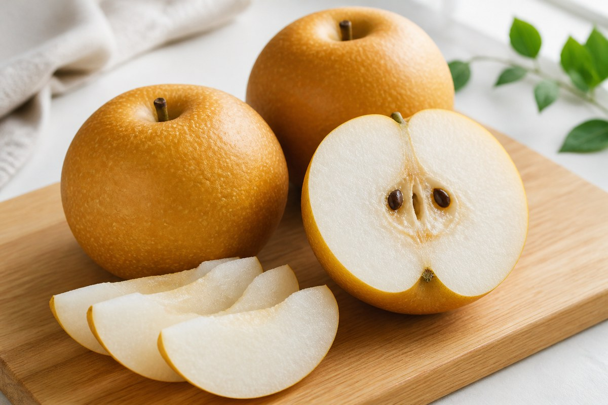

*▲ 배 100g은 45kcal, 당류 7g, 식이섬유 1.7g입니다. 11월 제철 배 한 알(400~500g)은 180~225kcal로, 배즙 한 컵(200ml)에는 배 1~1.5개분의 당이 들어갑니다.*

한 줄 결론 <strong>배 100g은 45kcal에 당류 7.0g, 식이섬유 1.7g, 칼륨 130mg입니다.</strong> 열량은 낮지만 당이 절반을 차지하고, 소르비톨이 들어 있어 변비에는 도움이 되고 과민성대장증후군에는 부담이 될 수 있습니다. 배즙은 하루 1컵(200ml) 이내가 적당합니다.

11월 제철을 맞는 **배(Asian pear)** 는 수분이 83%에 달하고 아삭한 식감 때문에 "다이어트에 좋은 과일"로 알려져 있습니다. 실제로 열량은 100g당 45kcal로 사과(57kcal)·바나나(93kcal)보다 낮습니다. 다만 열량이 낮다는 것과 **당이 적다**는 것은 다른 이야기입니다.

가장 많이 검색되는 질문은 **"배 칼로리가 정말 45kcal인가?"**, **"배즙을 매일 마셔도 되나?"**, **"기침에 배즙이 정말 좋은가?"** 세 가지입니다. 결론부터 말하면 **생배는 하루 1/2~1개가 적당하고, 배즙은 당과 소르비톨이 농축되므로 양을 정해 마셔야** 합니다.

아래에서는 식약처 국가표준식품성분표와 USDA FoodData Central 수치를 기준으로 배 100g의 영양 성분, 소르비톨의 실제 작용, 배즙과 생과일의 차이, 당뇨·과민성대장증후군의 주의점을 정리했습니다.

---

## 1. 배 칼로리와 영양성분은? (100g 45kcal)

아래 수치는 **배(생것, 가식부) 100g** 기준입니다. 국내산 배와 미국·칠레산 아시아배(Nashi pear)는 품종에 따라 수분이 3~5% 차이 나지만 열량과 당 구성은 비슷합니다.

| 영양 성분 (Nutrient) | 함량 (100g당) | 1일 권장 섭취량 비율 (한국인 성인 기준) |
| :--- | :--- | :--- |
| **열량 (Energy)** | 45 kcal | 2.3% |
| **수분 (Water)** | 83.2 g | 별도 표기¹ |
| **탄수화물 (Carbohydrates)** | 11.5 g | 3.5% |
| - 총 당류 (Total Sugars) | 7.0 g | 7.0% |
| - 식이섬유 (Dietary Fiber) | 1.70 g | 6.8% |
| **단백질 (Protein)** | 0.50 g | 0.9% |
| **지방 (Total Fat)** | 0.10 g | 0.2% |
| - 포화지방 (Saturated Fat) | 0.02 g | 0.1% |
| - 콜레스테롤 (Cholesterol) | 0.00 mg | 0.0% |
| **비타민C (Vitamin C)** | 3.0 mg | 3.0% |
| **비타민K (Vitamin K)** | 4.5 µg | 6.0% |
| **엽산 (Folate)** | 8 µg DFE | 2.0% |
| **칼슘 (Calcium)** | 4 mg | 0.6% |
| **칼륨 (Potassium)** | 130 mg | 3.7% |
| **마그네슘 (Magnesium)** | 8 mg | 2.0% |
| **철분 (Iron)** | 0.20 mg | 2.0% |
| **소르비톨 (Sorbitol)** | 2.0~3.0 g | 기준치 없음 |
| **나트륨 (Sodium)** | 1 mg | 0.1% |

**표 읽는 법:** 열량·탄수화물·단백질·지방·나트륨의 %는 식품 표시용 1일 영양성분 기준치(2,000kcal) 대비이고, 비타민C·칼슘·칼륨·철분·엽산의 %는 한국인 영양소 섭취기준 성인 권장량(비타민C 100mg, 칼슘 700mg, 칼륨 3,500mg, 철분 10mg, 엽산 400µg DFE) 대비입니다. ¹수분과 소르비톨은 1일 기준치가 설정되지 않은 성분으로 절대량만 표기했고, 소르비톨은 품종·숙성도에 따라 1.5~3.5g까지 차이가 납니다.

<strong>출처:</strong> 식품의약품안전처 국가표준식품성분표(배, 생것) · <a href="https://fdc.nal.usda.gov/" rel="nofollow noopener" target="_blank">USDA FoodData Central</a> (Pears, asian, raw) · <a href="https://pubmed.ncbi.nlm.nih.gov/" rel="nofollow noopener" target="_blank">PubMed</a> 아시아배 소르비톨·배즙 연구

### 실생활 환산: 배 한 알, 배즙 한 컵은 몇 kcal인가?

| 섭취 기준 | 중량 | 열량과 핵심 수치 |
| :--- | :--- | :--- |
| 1/4쪽(도시락 반찬) | 약 100 g | **45 kcal** · 당류 7 g |
| 1/2개 | 약 200 g | 90 kcal · 당류 14 g · 식이섬유 3.4 g |
| 1개(중간 크기) | 400~500 g | **180~225 kcal** · 당류 28~35 g |
| 배즙 1컵 | 200 ml (배 1~1.5개) | 130~160 kcal · 당류 20~25 g |
| 시판 배즙 1팩 | 100 ml | 45~70 kcal · 당류 10~15 g (제품별 표기 확인) |

배 한 알은 밥 한 공기(약 300kcal)의 3분의 2 수준입니다. "수분 많은 과일이라 부담 없다"고 배 한 알을 한 번에 먹으면 당류 30g을 넘길 수 있으므로, **한 번에 1/2개**를 기준으로 잡는 것이 안전합니다.

---

## 2. 과학적으로 입증된 4대 건강 효능

### H3. 배의 당류 7g은 많은 편인가?

100g당 7g으로 사과(10.4g)·바나나(12.2g)보다 적지만, 배 한 알이면 28~35g으로 하루 당류 섭취 권고(50g 이내)의 60%를 넘습니다.

배의 당은 과당·포도당·자당·소르비톨이 섞인 형태입니다. 100g 기준 당류 7.0g은 과일 중에서는 낮은 편이지만, **배는 한 알의 무게가 400~500g으로 큰 과일**이라는 점이 함정입니다.

세계보건기구(WHO)는 유리당 섭취를 총열량의 10% 이내(2,000kcal 기준 50g)로, 추가 감량을 권고할 때는 5%(25g) 이내로 제한합니다. 배 1개를 한 번에 먹으면 28~35g으로 이미 1일 권고치에 근접합니다. 당뇨가 있다면 **한 번에 1/2개(당류 14g)**, 하루 1개 이내를 기준으로 잡으세요.

배의 혈당지수(GI)는 35~40 수준으로 낮은 편에 속합니다(추정값). 식이섬유와 수분이 당 흡수 속도를 늦추기 때문이지만, GI가 낮다는 것이 총량을 늘려도 된다는 뜻은 아닙니다.

### H3. 배 소르비톨은 변비에 도움이 되나?

도움이 됩니다. 배 100g에 소르비톨 2~3g이 들어 있어 장에 수분을 끌어들이지만, 같은 이유로 과민성대장증후군에는 설사·복부팽만을 유발할 수 있습니다.

소르비톨은 잘 흡수되지 않는 당알코올로, 소장에서 흡수되지 못한 채 대장으로 내려가 **삼투압으로 수분을 끌어들이고 장 운동을 자극**합니다. 아시아배 즙이 소아 변비 완화에 쓰여 왔고, 실제로 무작위 배정 연구에서 배즙이 위장관 증상을 개선했다는 보고가 있습니다.

반대 방향의 주의도 같은 기전에서 나옵니다. 소르비톨 10g 이상을 한 번에 섭취하면 복부팽만·가스·묽은 변이 나타날 수 있고, **과민성대장증후군(IBS)** 이나 흡수장애가 있는 사람은 소량에도 증상이 생깁니다. 배즙 1컵에는 소르비톨이 5~9g 들어 있어, 장이 예민한 사람에게는 증상 유발 용량에 가깝습니다.

### H3. 배즙은 생배보다 좋은가, 나쁜가?

같지 않습니다. 배즙은 식이섬유 대부분이 걸러지고 당과 소르비톨이 농축되어, 같은 양의 배보다 혈당 상승이 빠르고 장 부담이 큽니다.

생배를 씹어 먹으면 식이섬유 1.7g(100g당)과 씹는 시간이 함께 들어옵니다. 즙을 내면 이 섬유질이 걸러져 **당 흡수 속도가 빨라지고 포만감은 줄어듭니다.** 시판 배즙은 여기에 설탕이나 액상과당을 더하는 경우도 있어, 성분표의 당류 함량을 확인해야 합니다.

배즙이 유리한 경우는 있습니다. 목이 아프거나 소화가 어려워 **고체를 삼키기 힘들 때**, 또는 감기로 수분 섭취가 필요할 때입니다. 이때도 하루 1컵(200ml) 이내로 제한하고, 나머지 과일 섭취는 통째로 씹어 먹는 쪽이 낫습니다.

### H3. 기침·가래에 배즙이 정말 효과가 있나?

근거는 제한적입니다. 임상시험으로 입증된 치료 효과는 없고, 따뜻한 수분과 당으로 목 불편감을 줄이는 보조적 효과 수준입니다.

배숙·배즙은 기침과 가래에 좋다는 전통적 인식이 널리 퍼져 있습니다. 그러나 **배 자체가 기침을 멈춘다는 인체 임상시험은 확인되지 않습니다.** 대한 소아과학회와 호흡기 관련 지침에서도 감기의 기침에는 꿀과 따뜻한 음료가 증상 완화에 도움이 될 수 있다는 수준으로 언급합니다.

배즙이 실제로 도움이 되는 지점은 **수분 공급과 목 점막 보습**입니다. 따뜻하게 데운 배즙은 기도 점막을 촉촉하게 해 기침 충동을 줄이는 데 보조적 역할을 합니다. 다만 기침이 2주 이상 지속되거나 발열·호흡곤란이 동반되면 배즙이 아니라 진료가 먼저입니다.

---

## 3. 흡수율을 높이는 조리·섭취 가이드

- **껍질째 씻어 드세요.** 배 껍질에는 식이섬유와 폴리페놀이 과육보다 많이 들어 있습니다. 흐르는 물에 문질러 씻고, 흠집이 있으면 그 부분만 도려내면 됩니다.
- **자르면 바로 드세요.** 배를 자르면 폴리페놀 산화효소가 작용해 갈변이 생깁니다. 식초물이나 레몬즙에 1~2분 담그면 갈변을 늦출 수 있습니다.
- **배즙 양념은 30분~1시간이면 충분합니다.** 배의 유기산과 당, 소량의 단백질 분해효소가 고기 근섬유를 부드럽게 합니다. 2시간 이상 재우면 육질이 물러져 식감이 떨어집니다.
- **배즙을 마실 때는 양을 먼저 정하세요.** 하루 1컵(200ml) 이내, 당뇨가 있다면 100ml 이내로 제한하고 식후에 마시면 혈당 상승이 완만해집니다.
- **차갑게 먹기 어려우면 데워 드세요.** 배숙처럼 60~70℃로 데우면 소르비톨 부담은 그대로지만 목 점막 자극이 줄어듭니다.
- **보관은 신문지에 싸서 냉장 2~3주.** 배는 0~5℃에서 2~4주 보관되며, 사과와 함께 두면 에틸렌으로 빨리 물러지므로 분리해 두세요.

---

## 4. 섭취 시 주의사항 및 부작용

- **소르비톨 과다 섭취는 묽은 변·복부팽만을 일으킵니다.** 배즙 1컵에는 소르비톨 5~9g이 들어 있습니다. 한 번에 2컵 이상 마시거나 공복에 마시면 설사를 할 수 있습니다.
- **과민성대장증후군(IBS)은 소량도 주의하세요.** 배는 저포드맵 식품이지만 소르비톨과 과당 함량이 높아 개인에 따라 증상이 나타납니다. 배즙보다 생배 1/4쪽부터 시작해 반응을 확인하세요.
- **당뇨가 있다면 한 번에 1/2개 이내로 제한하세요.** 배 1개는 당류 28~35g입니다. 식후 혈당을 확인하고, 배즙은 식후 소량으로 조절하는 편이 안전합니다.
- **만성신장질환자는 칼륨을 확인하세요.** 배 100g의 칼륨은 130mg으로 높지 않지만, 배즙을 농축해 마시면 칼륨 섭취가 늘어납니다. 투석 환자는 하루 과일 양을 의료진과 상의해야 합니다.
- **시판 배즙은 당류와 첨가물을 확인하세요.** "100% 배즙"이라도 착즙 농축액에 설탕·액상과당을 더한 제품이 있습니다. 영양정보의 당류가 100ml당 10g을 넘으면 주의하세요.
- **돌 이하 영아에게 배즙을 습관처럼 먹이지 마세요.** 영아는 과일 주스 대신 이유식 형태로 과일을 급여하는 것이 권장되며, 주스는 충치·과체중 위험과 관련됩니다.
- **배 알레르기(구강 알레르기 증후군).** 자작나무·사과 알레르기가 있는 사람은 배에서 입이 가렵거나 붓는 증상이 나타날 수 있습니다. 익혀 먹으면 대부분 완화됩니다.

---

## 5. 자주 묻는 질문 (FAQ)

**Q1. 배는 하루에 얼마나 먹으면 좋나요?**  
건강한 성인은 **하루 1/2~1개(200~400g)** 가 적당합니다. 열량은 90~180kcal, 당류는 14~28g입니다. 당뇨가 있으면 한 번에 1/2개 이내로 나눠 먹고, 배즙으로 마실 때는 하루 1컵(200ml) 이내로 제한하세요.

**Q2. 배즙을 매일 마셔도 되나요?**  
가능하지만 **하루 1컵(200ml) 이내**를 권합니다. 배즙은 식이섬유가 걸러지고 소르비톨이 농축되어, 매일 여러 잔을 마시면 묽은 변·복부팽만과 당 과다 섭취로 이어질 수 있습니다. 시판 제품은 당류 표기를 먼저 확인하세요.

**Q3. 배를 먹으면 변비에 좋은가요, 설사에 좋은가요?**  
**둘 다 해당될 수 있습니다.** 배의 식이섬유와 소르비톨은 장 운동을 촉진해 변비 완화에 도움이 되지만, 같은 성분이 과하면 묽은 변을 유발합니다. 평소 장이 예민하다면 소량부터 시작하고, 설사가 이어질 때는 배즙 섭취를 중단하세요.

---

## 6. 배와 함께 먹으면 좋은 음식

- **[닭다리살 (Chicken Thigh)](/posts/chicken-thigh-nutrition-benefits/):** 배즙의 유기산과 당은 닭다리살 근섬유를 부드럽게 하고, 배의 칼륨·식이섬유는 고기 중심 식사에서 부족해지기 쉬운 영양소를 채웁니다. 배즙 양념은 30분~1시간이면 충분합니다.
- **[사과 (Apple)](/posts/apple-nutrition-benefits/):** 사과는 100g당 식이섬유 2.4g과 펙틴이 많아 장내 환경에 관여합니다. 배와 사과를 번갈아 먹으면 수용성·불용성 섬유질을 고루 섭취할 수 있습니다.
- **[석류 (Pomegranate)](/posts/pomegranate-nutrition-benefits/):** 석류는 11월 제철 과일로 폴리페놀(퓨니칼라진) 함량이 높습니다. 당이 있는 과일이므로 하루 총량 안에서 나눠 드세요.
- **[저GI 음식 혈당 가이드](/posts/low-gi-foods-blood-sugar-guide/):** 배의 GI는 35~40 수준으로 낮은 편입니다. 혈당 관리 식단에서 어떤 과일을 어떤 순서로 먹을지 정리한 가이드입니다.

  
📌 관련 순위 가이드

  <ul>
    <li><a href="/posts/low-gi-foods-blood-sugar-guide/">저GI 음식 가이드: 혈당 천천히 올리는 식품</a></li>
    <li><a href="/posts/low-calorie-high-satiety-foods/">저칼로리 포만감 다이어트 음식 TOP 10</a></li>
  </ul>

---

## 7. 배 어떻게 먹을까? 핵심 요약

- 배 100g은 **45kcal·당류 7.0g·식이섬유 1.7g·칼륨 130mg**의 저열량 고수분 과일입니다.
- 열량은 낮지만 **배 한 알(400~500g)은 180~225kcal·당류 28~35g**으로 하루 권고의 60%를 넘습니다.
- 하루 적정량은 **1/2~1개**, 당뇨가 있다면 한 번에 1/2개 이내가 안전합니다.
- **소르비톨 2~3g/100g**이 변비에는 도움, 과민성대장증후군에는 부담입니다.
- 배즙은 **하루 1컵(200ml) 이내**, 기침에 대한 치료 효과는 기대하지 말고 수분 보충 용도로만 활용하세요.

