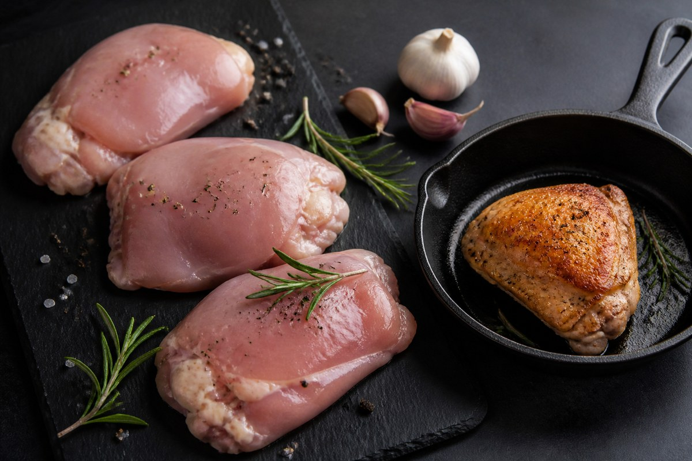

*▲ 닭다리살은 100g당 119kcal·단백질 19.7g입니다. 아래 수치는 껍질을 제거한 살코기 기준이며, 껍질째 조리하면 같은 100g이 211kcal로 올라갑니다.*

한 줄 결론 <strong>껍질을 벗긴 닭다리살 100g은 119kcal에 단백질 19.7g, 지방 3.9g입니다.</strong> 같은 무게의 닭가슴살(120kcal·단백질 22.5g)과 열량은 사실상 같고, 대신 철분이 2.5배(1.0mg), 아연이 2.4배(1.7mg) 많습니다. 껍질을 벗기느냐가 칼로리의 44%를 좌우합니다.

닭다리살은 닭가슴살보다 부드럽고 촉촉하지만 "살찌는 부위"로 오해받는 식재료입니다. 실제로 문제가 되는 것은 살코기가 아니라 **껍질과 조리 방식**입니다. 껍질을 벗긴 닭다리살은 닭가슴살과 열량이 1kcal 차이밖에 나지 않습니다.

가장 많이 검색되는 질문은 **"닭다리살 칼로리가 정말 119kcal인가?"**, **"닭가슴살 대신 먹어도 되나?"**, **"껍질을 벗기면 얼마나 줄어드나?"** 세 가지입니다. 결론부터 말하면 **껍질 제거 여부와 중심온도 74℃ 준수**가 이 식재료의 핵심입니다.

아래에서는 USDA FoodData Central과 식품의약품안전처 국가표준식품성분표 수치를 기준으로 닭다리살 100g의 영양 성분, 닭가슴살과의 실제 차이, 단백질 섭취량 계산, 캠필로박터 예방 조리법을 정리했습니다.

---

## 1. 닭다리살 칼로리와 영양성분은? (100g 119kcal)

아래 수치는 **닭다리살(생것, 껍질 제거 살코기) 100g** 기준입니다. 같은 부위라도 껍질 포함 여부와 익힘 상태에 따라 값이 크게 달라지므로 표 아래 환산표를 함께 보세요.

| 영양 성분 (Nutrient) | 함량 (100g당) | 1일 권장 섭취량 비율 (한국인 성인 기준) |
| :--- | :--- | :--- |
| **열량 (Energy)** | 119 kcal | 6.0% |
| **수분 (Water)** | 76.0 g | 별도 표기¹ |
| **단백질 (Protein)** | 19.70 g | 35.8% |
| **지방 (Total Fat)** | 3.91 g | 7.2% |
| - 포화지방 (Saturated Fat) | 1.00 g | 7.1% |
| - 콜레스테롤 (Cholesterol) | 88 mg | 29.3% |
| **탄수화물 (Carbohydrates)** | 0.00 g | 0.0% |
| - 식이섬유 (Dietary Fiber) | 0.00 g | 0.0% |
| **나이아신 (Vitamin B3)** | 5.50 mg | 36.7% |
| **비타민B6 (Vitamin B6)** | 0.44 mg | 29.3% |
| **비타민B12 (Vitamin B12)** | 0.53 µg | 22.1% |
| **판토텐산 (Vitamin B5)** | 1.01 mg | 20.2% |
| **셀레늄 (Selenium)** | 17.8 µg | 32.4% |
| **인 (Phosphorus)** | 185 mg | 26.4% |
| **아연 (Zinc)** | 1.70 mg | 21.3% |
| **철분 (Iron)** | 1.00 mg | 10.0% |
| **칼륨 (Potassium)** | 242 mg | 6.9% |
| **마그네슘 (Magnesium)** | 22 mg | 5.5% |
| **나트륨 (Sodium)** | 86 mg | 4.3% |

**표 읽는 법:** 열량·지방·포화지방·콜레스테롤·나트륨의 %는 식품 표시용 1일 영양성분 기준치(2,000kcal) 대비이고, 단백질·비타민B군·셀레늄·인·아연·철분·칼륨의 %는 한국인 영양소 섭취기준 성인 권장량(단백질 55g, 나이아신 15mg NE, 비타민B6 1.5mg, 비타민B12 2.4µg, 판토텐산 5mg, 셀레늄 55µg, 인 700mg, 아연 8mg, 철분 10mg, 칼륨 3,500mg) 대비입니다. ¹수분은 1일 기준치가 설정되지 않은 성분이라 절대량만 표기했습니다. 콜레스테롤 88mg은 조리 전 생고기 기준이며, 껍질을 포함하면 146mg까지 올라갑니다.

<strong>출처:</strong> <a href="https://fdc.nal.usda.gov/" rel="nofollow noopener" target="_blank">USDA FoodData Central</a> (Chicken, broilers or fryers, thigh, meat only, raw) · 식품의약품안전처 국가표준식품성분표(닭고기 다리살) · <a href="https://pubmed.ncbi.nlm.nih.gov/" rel="nofollow noopener" target="_blank">PubMed</a> 가금육 단백질 소화율 연구

### 실생활 환산: 닭다리살 한 조각, 한 끼는 몇 kcal인가?

| 섭취 기준 | 중량 | 열량과 핵심 수치 |
| :--- | :--- | :--- |
| 닭다리살 1조각(껍질 제거) | 약 90 g | **107 kcal** · 단백질 17.7 g |
| 닭다리살 1조각(껍질 포함) | 약 110 g | **232 kcal** · 지방 17.0 g |
| 1인분 2조각(껍질 제거) | 약 180 g | 214 kcal · **단백질 35.5 g** |
| 닭다리살 100g, 구운 뒤 | 조리 후 약 70 g | 119 kcal → 100g당 환산 시 170 kcal |
| 닭가슴살 100g(생것) | 100 g | 120 kcal · 단백질 22.5 g · 철분 0.4 mg |
| 닭다리살 100g(생것) | 100 g | **119 kcal** · 단백질 19.7 g · 철분 1.0 mg |

같은 무게에서 닭다리살과 닭가슴살의 열량 차이는 1kcal입니다. 그러나 **껍질을 붙인 채 조리하면 1조각이 232kcal**로 두 배가 되고, 여기에 기름을 두른 프라이팬 조리까지 더해지면 실제 섭취 열량은 300kcal를 넘습니다.

---

## 2. 과학적으로 입증된 4대 건강 효능

### H3. 껍질을 벗기면 칼로리가 얼마나 줄어드나?

211kcal에서 119kcal로 43.6% 줄어듭니다. 지방은 15.5g에서 3.9g으로, 포화지방은 4.4g에서 1.0g으로 떨어집니다.

닭다리살의 열량 대부분은 껍질 아래 지방층에 있습니다. 껍질을 포함한 생 닭다리살은 100g에 211kcal·지방 15.5g이지만, 껍질을 벗기면 119kcal·지방 3.9g이 됩니다. **같은 고기, 같은 양인데 칼로리의 44%와 지방의 75%가 껍질에서 나오는 셈**입니다.

조리법에 따른 차이도 큽니다. 껍질을 벗긴 닭다리살을 프라이팬에 굽는 것만으로도 추가 지방이 붙기 때문에, 다이어트 식단이라면 **껍질 제거 + 에어프라이어·오븐·삶기**가 기본 조합입니다. 반대로 껍질째 구운 닭다리살은 단백질 1g당 열량이 7.9kcal로, 껍질 제거(6.0kcal)보다 30% 높습니다.

### H3. 단백질 19.7g은 하루 필요량의 얼마인가?

체중 60kg 성인 기준 1일 권장량(48g)의 41%입니다. 1인분 2조각(180g)이면 35.5g으로 하루의 74%를 채웁니다.

한국인 영양소 섭취기준의 성인 단백질 권장량은 체중 1kg당 0.8g입니다. 체중 60kg이면 48g, 70kg이면 56g이며, **닭다리살 100g(19.7g)은 60kg 성인의 하루 필요량 중 41%**를 한 번에 채웁니다.

근력 운동이나 체중 감량 중이라면 단백질 목표가 체중 1kg당 1.2~1.6g으로 올라가 하루 72~96g(60kg 기준)이 됩니다. 이때 닭다리살 1인분 2조각(35.5g)은 현실적인 계산이 됩니다. 한 끼에 단백질을 30g 이상 공급하면 **식후 포만감과 근육 단백질 합성이 함께 올라간다**는 연구가 반복적으로 보고됐습니다.

닭다리살 단백질은 필수아미노산 9종을 모두 갖춘 완전단백질이며, 소화율(DIAAS)이 0.9 이상으로 콩·곡물 단백질보다 생체 이용률이 높습니다.

### H3. 닭가슴살과 비교하면 무엇이 다른가?

열량은 거의 같지만 철분 2.5배, 아연 2.4배, 비타민B12 2.6배로 미네랄과 B군이 더 많습니다. 대신 단백질은 100g당 2.8g 적습니다.

| 100g 생것 기준 | 닭다리살(껍질 제거) | 닭가슴살(껍질 제거) |
| :--- | :--- | :--- |
| 열량 | 119 kcal | 120 kcal |
| 단백질 | 19.7 g | 22.5 g |
| 지방 | 3.9 g | 2.6 g |
| 철분 | **1.00 mg** | 0.37 mg |
| 아연 | **1.70 mg** | 0.72 mg |
| 비타민B12 | **0.53 µg** | 0.21 µg |
| 셀레늄 | 17.8 µg | 22.8 µg |

닭다리살은 붉은 근육 섬유가 많아 미오글로빈과 함께 **철분·아연·B12가 풍부**합니다. 철분 결핍이 흔한 가임기 여성이나, 아연 섭취가 부족하기 쉬운 채식 위주 식단에 고기를 더하는 사람에게는 닭가슴살보다 유리한 선택입니다.

반대로 **체중 대비 최대한의 단백질을 적은 열량으로** 얻고 싶다면 닭가슴살이 여전히 우위입니다. 단백질 1g당 열량은 닭가슴살 5.3kcal, 닭다리살 6.0kcal입니다.

### H3. 지방 3.9g과 콜레스테롤 88mg은 걱정할 수준인가?

포화지방 1.0g은 1일 기준치의 7%로 낮은 편입니다. 콜레스테롤 88mg은 하루 300mg 한도의 약 29%입니다.

닭다리살의 지방은 절반 이상이 불포화지방(올레산·리놀레산)으로, 포화지방은 1.0g에 불과합니다. 콜레스테롤 88mg은 계란 1개(약 190mg)의 절반 수준이므로, 하루에 닭다리살 100g을 먹고 다른 식사에서 콜레스테롤을 과도하게 늘리지 않는다면 문제가 되지 않습니다.

혈중 콜레스테롤에 더 크게 영향을 주는 것은 **포화지방과 트랜스지방의 총량**입니다. 닭다리살을 껍질째 튀기거나 가공육(소시지·베이컨)으로 먹는 습관이 아니라면, 구운 닭다리살 100~180g은 일반적인 식사 지침 안에 들어옵니다.

---

## 3. 흡수율을 극대화하는 조리·섭취 가이드

- **중심온도 74℃ 이상, 15초 이상 가열하세요.** 식품의약품안전처는 가금류를 중심온도 74℃에서 15초 이상 익히도록 안내합니다. 닭다리살은 두꺼워 겉이 노릇해도 속이 덜 익기 쉬우므로, 굽기 전 **두께를 2cm 이내로 편평하게** 만들어 주세요.
- **생닭은 물로 씻지 마세요.** 흐르는 물에 씻으면 캠필로박터가 싱크대·주변 조리도구로 튀어 오염 범위가 넓어집니다. 물기는 키친타월로 닦아내고 바로 조리하세요.
- **양념에 배즙·키위즙을 쓰면 부드러워집니다.** 과일의 단백질 분해효소(프로테아제)가 근섬유를 끊어 줍니다. 30분~1시간 절이면 충분하고, 2시간을 넘기면 육질이 물러져 식감이 떨어집니다.
- **껍질은 벗겨 조리하고, 껍질은 따로 활용하세요.** 껍질을 벗긴 살코기를 굽고, 껍질은 기름을 내는 용도로만 쓰면 열량 부담 없이 풍미를 살릴 수 있습니다.
- **냉장 1~2일, 냉동 3개월 안에 드세요.** 생닭은 0~4℃에서 1~2일, -18℃ 이하 냉동 시 3개월이 안전 보관 기한이며, 삶은 물은 국물로 재사용하지 마세요.

---

## 4. 섭취 시 주의사항 및 부작용

- **캠필로박터는 국내 세균성 식중독 원인 1위입니다.** 닭고기에서 가장 흔히 검출되며, 100마리 미만의 균으로도 설사·복통·발열을 일으킵니다. 겉이 익었다고 속이 익었다고 판단하지 말고 중심온도를 확인하세요.
- **날개·다리 요리를 반쯤 익혀 두지 마세요.** 반조리 상태로 냉장 보관하면 균이 증식할 시간이 생깁니다. 조리는 전량 한 번에 끝내고, 남은 것은 완전히 익힌 뒤 식혀 보관하세요.
- **껍질 포함·튀김 형태는 열량이 두 배 이상입니다.** 껍질째 튀긴 닭다리살 100g은 250~290kcal로, 같은 부위 삶은 것(119kcal)의 2배가 넘습니다.
- **통풍·고요산혈증은 양을 조절하세요.** 닭고기 100g의 퓨린은 150mg 내외로 등푸른생선·내장보다는 낮지만 무시할 수 없는 수준입니다. 급성 발작기에는 100g 이내로 줄이세요.
- **만성신장질환자는 단백질·칼륨·인이 함께 제한될 수 있습니다.** 닭다리살 100g에 인 185mg, 칼륨 242mg이 들어 있어 단백질 1g당 인 비율이 높습니다. 의료진이 단백질 제한을 권한 경우 양을 먼저 확인하세요.
- **닭고기 알레르기(알파-갈 증후군 포함)는 드물지만 존재합니다.** 붉은 고기 섭취 후 3~6시간 뒤 두드러기가 반복된다면 진료를 받아보세요.

---

## 5. 자주 묻는 질문 (FAQ)

**Q1. 닭다리살은 하루에 얼마나 먹어도 되나요?**  
건강한 성인의 경우 **하루 100~200g(1~2조각, 껍질 제거)** 이 적당합니다. 단백질 20~40g을 공급하며 열량은 119~238kcal입니다. 가공육(햄·소시지)을 대신하는 용도로 주 3~4회 활용하고, 같은 날 다른 육류·생선 섭취량과 합쳐 하루 단백질 목표(체중 1kg당 0.8~1.2g) 안에서 조절하세요.

**Q2. 닭가슴살 대신 닭다리살로 바꿔도 다이어트에 문제없나요?**  
문제없습니다. **껍질을 벗긴 닭다리살은 100g당 119kcal로 닭가슴살(120kcal)과 차이가 없습니다.** 단백질은 2.8g 적지만 철분·아연·B12가 더 많고 식감이 부드러워 오래 먹기 쉽습니다. 다이어트의 성패는 부위보다 총열량·총단백질과 조리 방식에서 갈립니다.

**Q3. 닭다리살을 먹고 배탈이 났는데 원인이 무엇일까요?**  
가장 가능성 높은 원인은 **덜 익은 닭고기(캠필로박터)** 입니다. 섭취 후 2~7일에 걸쳐 설사·복통·발열이 나타납니다. 다음 조리부터 중심온도 74℃·15초를 지키고, 생닭을 씻지 말고, 도마·칼을 육류 전용으로 분리하세요. 증상이 3일 이상 지속되면 진료를 받아야 합니다.

---

## 6. 닭다리살과 함께 먹으면 좋은 음식

- **[닭가슴살 (Chicken Breast)](/posts/chicken-breast-nutrition-benefits/):** 닭가슴살은 100g당 단백질 22.5g·열량 120kcal로 단백질 밀도가 더 높습니다. 다리살은 미네랄, 가슴살은 단백질 효율을 담당하도록 번갈아 쓰면 한 주 단백질 구성이 단조로워지지 않습니다.
- **[배 (Asian Pear)](/posts/asian-pear-nutrition-benefits/):** 배즙의 단백질 분해효소는 닭다리살 근섬유를 부드럽게 하고, 배의 칼륨·식이섬유는 고기 위주의 식사에서 부족해지기 쉬운 영양소를 채웁니다. 배즙 양념은 30분~1시간이면 충분합니다.
- **[달걀 (Egg)](/posts/egg-nutrition-benefits/):** 달걀 1개(약 6g 단백질)를 곁들이면 한 끼 단백질이 26g을 넘어 식후 포만감이 커집니다. 아미노산 조성이 달라 상호 보완 효과도 있습니다.
- **[고단백 음식 순위 TOP 10](/posts/high-protein-foods-ranking/):** 100g당 단백질과 100kcal당 단백질을 함께 비교한 순위표에서 닭다리살의 위치를 확인할 수 있습니다.

  
📌 관련 순위 가이드

  <ul>
    <li><a href="/posts/high-protein-foods-ranking/">고단백 음식 순위 TOP 10: 100g·100kcal 비교</a></li>
    <li><a href="/posts/low-calorie-high-satiety-foods/">저칼로리 포만감 다이어트 음식 TOP 10</a></li>
  </ul>

---

## 7. 닭다리살 어떻게 먹을까? 핵심 요약

- 껍질을 벗긴 닭다리살 100g은 **119kcal·단백질 19.7g·지방 3.9g**으로, 닭가슴살과 열량이 사실상 같습니다.
- 칼로리의 44%는 껍질에서 나옵니다. **껍질째 211kcal → 껍질 제거 119kcal**입니다.
- 닭가슴살보다 **철분 2.5배·아연 2.4배·B12 2.6배**가 많아 미네랄 측면에서 유리합니다.
- 하루 적정량은 **100~200g(1~2조각)** 이며, 1인분 2조각이면 단백질 35.5g으로 하루 필요량의 74%를 채웁니다.
- 가장 중요한 안전 수칙은 **중심온도 74℃·15초**, 생닭을 물로 씻지 않기, 도마 분리입니다.

