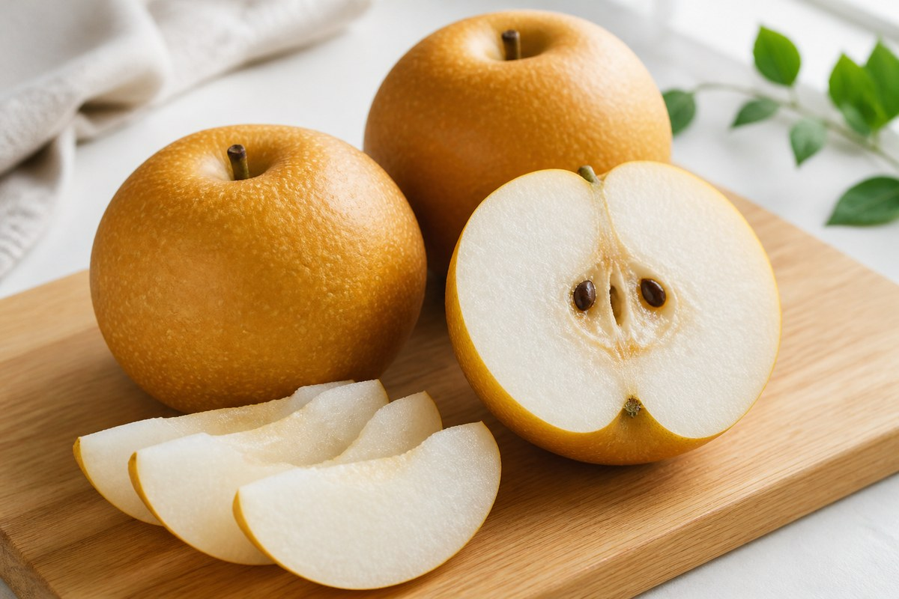

*▲ An Asian pear carries 42 calories, 3.6 g of fiber and 121 mg of potassium per 100 g. A single fruit weighs 350–500 g, so one pear delivers 150–210 calories and 25–35 g of sugar.*

Quick answer <strong>Raw Asian pear provides 42 calories, 10.65 g carbohydrate, 3.6 g fiber and 7.05 g sugar per 100 g, with 121 mg potassium and 3.8 mg vitamin C.</strong> It is one of the lowest-calorie fruits by weight, but a whole pear is large: half a fruit is the sensible serving, and pear juice concentrates both the sugar and the sorbitol behind this fruit's laxative effect.

The Asian pear — sold as nashi pear, Korean pear, or "apple pear" for its round shape — is crisp, watery and mildly sweet. Its diet-fruit reputation holds on calories and fails on sugar, and its most distinctive compound rarely appears on a label: sorbitol.

Readers ask most often **how much sugar a pear really has**, **whether juice counts the same as fruit**, and **why pears have a laxative reputation**. The short answers: 7 g of sugar per 100 g but 25–35 g per fruit, juice strips out the fiber, and sorbitol pulls water into the bowel.

---

## 1. How Many Calories Are in an Asian Pear? (42 kcal per 100 g)

The values below describe **raw Asian pear (nashi pear), edible portion**, as published in USDA FoodData Central. Korean and Japanese cultivars differ slightly in water content, but energy and sugar composition are close.

| Nutrient | Per 100 g | U.S. %DV |
| :--- | :--- | :--- |
| **Energy** | 42 kcal | 2.1% |
| **Water** | 88.25 g | No DV |
| **Carbohydrates** | 10.65 g | 3.9% |
| - Total Sugars | 7.05 g | No DV |
| - Dietary Fiber | 3.60 g | 12.9% |
| **Protein** | 0.50 g | 1.0% |
| **Total Fat** | 0.23 g | 0.3% |
| - Saturated Fat | 0.01 g | 0.1% |
| - Cholesterol | 0 mg | 0.0% |
| **Vitamin C** | 3.8 mg | 4.2% |
| **Vitamin K** | 4.5 µg | 3.8% |
| **Folate** | 8 µg DFE | 2.0% |
| **Potassium** | 121 mg | 2.6% |
| **Calcium** | 4 mg | 0.3% |
| **Magnesium** | 8 mg | 1.9% |
| **Iron** | 0.00 mg | 0.0% |
| **Sorbitol** | 2.0–3.0 g | No DV |
| **Sodium** | 0 mg | 0.0% |

**How to read the table:** percentages use the U.S. Daily Values printed on food labels, based on a 2,000-calorie reference diet. ¹Water, total sugars and sorbitol carry no Daily Value, so absolute amounts are listed. Sorbitol content varies with cultivar and ripeness, from roughly 1.5 g to 3.5 g per 100 g; Korean pears tend toward the higher end.

<strong>Sources:</strong> <a href="https://fdc.nal.usda.gov/" rel="nofollow noopener" target="_blank">USDA FoodData Central</a> (Pears, asian, raw) · Korea Ministry of Food and Drug Safety, Food Composition Table (배, 생것) · <a href="https://pubmed.ncbi.nlm.nih.gov/" rel="nofollow noopener" target="_blank">PubMed</a> literature on sorbitol in Asian pear and pear juice

### Real-world portions: what one pear actually delivers

| Portion | Weight | Calories and key nutrients |
| :--- | :--- | :--- |
| 1 slice | about 25 g | **11 kcal** · 1.8 g sugar |
| A quarter pear | about 100 g | 42 kcal · 7 g sugar · 3.6 g fiber |
| Half a pear | about 200 g | 84 kcal · 14 g sugar · 7.2 g fiber |
| One whole pear | 350–500 g | **150–210 kcal** · 25–35 g sugar |
| Pear juice, 1 cup | 240 ml | 130–160 kcal · 22–28 g sugar |

A whole pear eaten in one sitting carries as much sugar as a 12-ounce soft drink, with far more fiber — but the same rapid fructose load. Quartering it across the day is the practical fix.

---

## 2. Four Evidence-Backed Benefits

### H3. Is 7 g of sugar per 100 g high or low?

Low per 100 g — apples carry 10.4 g and bananas 12.2 g — but a whole pear still holds 25–35 g, over half the WHO free-sugar limit.

The World Health Organization recommends keeping free sugars below 10% of total energy, about 50 g on a 2,000-calorie diet, with added benefit below 5%. One large Asian pear supplies 25–35 g, so one fruit a day fits and three does not.

Asian pears have a glycemic index around 35–40, among the lower-GI fruits, because fiber and water slow gastric emptying. The GI does not cancel the total load: portion size still decides the glucose response.

### H3. Does the sorbitol in Asian pear relieve constipation?

Yes, in modest amounts. At 2–3 g per 100 g, sorbitol draws water into the colon and softens stool — the same mechanism that makes large servings laxative.

Sorbitol is a sugar alcohol absorbed poorly in the small intestine. What reaches the colon pulls water osmotically and ferments into short-chain fatty acids that stimulate motility. Asian pear juice has been studied as a treatment for functional constipation in children, with small trials reporting more frequent and softer stools.

The same mechanism produces the side effects. Ten grams or more at once reliably causes bloating, gas and loose stools in adults, and people with irritable bowel syndrome react to much less. A cup of pear juice can carry 5–9 g of sorbitol, which is why juice provokes symptoms the whole fruit often does not.

### H3. Is pear juice as good as eating the fruit?

No. Juicing removes most of the 3.6 g of fiber per 100 g and concentrates sugar and sorbitol, so the same pear raises blood glucose faster and satisfies less.

Chewing delivers fiber, water and time together, and that combination is part of what makes fruit filling. Juice keeps the sugar and drops the fiber; commercial pear juice and nectar often add sugar or high-fructose corn syrup on top, pushing a 240 ml glass past 30 g of sugar. Keep juice to one cup a day and choose a label with no added sugar.

### H3. Do pears help a cough or a cold?

Only as comfort. No clinical evidence shows pear stops a cough; warm pear tea helps mainly by supplying fluid and warmth to an irritated throat.

Poached pear and warm pear drinks are traditional cold remedies across East Asia, and honey-based warm drinks do have modest pediatric support for nighttime cough. Pear itself has not been shown in controlled trials to shorten a cough or clear sputum. A cough lasting more than two weeks, or one with fever or breathlessness, needs medical assessment rather than fruit.

---

## 3. How to Prepare and Store Asian Pears

- **Eat the skin.** Most of the fiber and polyphenols sit in and just under the peel. Rinse under running water and rub the surface; trim only bruised spots.
- **Slice just before serving.** Cutting exposes polyphenol oxidase to oxygen and the flesh browns within minutes. A one- to two-minute dip in acidulated water slows it.
- **Use grated pear as a marinade.** Acids and sugars tenderize beef and chicken in 30–60 minutes; beyond two hours the texture turns mushy. This is the base of Korean bulgogi seasoning.
- **Store whole pears wrapped and cold,** away from apples and other ethylene producers. They hold two to four weeks at 32–40°F (0–5°C).
- **Juice only what you will drink that day.** Fresh pear juice oxidizes and ferments quickly; refrigerate and finish within 24 hours.

---

## 4. Cautions and Side Effects

- **Too much sorbitol means loose stools.** Two or more cups of juice in a day, or juice on an empty stomach, commonly causes diarrhea and cramping.
- **Irritable bowel syndrome.** Asian pear is low in FODMAPs overall but high in sorbitol and excess fructose. Start with a quarter pear rather than a glass of juice.
- **Diabetes.** One fruit carries 25–35 g of sugar. Keep a serving to half a pear, eat it with protein or fat, and check post-meal glucose if you monitor.
- **Chronic kidney disease.** At 121 mg per 100 g, potassium is moderate, but concentrated juice adds up quickly. Confirm portions with your clinician if potassium is restricted.
- **Check labels on commercial juice.** "100% pear" products may still come from concentrate with added sugar; more than 10 g of sugar per 100 ml is a warning sign.
- **Do not give juice habitually to infants.** Pediatric guidance favors purée over juice under one year, and juice is linked to dental caries and excess weight gain.
- **Oral allergy syndrome.** People allergic to birch pollen or apples may feel itching or swelling in the mouth after eating pear; cooking usually removes the reaction.

---

## 5. Frequently Asked Questions

**Q1. How many Asian pears should I eat per day?**  
**Half to one pear (200–400 g)** is reasonable, providing 84–168 calories and 14–28 g of sugar. People with diabetes should keep a single serving to half a pear, and anyone drinking pear juice should cap it at one cup (240 ml) a day.

**Q2. Can I drink pear juice every day?**  
Yes, within limits. **One cup daily** is the practical ceiling: juice concentrates sugar and sorbitol while removing the fiber whole fruit provides. Several cups a day is a reliable way to provoke loose stools and to add 60 g or more of sugar to your diet.

**Q3. Does Asian pear cause constipation or relieve it?**  
**It usually relieves it, and can cause the opposite in excess.** Fiber and sorbitol promote bowel movements and soften stool, which is why pear juice has been used for constipation. In larger amounts, or with IBS, the same sorbitol causes gas, bloating and diarrhea.

---

## 6. Synergistic Food Pairings

- **[Chicken Thigh](/en/posts/chicken-thigh-nutrition-benefits/):** Grated pear tenderizes thigh meat in 30–60 minutes, and the fruit's potassium and fiber balance a meat-heavy plate — the practical version of a classic Korean marinade.
- **[Apple](/en/posts/apple-nutrition-benefits/):** Apples bring 2.4 g of fiber per 100 g, much of it pectin, with a different polyphenol profile. Alternating the two covers soluble and insoluble fiber.
- **[Pomegranate](/en/posts/pomegranate-nutrition-benefits/):** A late-autumn fruit rich in punicalagin polyphenols. Both are sugary, so split them across the day rather than serving both at once.
- **[Low-GI Foods Guide](/en/posts/low-gi-foods-blood-sugar-guide/):** Where Asian pear's glycemic index of roughly 35–40 fits in a blood-sugar-friendly meal order.

  
📌 Related rankings

  <ul>
    <li><a href="/en/posts/low-gi-foods-blood-sugar-guide/">Low-GI Foods: Keeping Blood Sugar Steady</a></li>
    <li><a href="/en/posts/low-calorie-high-satiety-foods/">Top 10 Low-Calorie, High-Satiety Foods</a></li>
  </ul>

---

## 7. Bottom Line

- An Asian pear is **42 calories, 3.6 g fiber and 121 mg potassium per 100 g**, with 7.05 g of sugar.
- A whole fruit weighs 350–500 g, so one pear delivers **150–210 calories and 25–35 g of sugar** — half a pear is the better serving.
- **Sorbitol (2–3 g per 100 g)** explains both the constipation relief and the bloating, and why juice provokes symptoms whole fruit often does not.
- **Cap juice at one cup a day.** It keeps the sugar and sorbitol and loses most of the fiber.
- Pears support hydration and fiber intake; they are **not a treatment for cough or cold**, and persistent symptoms need medical attention.

