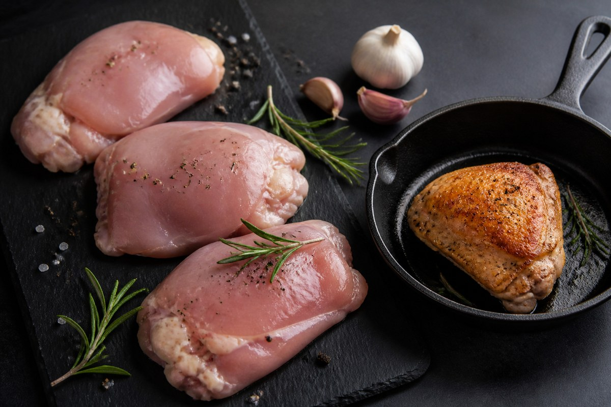

*▲ Skinless chicken thigh carries 119 calories and 19.7 g of protein per 100 g. The same weight with skin on reaches 211 calories — the skin accounts for 44% of the energy in the cut.*

Quick answer <strong>Skinless raw chicken thigh provides 119 calories, 19.7 g protein and 3.9 g fat per 100 g, with 1.0 mg iron, 1.7 mg zinc and 0.53 µg vitamin B12.</strong> That is one calorie less than skinless chicken breast, but with 2.5 times the iron and 2.4 times the zinc. Leaving the skin on raises the same 100 g to 211 calories.

Chicken thigh is the cut home cooks reach for when breast turns dry, and the one diet guides warn against. The warning aims at the wrong target: the meat is lean, and nearly half the calories sit in the fat layer directly under the skin.

The questions that come up most are **whether thigh meat is fattening**, **how it compares with breast**, and **how to cook it safely**. The short answers: 119 calories per 100 g skinless, roughly equal to breast on calories but richer in minerals, and 165°F (74°C) at the center for 15 seconds.

---

## 1. How Many Calories Are in Chicken Thigh? (119 kcal per 100 g)

The values below describe **raw chicken thigh, meat only, skin removed**, as published in USDA FoodData Central. Cooking drives off water, so a roasted thigh weighs about 70% of its raw weight and shows roughly 170 calories per 100 g of cooked meat — the same piece, concentrated.

| Nutrient | Per 100 g | U.S. %DV |
| :--- | :--- | :--- |
| **Energy** | 119 kcal | 6.0% |
| **Water** | 76.0 g | No DV |
| **Protein** | 19.70 g | 39.4% |
| **Total Fat** | 3.91 g | 5.0% |
| - Saturated Fat | 1.00 g | 5.0% |
| - Cholesterol | 88 mg | 29.3% |
| **Carbohydrates** | 0.00 g | 0.0% |
| - Dietary Fiber | 0.00 g | 0.0% |
| **Niacin (B3)** | 5.50 mg | 34.4% |
| **Vitamin B6** | 0.44 mg | 25.9% |
| **Vitamin B12** | 0.53 µg | 22.1% |
| **Pantothenic Acid (B5)** | 1.01 mg | 20.2% |
| **Selenium** | 17.8 µg | 32.4% |
| **Phosphorus** | 185 mg | 14.8% |
| **Zinc** | 1.70 mg | 15.5% |
| **Iron** | 1.00 mg | 5.6% |
| **Potassium** | 242 mg | 6.9% |
| **Magnesium** | 22 mg | 5.2% |
| **Sodium** | 86 mg | 3.7% |

**How to read the table:** percentages use the U.S. Daily Values printed on food labels, based on a 2,000-calorie reference diet. ¹Water and total sugars carry no Daily Value, so absolute amounts are listed. Cholesterol at 88 mg is for raw skinless meat; with skin on it rises to about 146 mg, and fat climbs from 3.91 g to 15.5 g.

<strong>Sources:</strong> <a href="https://fdc.nal.usda.gov/" rel="nofollow noopener" target="_blank">USDA FoodData Central</a> (Chicken, broilers or fryers, thigh, meat only, raw and with skin, raw) · Korea Ministry of Food and Drug Safety, Food Composition Table · <a href="https://pubmed.ncbi.nlm.nih.gov/" rel="nofollow noopener" target="_blank">PubMed</a> poultry protein digestibility literature

### Real-world portions: what one thigh actually delivers

| Portion | Weight | Calories and key nutrients |
| :--- | :--- | :--- |
| 1 skinless thigh | about 90 g | **107 kcal** · 17.7 g protein |
| 1 thigh with skin | about 110 g | 232 kcal · 17.0 g fat |
| 2 thighs (one serving) | about 180 g | 214 kcal · **35.5 g protein** |
| 100 g after roasting | about 70 g raw | 170 kcal · 28 g protein |
| Chicken breast, 100 g raw | 100 g | 120 kcal · 22.5 g protein · 0.37 mg iron |

Two thighs land inside the 25–35 g protein range that trials associate with strong satiety and near-maximal muscle protein synthesis in a single meal.
---

## 2. Four Evidence-Backed Benefits

### H3. How much do you save by removing the skin?

Roughly 44% of the calories and 75% of the fat: from 211 kcal and 15.5 g fat down to 119 kcal and 3.9 g fat per 100 g.

Chicken thigh carries its fat under the skin rather than marbled through the muscle, which makes the cut unusually responsive to trimming. Pull the skin and saturated fat falls from 4.4 g to 1.0 g per 100 g — about 5% of the daily value instead of 22%. Roasting on a rack or air-frying keeps a skinless thigh near its raw figures; pan-frying in oil adds 30–60 calories per serving from the pan.

### H3. Is 19.7 g of protein per 100 g enough for one meal?

Yes for most people. Two thighs provide 35.5 g, above the 25–30 g per meal that maximizes muscle protein synthesis in adults.

The U.S. recommended dietary allowance is 0.8 g of protein per kilogram of body weight — 48 g for a 60 kg adult. One 100 g portion of thigh meat covers 41% of that, and a normal two-thigh serving covers most of a day's requirement. Needs rise to 1.2–1.6 g per kilogram during weight loss, strength training and recovery from illness, which is where 35 g per meal becomes practical.

Thigh protein is complete, supplying all nine essential amino acids, with a digestibility score (DIAAS) above 0.9 — higher than most plant proteins.

### H3. What does thigh meat have that breast meat does not?

Iron at 2.7 times, zinc at 2.4 times and vitamin B12 at 2.5 times the levels in chicken breast, plus more collagen.

Dark muscle fibers carry more myoglobin and more of the trace minerals behind oxygen transport and immune function. A 100 g portion supplies 1.0 mg of heme iron, absorbed at 15–35%, against 2–5% for the non-heme iron in spinach — the difference that matters most for premenopausal women and people who eat little red meat. Thighs also hold more connective tissue, which is why they stay moist when braised.

### H3. Should 3.9 g of fat and 88 mg of cholesterol worry you?

Rarely. Saturated fat at 1.0 g is about 5% of the daily value, and the cholesterol is half of what a single egg supplies.

More than half the fat in chicken thigh is unsaturated, mostly oleic and linoleic acid. Dietary guidance now points to total saturated and trans fat as the main drivers of blood cholesterol, and 100 g of skinless thigh fits comfortably inside a 2,000-calorie diet. Preparation is the exception: deep-fried skin-on thigh reaches 250–290 calories per 100 g.

---

## 3. Cooking Chicken Thigh for Safety and Flavor

- **Cook to 165°F (74°C) at the center for 15 seconds.** Poultry is the leading source of *Campylobacter* food poisoning, and a browned surface does not mean a safe interior. Pounding thighs to an even 2 cm lets the center reach temperature before the outside dries.
- **Do not rinse raw chicken.** Running water splashes bacteria across the sink, sponge and nearby utensils. Pat dry with paper towel, then wash hands, board and knife with hot soapy water.
- **Keep a separate board for raw poultry.** A shared cutting board is the most common route for household *Campylobacter* and *Salmonella* infections.
- **Marinate with pear, onion or yogurt for 30–60 minutes.** Fruit acids and dairy calcium loosen muscle fibers; past two hours the texture turns mealy rather than tender.
- **Rest five minutes after roasting at 375°F (190°C),** then refrigerate within two hours and use within two days. Raw poultry keeps 1–2 days at 40°F (4°C) and three months frozen at 0°F (-18°C).

---

## 4. Cautions and Side Effects

- **Undercooked poultry is the real risk, not the fat.** *Campylobacter* causes diarrhea, cramps and fever two to seven days after exposure. Children, older adults and immunocompromised people should avoid any pink meat near the bone.
- **Gout and hyperuricemia.** Poultry purines run about 150 mg per 100 g — lower than oily fish and organ meat, but not negligible. Keep portions near 100 g during a flare.
- **Chronic kidney disease.** Thigh meat supplies 185 mg phosphorus and 242 mg potassium per 100 g, with a high phosphorus-to-protein ratio. If a clinician has set protein limits, confirm portions first.
- **Sodium hides in marinades and breading.** The meat has 86 mg per 100 g, but commercial marinades and coatings can add 300–600 mg per serving.
- **Chicken allergy, including alpha-gal syndrome,** is rare but documented; recurring hives three to six hours after meat warrant evaluation.
- **Skin-on and fried versions change the numbers.** If weight management is the goal, treat skin-on fried thigh as a treat, not the baseline.

---

## 5. Frequently Asked Questions

**Q1. How much chicken thigh should I eat per day?**  
A reasonable range is **100–200 g of skinless meat, or one to two thighs**, which supplies 20–40 g of protein for 119–238 calories. Rotate it three to four times a week in place of processed meat, and count it toward an overall target of 0.8–1.2 g of protein per kilogram of body weight.

**Q2. Can I replace chicken breast with thigh on a diet?**  
Yes. **Skinless thigh has 119 calories per 100 g against 120 for breast**, so the calorie cost is effectively zero. You give up about 2.8 g of protein per 100 g and gain iron, zinc and vitamin B12, plus a texture that makes chicken easier to eat repeatedly.

**Q3. How do I know chicken thigh is cooked safely?**  
Use an instant-read thermometer in the thickest part, away from bone: **165°F (74°C) held for 15 seconds**. Juices should run clear and the meat should not look translucent at the joint. Do not judge by color alone — thigh meat stays pinkish near the bone even when safely cooked.

---

## 6. Synergistic Food Pairings

- **[Chicken Breast](/en/posts/chicken-breast-nutrition-benefits/):** At 22.5 g protein and 120 calories per 100 g, breast is the more protein-dense cut. Alternating the two keeps a weekly plan varied.
- **[Asian Pear](/en/posts/asian-pear-nutrition-benefits/):** Grated Asian pear is a traditional Korean marinade; its acids tenderize thigh meat in 30–60 minutes, and its potassium and fiber balance a meat-heavy plate.
- **[Eggs](/en/posts/egg-nutrition-benefits/):** One egg adds about 6 g of protein and a different amino acid profile, pushing a meal past 25 g.
- **[High-Protein Foods Ranking](/en/posts/high-protein-foods-ranking/):** A side-by-side table of protein per 100 g and per 100 calories.

  
📌 Related rankings

  <ul>
    <li><a href="/en/posts/high-protein-foods-ranking/">Top 10 High-Protein Foods: Grams per 100 g and 100 kcal</a></li>
    <li><a href="/en/posts/low-calorie-high-satiety-foods/">Top 10 Low-Calorie, High-Satiety Foods</a></li>
  </ul>

---

## 7. Bottom Line

- **Skinless chicken thigh is 119 calories with 19.7 g protein and 3.9 g fat per 100 g** — the same calorie count as chicken breast.
- The skin accounts for **44% of the calories**: 211 kcal with skin against 119 kcal without.
- It beats breast on **iron (2.7×), zinc (2.4×) and vitamin B12 (2.5×)**, which matters for women of childbearing age and anyone eating little red meat.
- A serving of **two skinless thighs (about 180 g)** supplies 35.5 g of protein, most of a day's requirement in one meal.
- **Cook to 165°F (74°C) for 15 seconds and never rinse raw poultry.** The microbial risk of undercooked chicken far outweighs the fat in a trimmed thigh.

