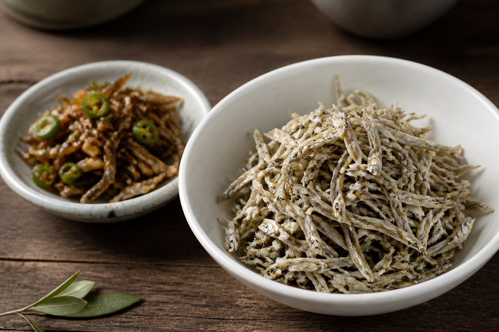

*▲ 마른멸치 100g은 302kcal에 단백질 59.3g, 칼슘 2,088mg, 나트륨 2,180mg입니다. 실제 한 끼 분량(볶음 15g)으로 환산하면 45kcal·단백질 8.9g·칼슘 313mg·나트륨 327mg입니다.*

한 줄 결론 <strong>마른멸치 100g은 302kcal에 단백질 59.3g, 칼슘 2,088mg, 인 1,726mg, 나트륨 2,180mg입니다.</strong> 국내 식품 중 칼슘 밀도가 매우 높은 편이지만, 칼슘은 통째로 씹어 먹어야 들어오고 육수에는 거의 우러나지 않습니다. 하루 10~15g은 칼슘과 단백질을 보충하면서 나트륨을 감당할 수 있는 현실적인 범위이며, 통풍이 있다면 진한 멸치육수와 통째 섭취는 줄이는 편이 좋습니다.

11월은 마른멸치가 가장 맛있는 시기 중 하나입니다(제철 9~11월). 멸치는 국물의 기본이면서 **"칼슘 하면 멸치"** 라는 공식이 있을 만큼 뼈 건강 식품으로 알려져 있습니다. 실제로 마른멸치 100g의 칼슘은 2,000mg을 넘어 우유(100g당 113mg)의 약 18배입니다.

가장 많이 검색되는 질문은 **"멸치 칼슘이 정말 2,000mg이 넘나?"**, **"멸치육수만 내도 칼슘을 먹는 건가?"**, **"멸치를 매일 먹어도 되나?"** 세 가지입니다. 결론부터 말하면 **칼슘 수치는 사실이고, 다만 그 칼슘은 멸치를 씹어 먹을 때만 들어오며, 나트륨과 퓨린이 실질적인 제한 요인**입니다.

아래에서는 농촌진흥청 국가표준식품성분 DB(멸치, 삶아서 말린 것)와 USDA·ODS-NIH 퓨린 데이터베이스를 기준으로 마른멸치 100g의 영양 성분, 칼슘이 우러나는 범위, 조리법별 차이, 통풍·고혈압 주의점을 정리했습니다.

---

## 1. 멸치 칼로리와 영양성분은? (100g 302kcal)

아래 수치는 **마른멸치(대멸치, 삶아서 말린 것, 가식부) 100g** 기준입니다. 같은 멸치라도 크기에 따라 성분이 크게 달라 표 아래에 비교했습니다.

| 영양 성분 (Nutrient) | 함량 (100g당) | 1일 권장 섭취량 비율 (한국인 성인 기준) |
| :--- | :--- | :--- |
| **열량 (Energy)** | 302 kcal | 15.1% |
| **수분 (Water)** | 19.2 g | 별도 표기¹ |
| **탄수화물 (Carbohydrates)** | 0.0 g | 0.0% |
| - 총 당류 (Total Sugars) | 0.0 g | 0.0% |
| - 식이섬유 (Dietary Fiber) | 0.0 g | 0.0% |
| **단백질 (Protein)** | 59.3 g | 107.8% |
| **지방 (Total Fat)** | 5.5 g | 11.0% |
| - 포화지방 (Saturated Fat) | 1.6 g | 10.7% |
| - 콜레스테롤 (Cholesterol) | 160 mg | 53.3% |
| **칼슘 (Calcium)** | 2,088 mg | 298.3% |
| **인 (Phosphorus)** | 1,726 mg | 246.6% |
| **철분 (Iron)** | 12.3 mg | 122.6% |
| **칼륨 (Potassium)** | 1,045 mg | 29.9% |
| **마그네슘 (Magnesium)** | 226 mg | 73.4% |
| **나트륨 (Sodium)** | 2,180 mg | 109.0% |
| **비타민D (Vitamin D)** | 1.28 µg | 12.8% |
| **엽산 (Folate)** | 98 µg DFE | 24.5% |
| **퓨린 (Purines)** | 약 1,109 mg | 기준치 없음 |

**표 읽는 법:** 열량·탄수화물·단백질·지방·콜레스테롤·나트륨의 %는 식품 표시용 1일 영양성분 기준치(2,000kcal) 대비이고, 칼슘·인·철분·칼륨·마그네슘·엽산·비타민D의 %는 한국인 영양소 섭취기준 성인 권장량(칼슘 700mg, 인 700mg, 철분 10mg, 칼륨 3,500mg, 마그네슘 308mg, 엽산 400µg DFE, 비타민D 10µg) 대비입니다. ¹수분과 퓨린은 1일 기준치가 설정되지 않은 성분으로 절대량만 표기했습니다. 퓨린은 USDA·ODS-NIH 데이터베이스의 건조 멸치 측정값(1,109mg/100g)이며, 생멸치는 304~411mg/100g으로 훨씬 낮습니다.

<strong>출처:</strong> 농촌진흥청 국가표준식품성분 DB 10.4(멸치, 대멸치·중멸치·잔멸치, 삶아서 말린 것) · 국립수산과학원 표준수산물성분표 · <a href="https://fdc.nal.usda.gov/" rel="nofollow noopener" target="_blank">USDA FoodData Central</a> (Fish, anchovy, european) · USDA·ODS-NIH Database for the Purine Content of Foods (2025)

### 크기별 비교: 대멸치·중멸치·잔멸치는 얼마나 다른가?

| 구분 | 열량 | 단백질 | 칼슘 | 나트륨 | 비타민D |
| :--- | :--- | :--- | :--- | :--- | :--- |
| **대멸치** | 302 kcal | 59.3 g | 2,088 mg | 2,180 mg | 1.28 µg |
| **중멸치** | 245 kcal | 49.7 g | **2,486 mg** | 2,377 mg | 4.13 µg |
| **잔멸치** | 226 kcal | 42.9 g | 620 mg | 2,646 mg | 17.22 µg |
| **생멸치(참조)** | 131 kcal | 20.4 g | 147 mg | 104 mg | 0 µg |

같은 멸치인데 **잔멸치의 칼슘은 대멸치의 3분의 1 수준(620mg)** 입니다. 잔멸치는 삶는 과정에서 뼈가 얇고 일부 부서지며, 국물용으로 오래 삶아 건조해 무기질이 빠져나가기 때문입니다. 반대로 비타민D는 잔멸치가 17.22µg으로 가장 높습니다. "잔멸치가 칼슘에 좋다"는 말은 **볶음용 중·대멸치**에 더 잘 맞는 이야기입니다.

### 실생활 환산: 한 줌, 한 접시는 몇 kcal인가?

| 섭취 기준 | 중량 | 열량과 핵심 수치 |
| :--- | :--- | :--- |
| 국물용 멸치 5마리 | 약 5 g | 15 kcal · 칼슘 104 mg · 나트륨 109 mg · 퓨린 약 55 mg |
| 멸치볶음 1회분 | 15 g | **45 kcal** · 단백질 8.9 g · 칼슘 313 mg · 나트륨 327 mg |
| 멸치볶음 한 접시 | 30 g | 91 kcal · 단백질 17.8 g · 칼슘 626 mg · 나트륨 654 mg |
| 멸치가루 1큰술 | 약 6 g | 18 kcal · 칼슘 125 mg · 나트륨 131 mg |

멸치볶음 15g은 **단백질 8.9g**으로 계란 1.5개분이고, **칼슘 313mg**은 성인 하루 권장량(700mg)의 45%입니다. 열량은 45kcal에 불과합니다. 반면 나트륨은 327mg으로 하루 기준치의 16%가 함께 들어옵니다. 멸치가 "고단백·고칼슘·고나트륨" 세 가지를 동시에 가진 식품인 이유입니다.

---

## 2. 과학적으로 입증된 4대 건강 효능

### 멸치 칼슘 2,000mg은 실제로 흡수되나?

일부만 흡수됩니다. 칼슘 흡수율은 보통 20~30%이고, 멸치 뼈의 칼슘은 유제품보다 흡수가 어렵습니다. 다만 멸치에 함께 든 단백질·비타민D·마그네슘이 흡수를 돕는 조합을 이룹니다.

칼슘은 일반적으로 섭취량의 일부만 흡수되는 미네랄입니다(흡수율은 나이·비타민D·식사 구성에 따라 크게 달라짐). 멸치 뼈의 칼슘은 결정 구조가 치밀해 우유의 칼슘보다 용출이 느리지만, **멸치를 잘게 씹거나 가루로 만들어 먹으면 표면적이 늘어 흡수에 유리합니다.** 실제로 멸치가루를 넣은 식사에서 칼슘 섭취량과 골밀도 지표가 개선됐다는 연구들이 보고됐습니다.

같이 든 영양소가 중요합니다. 멸치에는 **비타민D(1.28µg/100g)와 마그네슘(226mg)** 이 함께 있어 칼슘 대사에 필요한 보조 인자를 공급합니다. 다만 100g당 수치이고, 한 끼 15g에서는 비타민D가 0.2µg 수준으로 미미합니다. 결국 햇빛·유제품·다른 단백질 식품과 함께 채워야 하는 영양소입니다.

### 멸치육수만 내도 칼슘을 먹는 건가?

아닙니다. 칼슘은 물에 거의 녹지 않아 국물로 이행되는 양이 전체의 몇 % 수준입니다. 육수는 타우린·아미노산·이노신산으로 감칠맛을 내고, 칼슘은 멸치를 건져 먹어야 들어옵니다.

가장 흔한 오해입니다. 칼슘은 물에 대한 용해도가 낮은 미네랄이라, 멸치를 10~20분 끓여도 국물로 넘어가는 칼슘은 극히 일부입니다. 국물의 실제 효용은 **감칠맛 성분(이노신산·글루탐산)과 타우린, 유리 아미노산**입니다. 이 성분들은 나트륨과 함께 빠르게 우러납니다.

그래서 실용적인 결론은 이렇습니다. 국물용 멸치는 **한 번 우리고 건져서 다지거나 볶아 함께 먹는 것**이 칼슘 면에서 훨씬 유리합니다. 국물만 내고 멸치를 버리는 습관은 단백질·칼슘의 절반 이상을 버리는 셈입니다. 멸치가루를 국이나 무침에 1큰술 더하는 방법도 같은 이유에서 효과적입니다.

### 멸치 단백질 59g은 어떤 단백질인가?

필수아미노산이 고른 완전단백질에 가깝고, 특히 라이신이 많아 쌀·보리 중심 식사에서 부족해지기 쉬운 아미노산을 채웁니다. 15g이면 단백질 8.9g으로 계란 1.5개분입니다.

마른멸치의 단백질은 59.3g/100g으로, 건조로 수분이 빠지며 농축된 값입니다. 생멸치로는 20.4g/100g 수준입니다. 아미노산 조성은 필수아미노산이 고르게 들어 있는 편이며, 특히 **라이신**이 풍부합니다. 라이신은 쌀·밀가루 단백질의 제한 아미노산이라, 밥과 멸치를 함께 먹으면 단백질 이용 효율이 올라갑니다.

지방은 5.5g/100g으로 낮고, 그 안에 **EPA·DHA가 포함**됩니다. 생멸치 100g의 EPA+DHA는 약 1.45g으로 등푸른생선 중에서도 높은 편입니다. 다만 마른멸치는 건조·볶음 과정에서 지방 산화가 진행되므로, **기름에 오래 볶거나 상온에 오래 두면 풍미가 떨어지고 산패**합니다.

### 멸치를 매일 먹으면 나트륨·퓨린은 괜찮나?

양에 따라 다릅니다. 15g이면 나트륨 327mg으로 하루 기준의 16%이며 큰 문제가 아니지만, 100g을 통째로 먹는 식사는 나트륨 2,180mg(기준치 초과)에 퓨린 1,109mg까지 들어와 통풍 위험이 커집니다.

멸치의 실질적인 제한 요인은 칼로리도 지방도 아닌 **나트륨과 퓨린**입니다. 마른멸치 100g의 나트륨은 2,180mg으로, 세계보건기구 권고(하루 2,000mg)를 넘습니다. 국물용으로 5~10g 쓰는 양에서는 110~220mg 수준이라 문제가 되지 않지만, **멸치볶음을 반찬으로 크게 먹거나 멸치스낵을 한 봉지 비우는 방식**은 나트륨 과다로 이어집니다.

퓨린은 더 극명합니다. 건조 멸치는 100g당 1,109mg으로, USDA·ODS-NIH 데이터베이스에서 손꼽히게 높은 식품입니다. 다만 **건조로 농축된 값**이라는 점이 핵심입니다. 국물용 멸치 5g은 약 55mg으로, 빵 한 조각 수준에 불과합니다. 통풍 환자에게 문제가 되는 것은 멸치를 국물로 조금 쓰는 정도가 아니라, **멸치를 통째로 다량 먹는 습관**입니다.

---

## 3. 영양 손실을 줄이는 조리·섭취 가이드

- **육수는 10~15분, 건져서 함께 드세요.** 오래 끓이면 감칠맛 성분이 늘지만 칼슘·단백질은 국물로 가지 않습니다. 우리고 난 멸치는 다져서 국에 넣거나 볶아 드세요.
- **볶음은 약불에서 3~4분.** 센 불에 오래 볶으면 지방이 산화해 비린 맛이 생깁니다. 마늘·간장은 마지막에 넣어야 타지 않습니다.
- **멸치가루를 활용하세요.** 말린 멸치를 마른 팬에 1분 볶아 갈면 칼슘 흡수에 유리한 형태가 되고, 나물·국·김밥 속재료에 1큰술씩 넣기 좋습니다.
- **내장은 손질 여부를 제품에 맞춰 결정하세요.** 멸치 내장에는 쓴맛 성분과 함께 퓨린이 농축되어 있습니다. 국물용은 내장을 제거한 제품이 깔끔하고, 통째 볶음용은 그대로 쓰는 경우가 많습니다.
- **보관은 냉동이 기본.** 마른멸치는 지방 산화와 습기로 쉽게 상합니다. 밀봉해 냉동 보관하면 3~6개월 유지되며, 상온 보관은 2~4주가 한계입니다.
- **간을 줄이는 방향으로 조합하세요.** 멸치 자체에 나트륨이 있으므로 멸치볶음에 간장을 더하면 한 접시 나트륨이 700mg을 넘기 쉽습니다. 견과류·마늘·고추를 늘리고 간장·물엿은 줄이세요.

---

## 4. 섭취 시 주의사항 및 부작용

- **통풍·고요산혈증이 있으면 통째 섭취를 제한하세요.** 건조 멸치는 퓨린 1,109mg/100g으로 매우 높은 편입니다. 국물용 5g(약 55mg)은 무난하지만, 멸치볶음 30g은 약 333mg으로 하루 관리 목표의 상당 부분을 차지합니다.
- **고혈압·신장질환자는 나트륨과 인을 함께 보세요.** 마른멸치 100g의 나트륨은 2,180mg, 인은 1,726mg입니다. 만성신장질환자에서 인 과다와 나트륨 부하는 혈압·부종 관리에 불리합니다.
- **멸치 알레르기·히스타민 반응.** 생선 알레르기가 있거나, 상온에 오래 노출된 멸치·액젓에서 두드러기·두통이 나타날 수 있습니다. 멸치 액젓은 히스타민이 높아질 수 있어 신선도가 중요합니다.
- **어린이에게는 잘게 다져 주세요.** 마른멸치는 단단하고 뾰족해 질식 위험이 있습니다. 만 3세 이하에는 가루·잘게 다진 형태로 제공하세요.
- **나트륨이 많은 제품은 씻어 쓰세요.** 염장 강도가 높은 제품은 체에 밭쳐 흐르는 물에 한 번 헹구면 표면 염분이 일부 줄어듭니다(감소량은 제품·헹굼 시간에 따라 다름). 대신 감칠맛도 일부 빠집니다.
- **간질환·갑상선 약 복용자는 양을 조절하세요.** 멸치 자체의 요오드는 다시마·미역보다 훨씬 낮지만, 해조류 국물과 함께 매일 대량 섭취하는 경우는 전문가 상담이 필요합니다.

---

## 5. 자주 묻는 질문 (FAQ)

**Q1. 마른멸치는 하루에 얼마나 먹으면 좋나요?**  
건강한 성인은 **하루 10~15g(멸치볶음 한 접시)** 이 적당합니다. 열량 30~45kcal, 단백질 6~9g, 칼슘 210~313mg, 나트륨 220~327mg이 들어옵니다. 국물용은 5~10g이면 충분하고, 고혈압·신장질환·통풍이 있다면 양을 더 줄여야 합니다.

**Q2. 멸치육수만 내도 칼슘을 섭취할 수 있나요?**  
**거의 어렵습니다.** 칼슘은 물에 잘 녹지 않아 국물로 넘어가는 양이 극히 적습니다. 육수는 감칠맛과 타우린을 위한 것이고, 칼슘은 멸치를 건져 먹거나 가루로 먹어야 들어옵니다.

**Q3. 통풍이 있으면 멸치는 무조건 피해야 하나요?**  
**통째로 많이 먹는 것만 피하면 됩니다.** 건조 멸치의 퓨린은 100g당 1,109mg으로 매우 높지만, 국물용 5g은 약 55mg입니다. 멸치볶음을 한 접시(30g) 이상 먹거나 멸치스낵을 상습적으로 먹는 습관은 피하고, 요산 수치를 정기적으로 확인하세요.

---

## 6. 멸치와 함께 먹으면 좋은 음식

- **[무 (Radish)](/posts/radish-nutrition-benefits/):** 무멸치국은 칼슘과 비타민C를 동시에 채우는 조합입니다. 무의 유기산과 소화 효소가 멸치 비린내를 줄이고, 무에 거의 없는 칼슘을 멸치가 공급합니다. 멸치는 건져서 함께 드세요.
- **[김 (Laver)](/posts/laver-nutrition-benefits/):** 김은 100g당 단백질 30g 안팎에 요오드·철분이 풍부한 해조류입니다. 멸치와 함께 국·무침에 쓰면 나트륨은 늘지만 미네랄 조합은 좋아집니다.
- **[두부 (Tofu)](/posts/tofu-nutrition-benefits/):** 두부는 100g당 단백질 9g·칼슘 130mg 안팎의 식물성 칼슘 공급원입니다. 멸치육수에 두부를 넣으면 동물성·식물성 칼슘을 함께 섭취할 수 있습니다.
- **[고등어 (Mackerel)](/posts/mackerel-nutrition-benefits/):** 고등어는 100g당 EPA·DHA가 1g 이상인 등푸른생선입니다. 멸치는 건조로 지방이 줄어 오메가3 양이 적으므로, 지방산 섭취는 고등어·연어 쪽이 유리합니다.

  
📌 관련 순위 가이드

  <ul>
    <li><a href="/posts/high-protein-foods-ranking/">고단백 음식 순위 TOP 10</a></li>
    <li><a href="/posts/heart-blood-pressure-cholesterol-foods/">혈압·콜레스테롤 관리 식품 가이드</a></li>
  </ul>

---

## 7. 멸치 어떻게 먹을까? 핵심 요약

- 마른멸치 100g은 **302kcal·단백질 59.3g·칼슘 2,088mg·나트륨 2,180mg**의 고단백 고칼슘 식품입니다.
- 한 끼 기준 **15g이면 45kcal·단백질 8.9g·칼슘 313mg**으로, 열량 대비 영양 밀도가 매우 높습니다.
- 칼슘은 **물에 녹지 않아 육수로는 거의 나오지 않습니다.** 멸치를 건져 먹거나 가루로 먹어야 실제 섭취가 됩니다.
- 크기에 따라 차이가 큽니다. **칼슘은 중멸치(2,486mg), 비타민D는 잔멸치(17.22µg)** 가 우세합니다.
- 제한 요인은 **나트륨과 퓨린**입니다. 통풍이 있다면 통째 섭취를 줄이고 국물용 소량은 유지하세요.
- 하루 적정량은 **10~15g**, 보관은 밀봉 냉동으로 3~6개월입니다.

