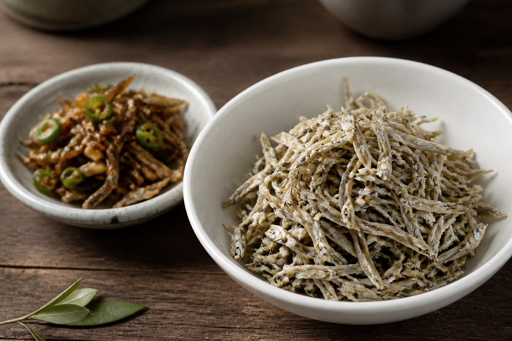

*▲ Raw European anchovy carries 131 calories, 20.4 g protein and about 1.45 g of EPA plus DHA per 100 g. Dried anchovies concentrate the same nutrients roughly fivefold — and the sodium and purines with them.*

Quick answer <strong>Raw anchovy provides 131 calories, 20.4 g protein, 1.45 g combined EPA and DHA, and 147 mg calcium per 100 g.</strong> It is one of the most nutrient-dense fish per calorie, and one of the highest-purine foods measured. The form on your plate changes everything: dried anchovies concentrate protein to about 60 g and calcium past 2,000 mg per 100 g, while canned anchovies bring 3,668 mg of sodium with them.

Anchovies occupy two different places in the world's kitchens. In Mediterranean cooking they are a seasoning — a few fillets in a puttanesca, a tin mashed into a dressing, a pizza topping. In Korean and Japanese cooking they are a foundation — dried and simmered into the stock that underlies soups, stews and noodle broths.

That split matters nutritionally, because the dried form is roughly five times as concentrated as the fresh fish. The same food, in different states, changes from "moderate portion of small oily fish" to "calcium and sodium bomb in a 15-gram spoonful."

The questions readers ask most: **how much protein and omega-3 does an anchovy actually deliver**, **does anchovy stock carry the calcium**, and **should people with gout avoid anchovies entirely**. The short answers: plenty per calorie, almost none of the calcium, and only the large whole-fish portions.

---

## 1. How Many Calories Are in an Anchovy? (131 kcal per 100 g)

The values below describe **raw European anchovy, edible portion**, from USDA FoodData Central.

| Nutrient | Per 100 g | U.S. %DV |
| :--- | :--- | :--- |
| **Energy** | 131 kcal | 6.6% |
| **Water** | 73.37 g | No DV |
| **Protein** | 20.35 g | 40.7% |
| **Total Fat** | 4.84 g | 6.2% |
| - Saturated Fat | 1.28 g | 6.4% |
| - Cholesterol | 60 mg | 20.0% |
| **Carbohydrates** | 0.00 g | 0.0% |
| - Dietary Fiber | 0.00 g | 0.0% |
| **Omega-3 (EPA + DHA)** | 1.449 g (EPA 0.538 / DHA 0.911) | No DV |
| **Calcium** | 147 mg | 11.3% |
| **Phosphorus** | 174 mg | 13.9% |
| **Potassium** | 383 mg | 8.1% |
| **Magnesium** | 41 mg | 9.8% |
| **Iron** | 3.25 mg | 18.1% |
| **Zinc** | 1.72 mg | 15.6% |
| **Selenium** | 36.5 µg | 66.4% |
| **Vitamin B12** | 0.62 µg | 25.8% |
| **Niacin (B3)** | 14.0 mg NE | 87.5% |
| **Sodium** | 104 mg | 4.5% |
| **Purines** | 304–411 mg | No DV |

**How to read the table:** percentages use the U.S. Daily Values printed on food labels, based on a 2,000-calorie reference diet. ¹Omega-3 fatty acids and purines have no established Daily Value, so absolute amounts are listed. Purine figures for raw anchovy range from 304 mg (fresh, Japanese analysis) to 411 mg (raw, U.S. testing) per 100 g in the USDA and ODS-NIH purine database.

*※ Source: [USDA FoodData Central FDC 174182](https://fdc.nal.usda.gov/food-details/174182/nutrients) — Fish, anchovy, european, raw (SR Legacy). The 131 kcal and 20.35 g protein per 100 g in the table above are this entry’s values; a different cooking state changes them.*

<strong>Sources:</strong> <a href="https://fdc.nal.usda.gov/" rel="nofollow noopener" target="_blank">USDA FoodData Central</a> (Fish, anchovy, european, raw; canned in oil, drained) · USDA and ODS-NIH Database for the Purine Content of Foods (2025) · Korea Rural Development Administration, National Food Composition DB 10.4 (dried anchovy) · National Institute of Fisheries Science, Standard Seafood Composition Table

### Fresh, canned and dried: the same fish, five times apart

| Form | Energy | Protein | Calcium | Sodium | Purines |
| :--- | :--- | :--- | :--- | :--- | :--- |
| **Raw, fresh** | 131 kcal | 20.4 g | 147 mg | 104 mg | 304–411 mg |
| **Canned in oil, drained** | 210 kcal | 28.9 g | 232 mg | 3,668 mg | 321 mg |
| **Dried (Korean large anchovy)** | 302 kcal | 59.3 g | 2,088 mg | 2,180 mg | 1,109 mg |

Drying removes water, so 100 g of dried anchovy began as roughly 400–500 g of fresh fish. That single fact explains the whole table: protein, calcium, sodium and purines all roughly quadruple. Reading a dried-anchovy purine figure and applying it to the two fillets on your pizza overstates the load by about three and a half times.

### Real-world portions: what you actually eat

| Portion | Weight | Calories and key nutrients |
| :--- | :--- | :--- |
| 2 canned fillets (pizza, pasta) | about 8 g | 17 kcal · 2.3 g protein · 26 mg purines · 293 mg sodium |
| 1 tablespoon dried, for stock | about 5 g | 15 kcal · 3.0 g protein · 104 mg calcium · 55 mg purines |
| A side of braised dried anchovies | 15 g | **45 kcal** · 8.9 g protein · 313 mg calcium · 166 mg purines |
| Grilled fresh anchovies | 100 g | 131 kcal · 20.4 g protein · 1.45 g omega-3s · 147 mg calcium |

The 15-gram side dish is the interesting one: 45 calories, 8.9 g of protein — about one and a half eggs — and 313 mg of calcium, nearly a quarter of the daily value. It is also 327 mg of sodium, which is where the enthusiasm should pause.

---

## 2. Four Evidence-Based Benefits

### Is anchovy calcium actually absorbed?

Partially. Calcium absorption generally runs 20–30%, and the calcium locked in small fish bones dissolves slowly — but grinding or chewing the bones thoroughly raises the fraction you absorb.

Anchovies are eaten whole, bones included, which is why the calcium figure is high at all: 147 mg per 100 g raw, 232 mg canned, and beyond 2,000 mg dried. The bones are also the reason the calcium is not fully available. Fish bone calcium is bound in a dense hydroxyapatite matrix that releases slowly during digestion.

What helps is particle size. Finely chewing, mincing, or using anchovy powder increases surface area and the proportion absorbed; studies of fish-bone calcium in diets consistently find modest but real contributions to calcium intake and bone density markers when the bones are thoroughly comminuted. What also helps is company: anchovies supply vitamin D, magnesium and high-quality protein, all of which support calcium handling.

The realistic target is not the headline number. **Fifteen grams of dried anchovy delivers about 313 mg of calcium**, which is a meaningful 24% of the daily value — and a far better representation of what a portion contributes than the per-100-gram figure.

### Does anchovy stock contain the calcium?

Almost none. Calcium barely dissolves in water, so simmering anchovies transfers flavor compounds and some taurine, not their calcium. To get the mineral, you have to eat the fish.

This is the most persistent myth about anchovy stock, and it is worth stating plainly: **calcium is poorly water-soluble**. Simmering dried anchovies for ten to twenty minutes extracts inosinate, glutamate, free amino acids and some taurine into the broth — the umami that makes the stock useful — while leaving the calcium in the bones you strain out.

So the practical guidance is simple. Simmer the anchovies, then **lift them out, chop them, and put them back** into the soup, or braise them alongside. Discarding the strained anchovies throws away most of the protein and essentially all of the calcium. A tablespoon of anchovy powder stirred into a stew accomplishes the same thing with less work.

### How good is anchovy protein and omega-3?

Very good. Anchovy is a complete protein with a strong essential amino acid profile, and its fat is roughly 30% EPA plus DHA — 1.45 g per 100 g raw, comparable to salmon per gram of fish.

Anchovy protein contains all nine essential amino acids, with notable lysine — the limiting amino acid in rice and wheat — which is why rice paired with anchovy side dishes is a better protein combination than rice alone. At 20.4 g per 100 g raw and nearly 60 g per 100 g dried, anchovy is one of the cheapest dense protein sources available.

The fat profile is the more impressive part. Anchovies are small, short-lived, low-trophic fish, so they accumulate less mercury than large predators while still carrying substantial long-chain omega-3s. At about 1.45 g of EPA plus DHA per 100 g raw, a 100 g serving covers well over the 250 mg daily EPA+DHA that most guidelines recommend for cardiovascular health.

The caveat is oxidation. Dried anchovies have far less fat than fresh — about 5.5 g per 100 g versus 4.84 g plus retained water — and that fat is exposed to air during drying and stir-frying. Rancid dried anchovy smells sharp and fishy in an unpleasant way; keep it frozen and use it within a few months.

### Are anchovies safe for gout?

Small portions are usually fine, large whole-fish portions are not. Dried anchovy measures 1,109 mg of purines per 100 g, but 5 g of stock anchovies contributes only about 55 mg — less than a slice of bread.

Anchovies sit at the top of every purine chart, and the number is real: the USDA and ODS-NIH database measures dried anchovy at 1,109 mg per 100 g, among the highest of 830 foods tested. Raw and canned forms measure 304–411 mg and 321 mg.

But purine charts invite a mistake: they describe 100 g of food, not a portion. A tablespoon of dried anchovies in a stock pot is 5 g, contributing roughly 55 mg of purines. Two canned fillets on a pizza are 8 g, about 26 mg. The danger case is the one where dried anchovy stops being a seasoning — a braised side dish eaten by the handful, or dried-fish snacks, where 30 g brings about 330 mg at once.

If you have gout or elevated uric acid, the sensible rules are: keep anchovy as a flavoring, avoid eating dried anchovies in bulk, and be aware that boiling moves purines into the cooking water — so a long-simmered stock you discard is lower in purines than the fish itself, while a stock you reduce and drink is not.

---

## 3. How to Buy, Prepare and Store Anchovies

- **For stock, choose the right size.** Large dried anchovies give a cleaner, deeper broth; small ones release more bitterness and soften faster. Remove heads and guts for a sweeter stock.
- **Simmer 10–15 minutes, then keep the fish.** Longer boiling extracts more umami but no more calcium. Chop the strained anchovies back into the dish or reserve them for a braise.
- **Rinse salted and canned anchovies.** A quick rinse under running water removes surface salt — roughly 10–20% of the sodium — without stripping all the flavor. Pat dry before frying.
- **Buy canned anchovies packed in olive oil and keep them cold after opening.** Transfer leftovers to a sealed container, cover with oil, and refrigerate for up to a week.
- **Freeze dried anchovies.** Their fat oxidizes at room temperature within weeks. Sealed and frozen, they hold three to six months with far better flavor.
- **Cook fresh anchovies hot and fast.** They are delicate and spoil quickly. Grill, pan-fry or marinate in acid within a day of purchase.

---

## 4. Cautions and Side Effects

- **Gout and hyperuricemia.** Dried anchovies are among the highest-purine foods measured at 1,109 mg per 100 g. Avoid eating them by the handful; a small amount of stock is a different matter.
- **Sodium.** Canned anchovies carry 3,668 mg per 100 g and dried anchovies 2,180 mg — over the entire daily recommended limit in 100 g. Rinse, drain, and use them as seasoning rather than protein.
- **Histamine intolerance.** Poorly stored fish, and fish sauces made from it, can accumulate histamine and trigger flushing, headache and hives. Freshness and cold chain matter more than brand.
- **Fish allergy.** Anchovy is a bony fish; people with fish allergy should avoid it and check Caesar dressing and Worcestershire sauce, both of which commonly contain it.
- **Kidney disease.** The combination of high phosphorus (174 mg raw, 1,726 mg dried per 100 g), potassium and sodium is a concern on a renal diet. Confirm portions with your clinician.
- **Choking risk for young children.** Whole dried anchovies are firm and pointed. Mince or powder them for children under three.
- **Texture of the bones.** Small bones are edible and are the point, but they can be sharp; if you wear dentures or have difficulty chewing, use anchovy powder instead.

---

## 5. Frequently Asked Questions

**Q1. How much anchovy should I eat per day?**  
As a **seasoning or side dish, 10–15 g of dried anchovy** is a reasonable daily amount, giving 30–45 calories, 6–9 g protein, 210–313 mg calcium and 220–327 mg sodium. For fresh fish, a 100 g serving is a standard portion with 131 calories and 1.45 g of omega-3s.

**Q2. Does anchovy stock provide calcium?**  
**Almost none.** Calcium is poorly soluble in water, so simmering anchovies transfers umami compounds and some taurine, not the mineral. Eat the strained anchovies, or use anchovy powder, if calcium is the goal.

**Q3. Should people with gout avoid anchovies completely?**  
**No, but portions matter.** Dried anchovies measure 1,109 mg of purines per 100 g, while 5 g used for stock is about 55 mg. Avoid eating dried anchovies in bulk and use them as a flavoring; discuss regular fish intake with your doctor if uric acid is elevated.

---

## 6. Synergistic Food Pairings

- **[Radish](/en/posts/radish-nutrition-benefits/):** Radish and anchovy form the base of Korean soup stock. The radish's acids and enzymes temper the fishy note, and the anchovy supplies the calcium (2,088 mg per 100 g dried) that radish lacks entirely.
- **[Mackerel](/en/posts/mackerel-nutrition-benefits/):** Both are small, oily, low-mercury fish. Mackerel offers a larger serving of omega-3s per portion; anchovy offers more calcium because it is eaten whole.
- **[Salmon](/en/posts/salmon-nutrition-benefits/):** Where anchovy is a seasoning, salmon is a centerpiece. Pairing them across the week covers vitamin D, selenium and long-chain omega-3s without repeating the same fish.
- **[Oyster](/en/posts/oyster-nutrition-benefits/):** Oysters bring zinc at levels anchovy cannot match, while anchovy brings selenium and protein density. Together they cover the trace minerals most diets miss.

  
📌 Related rankings

  <ul>
    <li><a href="/en/posts/high-protein-foods-ranking/">Top 10 High-Protein Foods</a></li>
    <li><a href="/en/posts/heart-blood-pressure-cholesterol-foods/">Foods for Blood Pressure and Cholesterol</a></li>
  </ul>

---

## 7. Bottom Line

- Raw anchovy is **131 calories, 20.4 g protein, 1.45 g EPA+DHA and 147 mg calcium per 100 g** — exceptional nutrient density per calorie.
- The form decides the numbers: **dried anchovy reaches 59 g protein and 2,088 mg calcium per 100 g**, canned brings 3,668 mg sodium, and fresh sits in between.
- Anchovy stock carries **flavor, not calcium**. Keep the strained fish and eat it.
- Dried anchovy is one of the highest measured purine foods at **1,109 mg per 100 g**, but 5 g of stock is only about 55 mg. Gout risk comes from bulk portions, not seasoning.
- A practical daily portion is **10–15 g dried or 100 g fresh**; rinse canned anchovies and freeze dried ones to control sodium and rancidity.

