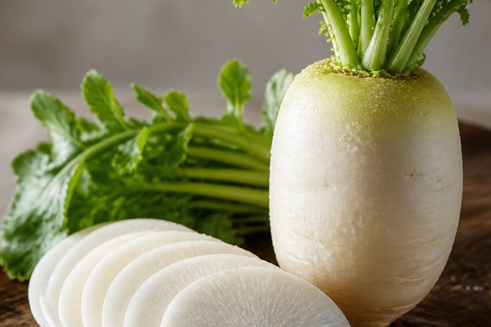

*▲ Daikon radish carries 18 calories, 22 mg of vitamin C and 227 mg of potassium per 100 g. A typical root weighs 500–1,000 g, so one radish supplies 90–180 calories and 100–220 mg of vitamin C.*

Quick answer <strong>Raw daikon radish provides 18 calories, 4.1 g carbohydrate, 1.6 g fiber and 22 mg vitamin C per 100 g, with 227 mg potassium.</strong> It is one of the lowest-energy vegetables in the produce aisle, and most of its vitamin C sits in the skin and leaves. Its digestive enzymes are real but mostly destroyed by stomach acid, and its pungent isothiocyanates are supported by laboratory rather than human evidence.

The radish — sold as daikon, white radish, or Asian radish — is the workhorse vegetable of Korean, Japanese and Chinese cooking. It is pickled, simmered in stocks, grated into sauces and pressed into kimchi. Nutritionally it earns its place on volume rather than power: very few calories, useful vitamin C, and a lot of water and fiber for the energy it costs.

Readers arrive with three questions. **Is the radish really only 18 calories?** Yes, per 100 g. **Do radish enzymes actually help digestion?** Partly, and the effect is smaller than the folk reputation suggests. **Is grated radish safe every day?** For most people yes, but potassium load and thyroid considerations set a practical ceiling.

Below are the USDA figures for raw daikon, the Korean composition table for the denser Korean radish, what the enzyme and isothiocyanate research actually shows, and the cautions worth knowing before you make radish juice a habit.

---

## 1. How Many Calories Are in a Radish? (18 kcal per 100 g)

The values below describe **raw oriental radish (daikon), edible portion**, from USDA FoodData Central.

| Nutrient | Per 100 g | U.S. %DV |
| :--- | :--- | :--- |
| **Energy** | 18 kcal | 0.9% |
| **Water** | 94.62 g | No DV |
| **Carbohydrates** | 4.10 g | 3.2% |
| - Total Sugars | 2.50 g | No DV |
| - Dietary Fiber | 1.60 g | 5.7% |
| **Protein** | 0.60 g | 1.2% |
| **Total Fat** | 0.10 g | 0.1% |
| - Saturated Fat | 0.03 g | 0.1% |
| - Cholesterol | 0 mg | 0.0% |
| **Vitamin C** | 22.0 mg | 24.4% |
| **Vitamin K** | 0.3 µg | 0.3% |
| **Folate** | 28 µg DFE | 7.0% |
| **Vitamin B6** | 0.046 mg | 2.7% |
| **Thiamin (B1)** | 0.02 mg | 1.7% |
| **Niacin (B3)** | 0.20 mg NE | 1.3% |
| **Calcium** | 27 mg | 2.1% |
| **Iron** | 0.40 mg | 2.2% |
| **Magnesium** | 16 mg | 3.8% |
| **Phosphorus** | 28 mg | 2.2% |
| **Potassium** | 227 mg | 4.8% |
| **Sodium** | 21 mg | 0.9% |
| **Zinc** | 0.15 mg | 1.4% |
| **Glucosinolates** | 20–60 mg | No DV |

**How to read the table:** percentages use the U.S. Daily Values printed on food labels, based on a 2,000-calorie reference diet. ¹Water, total sugars and glucosinolates carry no Daily Value, so absolute amounts are listed. Glucosinolate content varies widely with cultivar, growing conditions and how the root is cut; the range above reflects published analyses of daikon.

*※ Source: [USDA FoodData Central FDC 168451](https://fdc.nal.usda.gov/food-details/168451/nutrients) — Radishes, oriental, raw (SR Legacy). The 18 kcal and 0.6 g protein per 100 g in the table above are this entry’s values; a different cooking state changes them.*

<strong>Sources:</strong> <a href="https://fdc.nal.usda.gov/" rel="nofollow noopener" target="_blank">USDA FoodData Central</a> (Radishes, oriental, raw) · Korea Ministry of Food and Drug Safety, National Food Composition Table (무, 조선무, 생것) · <a href="https://pubmed.ncbi.nlm.nih.gov/" rel="nofollow noopener" target="_blank">PubMed</a> literature on radish isothiocyanates and myrosinase

### A note on Korean radish versus daikon

The Korean radish used for kimchi is denser than the daikon sold in Western supermarkets. Korea's national composition table lists it at **21 kcal, 83.7 g water, 1.0 g protein and 1.2 g fiber per 100 g**, with 15 mg vitamin C and 257 mg potassium. The lower water content means a Korean radish delivers more nutrients per gram but also more of its pungent compounds. Both are low-energy foods; the difference matters mainly if you are counting potassium.

### Real-world portions: what a serving actually delivers

| Portion | Weight | Calories and key nutrients |
| :--- | :--- | :--- |
| A few slices in a salad | 30 g | **5 kcal** · 6.6 mg vitamin C · 0.5 g fiber |
| Grated radish garnish | 50 g | 9 kcal · 11 mg vitamin C · 114 mg potassium |
| Half a cup, sliced | 75 g | 14 kcal · 16.5 mg vitamin C · 170 mg potassium |
| One cup, sliced | 150 g | **27 kcal** · 33 mg vitamin C · 341 mg potassium |
| One whole daikon | 500–1,000 g | 90–180 kcal · 110–220 mg vitamin C · 1.1–2.3 g potassium |

A whole radish is a lot of vegetable for very few calories, which is why it works as a volume food. The catch is potassium: one large root carries more than 2 g, over half the 4,700 mg daily value, which matters for anyone on a potassium-restricted diet.

---

## 2. Four Evidence-Based Benefits

### Is 22 mg of vitamin C per 100 g actually a lot?

Moderately. It is 24% of the daily value in 18 calories, among the best vitamin C densities of any vegetable — but an orange provides 53 mg and a red bell pepper 128 mg in a single serving.

Vitamin C density is where radish shines. At 22 mg per 100 g, you get roughly a quarter of the daily value for under 20 calories, so a cup of sliced radish (150 g) supplies a third of the day's vitamin C for 27 calories. Few vegetables beat that ratio.

Where the vitamin sits matters as much as how much there is. In radish, **ascorbic acid concentrates in the skin and the leaves**, and the leaves — usually discarded — carry several times the root's vitamin C along with calcium and iron. Peeling deeply or boiling the root for a long time removes a large share: cooking losses for radish vitamin C run from 30% to over 60% depending on the method. Eat it raw, or add it to soup late and eat the pieces rather than only drinking the broth.

### Do radish enzymes really help digestion?

A little. Radish contains amylase and other starch-splitting enzymes that survive chewing but are largely inactivated by stomach acid, so the practical benefit is modest — and comes mostly from eating raw radish with starch-heavy meals.

The folk claim that radish "cuts through" heavy food has a biochemical basis. Radish contains **diastase and amylase**, enzymes that break starch into smaller sugars, plus catalase and peroxidase. Grated raw radish served alongside grilled meat or noodles is a traditional pairing across Korea and Japan for exactly this reason.

The limitation is the stomach. Enzymes are proteins, and gastric acid at pH 1.5–3.5 denatures most of what arrives. Some activity survives in the stomach's buffered contents, particularly when radish is eaten with a large meal that raises gastric pH, but the effect is nowhere near what the folk reputation implies. The reliable digestive contribution is **fiber and water**: 1.6 g of fiber per 100 g adds bulk and pulls water into the stool.

For marinades, the enzyme story is more concrete. Grated radish or pear in a meat marinade measurably tenderizes muscle fibers within 30–60 minutes. Leave it longer than two hours and the texture turns mushy, because the same enzymes keep working.

### Are radish isothiocyanates anticancer?

Not established in humans. Cell and animal studies show antioxidant and anti-inflammatory activity from radish isothiocyanates, but no clinical trial demonstrates cancer prevention in people.

The peppery bite of raw radish comes from **glucosinolates**, which convert to isothiocyanates when the root is cut, grated or chewed. Daikon's dominant compound is 4-methylthio-3-butenyl isothiocyanate, the same chemical family that gives broccoli, cabbage and kale their research profile.

Laboratory work shows these compounds induce phase II detoxification enzymes and dampen inflammatory signaling. What is missing is human outcome data. The honest reading: eating radish is a good way to add a brassica to your diet, and the isothiocyanate content is a plausible bonus — not a reason to expect a therapeutic effect.

One practical detail follows from the chemistry. Because the enzyme myrosinase is released only when cells are damaged, **grated or sliced radish produces more pungency than a whole boiled root**. If the heat is too much, grate it, wait five to ten minutes for the reaction to peak, then rinse briefly in cold water to dial it back.

### Does radish juice or radish tea help a cough?

Only as comfort. No human trial shows radish stops a cough; warm radish drinks with honey help mainly by supplying warm fluid and coating an irritated throat.

Radish steeped in honey, and water from boiled radish, are common home remedies for cough and phlegm in East Asia. The plausible mechanism is unremarkable but real: warm liquids soothe the pharynx and loosen secretions, and honey has modest placebo-controlled support for nighttime cough in children over one year.

No controlled study supports a pharmacological effect of radish itself on cough or sputum. Two safety points matter more than the remedy: **never give honey to infants under 12 months** because of botulism risk, and a cough lasting more than two weeks, or one with fever, breathlessness or blood, needs a clinician rather than a kitchen remedy.

---

## 3. How to Prepare and Store Radish

- **Peel thin, or don't peel at all.** Most of the vitamin C and much of the fiber sit in and just under the skin. Scrub well, then shave off only the blemished surface.
- **Cut across the grain in even slices.** For salads and pickles, 3 mm slices across the fiber hold their crunch after dressing; thin shreds collapse and water out.
- **Grate just before serving.** Grating ruptures cells and releases both myrosinase and vitamin C oxidase, so pungency rises and vitamin C falls within minutes. A few drops of vinegar or lemon slows the loss.
- **Add to soup late and eat the pieces.** Simmering 10–15 minutes sweetens radish as starch converts to sugar; longer boiling drives water-soluble vitamins into the broth, so eat the radish, not just the liquid.
- **Use the leaves.** Radish greens carry more vitamin C, calcium and iron than the root. Blanch and dress them, or add to soup as you would spinach.
- **Store with the leaves removed.** Leaves pull moisture from the root. Wrap in paper towel and refrigerate at 32–40°F (0–5°C) for two to three weeks; a cut root keeps about a week.

---

## 4. Cautions and Side Effects

- **Thyroid disease.** Radish glucosinolates can compete with iodine uptake. Normal dietary amounts are not a concern, but habitually juicing large volumes of raw radish daily — a liter or more — is not advisable if you have hypothyroidism or take thyroid medication.
- **Potassium restriction.** One large daikon carries 1.1–2.3 g of potassium. People with chronic kidney disease or on dialysis should count radish and avoid radish juice, which concentrates the mineral.
- **Sensitive stomach.** Raw radish, especially on an empty stomach, can cause burning and cramping from isothiocyanates and organic acids. Cooked radish is gentler.
- **Irritable bowel syndrome.** Radish is low in FODMAPs but high in insoluble fiber and water; start with small portions if you bloat easily.
- **Diabetes and juice.** Radish itself has a low glycemic index, around 15, but radish juice sweetened with honey or sugar carries a real sugar load. Skip the sweetener and keep juice to half a cup.
- **Check commercial juices.** Bottled radish juice may contain preservatives, sweeteners and 10 g or more of sugar per 200 ml despite "100% radish" labeling.
- **Drug interactions are unlikely but not zero.** Large amounts of cruciferous vegetables can affect warfarin stability through vitamin K changes; keep intake consistent rather than fluctuating if you take it.

---

## 5. Frequently Asked Questions

**Q1. How much radish should I eat per day?**  
**150–200 g (about one cup sliced)** is a sensible daily amount, providing 27–36 calories and 33–44 mg of vitamin C. Radish juice should be capped at 100 ml a day, and anyone with kidney disease should avoid it in juice form because of the potassium concentration.

**Q2. Is radish juice safe every day?**  
In small amounts, yes — **up to 100 ml daily**. Juice concentrates potassium and pungent compounds while removing most of the fiber, so several glasses a day can irritate the stomach and push potassium intake high. Adding honey also adds sugar.

**Q3. Does eating radish really help digestion?**  
**Partly.** Radish amylase helps break down starch, and its fiber and water promote regular bowel movements. Because stomach acid inactivates much of the enzyme, the realistic approach is to eat raw radish with starchy meals rather than expecting it to resolve indigestion.

---

## 6. Synergistic Food Pairings

- **[Anchovy](/en/posts/anchovy-nutrition-benefits/):** Radish and dried anchovy are the base of Korean soup stock. Radish's organic acids and enzymes soften the fishy edge, while anchovy supplies the calcium (2,088 mg per 100 g dried) that radish almost entirely lacks. Lift the anchovies out and eat them rather than discarding them.
- **[Napa Cabbage](/en/posts/napa-cabbage-nutrition-benefits/):** The two kimchi staples. Napa cabbage brings 27 mg of vitamin C per 100 g and radish brings more potassium, so together they cover both.
- **[Beetroot](/en/posts/beetroot-nutrition-benefits/):** Both are root vegetables with high nitrate and fiber content. Roasting them together keeps well and covers a wider mineral profile.
- **[Low-Calorie High-Satiety Foods](/en/posts/low-calorie-high-satiety-foods/):** Where radish's 18 calories and 94% water fit in a volume-eating strategy for weight management.

  
📌 Related rankings

  <ul>
    <li><a href="/en/posts/low-calorie-high-satiety-foods/">Top 10 Low-Calorie, High-Satiety Foods</a></li>
    <li><a href="/en/posts/low-gi-foods-blood-sugar-guide/">Low-GI Foods: Keeping Blood Sugar Steady</a></li>
  </ul>

---

## 7. Bottom Line

- Raw daikon is **18 calories, 22 mg vitamin C, 1.6 g fiber and 227 mg potassium per 100 g**, at 94.6% water.
- Vitamin C density is excellent — **24% of the daily value for under 20 calories** — and most of it sits in the skin and leaves you may be discarding.
- Radish enzymes are real but **largely inactivated by stomach acid**; the dependable digestive benefit comes from fiber and water.
- Isothiocyanate benefits are **laboratory findings**, not established human outcomes.
- Practical limits: **150–200 g a day**, juice no more than 100 ml, and caution with thyroid medication or potassium restriction.
- Warm radish drinks are comfort, not treatment — persistent cough needs medical assessment.

