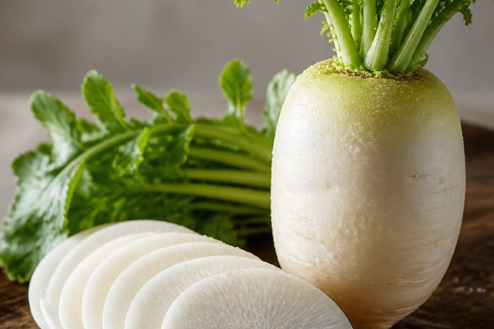

*▲ 무 100g은 21kcal, 비타민C 15mg, 칼륨 257mg입니다. 11월 김장철 무 한 개(1~1.5kg)는 210~315kcal이고, 무즙 한 컵(200ml)에는 무 1/3개분의 당과 칼륨이 들어갑니다.*

한 줄 결론 <strong>무 100g은 21kcal에 수분 83.7%, 비타민C 15mg, 칼륨 257mg, 식이섬유 1.2g입니다.</strong> 열량이 거의 없고 수분이 많아 부담 없는 채소이지만, 무즙을 습관처럼 마시면 칼륨과 매운맛 성분이 한꺼번에 들어옵니다. 무즙은 하루 반 컵(100ml) 이내, 생무는 하루 200g 안팎이 적당합니다.

11월 김장철이면 배추와 함께 가장 많이 사는 채소가 **무(Radish, 조선무)** 입니다. 예로부터 "무를 먹고 트림하면 속이 편하다"는 말이 있을 만큼 소화와 연관된 이미지가 강하고, 최근에는 **무즙·무 삶은 물이 기침과 가래에 좋다**는 이야기가 검색으로 꾸준히 올라옵니다.

가장 많이 검색되는 질문은 **"무 칼로리가 정말 21kcal인가?"**, **"무우 효능이 소화에 정말 도움이 되나?"**, **"무즙을 매일 마셔도 되나?"** 세 가지입니다. 결론부터 말하면 **무는 열량과 칼륨 면에서 훌륭한 저열량 채소이고, 무즙은 약이 아니라 식품이므로 양을 정해 마셔야** 합니다.

아래에서는 식품의약품안전처 국가표준식품성분표(조선무, 생것)와 USDA FoodData Central(daikon radish) 수치를 기준으로 무 100g의 영양 성분, 소화 효소의 실제 작용 범위, 기침에 대한 근거 수준, 갑상선·위장 주의점을 정리했습니다.

---

## 1. 무 칼로리와 영양성분은? (100g 21kcal)

아래 수치는 **조선무(생것, 가식부) 100g** 기준입니다. 같은 무라도 품종과 재배지에 따라 수분이 3~5% 차이 나며, 무청(잎)을 포함하면 비타민C와 칼슘이 크게 올라갑니다.

| 영양 성분 (Nutrient) | 함량 (100g당) | 1일 권장 섭취량 비율 (한국인 성인 기준) |
| :--- | :--- | :--- |
| **열량 (Energy)** | 21 kcal | 1.1% |
| **수분 (Water)** | 83.7 g | 별도 표기¹ |
| **탄수화물 (Carbohydrates)** | 4.6 g | 3.5% |
| - 총 당류 (Total Sugars) | 2.5 g | 2.5% |
| - 식이섬유 (Dietary Fiber) | 1.2 g | 4.8% |
| **단백질 (Protein)** | 1.0 g | 1.8% |
| **지방 (Total Fat)** | 0.1 g | 0.2% |
| - 포화지방 (Saturated Fat) | 0.02 g | 0.1% |
| - 콜레스테롤 (Cholesterol) | 0 mg | 0.0% |
| **비타민C (Vitamin C)** | 15 mg | 15% |
| **비타민B1 (Thiamin)** | 0.11 mg | 9.2% |
| **비타민B2 (Riboflavin)** | 0.03 mg | 2.1% |
| **나이아신 (Niacin)** | 0.5 mg NE | 3.3% |
| **칼슘 (Calcium)** | 26 mg | 3.7% |
| **인 (Phosphorus)** | 38 mg | 5.4% |
| **철분 (Iron)** | 0.4 mg | 4.0% |
| **칼륨 (Potassium)** | 257 mg | 7.3% |
| **나트륨 (Sodium)** | 43 mg | 2.2% |
| **무기질 총량 (Ash)** | 0.6 g | 기준치 없음 |

**표 읽는 법:** 열량·탄수화물·단백질·지방·나트륨의 %는 식품 표시용 1일 영양성분 기준치(2,000kcal) 대비이고, 비타민C·칼슘·칼륨·철분·인의 %는 한국인 영양소 섭취기준 성인 권장량(비타민C 100mg, 칼슘 700mg, 칼륨 3,500mg, 철분 10mg, 인 700mg) 대비입니다. ¹수분은 1일 기준치가 설정되지 않은 성분으로 절대량만 표기했습니다. 미국·일본에서 유통되는 다이콘(daikon)은 수분 94.6%·18kcal로 국내산 조선무보다 묽고, 같은 100g이라도 부피가 더 큽니다.

*※ 데이터 기준: 표의 수치는 국내 국가표준식품성분표(식약처 식품영양성분 DB)의 조선무, 생것, 가식부 분석값입니다. 같은 식품의 [USDA FoodData Central FDC 168451](https://fdc.nal.usda.gov/food-details/168451/nutrients) — Radishes, oriental, raw (SR Legacy)는 100g당 18 kcal·단백질 0.6 g입니다. 이 글의 21 kcal·단백질 1.0 g은 국내 조선무 값이며, 품종과 재배 조건이 다릅니다.*

<strong>출처:</strong> 식품의약품안전처 국가표준식품성분표(무, 조선무, 생것) · <a href="https://fdc.nal.usda.gov/" rel="nofollow noopener" target="_blank">USDA FoodData Central</a> (Radishes, oriental, raw / daikon) · 농촌진흥청 농식품종합정보시스템 무 성분 자료

### 실생활 환산: 무 한 개, 무즙 한 컵, 무생채 한 접시는 몇 kcal인가?

| 섭취 기준 | 중량 | 열량과 핵심 수치 |
| :--- | :--- | :--- |
| 무생채 한 접시 | 약 70 g | **15 kcal** · 비타민C 10.5 mg · 칼륨 180 mg |
| 국물용 무 몇 조각 | 약 50 g | 11 kcal · 나트륨 22 mg |
| 무즙 반 컵 | 100 ml | 21 kcal · 칼륨 257 mg · 당류 2.5 g |
| 무즙 한 컵 | 200 ml | **42 kcal** · 칼륨 514 mg |
| 무 한 개(중간 크기) | 1,000~1,500 g | 210~315 kcal · 비타민C 150~225 mg · 칼륨 2,570~3,855 mg |

무 한 개를 다 먹어도 밥 한 공기(약 300kcal) 수준입니다. 열량보다 주의할 것은 **칼륨**입니다. 무 한 개에는 칼륨이 2,500mg 이상 들어 있어, 신장 기능이 떨어진 사람이 무즙을 크게 마시면 하루 권장량을 쉽게 넘깁니다.

---

## 2. 과학적으로 입증된 4대 건강 효능

### 무의 비타민C는 정말 사과의 10배인가?

과장입니다. 국내산 무는 100g당 15mg, 사과는 4~5mg으로 3~4배 차이입니다. 다만 무 100g이 21kcal라는 점을 감안하면 열량당 비타민C 밀도는 과일 중에서도 상위입니다.

"가을 무는 비타민C가 사과의 10배"라는 문구가 매년 반복되는데, 이는 사과 품종과 무의 재배 조건에 따라 달라지는 최대치를 비교한 표현입니다. 국가표준식품성분표 기준 국내산 무의 비타민C는 100g당 15mg, 사과는 4~5mg입니다. 차이는 3~4배 수준입니다.

중요한 것은 **절대량보다 밀도**입니다. 성인 하루 비타민C 권장량이 100mg이므로, 무 200g(42kcal)이면 하루 권장량의 30%를 채웁니다. 같은 열량의 과일(약 100kcal)로 채우려면 사과 반 개 이상이 필요합니다. 무를 생으로 먹을 때 비타민C 손실이 적다는 점도 장점입니다. 무를 절이면 소금 농도에 따라 비타민C가 20~80% 남고, 끓는 물에 오래 삶으면 절반 이상 빠져나갑니다.

### 무의 소화 효소는 위장에 실제로 도움이 되나?

도움이 되지만 범위가 제한적입니다. 무에는 전분 분해 효소(아밀라아제)가 있어 소화를 돕지만, 위산에 의해 상당 부분 불활성화되므로 "먹기만 하면 소화가 해결된다"는 기대는 과합니다.

무의 소화 작용은 두 갈래입니다. 첫째는 **아밀라아제·디아스타제 같은 전분 분해 효소**로, 밥·떡·전분이 많은 식사와 함께 먹으면 전분 분해를 돕습니다. 둘째는 **식이섬유와 수분**으로 장 내용물의 부피와 수분을 늘려 배변을 촉진합니다.

효소는 단백질이므로 위의 강산(pH 1.5~3.5)에서 상당 부분 변성됩니다. 따라서 무를 먼저 먹어두면 소화가 잘 된다는 식의 기대보다, **생무를 식사와 함께 씹어 먹는 방식**이 현실적입니다. 실제로 무생채·무절임을 고기 요리와 함께 내는 한국·일본의 식문화는 지방이 많은 음식의 무거운 느낌을 줄이는 조합으로 자리 잡았습니다.

무즙을 내서 고기 양념에 쓰는 것도 같은 원리입니다. 무의 유기산과 당, 소량의 단백질 분해 효소가 근섬유를 부드럽게 합니다. 다만 30분~1시간이면 충분하고, 2시간 이상 재우면 육질이 물러집니다.

### 무의 매운맛 성분(이소티오시아네이트)은 항암 효과가 있나?

세포·동물 실험에서는 항산화·항염 작용이 보고됐지만, 사람을 대상으로 한 임상 근거는 아직 부족합니다. "무를 먹으면 암을 예방한다"는 표현은 성립하지 않고, 채소 섭취를 늘리는 식단의 일부로 보는 것이 정확합니다.

무의 톡 쏘는 맛은 **글루코시놀레이트가 잘릴 때 생성되는 이소티오시아네이트**(무에서는 주로 4-메틸티오-3-부테닐 이소티오시아네이트) 때문입니다. 이 성분은 세포 실험에서 항산화 효소 발현을 유도하고 염증 신호를 낮추는 것으로 보고됐습니다. 십자화과 채소(브로콜리·배추·케일)가 주목받는 이유와 같은 계열의 화합물입니다.

한 가지 실용적인 포인트가 있습니다. 이 성분은 **무를 자르거나 갈아서 세포가 파괴될 때** 만들어집니다. 따라서 무생채처럼 썰어서 먹거나 무즙을 내면 매운맛 성분 생성이 늘고, 통째로 삶으면 줄어듭니다. 매운맛이 부담스러우면 갈아서 5~10분 두었다가 찬물에 헹구면 강도가 낮아집니다.

### 무즙·무 삶은 물은 기침과 가래에 좋은가?

근거는 제한적입니다. 인체 임상시험으로 기침을 멈춘다는 결과는 없고, 따뜻한 수분과 삼투 작용으로 목 불편감과 가래 점도를 줄이는 보조적 수준입니다.

무를 꿀에 재운 무즙(무청·무꿀청)이나 무 삶은 물은 민간요법으로 널리 쓰입니다. 기대할 수 있는 효과는 **수분 공급과 목 점막 보습**입니다. 따뜻한 액체는 기도 점막을 촉촉하게 해 기침 충동을 줄이는 데 도움이 되고, 꿀은 소아 야간 기침에서 위약보다 나은 완화 효과가 보고된 바 있습니다.

무 자체의 약리 효과를 주장한 인체 연구는 확인되지 않습니다. 특히 **돌 이하 영아에게 꿀을 먹이면 보툴리누스 중독 위험**이 있어 절대 권장되지 않습니다. 기침이 2주 이상 이어지거나 발열·호흡곤란·객혈이 동반되면 무즙이 아니라 진료가 먼저입니다.

---

## 3. 영양 손실을 줄이는 조리·섭취 가이드

- **껍질은 얇게만 벗기세요.** 무의 비타민C는 껍질과 껍질 바로 아래에 많이 분포합니다. 무즙을 낼 때도 껍질을 벗기지 않는 편이 비타민 손실이 적습니다.
- **생으로 먹을 때는 결 방향으로 썰어 주세요.** 무생채는 결을 따라 3mm 두께로 썰어야 버무린 뒤에도 수분이 빠져 물러지지 않고 씹는 맛이 남습니다.
- **무즙은 갈아서 10분 안에 드세요.** 갈면 비타민C 산화 효소가 함께 나와 영양이 빠르게 줄어듭니다. 바로 마시거나, 식초·레몬즙을 몇 방울 넣으면 산화가 늦춰집니다.
- **국물용 무는 끓는 물에 넣고 10~15분.** 무는 익으면 단맛이 올라오지만 오래 끓이면 비타민C 대부분이 국물로 빠져나갑니다. 무를 건져 먹으면 손실분을 함께 섭취할 수 있습니다.
- **무청은 절대 버리지 마세요.** 무청(시래기)에는 비타민C·칼슘·철분·식이섬유가 뿌리보다 많습니다. 삶아서 나물로 무치거나 된장국에 넣으면 무 뿌리에서 부족한 칼슘을 보완합니다.
- **보관은 잎을 자르고 냉장 2~3주.** 잎이 붙어 있으면 뿌리의 수분과 영양을 빨아들입니다. 키친타월로 감싸 0~5℃에 두면 2~3주 보관됩니다.

---

## 4. 섭취 시 주의사항 및 부작용

- **갑상선 질환이 있으면 생무 과다 섭취를 피하세요.** 무의 글루코시놀레이트는 체내에서 요오드 이용을 방해하는 방향으로 작용할 수 있습니다. 일반적인 식사량에서는 문제가 되지 않지만, 하루 1kg 이상 무를 상습적으로 먹거나 무즙을 매일 다량 마시는 습관은 피하는 편이 안전합니다.
- **신장 기능이 떨어졌다면 칼륨을 계산하세요.** 무 100g에 칼륨이 257mg, 한 개면 2,500mg 이상입니다. 만성신장질환자·투석 환자는 무즙을 피하고, 생무도 하루 양을 의료진과 상의하세요.
- **위가 약하면 공복 생무즙은 피하세요.** 이소티오시아네이트와 유기산이 위벽을 자극해 속쓰림·복통을 유발할 수 있습니다. 식후에 소량 마시는 편이 낫습니다.
- **무즙 당뇨 주의.** 무 자체는 100g에 탄수화물이 4.6g뿐이지만(국제 GI 표에는 단독 측정값 없음), 무즙에 꿀·설탕을 넣으면 당류가 크게 올라갑니다. 당뇨가 있다면 무즙에 당을 더하지 말고 반 컵 이내로 제한하세요.
- **시판 무즙·무즙 음료는 첨가물을 확인하세요.** "100% 무즙"이라도 보존료·감미료가 들어간 제품이 있고, 200ml 한 팩에 당류가 10g을 넘는 경우도 있습니다.
- **생무 과다 섭취는 묽은 변을 유발합니다.** 불용성 식이섬유와 수분이 많아 장이 예민한 사람은 소량에도 복부팽만·설사가 생길 수 있습니다. 과민성대장증후군이 있다면 익힌 무부터 시작하세요.

---

## 5. 자주 묻는 질문 (FAQ)

**Q1. 무는 하루에 얼마나 먹으면 좋나요?**  
건강한 성인은 **하루 150~200g(약 무 1/8개)** 이 적당합니다. 열량은 30~42kcal, 비타민C는 22~30mg입니다. 무즙으로 마실 때는 100ml(무 약 1/3개) 이내로 제한하고, 신장 질환이 있다면 무즙은 피하는 편이 안전합니다.

**Q2. 무즙을 매일 마셔도 되나요?**  
소량이라면 가능하지만 **하루 100ml 이내**를 권합니다. 무즙에는 칼륨과 매운맛 성분이 농축되고 식이섬유는 걸러져, 매일 여러 잔을 마시면 위장 자극과 칼륨 과다 섭취로 이어질 수 있습니다. 꿀을 넣으면 당류가 함께 늘어납니다.

**Q3. 무를 먹으면 소화가 정말 잘 되나요?**  
**부분적으로 맞습니다.** 무의 아밀라아제는 전분 분해를 돕고 식이섬유·수분은 배변을 촉진합니다. 다만 효소는 위산에서 상당 부분 불활성화되므로, 생무를 식사와 함께 씹어 먹거나 무생채 형태로 먹는 것이 현실적인 방법입니다. 소화불량이 계속되면 원인 진단이 먼저입니다.

---

## 6. 무와 함께 먹으면 좋은 음식

- **[멸치 (Anchovy)](/posts/anchovy-nutrition-benefits/):** 멸치국물은 무와 가장 잘 맞는 조합입니다. 무의 유기산과 소화 효소가 멸치 비린내를 줄이고, 멸치의 칼슘(마른멸치 100g에 2,088mg)은 무에는 거의 없는 영양소를 채웁니다. 국물만 내지 말고 멸치를 건져 함께 볶아 드세요.
- **[배추 (Napa Cabbage)](/posts/napa-cabbage-nutrition-benefits/):** 11월 김장철의 두 주인공입니다. 배추는 100g당 15kcal·비타민C 27mg으로 무보다 비타민C가 많고, 무는 칼륨이 더 많아 김치·겉절이에서 서로를 보완합니다.
- **[당근 (Carrot)](/posts/carrot-nutrition-benefits/):** 무는 비타민C, 당근은 베타카로틴(비타민A 전구체)을 담당합니다. 무생채에 당근을 조금 섞으면 색과 영양이 함께 올라갑니다.
- **[저GI 음식 혈당 가이드](/posts/low-gi-foods-blood-sugar-guide/):** 무는 탄수화물이 100g에 4.6g뿐이라 혈당 부담이 작은 뿌리채소입니다(국제 GI 표에 단독 측정값은 없습니다). 혈당 관리 식단에서 뿌리채소를 어떻게 배치할지 정리한 가이드입니다.

  
📌 관련 순위 가이드

  <ul>
    <li><a href="/posts/low-calorie-high-satiety-foods/">저칼로리 포만감 다이어트 음식 TOP 10</a></li>
    <li><a href="/posts/low-gi-foods-blood-sugar-guide/">저GI 음식 가이드: 혈당 천천히 올리는 식품</a></li>
  </ul>

---

## 7. 무 어떻게 먹을까? 핵심 요약

- 무 100g은 **21kcal·수분 83.7%·비타민C 15mg·칼륨 257mg·식이섬유 1.2g**의 초저열량 채소입니다.
- 비타민C는 사과의 3~4배 수준이며, **열량당 밀도**가 높아 다이어트 식단에 유리합니다.
- 소화 효소는 전분 분해를 돕지만 위산에서 상당 부분 불활성화되므로, **생무를 식사와 함께 씹어 먹는 방식**이 현실적입니다.
- 매운맛 성분(이소티오시아네이트)은 **세포·동물 실험 단계**의 항산화 근거이며, 치료 효과를 기대할 성분은 아닙니다.
- 무즙은 **하루 100ml 이내**, 신장질환자는 피하고, 꿀을 더하면 당류가 늘어납니다.
- 무청과 껍질에 영양이 더 많으므로 **껍질은 얇게, 무청은 시래기로** 활용하세요.

