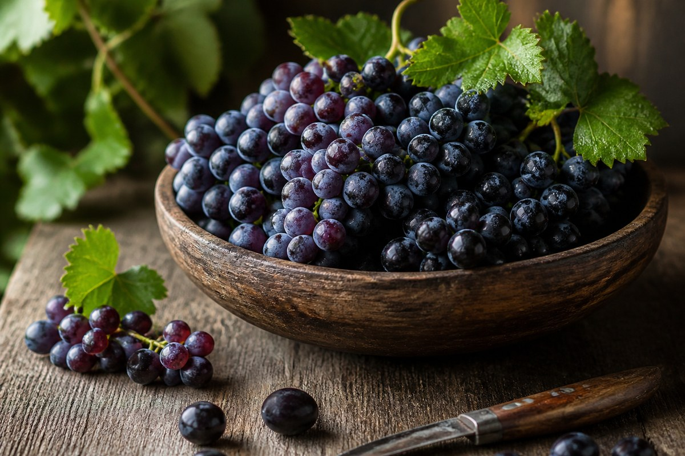

*▲ Grapes provide 69 calories, 15.5 g of sugar and 191 mg of potassium per 100 g. A single 400–500 g bunch supplies 280–345 calories and 60–78 g of sugar.*

Quick answer <strong>Grapes deliver 69 calories, 18.1 g carbohydrate and 15.5 g sugar per 100 g, with only 0.9 g of fiber and 191 mg potassium.</strong> They are 80% water and almost all of their remaining solids are sugar, so a whole bunch can pass 60 g of sugar in one sitting. The resveratrol in the skin is real, but a normal serving contains a small fraction of the dose used in clinical trials.

Grapes are the fruit people assume is "healthy sugar." They are certainly a whole food with useful polyphenols, and the skins carry compounds that laboratories study for vascular effects. But nutritionally they sit at the sugary end of the fruit aisle: more sugar per 100 g than an apple, less fiber, and very little vitamin C.

Three questions come up most often. **Are grapes really only 69 calories?** Yes, per 100 g — but a bunch is 400–500 g. **Do grapes spike blood sugar?** Moderately, with a glycemic index around 53; the portion decides the rest. **Is the resveratrol in grape skins worth seeking out?** Only as part of eating whole fruit, not as a therapy.

Below are the USDA figures for raw grapes, the Korean composition data for the denser cultivars sold in Korea, what the polyphenol trials actually measured, and the practical limits — including the choking risk that makes whole grapes a hazard for young children.

---

## 1. How Many Calories Are in Grapes? (69 kcal per 100 g)

The values below describe **raw red or green European-type grapes, edible portion**, from USDA FoodData Central.

| Nutrient | Per 100 g | U.S. %DV |
| :--- | :--- | :--- |
| **Energy** | 69 kcal | 3.4% |
| **Water** | 80.5 g | No DV |
| **Carbohydrates** | 18.1 g | 6.6% |
| - Total Sugars | 15.5 g | No DV |
| - Dietary Fiber | 0.9 g | 3.2% |
| **Protein** | 0.72 g | 1.4% |
| **Total Fat** | 0.16 g | 0.2% |
| - Saturated Fat | 0.05 g | 0.3% |
| - Cholesterol | 0 mg | 0.0% |
| **Vitamin C** | 3.2 mg | 3.6% |
| **Vitamin K** | 14.6 µg | 12.2% |
| **Folate** | 2 µg DFE | 0.5% |
| **Thiamin (B1)** | 0.069 mg | 5.8% |
| **Riboflavin (B2)** | 0.070 mg | 5.4% |
| **Niacin (B3)** | 0.188 mg NE | 1.2% |
| **Vitamin B6** | 0.086 mg | 5.1% |
| **Vitamin E** | 0.19 mg | 1.3% |
| **Calcium** | 10 mg | 0.8% |
| **Iron** | 0.36 mg | 2.0% |
| **Magnesium** | 7 mg | 1.7% |
| **Phosphorus** | 20 mg | 1.6% |
| **Potassium** | 191 mg | 4.1% |
| **Sodium** | 2 mg | 0.1% |
| **Copper** | 0.127 mg | 14.1% |
| **Manganese** | 0.071 mg | 3.1% |
| **Total Polyphenols** | 100–200 mg GAE | No DV |

**How to read the table:** percentages use the U.S. Daily Values printed on food labels, based on a 2,000-calorie reference diet. ¹Total sugars, water and polyphenols carry no Daily Value, so absolute amounts are listed. Polyphenol content is expressed as gallic acid equivalents and varies widely with cultivar, ripeness, skin color and growing conditions; darker, thicker-skinned grapes carry more. Vitamin C is low enough that grapes should not be counted as a vitamin C source — one orange supplies about 17 times as much.

*※ Source: [USDA FoodData Central FDC 174683](https://fdc.nal.usda.gov/food-details/174683/nutrients) — Grapes, red or green (European type), raw (SR Legacy). The 69 kcal and 0.72 g protein per 100 g in the table above are this entry’s values; a different cooking state changes them.*

<strong>Sources:</strong> <a href="https://fdc.nal.usda.gov/" rel="nofollow noopener" target="_blank">USDA FoodData Central</a> (Grapes, red or green, raw) · Korea Rural Development Administration, National Food Composition Table (포도, 캠벨얼리, 생것) · <a href="https://pubmed.ncbi.nlm.nih.gov/" rel="nofollow noopener" target="_blank">PubMed</a> literature on grape polyphenols, resveratrol bioavailability and grape glycemic response

### Cultivar differences: table grapes sold in Korea are denser

Korean cultivars are measured separately, and the numbers differ from the USDA European-type grapes because the fruit is denser and sweeter.

| Cultivar (raw, 100 g) | Energy | Sugars | Fiber | Potassium |
| :--- | :--- | :--- | :--- | :--- |
| **Campbell Early (캠벨얼리)** | 57 kcal | 14.3 g | 1.4 g | 180 mg |
| **Kyoho (거봉)** | 57 kcal | 14.3 g | 1.0 g | 166 mg |
| **Shine Muscat (샤인머스캣)** | 66 kcal | 15.3 g | 2.4 g | 205 mg |
| **USDA red/green table grapes** | 69 kcal | 15.5 g | 0.9 g | 191 mg |

Shine Muscat is the sweetest of the group but also the highest in fiber, and its thin skin means most people eat it skin-on, which is where the anthocyanins and resveratrol sit.

### Real-world portions: what a serving actually delivers

| Portion | Weight | Calories and key nutrients |
| :--- | :--- | :--- |
| One grape | 6–8 g | **3–5 kcal** · 0.9–1.2 g sugar |
| A small handful (15 grapes) | 100 g | 69 kcal · 15.5 g sugar · 0.9 g fiber |
| One cup | 150 g | **103 kcal** · 23 g sugar · 1.4 g fiber |
| A small bunch | 300 g | 207 kcal · 46 g sugar |
| A large bunch | 500 g | **345 kcal** · 78 g sugar · 955 mg potassium |
| Grape juice | 250 ml | 150–160 kcal · 35–38 g sugar |
| Raisins | 30 g | 90 kcal · 20 g sugar |

The whole-bunch problem is arithmetic. A 500 g bunch is 345 calories and 78 g of sugar — more than the 50 g of total sugar the World Health Organization suggests as a ceiling for an adult's daily intake, fruit sugar included. Grapes are also easy to eat absent-mindedly because they need no peeling and often have no seeds.

---

## 2. Four Evidence-Based Findings

### Do grapes spike blood sugar?

Moderately. Grapes have a glycemic index of about 53 — middle of the range — and a glycemic load of roughly 8 per 100 g. Fifteen grapes are fine for most people; a 400–500 g bunch delivers a glycemic load of 32–40, comparable to a large bowl of white rice.

The sugar in grapes is close to a 1:1 mix of glucose and fructose, which sounds worse than it behaves. The fruit also brings water (80%), organic acids and a little fiber, all of which slow gastric emptying. That is why grapes land at a glycemic index of 53 while white bread sits near 75.

The variable that matters is the portion, not the index. Glycemic load multiplies index by the carbohydrate actually eaten: 100 g of grapes scores about 8, a small bunch about 25, a large bunch over 35. Clinical guidance for people with diabetes usually places grapes in the "count it" category — around 15 grapes or 100 g per sitting, eaten with protein or fat rather than alone.

Raisins are a different matter. Drying removes water and concentrates sugar, pushing the glycemic index to roughly 64 and the load per 30 g to about 15. A handful of raisins is closer to candy than to fruit in metabolic terms.

### Is the resveratrol in grapes actually doing anything?

Not at the amounts found in fruit. Fresh grapes contain roughly 0.1–1.5 mg of resveratrol per 100 g, while supplement trials use 150–500 mg per day. You would need more than a kilogram of grapes daily to match a single capsule, and resveratrol's rapid metabolism in the gut and liver keeps blood levels low even then.

Resveratrol is a stilbene phytoalexin that grapevines produce in response to fungal infection. It concentrates in the skin, which is why red wine contains more than white and why red or black table grapes carry more than green ones. Anthocyanins — the pigments behind dark grape color — add another 30–100 mg per 100 g of skin.

The gap between food and pharmacology is the whole story. Resveratrol is rapidly sulfated and glucuronidated in the intestinal wall and liver, so oral bioavailability is low and plasma concentrations after food-sized doses are far below those used in cell studies. Human trials that showed blood-pressure or lipid effects used concentrated extracts or purified supplements at hundreds of milligrams.

That does not make grapes pointless. It redefines why to eat them: for fiber, water, potassium, anthocyanins, and the general benefit of replacing processed snacks with whole fruit. The claim "grapes are anti-aging because of resveratrol" is a marketing sentence, not a dietary recommendation.

### Do grapes lower blood pressure?

Slightly, and mostly in studies of grape seed extract rather than whole fruit. Pooled trials report systolic reductions of roughly 2–5 mmHg with grape polyphenols over 4–12 weeks. Grapes' 191 mg of potassium per 100 g also helps the kidney excrete sodium.

The evidence here is consistent in direction and modest in size. Randomized trials of grape seed extract and grape polyphenol preparations generally show small reductions in systolic blood pressure and small improvements in endothelial function and LDL oxidation markers. Effects large enough to replace medication have not been demonstrated, and trials using whole grapes or grape juice are fewer and less consistent.

Two practical points follow. First, potassium is the more reliable contribution: 191 mg per 100 g supports sodium balance in a diet that is probably too salty. Second, the benefit disappears if the grapes arrive as juice with added sugar or alongside a high-sodium meal.

For people with reduced kidney function the calculus reverses. Grapes are not a low-potassium fruit, and dialysis patients or those with chronic kidney disease should count them rather than eat freely.

### Does grape juice cure a hangover?

No. Grape juice helps with the dehydration and low blood sugar that accompany a hangover, but no human trial shows it speeds alcohol clearance or acetaldehyde breakdown.

The fructose theory is the usual explanation. Ethanol is oxidized to acetaldehyde and then acetate, a process that consumes NAD⁺; fructose metabolism regenerates NAD⁺ through a different route, so in theory it could accelerate ethanol disposal. Rodent data hint at this, and small human studies of fructose infusion have produced inconsistent results at best.

What grape juice reliably provides is fluid, glucose and potassium — the three things a hungover body is short of. A 250 ml glass carries 35–38 g of sugar, which is why it feels restorative. But large fructose loads raise triglycerides and uric acid, and no drink makes the liver process alcohol faster than time does.

---

## 3. How to Wash, Store and Eat Grapes

- **Wash only what you will eat.** The natural bloom on grape skins is a protective wax. Once washed and stored wet, grapes mold within days. Rinse a portion under running water and shake dry.
- **Pull grapes off the stem instead of washing the bunch.** Water trapped around a torn stem softens the fruit and shortens storage life for the rest of the bunch.
- **Keep the skins on.** Fiber, anthocyanins and resveratrol are concentrated there. If the skins feel tough, halve the grapes lengthwise and chew them skin-on rather than peeling.
- **Store at 32–36°F (0–2°C), wrapped and unwashed.** A paper towel inside a perforated bag keeps humidity right and absorbs condensation; grapes keep one to two weeks.
- **Freeze individual grapes.** Wash, dry completely, and freeze on a tray. Frozen grapes last three months and thaw into a sorbet-like snack that is harder to overeat than the fresh bunch.
- **Treat juice as fruit in liquid form.** A 250 ml glass equals roughly 300 g of grapes. If you drink it, keep it to 125 ml and choose 100% juice with no added sugar.

---

## 4. Cautions and Side Effects

- **Whole grapes are a choking hazard for children under four.** A grape is almost exactly the diameter of a small child's airway. Cut them lengthwise into quarters, and never serve them while a child is running, laughing or lying down. Grapes and cherry tomatoes are among the most common causes of food-related choking in toddlers.
- **Portion control matters more than the glycemic index.** 100 g (about 15 grapes) per sitting, twice a day at most, is a reasonable ceiling. Drinking juice on an empty stomach produces the largest glucose swing.
- **Fructose load adds up.** Fruit is not the problem, but habitual juice and large fruit portions contribute to triglyceride elevation and hepatic fat accumulation. Whole fruit with fiber is the safer form.
- **Potassium restriction.** At 191 mg per 100 g, a large bunch provides close to 1 g of potassium. People with chronic kidney disease should plan portions with their clinician.
- **Irritable bowel syndrome.** Grapes are high in fructose relative to glucose and can trigger bloating and gas in people with fructose malabsorption. Reducing the portion usually helps more than eliminating fruit.
- **Rare allergy.** Oral allergy syndrome can cause itching or swelling of the lips and throat after eating grapes; stop eating them if that happens.
- **Wine is not a health food.** Red wine concentrates polyphenols during fermentation, but the alcohol itself raises cancer and cardiovascular risk. Polyphenols are not a reason to drink.

---

## 5. Frequently Asked Questions

**Q1. How many grapes should I eat in a day?**  
**About 100–200 g, or 15–30 grapes**, is a sensible daily amount: 69–138 calories and 15–31 g of sugar. If you are managing blood sugar, keep it to 100 g per sitting and pair the grapes with protein, nuts or yogurt rather than eating them alone.

**Q2. Can eating a whole bunch of grapes make me gain weight?**  
A 400–500 g bunch carries **280–345 calories and 60–78 g of sugar**. As an occasional snack that is not a problem; as a daily after-dinner habit it can push you past your energy needs without much satiety, because grapes are low in fiber and protein. Portion them into a bowl rather than eating from the bag.

**Q3. Is the resveratrol in grape skins worth seeking out?**  
**Eat the skins, but do not expect a supplement effect.** Grape skins supply anthocyanins, some resveratrol and fiber. Fresh grapes contain only 0.1–1.5 mg of resveratrol per 100 g, far below the 150–500 mg used in clinical trials, so the cardiovascular benefits seen in supplement studies cannot be assumed from eating fruit.

---

## 6. Synergistic Food Pairings

- **[Blueberry](/en/posts/blueberry-nutrition-benefits/):** Grapes bring resveratrol and anthocyanins, blueberries bring anthocyanins and pterostilbene, and blueberries carry about 10 g of sugar per 100 g versus 15.5 g in grapes. Together they widen the polyphenol profile while lowering the sugar density of the bowl.
- **[Apple](/en/posts/apple-nutrition-benefits/):** Apples contribute pectin, the soluble fiber grapes lack (0.9 g per 100 g). A fruit plate of 100 g each keeps the sugar per serving predictable while adding bulk that slows eating.
- **[Pomegranate](/en/posts/pomegranate-nutrition-benefits/):** Both are polyphenol-dense fruits studied for vascular effects, and pomegranate's punicalagins complement grape anthocyanins. Pair them in a salad rather than as juice, where the sugar concentrates.
- **[Low-GI Foods Guide](/en/posts/low-gi-foods-blood-sugar-guide/):** Where grapes' glycemic index of 53 sits among fruits and grains, and how to build meals that blunt the rise.

  
📌 Related rankings

  <ul>
    <li><a href="/en/posts/low-gi-foods-blood-sugar-guide/">Low-GI Foods: Keeping Blood Sugar Steady</a></li>
    <li><a href="/en/posts/antioxidant-anti-aging-foods-guide/">Antioxidant and Anti-Aging Foods Guide</a></li>
  </ul>

---

## 7. Bottom Line

- Grapes are **69 calories, 15.5 g sugar, 0.9 g fiber and 191 mg potassium per 100 g**, at 80% water.
- One grape is 3–5 calories; a **whole 500 g bunch is 345 calories and 78 g of sugar**.
- Glycemic index is about 53 and load about 8 per 100 g, so **100 g portions** keep the response modest; raisins are markedly higher.
- Resveratrol in the skin is real but **0.1–1.5 mg per 100 g**, far below supplement trial doses of 150–500 mg.
- Blood pressure effects with grape polyphenols are **small (2–5 mmHg)** and mostly measured with extracts, not fruit.
- **Cut grapes lengthwise for children under four** — whole grapes are a leading choking hazard.

