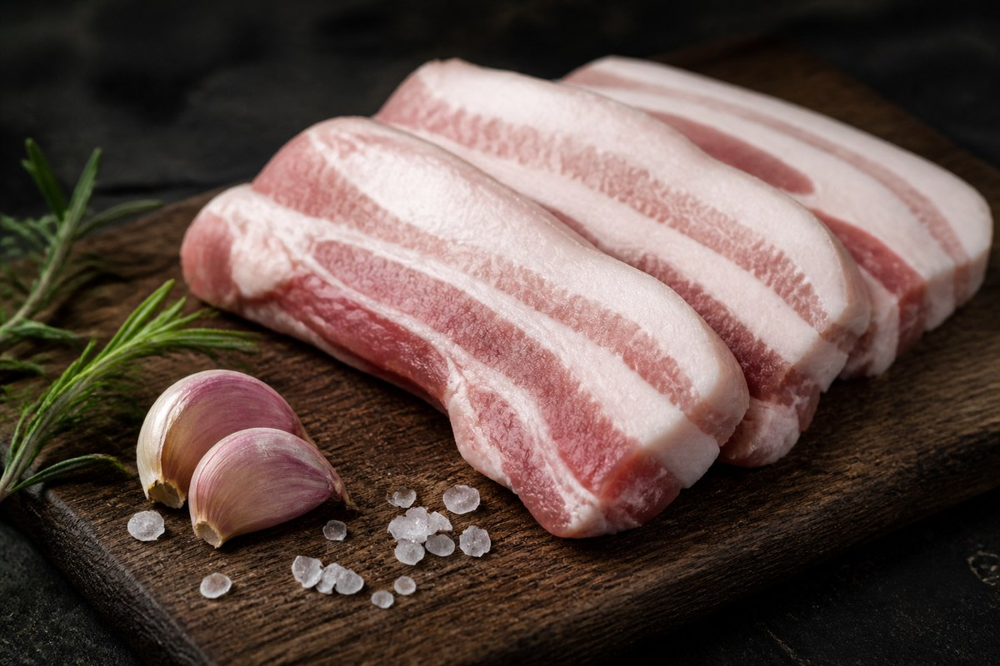

*▲ Raw pork belly carries 518 calories and 53 g of fat per 100 g, with only 9.3 g of protein. The same 100 g pan-cooked reads higher because water leaves and the slice shrinks.*

Quick answer <strong>Raw pork belly provides 518 calories, 53 g of fat and 9.3 g of protein per 100 g, plus 0.4 mg thiamin (33% DV) and 0.84 µg vitamin B12 (35% DV).</strong> It is a fat-first food, not a protein source: over 90% of its calories come from fat, and saturated fat alone covers 97% of the daily value in one 100 g portion. Treat it as an occasional indulgence with a 100–150 g portion, and cook it so it does not char.

Pork belly is the cut behind bacon, chashu, siu yuk, samgyeopsal and porchetta. It is prized precisely for the thing nutrition labels penalize: thick layers of fat braided through lean meat. That fat carries flavor, keeps the meat juicy at high heat, and makes the cut forgiving to cook.

The questions readers bring are usually the same. **How many calories are in pork belly really?** 518 per 100 g raw by USDA, with a Korean database recording 372 for the same cut. **Is pork belly high in protein?** Not really — 9.3 g per 100 g, less than a third of what chicken breast delivers. **Is grilled pork belly carcinogenic?** The cut is red meat, and high-heat charring adds compounds worth avoiding; both matter, and both are manageable.

Below are the USDA figures for raw pork belly, the reasons cooked slices show higher numbers, what its B-vitamin profile is actually worth, and how to grill, braise or roast it with less risk.

---

## 1. How Many Calories Are in Pork Belly? (518 kcal per 100 g)

The values below describe **fresh raw pork belly, edible portion**, from USDA FoodData Central (SR Legacy record 167812).

| Nutrient | Per 100 g | U.S. %DV |
| :--- | :--- | :--- |
| **Energy** | 518 kcal | 25.9% |
| **Water** | 36.7 g | No DV |
| **Protein** | 9.34 g | 18.7% |
| **Total Fat** | 53.0 g | 68.0% |
| - Saturated Fat | 19.3 g | 96.5% |
| - Monounsaturated Fat | 24.7 g | No DV |
| - Polyunsaturated Fat | 5.65 g | No DV |
| **Carbohydrates** | 0 g | 0.0% |
| - Dietary Fiber | 0 g | 0.0% |
| - Total Sugars | 0 g | No DV |
| **Cholesterol** | 72 mg | 24.0% |
| **Thiamin (B1)** | 0.396 mg | 33.0% |
| **Riboflavin (B2)** | 0.242 mg | 18.6% |
| **Niacin (B3)** | 4.65 mg NE | 29.0% |
| **Vitamin B6** | 0.130 mg | 7.6% |
| **Vitamin B12** | 0.84 µg | 35.0% |
| **Pantothenic Acid (B5)** | 0.26 mg | 5.2% |
| **Vitamin E** | 0.39 mg | 2.6% |
| **Vitamin A (RAE)** | 3 µg | 0.3% |
| **Phosphorus** | 108 mg | 8.6% |
| **Potassium** | 185 mg | 3.9% |
| **Iron** | 0.52 mg | 2.9% |
| **Zinc** | 1.02 mg | 9.3% |
| **Selenium** | 8.0 µg | 14.5% |
| **Copper** | 0.052 mg | 5.8% |
| **Magnesium** | 4 mg | 1.0% |
| **Calcium** | 5 mg | 0.4% |
| **Sodium** | 32 mg | 1.4% |

**How to read the table:** percentages use the U.S. Daily Values printed on food labels, based on a 2,000-calorie reference diet. ¹Water, total sugars, mono- and polyunsaturated fat, and vitamins without an established Daily Value are listed as absolute amounts only. Note that the sodium figure is for **raw, unseasoned** pork belly — cured belly (bacon) carries 1,500 mg or more per 100 g, and Korean grilled pork belly is usually dipped in salted sesame oil or soybean paste, which adds several hundred milligrams per serving.

<strong>Sources:</strong> <a href="https://fdc.nal.usda.gov/" rel="nofollow noopener" target="_blank">USDA FoodData Central</a> (Pork, fresh, belly, raw, FDC 167812) · Korea Rural Development Administration, National Food Composition Table (돼지고기, 삼겹살, 생것 / 삶은것 / 구운것) · <a href="https://pubmed.ncbi.nlm.nih.gov/" rel="nofollow noopener" target="_blank">PubMed</a> literature on heterocyclic amines, polycyclic aromatic hydrocarbons and red meat intake

### Why the same cut reads 518 kcal in one database and 372 in another

Korean samgyeopsal is measured at **372 kcal, 13.9 g protein and 33.3 g fat per 100 g**, notably leaner than the USDA record. The difference is not an error: it reflects the cut specification (how much belly fat and skin is trimmed), the breed, and the trimming practices of the retail market where the sample was bought. USDA's belly record is an untrimmed American-style belly destined for bacon.

The practical lesson is that **"pork belly" covers a wide range**. A thick Korean-style slice with visible lean streaks sits near 370–400 kcal per 100 g; a thin, fat-dominant American belly slice sits near 500–520. When you buy the cut, the label on the package is a better guide than any database.

### Cooked versus raw: why 100 g of cooked belly looks worse

Korean composition data illustrates the effect clearly.

| Pork belly per 100 g | Energy | Water | Protein | Fat |
| :--- | :--- | :--- | :--- | :--- |
| **Raw** | 372 kcal | 52.2 g | 13.9 g | 33.3 g |
| **Boiled (suyuk)** | 427 kcal | 41.8 g | 19.6 g | 36.6 g |
| **Pan-grilled** | 484 kcal | 30.9 g | 22.8 g | 41.2 g |

Nothing was added. Water was lost, so a fixed 100 g of finished meat contains more actual pork. This is why "grilled pork belly has more calories than raw" is true per 100 g and irrelevant per meal: 200 g of raw belly carries about 744 kcal whether you grill it or boil it, and grilling removes some fat that drips away.

### Real-world portions: what a serving actually delivers

| Portion | Weight | Calories and key nutrients |
| :--- | :--- | :--- |
| One thin slice (grilled) | 15 g | **78 kcal** · 2.9 g saturated fat |
| Three slices | 45 g | 233 kcal · 8.7 g saturated fat |
| Typical Korean serving (raw) | 150 g | 560–780 kcal · 20–29 g saturated fat |
| Restaurant portion (raw) | 200 g | **744–1,036 kcal** |
| Braised belly cube (Chinese style) | 40 g | 150–180 kcal · 1–2 g sugar from glaze |

A 200 g restaurant portion can supply half an adult's daily calorie needs and more than a day's saturated fat. When pork belly is the centerpiece of a meal, the side dishes decide whether the meal works: vegetables, kimchi, and a modest serving of rice beat fried rice cooked in the drippings.

---

## 2. Three Evidence-Based Findings

### Is pork belly a protein food or a fat food?

A fat food. Protein supplies only about 7% of its calories while fat supplies roughly 92%, and the protein density (9.3 g per 100 g) is half that of pork tenderloin (20.9 g) and a third of chicken breast (31 g).

Judging pork belly as a protein source produces bad math. To reach 30 g of protein you would need 320 g of belly — about 1,650 calories and 170 g of fat. The same 30 g from chicken breast takes 97 g and 160 calories.

| Cut (raw, 100 g) | Energy | Protein | Fat | Saturated fat |
| :--- | :--- | :--- | :--- | :--- |
| **Pork belly (USDA)** | 518 kcal | 9.3 g | 53.0 g | 19.3 g |
| **Pork belly (Korean 삼겹살)** | 372 kcal | 13.9 g | 33.3 g | 13.3 g |
| **Pork shoulder** | 227 kcal | 17.2 g | 16.4 g | 5.9 g |
| **Pork tenderloin** | 120 kcal | 20.9 g | 3.5 g | 1.2 g |

What pork belly does offer is **fat quality and micronutrients**. Nearly half of its fat is monounsaturated — 24.7 g per 100 g, more than the 19.3 g of saturated fat. It also brings thiamin, B12, niacin, selenium and zinc in meaningful amounts. The honest framing is a fat-rich food with a solid vitamin profile, eaten in small portions alongside lean protein elsewhere in the week.

### How much thiamin does pork belly actually give you?

About 0.4 mg per 100 g, roughly a third of the daily value — and among the best thiamin densities of any common meat. Thiamin is the coenzyme that converts carbohydrate into usable energy, so pairing pork with rice and beer is nutritionally coherent even if the total meal is heavy.

Pork is the standout dietary source of thiamin (vitamin B1). Pork belly's 0.396 mg per 100 g is about seven times chicken breast (0.07 mg) and several times beef sirloin. Thiamin is required by pyruvate dehydrogenase and transketolase, enzymes central to glucose metabolism and nerve function; deficiency causes beriberi and, in chronic alcohol use, Wernicke–Korsakoff syndrome.

Two caveats follow. First, **thiamin is water-soluble and heat-labile**, so boiled belly loses a share into the cooking liquid — 20–40% depending on time and volume. Grilling preserves more of it. Second, alcohol both increases thiamin requirements and reduces absorption, so the popular belief that pork belly "protects" you while drinking is only a partial truth: it supplies the vitamin but not immunity from alcohol's toxicity.

### Does pork belly raise cholesterol?

Less through its cholesterol (72 mg per 100 g) than through its saturated fat (19.3 g). Dietary cholesterol moves blood cholesterol modestly in most people, while saturated fat raises LDL in a dose-dependent way — so the portion and frequency of the fat matter more than the cholesterol number on the label.

For decades the advice on pork belly centered on its cholesterol content, and 72 mg per 100 g sounds alarming next to the old 300 mg daily limit. Current evidence is more nuanced. For most people, dietary cholesterol raises serum cholesterol far less than saturated and trans fat do, and the 2015 U.S. Dietary Guidelines dropped the specific 300 mg ceiling in favor of "as little as possible."

Pork belly's saturated fat is where the effect lives. At 19.3 g per 100 g (USDA) or 13.3 g (Korean cut), one serving covers most of the 20 g that a 2,000-calorie diet allows. Meta-analyses of saturated fat replacement show that swapping it for unsaturated fat lowers LDL cholesterol by roughly 0.2–0.3 mmol/L — a difference that matters at population scale and is achieved simply by eating less belly and more fish, nuts and olive oil.

If you have familial hypercholesterolemia or established cardiovascular disease, treat pork belly as a rare food rather than a weekly one, and ask your clinician whether your LDL target leaves room for it.

### Does grilling pork belly increase cancer risk?

Partly, and in two separate ways. The World Health Organization's cancer agency classifies red meat, including pork, as Group 2A (probably carcinogenic), with about 17% higher colorectal cancer risk per 100 g/day. High-heat grilling adds heterocyclic amines (HCAs) and polycyclic aromatic hydrocarbons (PAHs) from charring and dripping fat.

The red-meat finding comes from large cohort studies and is about habitual intake, not a single meal. The cooking finding is about chemistry: muscle creatine and amino acids react above roughly 150°C to form HCAs, while fat dripping onto a flame produces PAHs that deposit back on the meat.

Risk-reduction measures that preserve the dish:

- **Cook at moderate heat and turn often.** Frequent flipping roughly halves HCA formation compared with a single long sear.
- **Keep the meat off direct flame.** Raise the grill height, push coals to one side, or use a cast-iron pan.
- **Trim the char.** Blackened edges concentrate PAHs; cut them off rather than eating them.
- **Pair with garlic, onion and brassicas.** Their organosulfur and isothiocyanate compounds have been shown in laboratory work to modulate HCA activation pathways.
- **Keep frequency moderate.** One to two servings a week of 100–150 g keeps red-meat intake within the WHO's suggested ceiling of under 500 g cooked weight per week.

---

## 3. How to Cook Pork Belly with Less Fat and Less Char

- **Braise or boil for tenderness, grill for crust.** Simmering at 90–95°C for 60–90 minutes renders fat and keeps the meat moist; a final pass on high heat gives texture. The braise liquid can be skimmed and discarded rather than eaten.
- **Score the skin and start it fat-side down in a cold pan.** Gradual rendering releases 10–20% of the fat before the surface browns, and the meat cooks more evenly.
- **Keep slices about 1 cm thick.** Thicker slices char outside before the center is safe; thinner slices dry out. Cook to 145°F (63°C) with a three-minute rest.
- **Salt at the end, season after cooking.** Salt drawn in early pulls moisture out, and sugar-based marinades burn before the meat is done.
- **Use an air fryer at 400°F (200°C) for 12–15 minutes.** The basket lets fat drip away and reduces both smoke and charring compared with direct flame.
- **Choose the leaner belly when you can.** A slice with visible lean streaks and a thinner fat cap can be 25–30% lower in calories than an all-fat slice from the same package.

---

## 4. Cautions and Side Effects

- **Saturated fat is the binding constraint.** At 19.3 g per 100 g (USDA) or 13.3 g (Korean cut), one serving covers most of the 20 g daily limit recommended for a 2,000-calorie diet. If you have elevated LDL cholesterol or a history of cardiovascular disease, keep portions to 80–100 g and frequency low.
- **Colorectal cancer risk is dose-dependent.** Red meat is a Group 2A carcinogen and processed pork products (bacon, cured belly) are Group 1. Limit processed forms more strictly than fresh belly.
- **Sodium arrives through seasoning, not the meat.** Raw belly has 32 mg; cured bacon has over 1,500 mg, and salted sauces add more. People with hypertension should season lightly and skip the cured version.
- **Undercooked pork carries a parasite risk.** Cook pork to at least 145°F (63°C) with a rest, and to 160°F (71°C) for ground or stuffed preparations, to inactivate *Toxoplasma* and *Trichinella*. Pregnant people should eat only fully cooked pork.
- **Cross-contamination in the kitchen.** Use a separate board and knife for raw pork; *Campylobacter* and *Salmonella* transfer readily to vegetables cut on the same surface.
- **Gout is not an automatic ban.** Pork is moderate in purines — lower than organ meats and oily fish — but high fat intake reduces uric acid excretion, so avoid it during an acute flare.
- **Kidney disease requires counting.** Protein (9.3 g) and phosphorus (108 mg) per 100 g matter in renally restricted diets.

---

## 5. Frequently Asked Questions

**Q1. How much pork belly can I eat in a day?**  
**A 100–150 g portion, once or twice a week**, is a reasonable pattern for most healthy adults. That is 370–780 calories and 13–29 g of saturated fat depending on the cut, so the rest of the day should lean on vegetables and lean protein. Anyone with high LDL cholesterol should stay at the lower end.

**Q2. Is pork belly healthier grilled or boiled?**  
**Per 100 g of finished meat, boiled is lower** (427 vs 484 kcal in Korean data), because grilling drives off more water. Per meal, the difference is small; grilling removes some fat that drips away, while boiling leaves fat in the meat and in the broth you may not eat. The bigger health lever is avoiding char, salt and sugary glazes.

**Q3. How much protein is in pork belly?**  
**About 9.3 g per 100 g raw** (13.9 g in the leaner Korean cut) — roughly 19–25% of the daily value. Because fat supplies over 90% of its calories, pork belly is a poor protein staple; pork tenderloin at 20.9 g per 100 g and 120 calories is the efficient choice from the same animal.

---

## 6. Synergistic Food Pairings

- **[Garlic](/en/posts/garlic-nutrition-benefits/):** The classic pairing with grilled pork belly. Allicin and other organosulfur compounds have shown inhibitory effects on heterocyclic amine formation and activation in laboratory studies, and garlic adds flavor without sodium.
- **[Napa Cabbage](/en/posts/napa-cabbage-nutrition-benefits/):** Pork belly has no fiber at all. Cabbage — kimchi or fresh leaves used as wraps — supplies fiber, vitamin C and volume, letting you eat less meat for the same fullness.
- **[Radish](/en/posts/radish-nutrition-benefits/):** Radish simmered with belly cuts the greasiness and adds 21 calories per 100 g of volume. Its enzymes and organic acids also soften the fatty mouthfeel of a braise.
- **[Pork Tenderloin](/en/posts/pork-tenderloin-nutrition-benefits/):** The same animal, at 120 kcal and 20.9 g protein per 100 g. Keeping belly for one meal a week and using tenderloin for weekday protein is the practical way to keep saturated fat in range.

  
📌 Related rankings

  <ul>
    <li><a href="/en/posts/high-protein-foods-ranking/">Top 10 High-Protein Foods</a></li>
    <li><a href="/en/posts/heart-blood-pressure-cholesterol-foods/">Foods for Blood Pressure and Cholesterol</a></li>
  </ul>

---

## 7. Bottom Line

- Raw pork belly is **518 calories, 53 g fat and 9.3 g protein per 100 g**, with 19.3 g saturated fat.
- The leaner Korean cut reads **372 calories and 13.9 g protein**; the cut specification, not the database, explains the gap.
- **Fat, not protein, defines this food** — over 90% of calories. Chicken breast gives three times the protein for a third of the calories.
- Its real strengths are **thiamin (0.4 mg, 33% DV), B12 (0.84 µg, 35% DV), selenium and zinc**.
- Grilling adds HCAs and PAHs; **moderate heat, frequent turning, no char** and garlic-heavy sides reduce the load.
- Keep it to **100–150 g, once or twice a week**, and let vegetables and lean protein carry the rest of the week.

