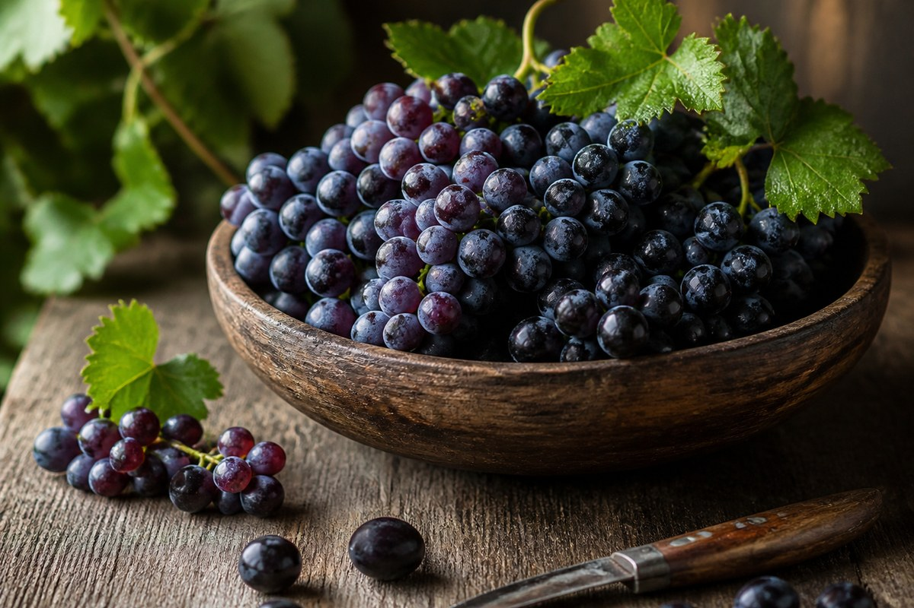

*▲ 포도 100g은 57kcal, 당류 14.3g, 칼륨 180mg입니다. 한 송이(400~500g)는 230~290kcal에 당류 57~72g, 한 알(6~8g)은 3~5kcal입니다.*

한 줄 결론 <strong>포도 100g은 57kcal에 당류 14.3g, 식이섬유 1.4g, 칼륨 180mg입니다.</strong> 열량이 낮아 보이지만 무게의 84%가 물이고 남은 영양소의 대부분이 당이어서, 한 송이를 다 먹으면 당류 60g을 넘습니다. 혈당 관리가 필요하다면 <strong>한 번에 15알(약 100g) 이내</strong>로 정하고, 껍질째 천천히 먹는 편이 좋습니다.

11월이면 샤인머스캣과 늦은 거봉·캠벨얼리가 시장에 함께 오릅니다. 포도는 "달지만 몸에 좋은 과일"로 알려져 있고, 실제로 껍질의 **레스베라트롤·안토시아닌** 같은 폴리페놀이 연구 대상이 되어 왔습니다. 그래서 "포도는 당뇨에 나쁘지 않다", "포도즙은 숙취에 좋다" 같은 이야기가 함께 돌아다닙니다.

가장 많이 검색되는 질문은 **"포도 칼로리가 정말 57kcal인가?"**, **"포도 한 송이 먹으면 살찌나?"**, **"포도 껍질의 레스베라트롤이 정말 효과가 있나?"** 세 가지입니다. 결론부터 말하면 **포도는 열량 대비 당 밀도가 높은 과일**이고, 폴리페놀은 식품으로 먹는 양에서 임상 용량에 이르기 어렵습니다.

아래에서는 농촌진흥청 국가표준식품성분표(캠벨얼리, 생것)와 USDA FoodData Central(적포도·청포도, 생것) 수치를 기준으로 포도 100g의 영양 성분, 한 송이·포도즙의 실제 당류, 혈당에 미치는 크기, 껍질 성분의 근거 수준, 아이에게 먹일 때의 주의점을 정리했습니다.

---

## 1. 포도 칼로리와 영양성분은? (100g 57kcal)

아래 수치는 **캠벨얼리(생것, 가식부) 100g** 기준입니다. 같은 포도라도 품종에 따라 당류와 열량이 10~15% 차이 나며, 껍질과 씨를 함께 먹으면 식이섬유와 폴리페놀이 늘어납니다.

| 영양 성분 (Nutrient) | 함량 (100g당) | 1일 권장 섭취량 비율 (한국인 성인 기준) |
| :--- | :--- | :--- |
| **열량 (Energy)** | 57 kcal | 2.9% |
| **수분 (Water)** | 83.9 g | 별도 표기¹ |
| **탄수화물 (Carbohydrates)** | 15.1 g | 4.7% |
| - 총 당류 (Total Sugars) | 14.3 g | 14.3% |
| - 과당 (Fructose) | 7.2 g | 기준치 없음 |
| - 포도당 (Glucose) | 7.2 g | 기준치 없음 |
| - 식이섬유 (Dietary Fiber) | 1.4 g | 5.6% |
| **단백질 (Protein)** | 0.5 g | 0.9% |
| **지방 (Total Fat)** | 0.1 g | 0.2% |
| - 포화지방 (Saturated Fat) | 0.02 g | 0.1% |
| - 콜레스테롤 (Cholesterol) | 0 mg | 0.0% |
| **칼륨 (Potassium)** | 180 mg | 5.1% |
| **칼슘 (Calcium)** | 3 mg | 0.4% |
| **철분 (Iron)** | 0.2 mg | 2.0% |
| **비타민C (Vitamin C)** | 흔적량(tr) | 기준 미달 |
| **비타민K (Vitamin K)** | 10.3 µg | 12.9% |
| **비타민B6 (Pyridoxine)** | 0.03 mg | 2.3% |
| **나트륨 (Sodium)** | 1 mg | 0.1% |
| **회분 (Ash)** | 0.4 g | 기준치 없음 |

**표 읽는 법:** 당류·탄수화물·단백질·지방·나트륨의 %는 식품 표시용 1일 영양성분 기준치(2,000kcal, 당류 100g·포화지방 15g 기준) 대비이고, 칼륨·칼슘·철분의 %는 한국인 영양소 섭취기준 성인 권장량(칼륨 3,500mg, 칼슘 700mg, 철분 10mg) 대비입니다. ¹수분과 과당·포도당은 1일 기준치가 설정되지 않은 성분으로 절대량만 적었습니다. ²비타민C는 원자료에 'tr(미량 존재)'로 표기돼 있어 수치 대신 표기만 남겼습니다. 캠벨얼리는 비타민C가 거의 없는 품종이고, 오렌지(100g당 45mg)와 비교하면 사실상 무시할 수준입니다.

*※ 데이터 기준: 표의 수치는 국내 국가표준식품성분표(식약처 식품영양성분 DB)의 포도, 캠벨얼리, 생것, 가식부 분석값입니다. 같은 식품의 [USDA FoodData Central FDC 174683](https://fdc.nal.usda.gov/food-details/174683/nutrients) — Grapes, red or green (European type), raw (SR Legacy)는 100g당 69 kcal·단백질 0.72 g입니다. 이 글의 57 kcal는 국내 주력 품종인 캠벨얼리 값이고, 품종에 따라 당도가 10~15% 차이 납니다.*

<strong>출처:</strong> 농촌진흥청 국가표준식품성분표(포도, 캠벨얼리, 생것) · <a href="https://fdc.nal.usda.gov/" rel="nofollow noopener" target="_blank">USDA FoodData Central</a> (Grapes, red or green, raw) · 농식품정보누리 제철농식품 포도

### 품종별 차이: 샤인머스캣은 66kcal, 거봉은 57kcal

| 품종 (생것 100g) | 열량 | 당류 | 식이섬유 | 칼륨 |
| :--- | :--- | :--- | :--- | :--- |
| **캠벨얼리** | 57 kcal | 14.3 g | 1.4 g | 180 mg |
| **거봉** | 57 kcal | 14.3 g | 1.0 g | 166 mg |
| **샤인머스캣** | 66 kcal | 15.3 g | 2.4 g | 205 mg |
| **수입 적포도·청포도(USDA)** | 69 kcal | 15.5 g | 0.9 g | 191 mg |

샤인머스캣은 당도가 높아 열량이 66kcal로 조금 더 높지만, 식이섬유(2.4g)와 칼륨(205mg)도 함께 높습니다. 껍질이 얇아 껍질째 먹는 비율이 높다는 점도 실제 섭취에서는 장점입니다.

### 실생활 환산: 한 알, 한 송이, 포도즙 한 잔은 몇 kcal인가?

| 섭취 기준 | 중량 | 열량과 핵심 수치 |
| :--- | :--- | :--- |
| 포도 한 알 | 6~8 g | **3~5 kcal** · 당류 0.9~1.2 g |
| 한 움큼(15알) | 약 100 g | 57 kcal · 당류 14.3 g · 식이섬유 1.4 g |
| 작은 송이 | 300 g | 171 kcal · 당류 43 g |
| 큰 송이 | 500 g | **285 kcal** · 당류 72 g · 칼륨 900 mg |
| 포도즙 한 잔 | 200 ml | 120~130 kcal · 당류 28~30 g |
| 건포도 | 30 g | 90 kcal · 당류 20 g |

한 송이를 혼자 다 먹으면 밥 한 공기(약 300kcal)에 가까운 열량이 들어옵니다. 문제는 열량보다 **당류**입니다. 세계보건기구(WHO)는 첨가당이 아닌 과일 당까지 포함해 하루 총당류를 50g 이하로 권고하는데, 큰 송이 한 개면 이 선을 넘습니다.

---

## 2. 과학적으로 입증된 4대 건강 효능

### 포도당 14g은 혈당을 얼마나 올리나?

포도의 혈당지수(GI)는 53으로 중간 정도이고, 100g당 혈당부하(GL)는 약 8입니다. 15알(100g)은 혈당을 완만하게 올리지만, 한 송이(300~500g)를 한 번에 먹으면 GL이 24~38로 올라가 흰쌀밥 한 공기와 비슷해집니다.

포도의 당은 **포도당과 과당이 1:1에 가깝게** 들어 있는 단순당입니다(캠벨얼리 100g당 각각 7.2g). 단순당이라는 말만 보면 급격한 혈당 상승을 걱정하게 되지만, 실제 반응은 **섬유질과 수분, 유기산이 함께 들어오는 속도**에 좌우됩니다. 포도는 식이섬유 1.4g과 수분 84%를 함께 담고 있어 GI 53으로 사과(36)보다는 높고 바나나(52)와 비슷한 중간군에 속합니다.

문제는 **한 번에 먹는 양**입니다. 포도는 껍질을 벗기지 않고 씨도 없어 집어 먹기 쉬워, 100g 단위로 멈추기 어렵습니다. 혈당 관리가 필요한 사람은 그릇에 15알만 덜어 놓는 식으로 양을 눈으로 확인하는 편이 효과적입니다. 당뇨가 있다면 식후 2시간 혈당을 한 번 재 보고 자기에게 맞는 양을 정하는 것이 가장 정확합니다.

참고로 **건포도는 GI 64**로 생포도보다 높습니다. 수분이 빠지면서 같은 무게에 당이 3배 가까이 농축되기 때문입니다.

### 포도 껍질의 레스베라트롤, 실제로 효과가 있나?

세포·동물 실험에서 항산화·혈관 이완 작용이 보고됐지만, 생포도로는 임상 연구 용량(하루 150~500mg)에 도달하기 어렵습니다. 100g당 레스베라트롤은 0.1~1.5mg 수준이라, 보충제 연구 결과를 포도 섭취에 그대로 적용할 수 없습니다.

포도 껍질의 대표 성분은 **레스베라트롤(스틸벤계 폴리페놀)** 과 **안토시아닌(검붉은 색소)** 입니다. 레스베라트롤은 포도가 곰팡이 감염에 대응해 만드는 방어 물질로, 적포도 껍질에 상대적으로 많고 청포도에는 적습니다. 안토시아닌은 검은 포도 껍질 100g에 30~100mg 수준 들어 있습니다.

임상 연구의 핵심은 **용량**입니다. 레스베라트롤 보충제 연구는 대부분 하루 150~500mg을 씁니다. 생포도의 레스베라트롤 함량(0.1~1.5mg/100g)으로 계산하면 같은 양을 얻으려면 하루 1kg 이상의 포도를 껍질째 먹어야 합니다. 게다가 레스베라트롤은 장과 간에서 황산화·글루쿠론산화로 빠르게 대사돼 혈중 농도가 낮게 유지됩니다.

그래서 정확한 표현은 이렇습니다. **포도의 폴리페놀은 "과일을 먹는 이유 중 하나"이지, "레스베라트롤을 먹기 위해 포도를 먹는 것"은 아닙니다.** 껍질째 먹으면 식이섬유와 안토시아닌을 함께 얻으니 껍질을 벗겨 먹는 것보다는 유리합니다.

### 포도가 혈압과 혈관에 도움이 되나?

근거는 있지만 폭이 작습니다. 포도 폴리페놀(주로 포도씨 추출물) 연구에서 수축기 혈압이 2~5mmHg 낮아진 결과가 보고됐고, 포도 자체의 칼륨 180mg도 나트륨 배출에 기여합니다. 약을 대체할 수준은 아닙니다.

포도와 혈압을 다룬 무작위 대조시험들을 종합하면, 포도씨 추출물이나 포도 폴리페놀을 4~12주 섭취했을 때 수축기 혈압이 평균 2~5mmHg, LDL 콜레스테롤이 소폭 낮아지는 경향이 반복해서 관찰됩니다. 효과 크기는 생활습관 교정이나 약물에 비해 작지만, 방향은 일관됩니다.

식품으로서 포도의 기여는 두 갈래입니다. 하나는 **칼륨**(100g당 180mg)으로, 칼륨은 신장에서 나트륨 배출을 돕습니다. 다른 하나는 **폴리페놀의 혈관 내피 기능 개선**입니다. 다만 짠 음식과 함께 먹는 습관(소금에 찍은 포도는 없지만, 가공육·젓갈과 함께 먹는 식사)이 있다면 칼륨 이점은 상쇄됩니다.

신장 기능이 떨어진 사람은 반대입니다. 포도는 칼륨이 적은 과일은 아니므로, 투석 환자나 만성신장질환자는 하루 양을 의료진과 상의해야 합니다.

### 포도즙은 숙취 해소에 정말 좋은가?

숙취가 빨리 풀린다는 근거는 없습니다. 포도즙의 당과 수분이 탈수와 저혈당을 완화하고, 과당이 알코올 대사에서 일부 우회 경로를 쓰는 것은 사실이지만, 아세트알데히드 분해 속도를 높인다는 인체 근거는 부족합니다.

술을 마신 뒤 포도·포도즙을 찾는 이유는 두 가지입니다. 첫째, **수분과 당 보충**입니다. 알코올은 이뇨 작용으로 수분과 전해질을 빼앗고, 다음 날 아침의 두통과 피로에는 탈수와 저혈당이 일부 관여합니다. 포도즙 한 잔은 이 부분을 실제로 채워 줍니다.

둘째, **과당의 알코올 대사 우회로**입니다. 에탄올은 알코올탈수소효소(ADH)로 아세트알데히드가 되고 다시 아세테이트로 바뀌는데, 이 과정에서 NAD⁺가 소모됩니다. 과당은 NAD⁺를 다시 환원하는 대사 경로를 쓰기 때문에 이론적으로 대사를 도울 수 있습니다. 그러나 **숙취 증상이 줄어든다는 인체 임상 결과는 일관되지 않고**, 오히려 과당 과다 섭취는 혈중 중성지방과 요산을 올립니다.

정리하면, 포도즙은 **숙취로 인한 탈수·저혈당 완화에는 도움이 되지만 "숙취 해소제"로 기대할 것은 아닙니다**. 같은 목적이라면 물과 소금기 있는 국물, 그리고 시간이 더 확실합니다.

---

## 3. 영양 손실을 줄이는 세척·보관·섭취 가이드

- **먹기 직전에 씻으세요.** 포도는 표면의 흰 가루(과분)가 자연 보호막 역할을 합니다. 씻은 뒤 보관하면 물기가 남아 곰팡이가 빨리 생깁니다. 먹을 양만 떼어 흐르는 물에 30초간 흔들어 씻으세요.
- **송이째 씻지 말고 알만 떼어 씻으세요.** 송이째 물에 담그면 꼭지 상처로 물이 스며들어 무르고, 남은 송이는 보관이 어려워집니다.
- **껍질은 벗기지 마세요.** 식이섬유와 안토시아닌은 껍질에 집중돼 있습니다. 껍질이 질겨 부담스럽다면 반으로 갈라 속만 먹기보다, 알을 세로로 반 갈라 껍질째 씹는 편이 낫습니다.
- **냉장 0~2℃, 키친타월에 싸서.** 포도는 저온·고습을 좋아합니다. 씻지 않은 상태로 키친타월에 싸 비닐봉지에 넣으면 1~2주 보관됩니다.
- **냉동 포도는 간식용으로 좋습니다.** 알을 떼어 씻고 물기를 완전히 말린 뒤 냉동하면 3개월 보관됩니다. 얼린 포도는 천천히 녹여 먹으면 당 흡수 속도도 느려집니다.
- **포도즙은 과일 하나를 통째로 마시는 것과 같습니다.** 200ml 한 잔에 포도 250~300g분의 당이 들어갑니다. 즙으로 마실 때는 100ml 이내로 줄이고, 식이섬유를 위해 통째로 먹는 쪽을 기본으로 하세요.

---

## 4. 섭취 시 주의사항 및 부작용

- **만 4세 이하 아이에게는 통포도를 주지 마세요.** 포도알은 기도 크기와 비슷해 질식 사고의 대표 원인입니다. 반드시 **세로로 4등분**해서 주고, 아이가 웃거나 뛰는 중에는 먹이지 마세요. 방울토마토·삶은 달걀과 함께 가장 흔한 질식 위험 식품입니다.
- **혈당 관리 중이라면 양을 먼저 정하세요.** 한 번에 100g(15알) 이내, 하루 2회 정도가 무난합니다. 공복에 즙으로 마시는 방식은 혈당 변동이 커집니다.
- **과당 과다 섭취는 중성지방을 올립니다.** 과당은 간에서 대사되며 지방 합성 경로로 들어갑니다. 과일 자체는 문제가 되지 않지만, 과일주스·포도즙을 습관적으로 다량 마시면 지방간·고중성지방혈증 위험이 커집니다.
- **신장질환자는 칼륨을 계산하세요.** 100g당 180mg으로 낮은 편은 아닙니다. 큰 송이 하나면 900mg에 이릅니다.
- **과민성대장증후군이라면 양을 줄이세요.** 포도에는 과당이 많아 흡수가 늦고, 장이 예민한 사람은 복부팽만·가스가 생길 수 있습니다. 사과·배와 같은 과당 유발 식품과 함께 먹을 때 증상이 커집니다.
- **포도 알레르기는 드물지만 존재합니다.** 구강 알레르기 증후군으로 입술·목이 가렵거나 붓는 경우가 있고, 이때는 섭취를 중단해야 합니다.
- **와인과 같은 폴리페놀을 기대하지 마세요.** 적포도주에는 발효 과정에서 폴리페놀이 농축되지만, 알코올 자체가 건강 위험을 키웁니다. 폴리페놀을 위해 술을 마시는 것은 권장되지 않습니다.

---

## 5. 자주 묻는 질문 (FAQ)

**Q1. 포도는 하루에 얼마나 먹으면 좋나요?**  
건강한 성인은 **하루 100~200g(15~30알)** 이 적당합니다. 열량 57~114kcal, 당류 14~29g입니다. 혈당 관리가 필요하다면 100g 이내로 제한하고 식사와 함께 드세요. 포도즙으로 마실 때는 100ml 이내가 안전합니다.

**Q2. 포도 한 송이를 다 먹으면 살이 찌나요?**  
한 송이(400~500g)는 **230~290kcal·당류 57~72g**입니다. 하루 한 끼로 대체한다면 문제가 아니지만, 식사 후 간식으로 통째로 먹으면 하루 필요 열량을 쉽게 넘깁니다. 살이 찌는지는 총섭취량의 문제이므로, 송이를 그릇에 덜어 먹는 습관이 실질적인 해법입니다.

**Q3. 포도 껍질에 있는 레스베라트롤은 먹을 만한가요?**  
**먹을 이유는 있지만 기대는 조절해야 합니다.** 껍질째 먹으면 식이섬유·안토시아닌·레스베라트롤을 함께 얻습니다. 다만 생포도의 레스베라트롤 양으로는 임상 연구 용량에 이르기 어려우므로, “포도를 먹으면 항노화된다”는 식의 기대는 근거가 부족합니다.

---

## 6. 포도와 함께 먹으면 좋은 음식

- **[블루베리 (Blueberry)](/posts/blueberry-nutrition-benefits/):** 포도는 안토시아닌과 레스베라트롤, 블루베리는 안토시아닌과 프테로스틸벤을 담당합니다. 두 과일을 함께 먹으면 폴리페놀 종류가 넓어지고, 블루베리는 포도보다 당류가 낮아(100g당 10g) 양 조절에 유리합니다.
- **[사과 (Apple)](/posts/apple-nutrition-benefits/):** 사과의 펙틴(수용성 식이섬유)은 포도에 부족한 섬유질을 채웁니다. 두 과일 모두 당류가 높으므로, 접시에 함께 담아 100g씩 나눠 먹는 방식이 현실적입니다.
- **[저GI 음식 혈당 가이드](/posts/low-gi-foods-blood-sugar-guide/):** 포도의 GI 53이 어느 위치인지, 같은 당류라도 어떤 식품이 혈당을 완만하게 올리는지 정리한 가이드입니다.
- **[항산화·항노화 음식 가이드](/posts/antioxidant-anti-aging-foods-guide/):** 포도 껍질의 폴리페놀이 실제 식단에서 어떤 비중을 차지하는지 비교해 볼 수 있습니다.

  
📌 관련 순위 가이드

  <ul>
    <li><a href="/posts/low-gi-foods-blood-sugar-guide/">저GI 음식 가이드: 혈당 천천히 올리는 식품</a></li>
    <li><a href="/posts/antioxidant-anti-aging-foods-guide/">항산화·항노화에 좋은 음식 총정리</a></li>
  </ul>

---

## 7. 포도 어떻게 먹을까? 핵심 요약

- 포도 100g은 **57kcal·당류 14.3g·식이섬유 1.4g·칼륨 180mg**으로, 열량보다 당 밀도가 높은 과일입니다.
- **한 알 3~5kcal, 한 송이 230~290kcal** — 송이째 먹으면 당류 60g을 넘습니다.
- 혈당지수는 53으로 중간군이지만, **한 번에 먹는 양**이 혈당 반응을 결정합니다. 15알(100g)이 기준선입니다.
- 껍질의 레스베라트롤은 **보충제 임상 용량에 크게 못 미칩니다**. 껍질째 먹는 이유는 식이섬유와 안토시아닌입니다.
- 포도즙은 **숙취 해소제가 아니라 수분·당 보충 음료**이며, 200ml에 당류 28g이 들어갑니다.
- **만 4세 이하 아이에게는 통포도를 주지 말고 세로로 4등분**하세요.

