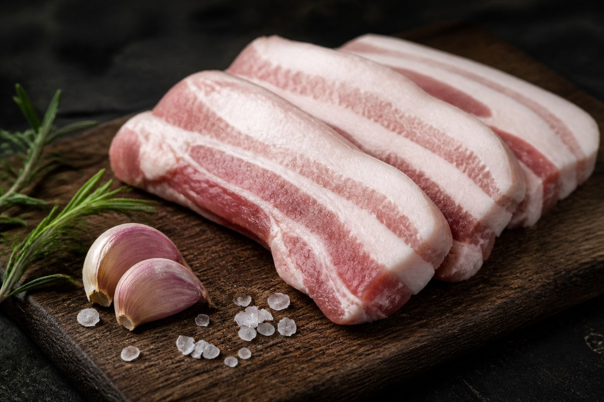

*▲ 생삼겹살 100g은 372kcal, 지방 33.3g, 단백질 13.9g입니다. 같은 100g을 팬에 구우면 484kcal, 삶으면 427kcal가 되는데, 고기가 늘어난 것이 아니라 수분이 빠져 같은 무게에 고기가 더 담기기 때문입니다.*

한 줄 결론 <strong>생삼겹살 100g은 372kcal에 지방 33.3g, 단백질 13.9g입니다.</strong> 열량의 84%가 지방에서 나오는 고기로, 단백질 식품이라기보다 <strong>지방이 많은 부위</strong>입니다. 같은 고기라도 팬구이 100g은 484kcal, 수육은 427kcal로 표시되며, 한 끼 적정량은 <strong>생것 150g(약 560kcal)</strong> 안팎입니다.

11월은 김장철이자 회식철입니다. 보쌈용 수육을 삶고, 삼겹살을 구워 배추김치에 싸 먹는 자리가 늘어납니다. 그런데 "삼겹살은 단백질이 많다"는 말과 "삼겹살은 지방 덩어리"라는 말이 동시에 돌아다녀서, 다이어트 중에도 먹어도 되는지 헷갈립니다.

가장 많이 검색되는 질문은 **"삼겹살 칼로리가 100g에 몇 kcal인가?"**, **"굽는 것과 수육 중 어느 쪽이 덜 찌나?"**, **"삼겹살에 단백질이 얼마나 들었나?"** 세 가지입니다. 결론부터 말하면 **삼겹살은 지방 비중이 압도적인 부위**이고, 남은 고기는 **수육이 구이보다 100g당 57kcal 낮습니다**.

아래에서는 농촌진흥청 국가표준식품성분표(돼지고기, 삼겹살, 생것·삶은것·구운것)와 USDA FoodData Central 데이터를 기준으로 삼겹살 100g의 영양 성분, 조리법에 따라 수치가 바뀌는 이유, 티아민·아연 같은 실제 강점, 구이의 발암 위험과 줄이는 방법을 정리했습니다.

---

## 1. 삼겹살 칼로리와 영양성분은? (100g 372kcal)

아래 수치는 **생삼겹살(가식부) 100g** 기준입니다. 삼겹살은 근육 사이에 지방이 층으로 들어간 부위라, 같은 돼지고기라도 부위·두께·지방층 비율에 따라 열량 차이가 20% 이상 납니다.

| 영양 성분 (Nutrient) | 함량 (100g당) | 1일 권장 섭취량 비율 (한국인 성인 기준) |
| :--- | :--- | :--- |
| **열량 (Energy)** | 372 kcal | 18.6% |
| **수분 (Water)** | 52.2 g | 별도 표기¹ |
| **탄수화물 (Carbohydrates)** | 0 g | 0.0% |
| - 당류 (Sugars) | 0 g | 0.0% |
| - 식이섬유 (Dietary Fiber) | 0 g | 0.0% |
| **단백질 (Protein)** | 13.9 g | 25.3% |
| **지방 (Total Fat)** | 33.3 g | 61.7% |
| - 포화지방 (Saturated Fat) | 13.3 g | 88.5% |
| - 단일불포화지방 (MUFA) | 14.1 g | 기준치 없음 |
| - 다중불포화지방 (PUFA) | 4.0 g | 기준치 없음 |
| - 트랜스지방 (Trans Fat) | 0.16 g | 별도 표기² |
| **콜레스테롤 (Cholesterol)** | 70 mg | 23.2% |
| **티아민 (Vitamin B1)** | 0.48 mg | 40.0% |
| **리보플라빈 (Vitamin B2)** | 0.16 mg | 11.6% |
| **나이아신 (Niacin)** | 3.56 mg NE | 23.7% |
| **비타민B6 (Pyridoxine)** | 0.03 mg | 2.3% |
| **비타민B12 (Cobalamin)** | 0.52 µg | 21.7% |
| **비타민D (Vitamin D)** | 0.71 µg | 7.1% |
| **철분 (Iron)** | 0.49 mg | 4.9% |
| **아연 (Zinc)** | 1.8 mg | 15.0% |
| **셀레늄 (Selenium)** | 15.4 µg | 28.0% |
| **칼륨 (Potassium)** | 239 mg | 6.8% |
| **인 (Phosphorus)** | 147 mg | 21.0% |
| **나트륨 (Sodium)** | 56 mg | 2.8% |

**표 읽는 법:** 열량·단백질·지방·포화지방·콜레스테롤·나트륨의 %는 식품 표시용 1일 영양성분 기준치(2,000kcal, 포화지방 15g·콜레스테롤 300mg 기준) 대비이고, 티아민·리보플라빈·나이아신·아연·칼륨·인의 %는 한국인 영양소 섭취기준 성인 권장량(티아민 1.2mg, 리보플라빈 1.4mg, 나이아신 15mg NE, 아연 12mg, 칼륨 3,500mg, 인 700mg) 대비입니다. ¹수분은 1일 기준치가 없는 성분이라 절대량만 적었습니다. ²트랜스지방은 1일 기준치 대신 "총열량의 1% 미만" 권고만 있어 수치로만 표기했습니다. **핵심은 포화지방 13.3g**입니다. 100g만 먹어도 하루 기준치(15g)의 88%에 이릅니다.

*※ 데이터 기준: 표의 수치는 국내 국가표준식품성분표(식약처 식품영양성분 DB)의 돼지고기 삼겹살, 생것, 가식부 분석값입니다. 같은 식품의 [USDA FoodData Central FDC 167812](https://fdc.nal.usda.gov/food-details/167812/nutrients) — Pork, fresh, belly, raw (SR Legacy)는 100g당 518 kcal·단백질 9.34 g입니다. 이 글의 372 kcal·단백질 13.9 g은 국내 유통 삼겹살 분석값으로, 지방층 비율이 다른 미국 표준 시료보다 열량이 낮습니다.*

<strong>출처:</strong> 농촌진흥청 국가표준식품성분표(돼지고기, 삼겹살, 생것 / 삶은것 / 구운것(팬)) · <a href="https://fdc.nal.usda.gov/" rel="nofollow noopener" target="_blank">USDA FoodData Central</a> (Pork, fresh, belly, raw) · 식품의약품안전처 1일 영양성분 기준치

### 조리 상태별 비교: 생것 372kcal, 수육 427kcal, 구이 484kcal

| 삼겹살 100g | 열량 | 수분 | 단백질 | 지방 | 포화지방 |
| :--- | :--- | :--- | :--- | :--- | :--- |
| **생것** | 372 kcal | 52.2 g | 13.9 g | 33.3 g | 13.3 g |
| **삶은것(수육)** | 427 kcal | 41.8 g | 19.6 g | 36.6 g | 14.6 g |
| **구운것(팬)** | 484 kcal | 30.9 g | 22.8 g | 41.2 g | 15.0 g |

표가 이상해 보이는 이유는 **무게 기준이 '익힌 뒤 100g'이기 때문**입니다. 생고기 100g을 구우면 수분이 20g 넘게 빠져 70g 남짓이 됩니다. 그 70g을 다시 100g으로 맞추려면 고기를 더 얹어야 하니, 100g당 수치가 올라가는 것입니다. 같은 논리로 단백질도 13.9g에서 22.8g으로 늘어 보입니다.

따라서 **"구이가 수육보다 칼로리가 높다"는 말은 100g 기준에서만 맞습니다.** 생고기 200g을 기준으로 보면 굽든 삶든 총열량은 744kcal 근처에서 크게 다르지 않고, 구울 때 흘러나온 기름을 먹지 않으면 오히려 조금 줄어듭니다.

### 실생활 환산: 1인분, 1점, 보쌈 한 접시는 몇 kcal인가?

| 섭취 기준 | 중량 | 열량과 핵심 수치 |
| :--- | :--- | :--- |
| 삼겹살 한 점(구이) | 15~20 g | **55~75 kcal** · 포화지방 2~3 g |
| 1인분(생것) | 150 g | 558 kcal · 지방 50 g |
| 1인분(생것, 넉넉히) | 200 g | **744 kcal** · 포화지방 27 g |
| 보쌈 수육 3점 | 100 g | 427 kcal · 단백질 19.6 g |
| 소금구이 1인분 + 쌈채소 | 150 g + 50 g | 570 kcal · 식이섬유 1.5 g 추가 |

삼겹살 1인분 200g은 밥 두 공기와 맞먹는 열량입니다. 여기에 된장찌개·볶음밥·소주까지 더해지면 한 끼 1,500kcal를 넘기기 쉽습니다. 삼겹살을 먹는 날은 **밥과 술의 양을 먼저 정하고, 고기는 150g으로 제한**하는 방식이 현실적입니다.

---

## 2. 과학적으로 입증된 4대 건강 효능

### 삼겹살은 단백질 식품인가, 지방 식품인가?

지방 식품입니다. 100g당 단백질 13.9g, 지방 33.3g으로 열량의 약 84%가 지방에서 나옵니다. 같은 돼지고기라도 안심(120kcal·단백질 21.8g)이나 목심(227kcal·단백질 17.2g)과는 성격이 완전히 다릅니다.

삼겹살을 단백질 공급원으로 기대하면 계산이 어긋납니다. 단백질 20g을 삼겹살로 채우려면 144g을 먹어야 하고, 그 과정에서 지방 48g(430kcal 상당)을 함께 먹게 됩니다. 같은 20g을 안심으로 채우면 92g, 약 110kcal로 끝납니다.

| 부위 (생것 100g) | 열량 | 단백질 | 지방 | 포화지방 |
| :--- | :--- | :--- | :--- | :--- |
| **삼겹살** | 372 kcal | 13.9 g | 33.3 g | 13.3 g |
| **목심(목살)** | 227 kcal | 17.2 g | 16.4 g | 5.9 g |
| **안심** | 120 kcal | 21.8 g | 3.5 g | 1.0 g |
| **닭다리살(껍질 제거)** | 119 kcal | 19.7 g | 3.9 g | 1.1 g |

그렇다면 삼겹살의 가치는 어디에 있을까요. **지방의 질과 미량영양소**입니다. 삼겹살 지방은 단일불포화지방(올레산)이 14.1g으로 포화지방(13.3g)보다 많습니다. 올레산은 올리브유의 주성분과 같은 지방산입니다. 여기에 티아민·아연·셀레늄·B12가 함께 들어 있어, **"지방이 많은 고기"라는 사실을 인정하고 양을 조절해 먹는 것**이 정확한 접근입니다.

### 삼겹살의 티아민 0.48mg은 어느 정도인가?

성인 하루 권장량(1.2mg)의 40%로, 육류 중에서도 손꼽히게 높습니다. 티아민은 탄수화물을 에너지로 바꾸는 효소의 조효소라 밥·술과 함께 먹는 삼겹살 조합은 영양학적으로 앞뒤가 맞습니다. 다만 조리 중 20~40%가 손실됩니다.

돼지고기는 티아민(비타민B1)이 많은 대표 육류입니다. 삼겹살 100g의 0.48mg은 닭가슴살(0.07mg)의 약 7배, 소고기 등심(0.06mg)의 약 8배 수준입니다. 티아민은 포도당을 피루브산에서 아세틸CoA로 넘기는 효소의 필수 조효소로, **탄수화물 비중이 높은 한국 식사**에서 부족해지기 쉬운 영양소입니다.

술과의 관계도 여기서 나옵니다. 알코올 대사는 티아민을 소모하고, 만성 음주는 티아민 결핍(베르니케-코르사코프 증후군)의 대표 원인입니다. 삼겹살과 소주를 함께 먹는 습관이 통설처럼 "술을 깨게 한다"고 말하는 이유의 일부는 이 티아민 공급에 있습니다. 물론 **알코올 자체의 독성을 줄이는 것은 아니므로** 과음의 면죄부는 아닙니다.

주의할 점은 조리 손실입니다. 티아민은 물에 잘 녹고 열에 약해, 삶으면 국물로 30~40%가 빠져나갑니다. 수육의 육수를 마시지 않으면 그만큼 손실이고, 구이는 상대적으로 보존율이 높습니다. 다만 구이는 아래에서 설명할 **고온 조리 위험**과 맞바꿔야 합니다.

### 구이와 수육, 실제로 먹는 열량은 어느 쪽이 적나?

같은 무게의 생고기라면 총열량은 비슷하고, 굽는 과정에서 기름이 떨어져 나가면 구이가 5~15% 정도 적습니다. 대신 수육은 부드러워 많이 먹기 쉽고, 구이는 쌈·양념으로 나트륨이 늘어납니다.

조리법 비교는 **기준을 무엇으로 잡느냐**에 따라 답이 달라집니다.

- **익힌 무게 100g 기준:** 구이(484kcal) > 수육(427kcal) > 생것(372kcal). 수육이 구이보다 57kcal 낮습니다.
- **생고기 200g 기준:** 생것 744kcal → 굽고 나면 기름이 흘러나와 실제 섭취는 650~700kcal, 삶으면 지방 일부가 물로 이동해 680~720kcal. 차이는 크지 않습니다.
- **먹는 양 기준:** 수육은 부드럽고 간이 배어 있어 같은 포만감에 더 많이 먹기 쉽습니다. 구이는 쌈으로 채소를 함께 먹어 포만감 대비 열량이 낮아질 수 있습니다.

결론적으로 **"수육이 다이어트에 유리"라는 말은 100g당 숫자만 본 결론**입니다. 실질적으로 중요한 것은 ① 생고기 무게를 150g으로 정하기 ② 구울 때 태우지 않기 ③ 쌈채소와 김치로 부피 늘리기 ④ 술과 볶음밥을 줄이기입니다.

### 삼겹살 구이의 발암 위험은 어느 정도인가?

과장할 것도 무시할 것도 아닙니다. 국제암연구소(IARC)는 돼지고기를 포함한 적색육을 '2A군(발암 가능 성분)'으로, 가공육을 '1군'으로 분류했습니다. 직접 불꽃에 태우면 다환방향족탄화수소(PAH)와 헤테로사이클릭아민(HCA)이 생기므로, 중불에서 자주 뒤집고 탄 부분은 잘라내는 것이 권장됩니다.

발암 위험은 두 갈래에서 옵니다. 첫째는 **적색육 자체**입니다. IARC는 하루 100g의 적색육 섭취가 대장암 위험을 약 17% 높인다고 평가했습니다. 둘째는 **조리 방식**입니다. 고기 지방이 불꽃에 떨어져 타면 PAH가, 150℃ 이상의 고온에서 근육 단백질이 반응하면 HCA가 생깁니다.

실무적인 대응은 명확합니다.

- **중불(150~180℃)에서 조리하고, 자주 뒤집으세요.** 한 면을 오래 굽는 방식이 HCA 생성을 늘립니다.
- **불꽃이 고기에 닿지 않게 하세요.** 숯불이라면 고기를 위로 올리거나 불을 옆으로 옮깁니다.
- **탄 부분은 먹지 마세요.** 검게 탄 부위에 PAH가 집중됩니다.
- **마늘·양파·배추김치와 함께 드세요.** 이소티오시아네이트와 황화합물이 HCA의 활성화 경로에 개입한다는 세포·동물 연구가 있습니다.
- **주 1~2회, 1회 150g 이내**로 두는 것이 WHO 권고 범위(주 500g 이하)에 들어갑니다.

---

## 3. 수육과 구이, 맛과 영양을 살리는 조리 가이드

- **수육은 90분, 물온도 90~95℃.** 끓는 물에 넣고 바로 약불로 줄여 90분 삶으면 중심까지 균일하게 익고 육즙 손실이 적습니다. 대파·마늘·통후추·된장 반 큰술을 넣으면 잡내가 줄어듭니다.
- **수육은 삶은 뒤 찬물에 담갔다가 결 반대로 썰기.** 껍질이 탱탱해지고 썰 때 부서지지 않습니다. 2시간 이상 삶으면 육질이 물러지고 티아민 손실도 커집니다.
- **구이는 두께 1cm, 중심온도 71℃.** 두꺼운 삼겹살은 겉이 타도 속이 덜 익습니다. 뒤집개로 눌러 탄력이 없고 육즙이 맑아지면 다 익은 신호입니다.
- **소금은 굽기 직전에, 양념은 굽고 나서.** 소금을 미리 뿌리면 수분이 빠져 퍽퍽해지고, 양념을 미리 바르면 당이 타서 PAH가 늘어납니다.
- **에어프라이어는 180℃ 12~15분.** 기름을 받아낼 수 있어 구이보다 지방 섭취가 10%가량 줄고, 연기와 탄 부분이 적습니다.
- **먹을 양은 접시에 덜어 놓고 시작하세요.** 삼겹살은 불판 위에서 계속 집어 먹게 되어, 눈으로 양을 확인하지 않으면 200g을 넘기기 쉽습니다.

---

## 4. 섭취 시 주의사항 및 부작용

- **포화지방 13.3g은 하루 기준치의 88%입니다.** 100g만 먹어도 포화지방 한도를 거의 채웁니다. 혈중 LDL 콜레스테롤이 높거나 심혈관질환 병력이 있다면 1회 80~100g 이내가 안전합니다.
- **대장암 가족력이 있다면 빈도를 줄이세요.** 적색육 섭취와 대장암의 연관성은 여러 대규모 코호트에서 반복 확인됐습니다. 주 1회 이하로 두고 가공육(베이컨·소시지)은 더 줄이는 편이 좋습니다.
- **덜 익힌 고기는 톡소플라스마 위험.** 돼지고기는 충분히 익혀야 합니다(중심온도 71℃ 이상). 특히 임신 중에는 위험도가 높아 반드시 완전히 익힌 고기만 드세요.
- **칼도마의 교차오염을 막으세요.** 생고기를 만진 도마·칼로 채소를 썰면 캠필로박터·살모넬라가 옮겨갑니다.
- **통풍이라고 무조건 피할 필요는 없습니다.** 돼지고기의 퓨린은 내장·등푸른생선보다 낮은 중간군입니다. 다만 지방이 많으면 요산 배출이 줄어드는 방향으로 작용하므로, 통풍 발작기에는 피하는 편이 좋습니다.
- **나트륨은 고기보다 양념에서 옵니다.** 생삼겹살은 56mg이지만 소금구이 양념·쌈장·젓갈이 붙으면 한 끼 나트륨이 2,000mg을 넘기 쉽습니다.
- **신장질환자는 단백질·인을 함께 계산하세요.** 인 147mg, 단백질 13.9g은 만성신장질환 식단에서 무시할 수 없는 양입니다.
- **구운 고기를 매일 먹는 습관은 피하세요.** 조리 방식과 섭취 빈도가 위험을 결정합니다.

---

## 5. 자주 묻는 질문 (FAQ)

**Q1. 삼겹살은 하루에 얼마나 먹어도 괜찮나요?**  
건강한 성인은 **1회 150g(약 560kcal)**, 주 1~2회가 무난합니다. 포화지방은 20g으로 하루 기준치를 넘기 때문에, 그날 다른 식사에서 기름진 음식과 가공육을 줄여야 균형이 맞습니다. 혈중 콜레스테롤이 높다면 1회 80~100g으로 줄이세요.

**Q2. 구이와 수육 중 어느 쪽이 살이 덜 찌나요?**  
**생고기 무게가 같으면 총열량은 비슷합니다.** 100g당으로는 수육(427kcal)이 구이(484kcal)보다 낮지만, 이는 익힌 뒤 무게 기준의 차이입니다. 구이는 기름이 흘러나가 실제 섭취 열량이 조금 줄고, 수육은 부드러워 많이 먹게 되는 점을 함께 고려하세요.

**Q3. 삼겹살에 단백질이 얼마나 들어 있나요?**  
생것 100g에 **13.9g**입니다. 하루 단백질 권장량(성인 55~65g)의 약 25%지만, 같은 양의 지방 33.3g을 함께 먹게 됩니다. 단백질이 목적이라면 안심(21.8g)이나 닭가슴살(23g)이 효율적입니다.

---

## 6. 삼겹살과 함께 먹으면 좋은 음식

- **[마늘 (Garlic)](/posts/garlic-nutrition-benefits/):** 삼겹살 구이의 기본 조합입니다. 마늘의 알리신은 고온 조리에서 생기는 헤테로사이클릭아민(HCA)의 생성·활성화를 낮춘다는 세포·동물 연구가 있습니다. 마늘을 함께 굽고, 탄 부분은 떼어내세요.
- **[배추 (Napa Cabbage)](/posts/napa-cabbage-nutrition-benefits/):** 삼겹살에 가장 부족한 식이섬유(0g)를 김치·겉절이로 채웁니다. 배추김치는 유산균과 식이섬유를 함께 주고, 쌈으로 먹으면 같은 포만감에 고기량을 줄일 수 있습니다.
- **[무 (Radish)](/posts/radish-nutrition-benefits/):** 수육에 무를 함께 삶으면 무의 소화 효소와 유기산이 기름진 맛을 잡아 줍니다. 무는 100g당 21kcal로, 고기 양을 늘리지 않고 접시 부피를 채우는 역할을 합니다.
- **[돼지고기 안심 (Pork Tenderloin)](/posts/pork-tenderloin-nutrition-benefits/):** 같은 돼지고기지만 120kcal·단백질 21.8g·포화지방 1g 미만입니다. 삼겹살을 주 1회로 두고, 평일 단백질은 안심으로 채우는 조합이 실용적입니다.

  
📌 관련 순위 가이드

  <ul>
    <li><a href="/posts/high-protein-foods-ranking/">고단백 식품 순위 TOP 10</a></li>
    <li><a href="/posts/heart-blood-pressure-cholesterol-foods/">혈압·콜레스테롤 관리에 좋은 음식</a></li>
  </ul>

---

## 7. 삼겹살 어떻게 먹을까? 핵심 요약

- 생삼겹살 100g은 **372kcal·지방 33.3g·단백질 13.9g**으로, 열량의 84%가 지방입니다.
- 같은 100g이 **수육 427kcal·팬구이 484kcal**로 표시되는 것은 수분 손실로 같은 무게에 고기가 더 담기기 때문입니다.
- **포화지방 13.3g은 하루 기준치의 88%** — 양 조절이 핵심입니다. 1회 150g, 주 1~2회.
- 강점은 **티아민 0.48mg(권장량 40%)·아연·셀레늄·B12**이며, 밥·술과 함께 먹는 조합은 영양학적으로 앞뒤가 맞습니다.
- 단백질 공급원으로는 비효율적입니다. 단백질이 목적이면 **안심(120kcal·21.8g)** 쪽이 낫습니다.
- 구울 때는 **중불·자주 뒤집기·탄 부분 제거**, 그리고 **마늘·배추김치·무**를 곁들이세요.

