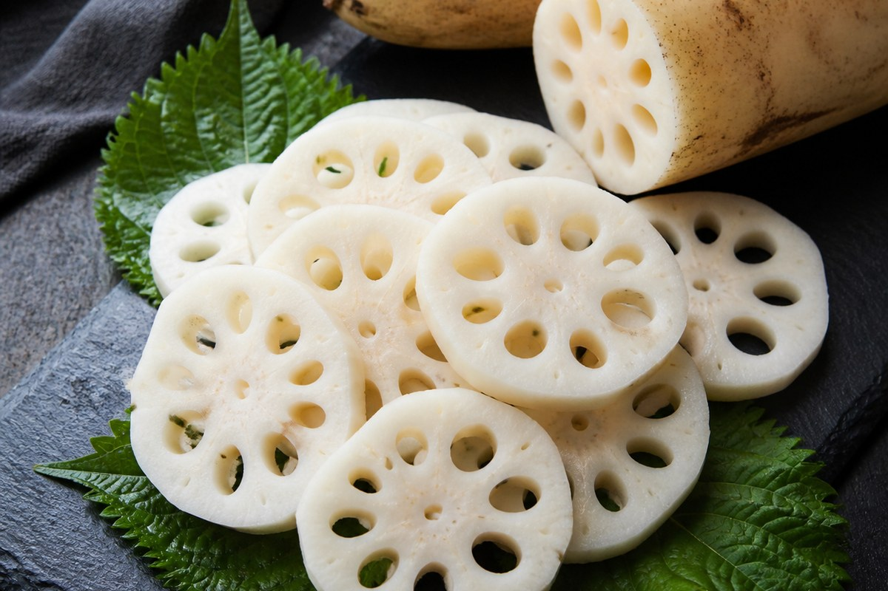

*▲ Raw lotus root carries 74 calories, 17.2 g of carbohydrate and 4.9 g of fiber per 100 g. Boiling drops its vitamin C from 44 mg to about 27 mg in the same 100 g.*

Quick answer <strong>Raw lotus root provides 74 calories, 17.2 g of carbohydrate, 4.9 g of fiber, 44 mg of vitamin C and 556 mg of potassium per 100 g.</strong> It looks like a low-calorie vegetable, but 17 g of that weight is starch, so treat it as a <strong>carbohydrate</strong> on a diabetes plate rather than a free vegetable. Vitamin C is its fragile nutrient: boiling leaches out roughly 40% of it, so slice thick and cook briefly.

Lotus root is the underground stem of the aquatic lotus plant. Its lacy cross-section is not decoration — those holes are aerenchyma, air channels that carry oxygen from the leaves down to roots buried in mud. In Korea the root is harvested from October through February, and it appears on the table most often as *yeongeun-jorim*, a soy-braised side dish, or as a crisp addition to salads and tempura.

The questions readers bring are usually the same three. **How many calories are in lotus root really?** 74 per 100 g by USDA, with Korean food tables recording 75. **Is lotus root actually good for the stomach?** The claim rests more on its soft texture and 79% water than on any proven compound. **Does cooking destroy its vitamin C?** Partly — and the Korean composition table lets us measure exactly how much.

Below are the USDA figures, the gap between raw and boiled root, what the "stomach-friendly" reputation is really built on, and how to cook lotus root so that browning and nutrient loss stay minimal.

---

## 1. How Many Calories Are in Lotus Root? (74 kcal per 100 g)

The values below describe **raw lotus root, edible portion**, from USDA FoodData Central (SR Legacy). They are scaled from the reference portion of 81 g — about ten 2.5-inch slices.

| Nutrient | Per 100 g | U.S. %DV |
| :--- | :--- | :--- |
| **Energy** | 74 kcal | 3.7% |
| **Water** | 79.1 g | No DV |
| **Protein** | 2.6 g | 5.2% |
| **Total Fat** | 0.1 g | 0.1% |
| - Saturated Fat | 0.03 g | 0.1% |
| - Monounsaturated Fat | 0.02 g | No DV |
| - Polyunsaturated Fat | 0.02 g | No DV |
| **Carbohydrates** | 17.2 g | 6.3% |
| - Dietary Fiber | 4.9 g | 17.5% |
| - Total Sugars | 0.5 g | No DV¹ |
| **Cholesterol** | 0 mg | 0.0% |
| **Vitamin C** | 44 mg | 48.9% |
| **Thiamin (B1)** | 0.16 mg | 13.3% |
| **Riboflavin (B2)** | 0.22 mg | 16.9% |
| **Niacin (B3)** | 0.40 mg | 2.5% |
| **Pantothenic Acid (B5)** | 0.38 mg | 7.6% |
| **Vitamin B6** | 0.26 mg | 15.3% |
| **Folate** | 13.6 µg DFE | 3.4% |
| **Vitamin A (RAE)** | 0 µg | 0.0% |
| **Potassium** | 556 mg | 11.8% |
| **Phosphorus** | 100 mg | 8.0% |
| **Magnesium** | 23 mg | 5.6% |
| **Calcium** | 44 mg | 3.4% |
| **Iron** | 1.16 mg | 6.4% |
| **Manganese** | 0.26 mg | 11.3% |
| **Copper** | 0.26 mg | 28.9% |
| **Zinc** | 0.40 mg | 3.6% |
| **Selenium** | 0.7 µg | 1.3% |
| **Sodium** | 40 mg | 1.7% |

**How to read the table:** percentages use the U.S. Daily Values printed on food labels, based on a 2,000-calorie reference diet. ¹Water and total sugars have no established Daily Value, so only absolute amounts are listed. Vitamins A and D are effectively absent because this is a root, not a leaf — lotus root has no carotenoids and no fat-soluble vitamin content worth counting. Note that the nutrients are reported **raw**; lotus root is almost always eaten cooked, and cooking changes several of these numbers substantially.

<strong>Sources:</strong> <a href="https://fdc.nal.usda.gov/" rel="nofollow noopener" target="_blank">USDA FoodData Central</a> (Lotus root, raw, SR Legacy) · Korea Rural Development Administration, National Food Composition Table DB 10.4 (연근, 생것 / 데친것) · Korea Ministry of Food and Drug Safety, Food Nutrient Database

### Why Korean and U.S. tables disagree on the same root

The Korean national table records **75 kcal, 17.28 g carbohydrate, 3.3 g fiber, 28.35 mg vitamin C, 478 mg potassium and 1.89 mg manganese** per 100 g. USDA records 74 kcal, 17.2 g carbohydrate but 4.9 g fiber, 44 mg vitamin C, 556 mg potassium and 0.26 mg manganese.

Energy and carbohydrate match almost exactly; fiber, vitamin C and manganese diverge. That pattern is typical of composition tables built from different samples. Fiber depends on which analytical method was used (enzyme-gravimetric versus total dietary fiber by AOAC 991.43) and on how much of the stringy vascular tissue is included in the edible portion. Vitamin C and manganese depend on cultivar, growing water quality and how long the root sat in storage before analysis.

The practical rule: **use one table consistently within a meal plan** rather than mixing rows. For European and U.S. dietary advice, USDA figures are the safer reference. For a Korean diet where the same database generated the sodium and potassium targets, the Korean table fits better. The manganese gap of sevenfold is a good reminder that a single "superfood" claim rarely survives contact with a second database.

### Raw versus boiled: what a 100 g portion actually contains

Korean composition data lists both states, which makes the cooking loss visible.

| Lotus root per 100 g | Raw | Boiled | Change |
| :--- | :--- | :--- | :--- |
| **Energy** | 75 kcal | 62 kcal | −17% |
| **Water** | 80.0 g | 84.0 g | +4.0 g |
| **Carbohydrate** | 17.28 g | 14.41 g | −16.6% |
| **Protein** | 1.63 g | 1.07 g | −34.4% |
| **Fiber** | 3.3 g | 2.8 g | −15.2% |
| **Vitamin C** | 28.35 mg | 17.32 mg | **−38.9%** |
| **Manganese** | 1.89 mg | 0.99 mg | −47.6% |
| **Copper** | 0.13 mg | 0.06 mg | −53.8% |

The calorie drop is not a health benefit. Boiled root weighs more because it absorbed water, so 100 g of boiled root is less actual lotus root than 100 g raw. The vitamin C, manganese and copper losses are real losses into the cooking water. If you drink or reuse that water — for a stew or braise — you recover part of it; if you drain it down the sink, that 11 mg of vitamin C goes with it.

### Portions in real life: slices, braised dishes and lotus chips

| Portion | Weight | Calories and key nutrients |
| :--- | :--- | :--- |
| One 0.5 cm slice | 15 g | **11 kcal** · 2.6 g carbs · 0.5 g fiber |
| A side dish of soy-braised root | 50 g | 38 kcal from the root + 40–60 kcal from soy sauce and syrup |
| One medium root section | 200 g | **150 kcal** · 34.6 g carbs · 6.6 g fiber |
| Lotus root juice, one glass | 200 ml | 90–100 kcal · 20 g carbs, most fiber filtered out |
| Fried lotus chips | 30 g | **150–170 kcal** · 10 g or more of fat |

The root itself is a low-calorie food. The dishes built around it are not: braising adds sugar, and frying adds oil at roughly 30 g of fat per 100 g. Anyone counting calories should look at the cooking method before the vegetable.

---

## 2. What Lotus Root Actually Does for Your Body

### Is lotus root good for your stomach?

The direct human evidence is weak. Its slippery texture comes from water-soluble polysaccharides, and the idea that it coats the stomach lining rests on laboratory and animal work rather than clinical trials. What genuinely helps is the soft texture, 79% water and easily gelatinized starch.

Korean home remedies call lotus root juice a treatment for gastritis, and the claim usually cites "mucin." That label is misleading: the sticky substance in lotus root is a mix of pectin and starch breakdown products, not the mucin protein that makes up gastric mucus. No controlled trial has shown lotus root juice healing an inflamed stomach.

What is real is mechanical and thermal. Lotus root's insoluble fiber sits in thin, soft cell walls, so it does not scrape. Its water content is close to 79%, so a braised or steamed portion delivers volume with few calories. And when heated, its starch gelatinizes into a soft matrix that is easy to chew and empty from the stomach. The fair summary is that lotus root is a **gentle food** for a sensitive stomach, not a treatment for one.

### How much vitamin C survives cooking?

About 60%. Korean composition data shows 28.35 mg in raw root and 17.32 mg in boiled root per 100 g, a 39% loss. Because the loss is mostly leaching into water, not heat destruction alone, thick slices and short boiling times keep far more.

Lotus root is an unusually good vitamin C source for a root vegetable: 44 mg per 100 g by USDA, roughly six times an apple's 4–5 mg and nearly half the U.S. Daily Value. But vitamin C is water-soluble and heat-labile, and lotus root is almost never eaten raw.

Three variables decide how much you keep. **Surface area:** a 0.3 cm slice loses far more than a 0.7 cm slice because more cells are cut open. **Water contact:** boiling in a large pot leaches more than brief blanching or steaming. **Time:** a one-minute blanch preserves more than a five-minute boil.

Practical guidance: cut thick, drop into already-boiling water, blanch for 60 seconds, and reuse the blanching water in the braise. If you cook lotus root for 20 minutes in a stew, stop counting it as a vitamin C source — get that nutrient from broccoli, bell pepper or kiwi instead, and value the root for fiber and potassium.

### Does lotus root help blood pressure?

It helps in the right direction. At 556 mg of potassium and only 40 mg of sodium per 100 g, lotus root has one of the better mineral ratios among starchy roots — roughly 14 times more potassium than sodium. That supports sodium excretion, though the effect is modest next to medication.

Potassium lowers blood pressure by promoting sodium excretion in the kidney and by relaxing vascular smooth muscle. The DASH trials built their diets around exactly this ratio: high potassium, low sodium, mostly plants. Lotus root fits that pattern better than potatoes or rice, and its Korean-style braise is where the benefit usually collapses — soy sauce and starch syrup push a 100 g side dish past 400 mg of sodium.

For someone with hypertension, the useful version is blanched lotus root dressed with sesame oil and vinegar, or added to a clear soup, rather than *jorim* with two tablespoons of soy sauce. And for anyone with reduced kidney function, the potassium is the opposite of a benefit: 556 mg per 100 g is a third of a typical 1,500–2,000 mg daily limit, so portion size belongs in a conversation with a clinician.

### Are the tannins and polyphenols worth anything?

They explain the browning and the astringency, but not a proven health effect. Cutting lotus root exposes polyphenols to polyphenol oxidase (PPO), which turns the surface brown within minutes. Laboratory studies show antioxidant activity; human trials at normal serving sizes do not exist.

The browning reaction is enzymatic, not spoilage. PPO uses oxygen to convert phenolic compounds into brown quinones, and the reaction slows sharply at low pH. That is why a few drops of vinegar or lemon in the soaking water keeps slices white — a culinary trick with a clean biochemical explanation.

On health effects, the honest position is cautious. Lotus root extracts have shown antioxidant, anti-inflammatory and lipid-lowering activity in cell and animal models. Those studies use concentrated extracts, not a 50 g side dish. The more defensible nutritional asset in lotus root is manganese: 1.89 mg per 100 g in the Korean table, 63% of the daily reference value, where manganese serves as a cofactor for manganese superoxide dismutase and for enzymes involved in bone matrix formation.

---

## 3. How to Cook Lotus Root Without Losing Its Vitamin C

- **Peel thin.** Polyphenols and fiber concentrate just under the skin. A vegetable peeler taking 1 mm is enough; heavy trimming removes the best part.
- **Acidulate immediately.** One tablespoon of vinegar or the juice of half a lemon in a liter of water. Five minutes of soaking stops browning and keeps braised dishes looking clean.
- **Blanch in already-boiling water, 60 seconds.** Starting from cold water means a longer heat exposure and more leaching. Shock in cold water afterward to firm the texture.
- **Slice thick for braises, thin for chips.** Thick slices hold nutrients and bite; thin slices are only worth it when you fry or air-fry them crisp.
- **Cut the syrup in braises.** Two tablespoons of starch syrup adds more than 10 g of sugar. Reduce it, or finish with sesame oil instead.
- **Air-fry instead of deep-fry.** Deep-fried lotus chips exceed 30 g of fat per 100 g. A light brush of oil and 200°C in an air fryer keeps them under 10 g.
- **Skip the juice if you are watching blood sugar.** Juicing throws away 4.9 g of fiber and leaves the starch and sugars. Eat the root sliced.
- **Store wrapped in paper, refrigerated, up to a week.** Plastic bags trap moisture and grow mold. Cut root keeps 3–4 days in a sealed container after a 10-minute vinegar soak.

---

## 4. Who Should Be Careful With Lotus Root?

- **Do not eat it raw.** Lotus root grows in mud, and freshwater aquatic plants can carry soil contamination and parasites such as liver fluke. Cook it thoroughly, and make juice from blanched root, not raw.
- **Count it as a carbohydrate, not a vegetable.** At 17.2 g of carbohydrate per 100 g, one serving equals about a third of a bowl of rice. For diabetes management, keep portions to 50–100 g per meal and subtract from other starches.
- **Watch potassium if your kidneys are impaired.** 556 mg per 100 g is significant on a restricted diet. Boiling and discarding the water removes some potassium; confirm the approach with your care team.
- **Start small with IBS.** The 4.9 g of fiber per 100 g is mostly insoluble and can cause gas and bloating. Half a portion first, then increase.
- **Rare allergy exists.** Oral allergy symptoms — itchy lips, tingling mouth — have been reported with lotus root. Raw juice can also irritate skin, so wear gloves when peeling.
- **Do not treat lotus root tea as medicine.** It is a food. Large daily volumes add potassium and starch without the fiber of the whole root.

---

## 5. Frequently Asked Questions

**Q1. How much lotus root should I eat a day?**  
For healthy adults, **100–200 g a day** is a reasonable range: 75–150 calories, 17–35 g of carbohydrate and 3.3–6.6 g of fiber. If you manage blood sugar, keep it to 50–100 g per meal and reduce rice accordingly.

**Q2. Does boiling destroy all the vitamin C in lotus root?**  
No. Korean composition data shows a **39% loss** (28.35 mg to 17.32 mg per 100 g), not total destruction. Fiber, potassium and starch largely remain. Blanching for 60 seconds in boiling water and slicing thick cuts the loss to roughly half of that.

**Q3. Is lotus root juice good for gastritis?**  
**The evidence is insufficient.** The idea that its slippery polysaccharides protect the stomach lining comes from laboratory work; clinical trials in gastritis patients are essentially absent. Softened, well-cooked lotus root is gentle, but persistent stomach pain needs medical assessment rather than juice.

---

## 6. Synergistic Food Pairings

- **[Carrot](/en/posts/carrot-nutrition-benefits/):** carrot brings beta-carotene and a natural sweetness that lets you cut the syrup in a braise, while lotus root supplies potassium and fiber. Braise them together and the dish needs less sugar and less soy sauce.
- **[Broccoli](/en/posts/broccoli-nutrition-benefits/):** broccoli delivers well over 80 mg of vitamin C per 100 g, so a plate combining both covers the vitamin C that lotus root loses to blanching. Steam the broccoli briefly to preserve its own ascorbate.
- **[Pork Tenderloin](/en/posts/pork-tenderloin-nutrition-benefits/):** lotus root's starch and fiber balance a lean protein. Stir-frying thin slices with tenderloin gives a complete plate with less sugar and sodium than a braise.
- **[Low-GI Foods Guide](/en/posts/low-gi-foods-blood-sugar-guide/):** a reference for how starchy roots like lotus root should be counted against rice and bread in a blood-sugar-conscious meal plan.

  
📌 Related ranking guides

  <ul>
    <li><a href="/en/posts/low-gi-foods-blood-sugar-guide/">Low-GI foods: keeping blood sugar steady</a></li>
    <li><a href="/en/posts/low-calorie-high-satiety-foods/">Low-calorie foods that keep you full</a></li>
  </ul>

---

## 7. Key Takeaways

- Raw lotus root is **74 calories, 17.2 g carbohydrate, 4.9 g fiber, 44 mg vitamin C and 556 mg potassium** per 100 g.
- It is a **starchy root**, not a free vegetable: 50–100 g per meal replaces part of your rice.
- **Boiling costs about 39% of its vitamin C** and roughly half its manganese and copper. Slice thick, blanch 60 seconds, reuse the water.
- The "good for the stomach" reputation comes from **soft texture and water content**, not from a proven active compound.
- Its mineral profile — 556 mg potassium against 40 mg sodium — supports blood pressure, but the soy-braised version usually cancels it.
- **Cook it before eating.** Freshwater roots can carry soil and parasite contamination.
- Battle browning with **acid, not heat**: a vinegar or lemon soak keeps slices white by slowing polyphenol oxidase.

