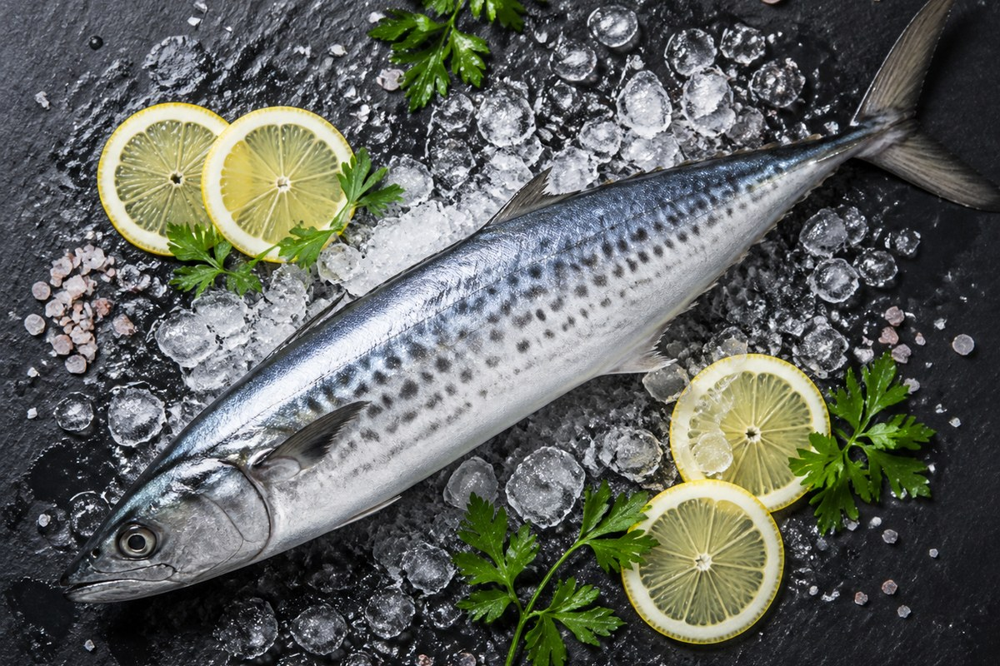

*▲ Raw Spanish mackerel supplies 139 calories, 19.3 g of protein and 1 g of EPA plus DHA per 100 g. The same 100 g grilled reads 184 calories because water leaves and the flesh concentrates.*

Quick answer <strong>Raw Spanish mackerel provides 139 calories, 19.3 g of protein, 6.3 g of fat and about 1 g of EPA plus DHA per 100 g, along with 7.3 µg of vitamin D (37% DV) and 36.5 µg of selenium (66% DV).</strong> It is a lean, protein-dense fish that delivers a full day's omega-3 in a single fillet. Two cautions matter more than calories: <strong>grilled portions read far higher per 100 g</strong> because water is lost, and as a scombroid fish it can form <strong>histamine</strong> if it is not kept cold.

Spanish mackerel (*Scomberomorus niphonius* in Korean waters, marketed as *samchi*) is a narrow, silver-blue fish with faint spots along its flank. Korea's Ministry of Oceans and Fisheries named it, together with scallops, as the fish of November 2026: the flesh gains fat from autumn onward, and the season runs from November into winter. It is eaten grilled with salt, braised with radish, steamed, or sliced raw.

The questions readers ask are consistent. **How many calories are in Spanish mackerel?** 139 per 100 g by USDA, with Korean tables recording 112 for a leaner sample. **Does it have more omega-3 than salmon?** Less per gram than farmed salmon, more than most white fish, and far more than chicken or beef. **Why does grilled mackerel show higher calories?** Water loss, not added fat.

Below are the USDA figures, the gap between raw and grilled, what 1 g of omega-3 actually means for a week of eating, and the histamine and mercury questions that matter more than the calorie count.

---

## 1. How Many Calories Are in Spanish Mackerel? (139 kcal per 100 g)

The values below describe **raw Spanish mackerel, edible portion**, from USDA FoodData Central (SR Legacy record 173673).

| Nutrient | Per 100 g | U.S. %DV |
| :--- | :--- | :--- |
| **Energy** | 139 kcal | 7.0% |
| **Water** | 71.7 g | No DV |
| **Protein** | 19.29 g | 38.6% |
| **Total Fat** | 6.30 g | 8.1% |
| - Saturated Fat | 1.80 g | 9.0% |
| - **EPA** | **0.329 g** | No DV¹ |
| - **DHA** | **1.01 g** | No DV¹ |
| **Carbohydrates** | 0 g | 0.0% |
| - Dietary Fiber | 0 g | 0.0% |
| - Total Sugars | 0 g | No DV |
| **Cholesterol** | 76 mg | 25.3% |
| **Vitamin D (D2+D3)** | 7.3 µg | 36.5% |
| **Vitamin B12** | 2.40 µg | 100.0% |
| **Selenium** | 36.5 µg | 66.4% |
| **Niacin (B3)** | 2.30 mg | 14.4% |
| **Vitamin B6** | 0.40 mg | 23.5% |
| **Vitamin B5** | 0.75 mg | 15.0% |
| **Riboflavin (B2)** | 0.17 mg | 13.1% |
| **Thiamin (B1)** | 0.13 mg | 10.8% |
| **Choline** | 50.5 mg | 9.2% |
| **Vitamin E** | 0.69 mg | 4.6% |
| **Vitamin A (RAE)** | 39 µg | 4.3% |
| **Vitamin C** | 1.6 mg | 1.8% |
| **Folate** | 1 µg DFE | 0.3% |
| **Potassium** | 446 mg | 9.5% |
| **Phosphorus** | 205 mg | 16.4% |
| **Magnesium** | 33 mg | 7.9% |
| **Calcium** | 11 mg | 0.8% |
| **Iron** | 0.44 mg | 2.4% |
| **Zinc** | 0.49 mg | 4.5% |
| **Copper** | 0.055 mg | 6.1% |
| **Manganese** | 0.014 mg | 0.6% |
| **Sodium** | 59 mg | 2.6% |

**How to read the table:** percentages use the U.S. Daily Values on food labels, based on a 2,000-calorie reference diet. ¹EPA and DHA have no established U.S. Daily Value; compare them against the 250 mg per day of EPA plus DHA recommended by EFSA for general adults, and the American Heart Association's advice of two fish meals (about 200–250 g) per week. Note that this record is for **raw fish**; cured, salted or braised preparations add sodium that is not reflected above.

<strong>Sources:</strong> <a href="https://fdc.nal.usda.gov/" rel="nofollow noopener" target="_blank">USDA FoodData Central</a> (Fish, mackerel, spanish, raw, FDC 173673) · Korea National Institute of Fisheries Science, Standard Fish Composition Table (삼치, 생것 / 구운것 / 젓갈) · Korea Ministry of Food and Drug Safety, Food Nutrient Database · Korea Ministry of Oceans and Fisheries, Fish of the Month release, October 2026

### Why Korean tables say 112 calories and USDA says 139

Korean composition data for raw *samchi* records **112 kcal, 20.08 g protein and 2.93 g fat** per 100 g, against USDA's 139 kcal, 19.29 g protein and 6.3 g fat. Protein matches within 4%; fat differs by a factor of two, and that difference is the entire calorie gap.

Neither number is wrong. Fat in this species varies with season (it rises sharply from autumn), with the cut, and with the sample's fat-trimming. Korean reference tables also separate ordinary muscle from the dark, blood-rich muscle along the spine, which has a different fat profile; a single steak contains both. A Korean market sample in November, when the fish is at its fattiest, will read closer to the USDA figure than to the lean 112.

Practical advice: **treat 112–139 kcal per 100 g as the honest range** for raw Spanish mackerel, and let your fishmonger's season be your guide.

### Raw versus grilled: why the same fish reads 184 kcal

| Spanish mackerel per 100 g | Raw | Grilled | Change |
| :--- | :--- | :--- | :--- |
| **Energy** | 112 kcal | 184 kcal | +64% |
| **Water** | 76.0 g | 63.8 g | −12.2 g |
| **Protein** | 20.08 g | 23.6 g | +17.5% |
| **Fat** | 2.93 g | 10.8 g | **+269%** |
| **EPA + DHA** | 1,001 mg | 1,560 mg | +56% |
| **Vitamin B12** | 3.25 µg | 5.3 µg | +63% |

Nothing was added to the fish. Twelve grams of water left, so a fixed 100 g of finished fish contains more actual flesh, more fat and more omega-3. A 130 g raw steak yields roughly 100 g grilled — and that 100 g carries the 130 g steak's original 146 calories, not 184.

This distinction matters for anyone weighing food. The rule to remember is **"100 g grilled equals about 130 g raw."** A restaurant portion of 150 g raw fish is about 112 g grilled, or roughly 168 calories.

### Portions in real life

| Portion | Weight | Calories and key nutrients |
| :--- | :--- | :--- |
| One steak, raw | 80 g | **90–111 kcal** · 16 g protein · 800 mg EPA+DHA |
| One steak, grilled | 60 g | 110 kcal · 14 g protein |
| Salt-grilled dinner portion | 150 g raw | **168–209 kcal** · 30 g protein |
| Braised with radish | 150 g + sauce | 168 kcal + 60–90 kcal from soy sauce and syrup |
| Whole medium fish | 600 g | 264 g edible · **296–367 kcal** |

Spanish mackerel has a 56% waste rate — head, bones and viscera — so a 600 g whole fish yields only about 264 g of edible flesh. That is the number to use when comparing prices at the market.

---

## 2. Four Evidence-Based Findings

### Is Spanish mackerel a protein food?

Yes. At 19.3 g of protein per 100 g, about 56% of its calories come from protein, and one 150 g portion supplies over half an adult's daily protein target. It is leaner than salmon (13.4 g fat) and comparable in protein density to chicken breast, with omega-3 attached.

For 30 g of protein you need about 155 g of raw Spanish mackerel, or 97 g of chicken breast. Chicken wins on efficiency. What chicken does not carry is 1.5 g of EPA plus DHA, 3.6 µg of vitamin B12 or 55 µg of selenium — all of which arrive in that same 155 g of fish.

That combination is why nutrition guidelines treat oily fish as a category of its own rather than as a protein substitute. The protein is the scaffold; the fatty acids and micronutrients are the reason to choose fish over poultry twice a week.

### How much omega-3 is 1 g?

Four days' worth of the EFSA adult recommendation in a single 100 g serving. Spanish mackerel carries about 1.01 g of DHA and 0.33 g of EPA per 100 g raw, and the omega-6 to omega-3 ratio is roughly 12:1 — far better than the 15–20:1 typical of Western diets.

DHA is the structural fatty acid of retinal and neuronal membranes; EPA is the precursor to resolvins that damp inflammation. Together they lower triglycerides at intakes of 2–4 g per day, which is above food levels but easily reached with three or four fish meals a week.

Two practical points. First, **omega-3 is heat- and oxygen-sensitive.** Grilling at high heat or deep-frying oxidizes a portion of it, and repeated fryer oil is worst. Salt-grilling at moderate heat, steaming or braising in liquid preserves more. Second, **the fat content of the fish matters more than the species.** A November fish with 6 g of fat carries twice the omega-3 of a lean summer fish.

### Why does grilled mackerel read 184 calories?

Because water leaves. Grilling removes about 12 g of water per 100 g, concentrating protein and fat into the remaining weight. Total calories in the steak do not increase; the per-100 g figure does. Fat percentage rises most, which is why grilled fish feels richer.

Cooking method changes the numbers in different directions, and it helps to know which:

- **Salt-grilling:** water loss concentrates nutrients; some fat drips away, so total calories fall slightly even as the per-100 g figure rises.
- **Braising:** fat renders into the liquid and is partly discarded, but soy sauce and sugar add sodium and carbohydrates. A Korean braise can add 1,000 mg of sodium to a portion.
- **Salting and fermenting (jeotgal):** calories drop to about 101 per 100 g because water and fat are replaced by salt — sodium rises above 2,000 mg per 100 g in many products.
- **Deep-frying:** batter and oil push the total above 250 kcal per 100 g and oxidize a large share of the omega-3.

### Are histamine and mercury real concerns?

Histamine, yes — this is a scombroid fish. If it is not kept cold, bacteria convert histidine into histamine, which cooking does not destroy and which causes flushing, hives, headache and diarrhea within minutes to hours. Mercury, less so: Spanish mackerel is far lower than large tuna or swordfish.

Scombroid poisoning is the specific risk with mackerel family fish. It is not an allergy and not a sign of spoilage you can always smell: a fish held too warm for a few hours can look and smell acceptable and still cause a reaction. Prevention is entirely about temperature — ice or refrigeration immediately after catching or buying, cooking within a day, and thawing frozen fish in the refrigerator rather than on the counter.

If a piece tastes sharply sour, peppery or "fizzy" on the tongue, discard it. For mild flushing or hives, antihistamines help; for breathing difficulty or a severe headache, seek care.

On mercury, Spanish mackerel sits low on the food chain and accumulates little. Pregnant and breastfeeding women can include it, following the usual advice to vary species and keep oily fish to about two servings a week.

---

## 3. Cooking Spanish Mackerel Without the Fishy Smell

- **Brine it for 10 minutes.** A 3% salt solution (30 g salt per liter of water) pulls blood and surface slime out of the flesh and firms it. Pat completely dry before cooking.
- **Start skin-side down in a dry pan.** The skin releases its own fat within three minutes. Press gently with a spatula so the skin stays flat and crisp.
- **Use ginger, scallion and a splash of rice wine.** These aromatics mask trimethylamine, the compound behind the "fishy" note, more effectively than heavy spice.
- **Braise with radish.** Radish absorbs salt from the braising liquid and its potassium and water soften the seasoning, so the fish itself tastes less salty.
- **Add acid at the table, not in advance.** Lemon or vinegar neutralizes amines, but applied early it "cooks" the surface and turns it chalky.
- **Thaw in the refrigerator, 6–8 hours.** Counter-thawing is exactly the warm window where histamine forms.
- **Eat leftovers within two days.** Reheat to 75°C throughout, and discard anything that smells sharp.

---

## 4. Who Should Be Careful With Spanish Mackerel?

- **Anyone handling a scombroid fish.** Keep it cold from purchase to pan. Reject fish with dull eyes, soft flesh or a sour smell, and never leave it in a warm car.
- **People with fish allergy.** Parvalbumin is the main fish allergen and steaming fish can trigger reactions through inhaled vapor. Avoid the species entirely if you react to other fish.
- **Children and older adults, because of bones.** Spanish mackerel has fine, branching bones. Debone carefully; a bone lodged in the airway is a medical emergency.
- **Anyone on a low-sodium diet.** The fish itself has only 59 mg of sodium per 100 g, but braises and salted products carry 1,000–2,000 mg per serving.
- **People with gout.** Fish is moderate in purines. During an acute flare, keep portions to 100 g and skip the broth.
- **Pregnant and breastfeeding women.** Vary species rather than eating the same fish daily, and keep total oily fish to about two servings a week.
- **Anyone counting calories in winter.** November and December fish are fattier; a 100 g portion can carry 5–6 g of fat rather than 2.9 g.

---

## 5. Frequently Asked Questions

**Q1. How much Spanish mackerel should I eat?**  
**About 100 g per serving, two to three times a week.** One 100 g serving gives 139 calories, 19.3 g of protein and roughly 1 g of EPA plus DHA. Rotate it with salmon, sardines or mackerel so the omega-3 intake stays consistent.

**Q2. Does Spanish mackerel have more omega-3 than salmon?**  
**Less than farmed Atlantic salmon** (about 1.8–2.3 g per 100 g) and **more than most white fish.** At 1.3 g of EPA plus DHA per 100 g it comfortably covers the 250 mg daily recommendation in a single serving, and its fat content is half of salmon's.

**Q3. Why do grilled mackerel labels show more calories than raw?**  
**Water loss, not added fat.** Grilling removes roughly 12 g of water per 100 g, so a fixed 100 g of cooked fish contains more flesh and fat. The steak's total calories do not change: 130 g raw yields about 100 g grilled at the same total energy.

---

## 6. Synergistic Food Pairings

- **[Radish](/en/posts/radish-nutrition-benefits/):** the classic Korean braise. Radish absorbs soy sauce and releases water and potassium, so the fish tastes seasoned while carrying less sodium. Add 100 g of radish per serving.
- **[Mackerel](/en/posts/mackerel-nutrition-benefits/):** the other oily fish in the same family, with 1.5–1.8 g of EPA plus DHA per 100 g and more fat. Alternating the two across the week covers omega-3 without monotony.
- **[Garlic](/en/posts/garlic-nutrition-benefits/):** garlic's allicin masks fishy notes and lets you cut back on salt in a marinade. A paste of garlic, ginger and rice wine works on both fillets and steaks.
- **[High-Protein Foods Ranking](/en/posts/high-protein-foods-ranking/):** where Spanish mackerel's 19.3 g of protein sits against chicken breast, tofu, eggs and legumes.

  
📌 Related ranking guides

  <ul>
    <li><a href="/en/posts/high-protein-foods-ranking/">High-protein foods ranked by protein density</a></li>
    <li><a href="/en/posts/heart-blood-pressure-cholesterol-foods/">Foods for heart, blood pressure and cholesterol</a></li>
  </ul>

---

## 7. Key Takeaways

- Raw Spanish mackerel is **139 calories, 19.3 g protein, 6.3 g fat and about 1.3 g of EPA plus DHA** per 100 g.
- Korean tables record **112 calories and 2.9 g fat** for a leaner sample; both are valid, and November fish sit nearer the higher end.
- **100 g grilled equals about 130 g raw.** Grilling concentrates nutrients by removing water; it does not add calories.
- One serving covers **four days of the EFSA omega-3 recommendation**, plus a full day of vitamin B12 and two-thirds of selenium.
- As a scombroid fish it can form **histamine** if it is not kept cold; cooking does not destroy it.
- **Mercury is low** compared with large tuna, so it fits a varied two-fish-meals-a-week pattern, pregnancy included.
- Braises and salted preparations, not the fish, are where the **sodium** comes from.

