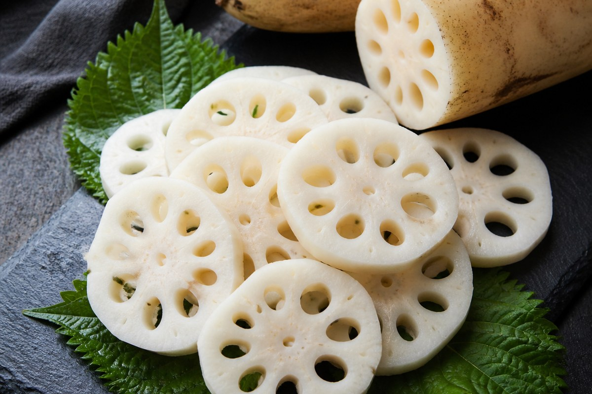

*▲ 연근 100g은 75kcal, 탄수화물 17.28g, 식이섬유 3.3g, 칼륨 478mg, 비타민C 28.35mg입니다. 식품성분표의 데친 연근 값은 비타민C가 17.3mg으로 39% 낮습니다.*

한 줄 결론 <strong>연근 100g은 75kcal에 탄수화물 17.28g, 식이섬유 3.3g, 칼륨 478mg, 비타민C 28.35mg입니다.</strong> 열량은 낮지만 무게의 17%가 전분이라 채소라기보다 <strong>탄수화물 식품</strong>에 가깝습니다. 비타민C는 열에 약해, 국가표준식품성분표의 데친 연근 값은 생것보다 비타민C가 39% 낮습니다(조리 조건에 따라 차이). <strong>두껍게 썰어 짧게 익히는 쪽</strong>이 손실이 적습니다.

11월은 연근이 가장 단단하고 전분이 알차는 시기입니다. 김장철 반찬으로 연근조림을 한 번쯤 만들게 되고, 그때마다 "연근은 위에 좋다더라", "연근 칼로리가 낮다더라"는 말이 함께 따라옵니다. 실제로 연근은 10월부터 이듬해 2월까지가 제철이고, 국내에서 가장 많이 쓰이는 뿌리채소 중 하나입니다.

검색창에 가장 많이 들어오는 질문은 세 가지입니다. **"연근 칼로리는 정말 75kcal인가?"**, **"연근이 위염에 좋다는 게 사실인가?"**, **"연근을 데치면 영양소가 다 없어지나?"** 결론부터 말하면 연근은 **열량 대비 식이섬유와 칼륨이 많은 뿌리채소**이고, 위에 좋다는 이야기는 성분보다 식감에서 오는 부분이 큽니다.

아래에서는 농촌진흥청 국가표준식품성분표(연근, 생것)와 USDA FoodData Central 수치를 기준으로 연근 100g의 영양, 데친 연근과 생연근의 차이, 위 건강설의 근거 수준, 그리고 연근조림·연근즙을 먹을 때 실제로 달라지는 양을 정리했습니다.

---

## 1. 연근 칼로리와 영양성분은? (100g 75kcal)

아래 수치는 **연근(생것, 가식부) 100g** 기준입니다. 연근은 껍질과 양끝을 잘라내고 먹기 때문에 실제 구입 무게에서는 약 10%가 버려지고, 버리는 부분을 포함한 100g당 열량은 68kcal입니다.

| 영양 성분 (Nutrient) | 함량 (100g당) | 1일 권장 섭취량 비율 (한국인 성인 기준) |
| :--- | :--- | :--- |
| **열량 (Energy)** | 75 kcal | 3.8% |
| **수분 (Water)** | 80.0 g | 별도 표기¹ |
| **탄수화물 (Carbohydrates)** | 17.28 g | 5.3% |
| - 총 당류 (Total Sugars) | 1.81 g | 1.8% |
| - 식이섬유 (Dietary Fiber) | 3.3 g | 13.2% |
| - 수용성 식이섬유 (Soluble) | 0.9 g | 기준치 없음 |
| - 불용성 식이섬유 (Insoluble) | 2.4 g | 기준치 없음 |
| **단백질 (Protein)** | 1.63 g | 3.0% |
| **지방 (Total Fat)** | 0.07 g | 0.1% |
| - 포화지방 (Saturated Fat) | 0.02 g | 0.1% |
| - 콜레스테롤 (Cholesterol) | 0 mg | 0.0% |
| **칼륨 (Potassium)** | 478 mg | 13.7% |
| **칼슘 (Calcium)** | 28 mg | 4.0% |
| **인 (Phosphorus)** | 75 mg | 10.7% |
| **마그네슘 (Magnesium)** | 23 mg | 7.3% |
| **철분 (Iron)** | 0.8 mg | 8.0% |
| **아연 (Zinc)** | 0.24 mg | 2.8% |
| **구리 (Copper)** | 0.13 mg | 16.3% |
| **망간 (Manganese)** | 1.89 mg | 63.0% |
| **셀레늄 (Selenium)** | 0.5 µg | 0.9% |
| **비타민C (Vitamin C)** | 28.35 mg | 28.4% |
| **비타민B1 (Thiamin)** | 0.09 mg | 7.5% |
| **비타민B2 (Riboflavin)** | 0.12 mg | 8.6% |
| **나이아신 (Niacin)** | 0.14 mg | 0.9% |
| **엽산 (Folate)** | 7 µg DFE | 1.8% |
| **비타민A·D·K** | 0 | 기준 미달 |
| **나트륨 (Sodium)** | 21 mg | 1.1% |
| **식염상당량 (Salt Equivalent)** | 0.1 g | 기준치 없음 |

**표 읽는 법:** 당류·탄수화물·단백질·지방·나트륨·비타민C의 %는 식품 표시용 1일 영양성분 기준치(2,000kcal, 탄수화물 324g·당류 100g·단백질 55g·지방 54g·나트륨 2,000mg·비타민C 100mg 기준) 대비입니다. 칼륨·칼슘·인·마그네슘·철분의 %는 한국인 영양소 섭취기준 성인 권장량(칼륨 3,500mg, 칼슘 700mg, 인 700mg, 마그네슘 315mg, 철분 10mg) 대비입니다. ¹수분과 수용성·불용성 식이섬유, 식염상당량은 1일 기준치가 설정되지 않아 절대량만 적었습니다. ²비타민A·D·K는 원자료에 0으로 기록돼 있습니다. 연근은 잎을 먹는 채소가 아니라 뿌리라서 카로티노이드도, 지용성 비타민도 거의 없습니다.

*※ 데이터 기준: 표의 수치는 국내 국가표준식품성분표(식약처 식품영양성분 DB)의 연근, 생것, 가식부 분석값입니다. 같은 식품의 [USDA FoodData Central FDC 169250](https://fdc.nal.usda.gov/food-details/169250/nutrients) — Lotus root, raw (SR Legacy)는 100g당 74 kcal·단백질 2.6 g입니다. 이 글의 75 kcal·단백질 1.63 g은 국내 연근 값이며, 단백질 값에서 차이가 납니다.*

<strong>출처:</strong> 농촌진흥청 국가표준식품성분표 DB 10.4(연근, 생것 / 데친것) · <a href="https://fdc.nal.usda.gov/" rel="nofollow noopener" target="_blank">USDA FoodData Central</a> (Lotus root, raw) · 보건복지부 2025 한국인 영양소 섭취기준

### 생연근과 데친 연근, 숫자가 이렇게 달라진다

연근은 대부분 익혀 먹습니다. 데치는 순간 수분이 들어오고 수용성 성분이 빠져나가면서 표의 숫자가 바뀝니다.

| 연근 100g (가식부) | 생것 | 데친 것 | 변화 |
| :--- | :--- | :--- | :--- |
| **열량** | 75 kcal | 62 kcal | -17% |
| **수분** | 80.0 g | 84.0 g | +4.0 g |
| **탄수화물** | 17.28 g | 14.41 g | -16.6% |
| **식이섬유** | 3.3 g | 2.8 g | -15.2% |
| **비타민C** | 28.35 mg | 17.32 mg | **-38.9%** |
| **망간** | 1.89 mg | 0.99 mg | -47.6% |
| **구리** | 0.13 mg | 0.06 mg | -53.8% |

열량이 줄어드는 건 영양이 사라져서가 아니라 **물이 들어와 무게가 늘었기 때문**입니다. 같은 100g을 먹어도 데친 연근은 실제 연근의 양이 적습니다. 반면 비타민C와 망간은 물에 녹아 실제로 빠져나갑니다. 비타민C 기준으로 보면 데치기 전 28.35mg이 데친 뒤 17.32mg으로 줄어 **11mg이 물로 간 것**입니다.

### 실생활 환산: 한 조각, 연근조림 한 접시는 몇 kcal인가?

| 섭취 기준 | 중량 | 열량과 핵심 수치 |
| :--- | :--- | :--- |
| 연근 한 조각(0.5cm) | 15 g | **11 kcal** · 탄수화물 2.6 g · 식이섬유 0.5 g |
| 연근조림 한 접시 | 50 g | 38 kcal + 조림 양념(간장·조청) 40~60 kcal |
| 생연근 한 마디 | 200 g | **150 kcal** · 탄수화물 34.6 g · 식이섬유 6.6 g |
| 연근즙 한 잔 | 200 ml | 90~100 kcal · 탄수화물 20 g (식이섬유는 대부분 걸러짐) |
| 연근칩(튀김) 한 봉 | 30 g | **150~170 kcal** · 지방 10 g 이상 |

연근 자체는 100g에 75kcal로 낮지만, **연근조림과 연근튀김은 요리법이 열량을 결정합니다**. 조림은 조청·설탕이, 튀김은 기름이 붙기 때문입니다. 연근을 다이어트 식품으로 생각한다면 조리법부터 확인해야 합니다.

---

## 2. 연근의 4가지 영양 포인트와 근거 수준

### 연근은 정말 위에 좋은가?

직접적인 인체 근거는 약합니다. 연근의 끈적한 점질물은 수용성 다당류로, 위 점막을 코팅한다는 설명은 실험실·동물 연구 수준에 머물러 있습니다. 다만 부드러운 식감과 수분 80%, 소화되기 쉬운 전분은 실제로 위가 예민할 때 부담을 줄여 줍니다.

연근의 끈적임을 '뮤신'이라고 부르는 글을 자주 보게 됩니다. 그러나 연근의 점질물은 **펙틴과 전분 분해물이 섞인 점액성 다당류**로, 위벽 점액의 주성분인 뮤신과 같은 물질은 아닙니다. 위염 환자에게 연근즙을 권하는 임상시험도 아직 충분하지 않습니다.

그럼에도 연근이 위에 편한 식재료로 불리는 이유는 따로 있습니다. 첫째, **섬유질이 질기지 않습니다**. 불용성 식이섬유 2.4g은 대부분 연한 세포벽 구조로 들어 있어, 생채소보다 위를 긁는 느낌이 적습니다. 둘째, **수분이 80%**라 죽·찜처럼 조리하면 부피 대비 열량이 낮습니다. 셋째, **전분이 호화되면서 부드러워집니다**.

정리하면 연근은 위에 **부담이 적은 음식**이지, 위염을 치료하는 음식은 아닙니다. 위가 불편할 때는 연근을 푹 익혀 부드럽게 먹고, 속이 쓰리면 연근보다 자극이 적은 죽·미음부터 시작하는 편이 좋습니다.

### 연근 비타민C는 데치면 얼마나 남나?

생연근 100g에 28.35mg이던 비타민C가 데치면 17.32mg으로 39% 줄어듭니다. 국물에 녹아 나간 양이 대부분이라, 데친 물을 버리면 그만큼 손실됩니다. 1분 이내로 짧게 데치고 식초를 조금 넣으면 손실과 갈변을 함께 줄일 수 있습니다.

연근은 뿌리채소 중에서 비타민C가 많은 편입니다. 100g당 28.35mg은 성인 1일 기준치(100mg)의 28%로, 같은 무게의 사과(4~5mg)보다 6배 가까이 많습니다. 문제는 이 비타민C가 **물과 열에 모두 약하다**는 점입니다.

국가표준식품성분표의 데친 연근 수치는 생것보다 39% 낮습니다. 이는 특정 조리 조건의 분석값이므로, 가정 조리에서는 데치는 시간이 길수록, 썰은 두께가 얇을수록 손실이 커진다고 보는 것이 합리적입니다. 손실을 줄이는 방법은 세 가지입니다.

- **두껍게 썰기:** 0.3cm보다 0.7cm가 표면적이 작아 유출이 적습니다.
- **끓는 물에 짧게:** 찬물부터 넣으면 가열 시간이 길어집니다. 끓는 물에 1분 이내가 기준입니다.
- **데친 물 활용:** 조림·국물에 그 물을 쓰면 녹아 나온 비타민C를 일부 회수할 수 있습니다.

반대로 연근을 오래 삶아 으깨는 요리는 비타민C 기대치가 낮습니다. 그때는 비타민C는 다른 채소에서 채우고, 연근은 식이섬유·칼륨 공급원으로 보는 게 정확합니다.

### 연근 칼륨 478mg은 혈압에 도움이 되나?

방향은 맞습니다. 연근 100g의 칼륨 478mg은 성인 권장량의 14%로, 같은 무게의 배추(222mg)보다 두 배 많습니다. 칼륨은 신장에서 나트륨 배출을 돕고 혈압을 낮추는 방향으로 작용합니다. 다만 신장 기능이 떨어진 사람에게는 반대로 위험할 수 있습니다.

연근은 나트륨이 21mg으로 매우 낮고 칼륨이 478mg으로 높습니다. 이 조합은 **나트륨을 많이 먹는 한국 식단에서 의미가 있습니다**. 국·찌개·장아찌로 짜게 먹는 날, 반찬으로 연근조림이나 연근샐러드를 곁들이면 칼륨 섭취가 늘어납니다.

주의할 점은 조림 양념입니다. 연근조림은 간장과 조청을 쓰기 때문에 **나트륨이 100g당 300~500mg까지 올라갑니다**. 칼륨 이점을 살리려면 간장을 줄이고, 조림 대신 데쳐서 들기름·식초로 무치는 방식이 낫습니다.

신장질환이 있거나 투석 중이라면 칼륨 478mg은 무시할 수 없는 양입니다. 하루 칼륨 제한이 2,000mg인 경우 연근 100g이 4분의 1을 차지합니다. 이때는 데친 뒤 물을 한 번 더 갈아 끓여 칼륨을 일부 빼는 방법을 의료진과 상의하세요.

### 연근의 탄닌·폴리페놀, 항산화 효과는 어느 정도인가?

연근을 자르면 금세 갈변하는 것은 폴리페놀 산화효소(PPO)가 탄닌을 산화시키기 때문입니다. 시험관 실험에서는 항산화·항염 작용이 보고됐지만, 연근을 먹는 양으로 인체 효과를 입증한 임상은 부족합니다. 갈변을 막는 실용적인 방법은 산성 물에 담그는 것입니다.

연근의 떫은맛과 갈변은 **탄닌과 클로로겐산 계열 폴리페놀**에서 옵니다. 칼로 자른 면이 공기 중에서 갈색으로 변하는 것은 PPO 효소가 산소와 만나 폴리페놀을 산화시키는 반응입니다. 이 반응은 산성에서 느려지므로 **식초나 레몬즙을 몇 방울 넣은 물에 5분 담그면** 색이 유지됩니다.

폴리페놀의 건강 효과는 기대치를 조절해야 합니다. 시험관·동물 연구에서는 연근 추출물의 항산화, 지질 개선, 간 보호 작용이 보고됐지만, 사람이 연근 반찬 한 접시를 먹는 양으로 같은 결과가 나오는지는 확인되지 않았습니다.

대신 연근에는 **망간이 1.89mg** 들어 있습니다. 이는 1일 기준치(3mg)의 63%로, 뿌리채소 중에서도 매우 높은 수준입니다. 망간은 항산화 효소(망간 슈퍼옥사이드 디스무타아제)와 뼈 형성에 관여하는 미량원소라, 연근의 실제 영양학적 강점은 폴리페놀보다 이쪽에 있습니다.

---

## 3. 영양 손실을 줄이는 손질·조리·보관 가이드

- **껍질은 얇게 벗기세요.** 연근 껍질 바로 아래에 폴리페놀과 식이섬유가 몰려 있습니다. 필러로 1mm 정도만 벗기면 충분합니다.
- **자른 즉시 식초물에 담그세요.** 물 1L에 식초 1큰술. 5분 담갔다가 물기를 빼면 갈변이 거의 없고, 조림 색도 깔끔해집니다.
- **데치기는 끓는 물에 1분.** 찬물부터 시작하면 가열 시간이 길어져 비타민C 손실이 커집니다. 데친 뒤 찬물에 헹구면 조직이 단단해져 씹는 맛이 살아납니다.
- **연근조림은 조청을 줄이세요.** 조청 2큰술이면 당류가 10g 이상 붙습니다. 간장·맛술·올리고당으로 졸이고 마지막에 들기름을 두르는 편이 당을 아낄 수 있습니다.
- **튀김은 흡유가 많습니다.** 연근칩은 100g당 지방이 30g을 넘기도 합니다. 에어프라이어로 얇게 구우면 기름을 크게 줄일 수 있습니다.
- **연근즙은 식이섬유가 빠집니다.** 즙을 내면 3.3g의 식이섬유 대부분이 걸러져 당만 남습니다. 혈당이 신경 쓰인다면 즙보다 썰어 먹는 쪽을 권합니다.
- **보관은 신문지에 싸서 냉장 7일.** 연근은 수분이 많은 뿌리라 비닐에 밀봉하면 곰팡이가 생깁니다. 자른 연근은 식초물에 10분 담갔다가 물기를 빼고 밀폐 용기에 넣으면 3~4일 더 갑니다.

---

## 4. 섭취 시 주의사항 및 부작용

- **생으로 먹지 마세요.** 연근은 진흙에서 자라는 수생식물이라 흙과 기생충(간흡충 등) 오염 가능성이 있습니다. 충분히 익혀 먹고, 연근즙도 데친 연근으로 만드는 편이 좋습니다.
- **혈당 관리 중이라면 '채소'로 세지 마세요.** 연근 100g의 탄수화물은 17.28g으로 밥 3분의 1 공기에 해당합니다. 당뇨 식단에서는 채소가 아니라 **탄수화물 교환단위**로 계산해야 합니다. 한 끼 50~100g이 무난합니다.
- **신장질환자는 칼륨을 계산하세요.** 100g당 478mg은 낮지 않습니다. 투석 환자나 만성신장질환자라면 섭취량을 의료진과 상의하세요.
- **과민성대장증후군은 양을 조절하세요.** 불용성 식이섬유 2.4g은 장이 예민한 사람에게 가스·복부팽만을 일으킬 수 있습니다. 한 번에 많은 양을 먹지 말고 소량부터 시작하세요.
- **연근 알레르기는 드물지만 있습니다.** 연근을 손질할 때 손이 가렵거나 입술이 붓는 경우가 드물게 보고됩니다. 생연근 즙이 피부에 닿으면 자극이 될 수 있으니 장갑을 끼세요.
- **연근차·연근환은 식품입니다.** 특정 질환 치료를 기대하고 다량 섭취하면 칼륨·전분 과다가 될 수 있습니다. 하루 1~2잔 정도면 무난하지만, 칼륨 제한 식이 중이라면 의사와 상의하세요.
- **조림·장아찌의 나트륨을 보세요.** 연근 자체는 나트륨이 21mg뿐이지만, 조림 한 접시에는 300mg 이상이 붙습니다. 짠 반찬과 함께 먹으면 칼륨 이점이 상쇄됩니다.

---

## 5. 자주 묻는 질문 (FAQ)

**Q1. 연근은 하루에 얼마나 먹으면 좋나요?**  
건강한 성인은 **하루 100~200g**이 적당합니다. 열량 75~150kcal, 탄수화물 17~35g, 식이섬유 3.3~6.6g입니다. 혈당 관리가 필요하다면 한 끼 50~100g으로 제한하고, 밥 양을 그만큼 줄여 드세요.

**Q2. 연근을 데치면 영양소가 다 없어지나요?**  
다 없어지지는 않습니다. 물에 녹는 **비타민C는 눈에 띄게 줄고**, 식이섬유·칼륨·전분은 비교적 덜 줄어듭니다. 망간 등 미네랄의 손실률은 분석 조건에 따라 보고가 달라 단정할 수 없습니다. 데치는 시간을 1분 이내로 줄이고 두껍게 썰면 손실을 줄이는 데 도움이 됩니다.

**Q3. 연근즙이 위염에 좋다는 게 사실인가요?**  
**근거가 부족합니다.** 연근의 점질 다당류가 위 점막을 보호한다는 설명은 실험실 수준이고, 위염 환자를 대상으로 한 임상 연구는 거의 없습니다. 위가 불편할 때는 연근즙보다 자극이 적은 죽·미음이 안전하며, 증상이 지속되면 진료를 받으세요.

---

## 6. 연근과 함께 먹으면 좋은 음식

- **[당근 (Carrot)](/posts/carrot-nutrition-benefits/):** 연근은 탄수화물과 칼륨, 당근은 베타카로틴과 식이섬유를 담당합니다. 연근조림에 당근을 함께 넣으면 색과 영양이 모두 채워지고, 당근의 단맛으로 조청 양을 줄일 수 있습니다.
- **[브로콜리 (Broccoli)](/posts/broccoli-nutrition-benefits/):** 연근은 데치면 비타민C가 39% 낮아지지만, 브로콜리는 100g당 비타민C가 100mg을 넘습니다. 브로콜리는 살짝 데쳐 함께 곁들이면 한 접시의 비타민C를 보완할 수 있습니다.
- **[돼지고기 안심 (Pork Tenderloin)](/posts/pork-tenderloin-nutrition-benefits/):** 연근의 탄수화물·식이섬유에 안심의 단백질을 더하면 한 끼 균형이 맞습니다. 연근을 얇게 썰어 안심과 함께 볶으면 조림보다 당과 나트륨이 적습니다.
- **[저GI 음식 혈당 가이드](/posts/low-gi-foods-blood-sugar-guide/):** 연근처럼 전분이 많은 뿌리채소를 밥 대신 얼마큼 써야 하는지 기준을 정리한 글입니다.

  
📌 관련 순위 가이드

  <ul>
    <li><a href="/posts/low-gi-foods-blood-sugar-guide/">저GI 음식 가이드: 혈당 천천히 올리는 식품</a></li>
    <li><a href="/posts/low-calorie-high-satiety-foods/">포만감 높은 저칼로리 음식 정리</a></li>
  </ul>

---

## 7. 연근 어떻게 먹을까? 핵심 요약

- 연근 100g은 **75kcal·탄수화물 17.28g·식이섬유 3.3g·칼륨 478mg·비타민C 28.35mg**입니다.
- 열량은 낮지만 **전분 비중이 높아 채소가 아닌 탄수화물 식품**입니다. 한 끼 50~100g이 기준입니다.
- **식품성분표의 데친 연근은 비타민C가 28.35mg에서 17.32mg으로 39% 낮습니다.** 끓는 물에 짧게, 두껍게 썰어 익히면 손실을 줄일 수 있습니다.
- 위에 좋다는 말은 **부드러운 식감과 수분에서 오는 이점**이지 치료 효과가 아닙니다.
- 칼륨 478mg은 혈압 관리에 방향이 맞지만, **신장질환자는 양을 계산**해야 합니다.
- 연근조림·연근튀김은 **양념과 기름이 열량을 결정**합니다. 연근 자체는 75kcal입니다.
- **생연근은 익혀 드세요.** 수생식물이라 흙·기생충 오염 가능성이 있습니다.

