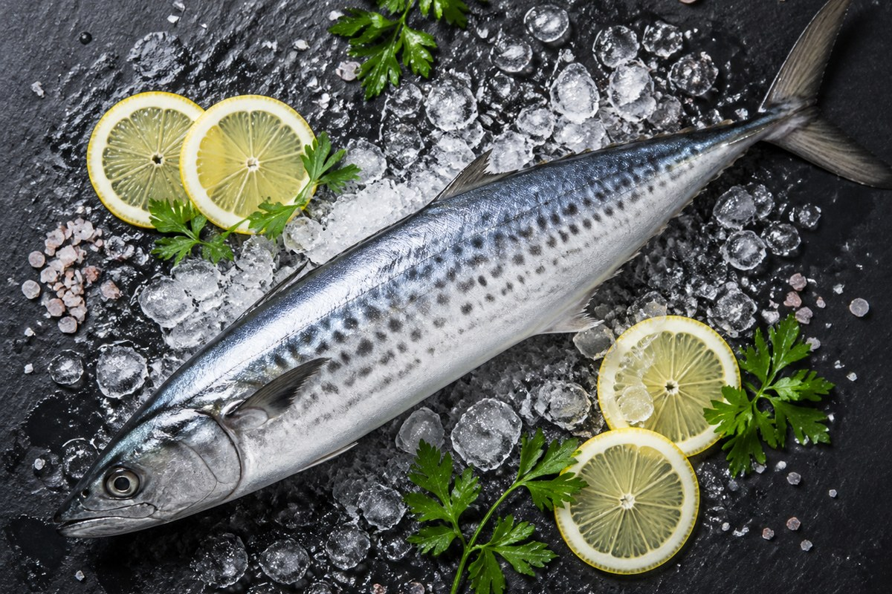

*▲ 삼치 100g은 112kcal, 단백질 20.08g, 지방 2.93g, EPA+DHA 1,000mg입니다. 같은 100g을 구우면 수분이 빠져 184kcal가 됩니다.*

한 줄 결론 <strong>삼치 100g은 112kcal에 단백질 20.08g, 지방 2.93g, EPA와 DHA를 합쳐 1,000mg입니다.</strong> 지방이 적은데도 오메가3가 고등어 못지않게 들어 있고, 단백질 1일 기준치의 37%를 한 토막으로 채웁니다. 다만 <strong>구우면 184kcal</strong>가 되고, 등푸른생선이라 <strong>신선도가 떨어지면 히스타민 중독</strong> 위험이 있으니 구입 후 바로 냉장하세요.

해양수산부가 2026년 11월의 수산물로 **삼치와 가리비**를 선정했습니다. 삼치는 가을부터 살에 지방이 차올라 11월부터 겨울까지가 가장 맛있는 시기이고, 소금구이·조림·찜·회로 두루 쓰입니다. 11월 제철 음식을 찾는 검색이 늘어나는 때라 지금이 가장 알맞은 재료이기도 합니다.

많이 검색되는 질문은 세 가지입니다. **"삼치 칼로리가 정말 112kcal인가?"**, **"삼치 오메가3가 고등어보다 많은가?"**, **"삼치를 구우면 왜 열량이 확 오르나?"** 결론부터 말하면 삼치는 **단백질 비중이 75%인 저지방 등푸른생선**이고, 오메가3는 100g당 1,000mg으로 성인 하루 권고량을 한 번에 넘깁니다.

아래에서는 식품의약품안전처·국립수산과학원의 삼치 성분값과 USDA FoodData Central 수치를 나란히 놓고, 생것과 구운 것의 차이, 오메가3의 실제 양, 비린내를 줄이는 조리법, 등푸른생선에서 꼭 알아야 할 히스타민 주의점을 정리했습니다.

---

## 1. 삼치 칼로리와 영양성분은? (100g 112kcal)

아래 수치는 **삼치(생것, 가식부) 100g** 기준입니다. 삼치는 머리·뼈·내장을 제거하고 먹기 때문에 폐기율이 56%에 이릅니다. 즉 시장에서 100g을 사면 실제로 먹는 살은 44g이고, 그 44g에서 열량은 약 49kcal입니다.

| 영양 성분 (Nutrient) | 함량 (100g당) | 1일 권장 섭취량 비율 (한국인 성인 기준) |
| :--- | :--- | :--- |
| **열량 (Energy)** | 112 kcal | 5.6% |
| **수분 (Water)** | 76.0 g | 별도 표기¹ |
| **단백질 (Protein)** | 20.08 g | 36.5% |
| **지방 (Total Fat)** | 2.93 g | 5.4% |
| - 포화지방 (Saturated Fat) | 0.75 g | 5.0% |
| - 단일불포화지방 (MUFA) | 0.56 g | 기준치 없음 |
| - 다중불포화지방 (PUFA) | 1.16 g | 기준치 없음 |
| - **EPA + DHA** | **1,000.8 mg** | 기준치 없음² |
| - 오메가3 지방산 합계 | 1.06 g | 기준치 없음 |
| - 오메가6 지방산 | 0.09 g | 기준치 없음 |
| - 콜레스테롤 (Cholesterol) | 4.8 mg | 1.6% |
| **탄수화물 (Carbohydrates)** | 0 g | 0.0% |
| - 당류 (Sugars) | 0 g | 0.0% |
| - 식이섬유 (Dietary Fiber) | 0 g | 0.0% |
| **칼륨 (Potassium)** | 387 mg | 11.1% |
| **인 (Phosphorus)** | 211 mg | 30.1% |
| **마그네슘 (Magnesium)** | 30 mg | 9.5% |
| **칼슘 (Calcium)** | 5 mg | 0.7% |
| **철분 (Iron)** | 0.1 mg | 1.0% |
| **아연 (Zinc)** | 0.56 mg | 6.6% |
| **구리 (Copper)** | 0.02 mg | 2.5% |
| **나트륨 (Sodium)** | 39 mg | 2.0% |
| **비타민B12 (Cobalamin)** | 3.25 µg | 135.4% |
| **비타민B1 (Thiamin)** | 0.08 mg | 6.7% |
| **비타민B2 (Riboflavin)** | 0.06 mg | 4.3% |
| **판토텐산 (B5)** | 0.38 mg | 7.6% |
| **바이오틴 (B7)** | 17.58 µg | 58.6% |
| **비타민E (Tocopherol)** | 0.14 mg | 1.4% |
| **비타민C·D** | 원자료 미수록³ | 기준 미달 |
| **회분 (Ash)** | 2.05 g | 기준치 없음 |

**표 읽는 법:** 당류·탄수화물·단백질·지방·포화지방·나트륨·비타민의 %는 식품 표시용 1일 영양성분 기준치(2,000kcal, 단백질 55g·지방 54g·포화지방 15g·나트륨 2,000mg·비타민B12 2.4µg 기준) 대비입니다. 칼륨·인·마그네슘·칼슘·철분의 %는 한국인 영양소 섭취기준 성인 권장량(칼륨 3,500mg, 인 700mg, 마그네슘 315mg, 칼슘 700mg, 철분 10mg) 대비입니다. ¹수분은 1일 기준치가 없어 절대량만 적었습니다. ²EPA+DHA는 국내 1일 기준치가 설정돼 있지 않아, 세계보건기구·유럽식품안전청의 성인 권고(EPA+DHA 하루 250mg)와 비교해 읽으시면 됩니다. ³비타민C와 비타민D는 국내 원자료에 값이 없습니다. USDA는 같은 어종 생것 100g에 비타민D 7.3µg을 기록하고 있고, 이는 1일 기준치의 73%에 해당합니다.

<strong>출처:</strong> 식품의약품안전처 식품영양성분 DB · 국립수산과학원 표준수산물성분표(삼치, 생것 / 구운것 / 젓갈) · <a href="https://fdc.nal.usda.gov/" rel="nofollow noopener" target="_blank">USDA FoodData Central</a> (Fish, mackerel, spanish, raw, FDC 173673) · 해양수산부 2026년 11월 이달의 수산물 보도자료

### 생삼치와 구운 삼치, 같은 100g인데 왜 184kcal인가

| 삼치 100g | 생것 | 구운 것 | 변화 |
| :--- | :--- | :--- | :--- |
| **열량** | 112 kcal | 184 kcal | +64% |
| **수분** | 76.0 g | 63.8 g | -12.2 g |
| **단백질** | 20.08 g | 23.6 g | +17.5% |
| **지방** | 2.93 g | 10.8 g | **+269%** |
| **EPA + DHA** | 1,000.8 mg | 1,560 mg | +56% |
| **비타민B12** | 3.25 µg | 5.3 µg | +63% |

구우면 열량이 64% 오르는 것처럼 보이지만, **고기 자체가 늘어난 것이 아닙니다**. 수분 12g이 빠지면서 같은 100g 안에 들어 있는 살의 양이 많아진 것입니다. 실제로 삼치 100g을 구우면 완성품은 70~80g으로 줄어듭니다. 생삼치 130g을 구워 100g이 되었다면, 그 100g은 184kcal이 아니라 원래의 112kcal×1.3에 해당합니다.

지방이 2.93g에서 10.8g으로 3.7배 늘어난 것도 같은 원리입니다. 굽는 동안 수분이 빠지고, 삼치의 지방은 살 속에 남아 있기 때문입니다. **지방이 많은 삼치는 이 수치가 더 크게 오릅니다**. 같은 삼치라도 겨울철 기름이 오른 개체는 생것부터 지방이 5g을 넘기도 합니다.

### 삼치 종류별 차이: 줄삼치·평삼치·젓갈

| 구분 (100g) | 열량 | 단백질 | 지방 | EPA+DHA |
| :--- | :--- | :--- | :--- | :--- |
| **삼치(생것)** | 112 kcal | 20.08 g | 2.93 g | 1,000.8 mg |
| **줄삼치(생것)** | 134 kcal | 24.6 g | 3.1 g | 별도 표기 없음 |
| **평삼치(생것)** | 121 kcal | 17.9 g | 4.8 g | 별도 표기 없음 |
| **삼치 구운것** | 184 kcal | 23.6 g | 10.8 g | 1,560 mg |
| **삼치 젓갈** | 101 kcal | 22.7 g | 1.1 g | 별도 표기 없음 |

삼치는 지역과 시장에서 줄삼치·평삼치로 나뉘어 유통됩니다. 줄삼치는 몸이 길고 살이 두꺼워 단백질이 24.6g으로 더 높고, 평삼치는 지방이 4.8g으로 조금 많습니다. **젓갈은 열량이 101kcal로 가장 낮아 보이지만, 염분이 100g당 2,000mg을 넘는 경우가 많아** 혈압 관리 중이라면 피하는 편이 낫습니다.

### 실생활 환산: 한 토막, 한 마리는 몇 kcal인가?

| 섭취 기준 | 중량 | 열량과 핵심 수치 |
| :--- | :--- | :--- |
| 삼치 한 토막(생것) | 80 g | **90 kcal** · 단백질 16 g · EPA+DHA 800 mg |
| 삼치 한 토막(구운 것) | 60 g | 110 kcal · 단백질 14 g |
| 소금구이 1인분(생것 150g) | 150 g | **168 kcal** · 단백질 30 g |
| 삼치조림 1인분 | 150 g + 양념 | 168 kcal + 간장·물엿 60~90 kcal |
| 삼치 한 마리(중형) | 600 g | 가식부 264 g · **296 kcal** |

삼치 한 토막(80g)이면 단백질 16g과 오메가3 800mg을 함께 얻습니다. 성인 단백질 권장량이 하루 55~65g인 것을 감안하면 **한 끼 주단백질로 충분한 양**입니다.

---

## 2. 과학적으로 입증된 4대 건강 효능

### 삼치는 단백질 식품인가?

맞습니다. 100g당 단백질 20.08g으로 열량의 약 75%가 단백질에서 나옵니다. 지방은 2.93g뿐이라 닭가슴살(23g·1.2g)과 비슷한 단백질 밀도에 오메가3까지 붙은 구성입니다. 다만 필수아미노산 조성은 어류라 라이신·류신이 많고, 메티오닌은 상대적으로 적습니다.

삼치 100g의 단백질 20.08g은 성인 1일 기준치(55g)의 36.5%입니다. 삼겹살(13.9g)이나 계란 3개(19g)와 비교하면 같은 무게에서 더 많은 단백질을 얻습니다. 총 아미노산은 18.8g으로 이 중 필수아미노산이 49%를 차지합니다.

단백질만 놓고 보면 닭가슴살이 더 효율적입니다. 그런데 삼치에는 **단백질과 함께 오메가3, 비타민B12, 셀레늄이 붙어 옵니다**. 닭가슴살 100g에는 EPA+DHA가 사실상 없고 비타민B12도 0.3µg 수준입니다. 그래서 삼치는 "단백질 공급원"이라기보다 **"단백질 + 지방산 + 미량영양소를 한 번에 받는 식재료"**로 보는 편이 정확합니다.

### 삼치 오메가3 1,000mg은 어느 정도 양인가?

성인 하루 권고량(EPA+DHA 250mg)의 4배입니다. 100g당 DHA 814mg, EPA 186mg이며, 일주일에 두 번 100g씩 먹으면 오메가3 보충제 없이도 권고량을 채웁니다. 다만 열에 약해 굽거나 튀기면 일부 손실됩니다.

삼치의 지방은 2.93g뿐인데 그중 **1.06g이 오메가3**입니다. 지방산 구성에서 오메가3가 42%, 오메가6가 3.6%로, 오메가6 대비 오메가3 비율이 약 12:1입니다. 서구 식단의 평균 비율이 15~20:1인 것을 감안하면 매우 유리한 구성입니다.

EPA와 DHA는 혈중 중성지방을 낮추고, 혈소판 응집과 염증 반응에 관여합니다. 미국심장협회는 **일주일에 지방이 많은 생선 2회(약 200~250g)** 섭취를 권고합니다. 삼치 100g 두 번이면 이 기준을 충족합니다.

주의할 점은 조리입니다. EPA와 DHA는 다중불포화지방산이라 산화에 약합니다. **200℃ 이상의 직화나 반복 사용한 기름**에 노출되면 산패가 진행됩니다. 삼치는 소금구이처럼 180℃ 전후에서 짧게 익히거나, 조림·찜처럼 물을 매개로 익히는 편이 지방산 보존에 유리합니다.

### 삼치 구우면 왜 열량이 184kcal로 오르나?

수분이 12g 빠져나가면서 같은 무게에 더 많은 살과 지방이 농축되기 때문입니다. 실제로 먹는 양 기준으로는 열량이 늘지 않습니다. 생삼치 150g을 구워 110g이 되었다면 그 한 접시는 168kcal입니다.

조리법에 따라 같은 삼치도 숫자가 달라집니다. 여기서 중요한 것은 **"100g당"이 조리 후 무게인지 전 무게인지**입니다. 대부분의 식품 DB는 조리 후 상태를 따로 기록하므로, 구운 삼치 100g은 생삼치 130g과 같은 양입니다.

조리법별로 보면 이렇습니다.

- **소금구이:** 수분이 빠져 단백질·지방 밀도가 올라갑니다. 겉면을 마른팬에 먼저 지지면 비린내가 줄고, 기름은 일부 흘러내립니다.
- **조림:** 무·대파를 넣고 간장으로 졸이면 지방이 국물로 빠져나가 열량은 낮아지지만, 나트륨이 1,000mg 이상 올라갑니다.
- **젓갈:** 열량은 101kcal로 가장 낮지만 염분이 매우 높습니다. 반찬으로 한 젓가락씩만.
- **튀김:** 튀김옷과 기름으로 100g당 250kcal를 넘습니다. 오메가3 산화도 가장 큽니다.

결론은 **"구운 삼치 100g = 생삼치 130g"**으로 기억하면 됩니다. 접시에 담긴 양을 기준으로 보면 구이가 특별히 살찌는 요리는 아닙니다.

### 삼치의 비린내와 히스타민, 얼마나 조심해야 하나?

삼치는 고등어과라 신선도가 떨어지면 히스타민이 생겨 두드러기·두통·설사 같은 중독 증상이 날 수 있습니다. 구입 후 2시간 안에 냉장(0~4℃)하고, 살이 물러지거나 입안이 얼얼한 맛이 나면 버려야 합니다. 수은 농도는 대형어류보다 낮은 편입니다.

등푸른생선은 살 속의 히스티딘이 세균 효소로 분해되면 **히스타민**이 됩니다. 히스타민은 조리해도 파괴되지 않아, 상한 생선을 익혀 먹어도 두드러기·얼굴 붉어짐·두통·복통이 생길 수 있습니다. 삼치는 회로도 먹기 때문에 이 위험이 다른 생선보다 크지 않은 대신, **날것을 다룰 때 신선도 관리가 특히 중요**합니다.

실제 예방은 세 가지입니다. 첫째, **구입 즉시 아이스박스나 냉장고**로. 둘째, **손질 후 2시간 내 조리**, 하루 안에 먹기. 셋째, **냉동 보관 시 -18℃ 이하**에서 해동은 냉장 해동으로. 살에서 시큼한 냄새나 얼얼한 맛이 나면 히스타민을 의심하고 폐기하세요.

수은은 삼치가 대형 참치류보다 훨씬 낮습니다. 다만 임신부·수유부는 **다양한 생선을 주 2회 이내로 돌아가며** 먹는 식약처 권고를 따르는 편이 안전합니다.

---

## 3. 비린내를 줄이고 영양을 지키는 조리 가이드

- **소금물에 10분 담갔다가 굽세요.** 3% 소금물(물 1L에 소금 30g)에 10분 담그면 표면의 혈액과 점액이 빠져 비린내가 크게 줄고, 살이 단단해집니다.
- **마른팬에 껍질부터.** 기름을 두르지 않고 껍질을 아래로 3분 지지면 기름이 자연히 나옵니다. 뒤집개로 눌러 주면 껍질이 부서지지 않고 바삭해집니다.
- **생강·대파·청주로 잡내 제거.** 조림에는 생강 편과 대파를 먼저 깔고, 구이에는 청주나 맛술을 살짝 뿌립니다.
- **조림은 무를 함께.** 무의 칼륨과 수분이 짠맛을 부드럽게 하고, 무가 간장을 흡수해 생선살이 덜 짜집니다.
- **레몬·식초는 먹기 직전에.** 비린내 성분(트리메틸아민)은 산과 만나 염을 만들어 냄새가 줄지만, 미리 뿌려 두면 살이 하얗게 변합니다.
- **냉동 삼치는 저온 해동.** 실온 해동은 히스타민 생성 위험이 있어, 냉장실에서 6~8시간 해동하세요.
- **남은 삼치는 다음 날까지.** 조리한 생선은 냉장 2일을 넘기지 말고, 다시 데울 때는 속까지 75℃ 이상 가열하세요.

---

## 4. 섭취 시 주의사항 및 부작용

- **히스타민 중독을 조심하세요.** 상한 등푸른생선은 조리 후에도 두드러기·두통·구토를 일으킵니다. 항히스타민제로 증상이 완화되지만, 호흡 곤란이나 심한 두통이면 진료를 받으세요.
- **생선 알레르기가 있다면 피하세요.** 어류의 주요 알레르겐은 파르발부민이며, 삼치도 예외가 아닙니다. 조리 중 증기가 피부에 닿아도 두드러기가 날 수 있습니다.
- **뼈가 많습니다.** 삼치는 잔뼈가 촘촘해 아이와 어르신에게 줄 때는 반드시 발라서 주세요. 생선 뼈는 기도에 걸리면 위험합니다.
- **짠 조림·젓갈은 나트륨 과다.** 삼치 자체는 나트륨 39mg뿐이지만, 조림 한 접시에 간장 2큰술이면 1,000mg이 넘습니다. 하루 나트륨 목표(2,000mg)의 절반입니다.
- **통풍이 있다면 양을 조절하세요.** 생선은 퓨린이 중간 정도인 식품입니다. 급성 통풍 발작기에는 100g 이내로 줄이고 국물은 피하세요.
- **임신부·수유부는 종류를 돌려 드세요.** 삼치는 수은이 낮지만, 참치·새치 같은 대형어류와 번갈아 먹는 편이 안전합니다.
- **기름이 많은 겨울 삼치는 열량이 다릅니다.** 11~12월 삼치는 지방이 5g을 넘기도 합니다. 열량을 계산한다면 구입 시기를 함께 보세요.

---

## 5. 자주 묻는 질문 (FAQ)

**Q1. 삼치는 하루에 얼마나 먹으면 좋나요?**  
**하루 100g, 일주일에 2~3회**가 적당합니다. 1회 100g이면 열량 112kcal, 단백질 20g, EPA+DHA 1,000mg입니다. 등푸른생선은 일주일에 두 번 이상 먹도록 권장되므로, 고등어·연어와 번갈아 드시면 좋습니다.

**Q2. 삼치 오메가3가 고등어보다 많나요?**  
**비슷하거나 조금 적습니다.** 국내 자료 기준 삼치 생것 100g의 EPA+DHA는 1,000mg, 고등어(생것)는 1,500~1,800mg 수준입니다. 다만 삼치는 지방 총량이 2.93g으로 고등어(13g 안팎)보다 훨씬 적어, **같은 열량에서 오메가3 비중은 더 높습니다**. 기름진 생선이 부담스러울 때 삼치가 좋은 대안입니다.

**Q3. 삼치를 구우면 열량이 두 배가 되나요?**  
**아닙니다.** 구운 삼치 100g은 생삼치 약 130g에 해당합니다. 수분이 빠져 무게가 줄었을 뿐 실제 열량은 늘지 않습니다. 생삼치 100g을 구우면 완성품은 70~80g, 열량은 112kcal 그대로입니다.

---

## 6. 삼치와 함께 먹으면 좋은 음식

- **[무 (Radish)](/posts/radish-nutrition-benefits/):** 삼치조림의 정석 조합입니다. 무의 수분과 칼륨이 간장의 짠맛을 부드럽게 하고, 무가 국물을 흡수해 생선살이 덜 짜집니다. 무 100g을 함께 넣으면 나트륨 부담을 체감으로 줄일 수 있습니다.
- **[고등어 (Mackerel)](/posts/mackerel-nutrition-benefits/):** 같은 등푸른생선으로 오메가3 공급을 번갈아 채울 수 있습니다. 고등어는 지방이 13g 안팎으로 열량이 높고, 삼치는 2.93g으로 가볍습니다. 두 생선을 주 2회씩 돌려 먹는 식단이 실용적입니다.
- **[마늘 (Garlic)](/posts/garlic-nutrition-benefits/):** 마늘의 알리신은 생선의 비린내를 줄이고, 구이 양념으로 쓰면 소금 사용량을 줄일 수 있습니다. 삼치구이에 다진 마늘을 섞은 양념을 발라 보세요.
- **[고단백 식품 순위](/posts/high-protein-foods-ranking/):** 삼치의 단백질 20.08g이 닭가슴살·두부·계란과 비교해 어느 위치인지 정리한 글입니다.

  
📌 관련 순위 가이드

  <ul>
    <li><a href="/posts/high-protein-foods-ranking/">고단백 식품 순위: 단백질 밀도 비교</a></li>
    <li><a href="/posts/heart-blood-pressure-cholesterol-foods/">심장·혈압·콜레스테롤에 좋은 음식</a></li>
  </ul>

---

## 7. 삼치 어떻게 먹을까? 핵심 요약

- 삼치 100g은 **112kcal·단백질 20.08g·지방 2.93g·EPA+DHA 1,000mg**입니다.
- 열량의 75%가 단백질이고, **같은 무게에서 닭가슴살과 비슷한 단백질 밀도**에 오메가3가 붙은 식재료입니다.
- **구운 삼치 100g은 생삼치 130g**과 같습니다. 열량이 늘어난 것이 아니라 수분이 빠진 것입니다.
- EPA+DHA 1,000mg은 **성인 하루 권고의 4배**로, 주 2회 100g이면 충분합니다.
- 고등어과라 **히스타민 중독** 위험이 있습니다. 구입 후 2시간 내 냉장, 의심되면 폐기하세요.
- 조림·젓갈은 **나트륨이 1,000mg 이상** 붙습니다. 삼치 자체는 나트륨 39mg으로 매우 낮습니다.
- 11월부터 겨울이 제철이며, **기름이 오른 개체는 지방이 5g을 넘기도** 합니다.

