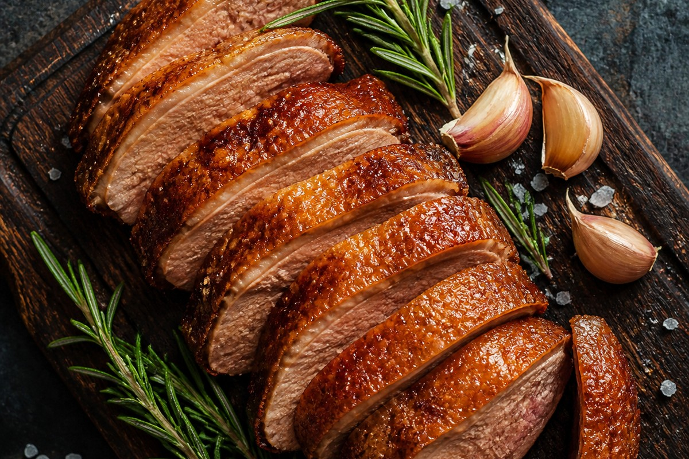

*▲ 오리 살코기 100g은 135kcal, 단백질 18.3g, 지방 5.95g, 철분 2.4mg입니다. 껍질과 지방층을 함께 넣으면 같은 100g이 404kcal까지 올라갑니다.*

한 줄 결론 <strong>오리 살코기(생것) 100g은 135kcal에 단백질 18.28g, 지방 5.95g, 철분 2.4mg, 나이아신 5.3mg입니다.</strong> 닭가슴살보다는 기름지지만 삼겹살(372kcal)의 3분의 1 수준으로, <strong>단백질 대비 열량이 낮은 축</strong>에 속합니다. 다만 껍질을 붙이면 같은 100g이 <strong>404kcal</strong>이 되므로, 오리고기의 건강 효과는 대부분 <strong>껍질과 기름을 어떻게 처리하느냐</strong>에서 갈립니다.

11월은 오리고기가 가장 맛있는 시기입니다. 오리백숙, 오리 주물럭, 오리 로스구이를 찾는 자리가 늘고, 방송에서 "불포화지방산이 많아 살이 안 찌는 고기"라는 말이 나오면서 주문이 몰립니다. 그런데 같은 오리고기라도 **껍질째 굽느냐, 살코기만 삶느냐**에 따라 열량이 세 배 넘게 벌어집니다.

검색창에 들어오는 질문은 세 가지로 모입니다. **"오리 100g 칼로리가 117kcal인가 135kcal인가?"**, **"오리가 삼겹살보다 정말 건강한가?"**, **"오리 기름은 먹어도 되나?"** 결론부터 말하면 오리고기는 **살코기 기준으로는 단백질 밀도가 좋은 고기**이고, **껍질과 기름을 그대로 먹으면 지방 덩어리**가 됩니다.

아래에서는 USDA FoodData Central(오리, 살코기, 생것·구운 것)과 농촌진흥청 국가표준식품성분표를 기준으로 오리 100g의 영양, 껍질 유무에 따른 차이, "불포화지방산이라 안 찐다"는 말의 실제 근거, 그리고 오리를 기름 없이 조리하는 방법을 정리했습니다.

---

## 1. 오리고기 칼로리와 영양성분은? (100g 135kcal)

아래 수치는 **오리 살코기(생것, 가식부) 100g** 기준입니다. USDA FoodData Central의 'Duck, domesticated, meat only, raw'(FDC 172410) 기록을 그대로 옮겼습니다. 껍질과 표면 지방을 제거한 상태입니다.

| 영양 성분 (Nutrient) | 함량 (100g당) | 1일 권장 섭취량 비율 (한국인 성인 기준) |
| :--- | :--- | :--- |
| **열량 (Energy)** | 135 kcal | 6.8% |
| **수분 (Water)** | 73.8 g | 별도 표기¹ |
| **탄수화물 (Carbohydrates)** | 0.9 g | 0.3% |
| - 총 당류 (Total Sugars) | 0 g | 0.0% |
| - 식이섬유 (Dietary Fiber) | 0 g | 0.0% |
| **단백질 (Protein)** | 18.28 g | 33.2% |
| **지방 (Total Fat)** | 5.95 g | 11.0% |
| - 포화지방 (Saturated Fat) | 2.32 g | 15.5% |
| - 단일불포화지방 (Monounsaturated) | 1.54 g | 기준치 없음 |
| - 다중불포화지방 (Polyunsaturated) | 0.75 g | 기준치 없음 |
| - 콜레스테롤 (Cholesterol) | 77 mg | 25.7% |
| **철분 (Iron)** | 2.40 mg | 24.0% |
| **아연 (Zinc)** | 1.90 mg | 21.1% |
| **셀레늄 (Selenium)** | 13.9 µg | 25.3% |
| **나이아신 (Niacin, B3)** | 5.30 mg | 35.3% |
| **리보플라빈 (Riboflavin, B2)** | 0.45 mg | 32.1% |
| **티아민 (Thiamin, B1)** | 0.36 mg | 30.0% |
| **비타민B6 (Pyridoxine)** | 0.34 mg | 20.0% |
| **비타민B12 (Cobalamin)** | 0.40 µg | 16.7% |
| **엽산 (Folate)** | 25 µg | 6.3% |
| **칼륨 (Potassium)** | 271 mg | 7.7% |
| **인 (Phosphorus)** | 203 mg | 29.0% |
| **칼슘 (Calcium)** | 11 mg | 1.6% |
| **나트륨 (Sodium)** | 74 mg | 3.7% |

¹ 수분과 단일·다중불포화지방은 1일 권장 섭취량 기준치가 설정되지 않은 항목입니다. 비율 대신 절대량으로만 표기했습니다.

### 표 읽는 법: 117kcal과 135kcal, 어느 쪽이 맞나?

같은 오리고기가 자료마다 117kcal과 135kcal로 갈리는 이유는 **측정 대상이 다르기 때문**입니다.

- **135kcal:** USDA '살코기, 생것'. 껍질과 피하지방을 모두 제거한 상태로, 지방 5.95g입니다.
- **117kcal:** 농촌진흥청 국가표준식품성분표의 국내 오리 살코기 값. 지방 3.07g으로 USDA보다 지방이 적게 잡혀 있습니다. 국내 유통 오리의 품종·사육 기간이 다르고, 지방층 제거 정도가 더 엄격한 결과로 해석됩니다.
- **242kcal:** 국내 자료의 '껍질 포함 생오리'. 지방 18.99g, 총지방산 18.15g 가운데 불포화지방산이 11.84g, 포화지방산이 6.17g입니다.
- **404kcal:** USDA '껍질·지방 포함 생것'. 지방 39.34g입니다.

정리하면 **오리고기 100g의 열량은 껍질을 벗기면 120~135kcal, 붙이면 240~404kcal**입니다. 어느 수치를 보든 "오리고기가 저칼로리"라는 말은 **살코기일 때만** 성립합니다.

### 실생활 환산: 오리 한 다리, 오리백숙 한 그릇은?

- **오리 다리살 1개(가식부 약 100~120g, 껍질 제거):** 135~160kcal, 단백질 18~22g. 닭다리살(약 180kcal)보다 조금 낮습니다.
- **오리 로스구이 100g(껍질째, 기름 받아냄):** 굽는 과정에서 지방이 빠져나가 220~260kcal 수준으로 내려갑니다. 그래도 살코기 삶은 것의 두 배입니다.
- **오리백숙 1인분(살코기 150g + 국물):** 고기 200kcal 안팎에 국물의 지방이 더해져 250~300kcal. 찹쌀·대추·인삼이 들어가면 400kcal를 넘습니다.
- **오리 훈제 슬라이스 50g:** 140~160kcal에 나트륨 400~600mg. 열량보다 나트륨이 문제입니다.

---

## 2. 과학적으로 입증된 4대 건강 효능

### 오리고기는 삼겹살보다 건강한 고기인가?

같은 100g으로 비교하면 차이가 뚜렷합니다. **삼겹살 372kcal·지방 33.3g·단백질 13.9g**이고, **오리 살코기 135kcal·지방 5.95g·단백질 18.28g**입니다. 열량은 3분의 1, 지방은 6분의 1인데 단백질은 오히려 많습니다.

지방의 질도 다릅니다. 국내 자료 기준 오리 지방산 18.15g 중 **불포화지방산이 11.84g(65%)**, 포화지방산이 6.17g(34%)입니다. 반면 삼겹살은 포화지방 비중이 훨씬 높습니다. 질병관리청은 포화지방을 불포화지방으로 대체하면 혈중 LDL 콜레스테롤을 낮추는 데 도움이 된다고 설명합니다.

단, **"오리가 무조건 건강한 고기"로 일반화하면 안 됩니다.** 껍질째 구운 오리는 100g에 404kcal·지방 39.3g으로 삼겹살보다 열량이 높습니다. 오리고기의 우위는 **껍질을 벗기고 기름을 빼냈을 때** 생기는 것이지, 오리라는 이름에서 자동으로 오는 것이 아닙니다.

### 오리 기름의 불포화지방산은 다이어트에 유리한가?

결론부터 말하면 **아닙니다.** 불포화지방산은 혈중 지질 관리에 유리한 방향이지만, **지방 1g은 종류와 관계없이 9kcal**입니다. 오리 기름을 "건강한 기름"이라며 더 먹으면 총열량이 올라가 체중 감량에는 불리합니다.

실제로 문제가 되는 것은 양입니다. 오리 껍질에는 지방이 집중되어 있어, 껍질을 벗기면 **열량이 절반 이하로, 지방은 6분의 1 수준으로** 줄어듭니다. 다이어트 목적이라면 오리 고기 자체보다 **껍질과 구이판에 고인 기름을 제거하는 것**이 훨씬 큰 차이를 만듭니다.

기름의 성분 자체에는 쓸모가 있습니다. 오리 기름의 주된 단일불포화지방산은 **올레산**으로, 같은 양의 포화지방을 대체할 때 LDL을 낮추는 방향으로 작용합니다. 그래서 오리 기름을 버리지 않고 채소 볶음에 조금 쓰는 방식은, 버터나 라드로 같은 요리를 하는 것보다 유리합니다. 한 끼에 1작은술(약 5g, 45kcal) 정도가 현실적인 선입니다.

### 오리고기 철분 2.4mg은 빈혈에 도움이 되나?

오리 살코기 100g의 철분은 **2.4mg**으로, 1일 권장량(성인 남성 10mg, 여성 14mg)의 17~24%입니다. 닭가슴살(0.3mg)의 8배 수준이고, 소고기 등심(약 2.4~2.7mg)과 비슷합니다.

더 중요한 것은 **형태**입니다. 육류의 철분은 **헴철(heme iron)** 로, 식물성 식품의 비헴철보다 흡수율이 2~3배 높습니다. 같은 2.4mg이라도 시금치의 철분과 오리의 철분은 체내 흡수량이 다릅니다. 여기에 오리에는 **비타민B12(0.40µg)** 와 **엽산(25µg)** 이 함께 들어 있어 적혈구 생성에 필요한 재료가 같이 옵니다.

빈혈이 의심된다면 식사만으로 해결하려 하지 말고 진단을 먼저 받아야 합니다. 철결핍성 빈혈인지, 만성질환에 따른 빈혈인지에 따라 접근이 완전히 다릅니다.

### 나이아신·셀레늄·아연은 얼마나 들어 있나?

오리고기의 미량영양소는 육류 중에서도 상위권입니다. **나이아신 5.30mg**은 1일 기준치의 35%로, 에너지 대사와 피부 건강에 관여합니다. **리보플라빈 0.45mg(32%)**, **티아민 0.36mg(30%)** 도 닭가슴살보다 많습니다.

**셀레늄 13.9µg(25%)** 은 항산화 효소(글루타티온 퍼옥시다제)의 구성 성분이고, **아연 1.90mg(21%)** 은 면역 기능과 상처 회복에 필요합니다. 특히 겨울철 식사량이 줄고 단백질이 부족해지기 쉬운 시기에, 오리 한 접시는 **단백질 18g과 B군 비타민을 한 번에 채우는 선택**이 됩니다.

---

## 3. 기름을 줄이는 조리·섭취 가이드

- **초벌 데치기를 하세요.** 오리를 찬물에 넣고 끓기 시작하면 5분간 삶아 그 물을 버리면 표면의 기름과 불순물이 빠집니다. 이 과정만으로 구이 때 나는 연기와 잡내가 크게 줄어듭니다.
- **껍질은 먹기 직전에 벗기세요.** 조리 전에 벗기면 속이 마르고, 먹기 직전에 벗기면 촉촉함과 기름의 풍미를 남기면서 열량을 줄일 수 있습니다.
- **삶거나 찌는 것이 기본입니다.** 오리백숙·오리 수육은 추가 기름 없이 조리되고, 조리 중 지방이 국물로 빠져나갑니다. 국물의 기름은 식혀서 걷어내세요.
- **구울 때는 기름받이를 쓰세요.** 오리 로스는 껍질면부터 노릇하게 굽고, 나온 기름을 받아내면 100g당 30~50kcal가 줄어듭니다. 기름에 젖은 채로 다시 굽지 마세요.
- **속까지 익히세요.** 가금류는 중심 온도 **74℃ 이상**으로 익혀야 합니다. 오리는 두께가 있어 겉만 익기 쉬우니, 두꺼운 부위는 칼집을 넣고 시간을 늘리세요.
- **훈제 오리는 '단백질 식품'보다 '가공육'으로 보세요.** 훈제 슬라이스 100g에는 나트륨이 800mg을 넘는 제품이 많습니다. 하루 한 끼 반찬으로 50g 정도가 적당합니다.
- **향신료로 소금을 줄이세요.** 로즈메리, 통후추, 마늘, 월계수잎은 오리의 기름진 향을 잡아줍니다. 소금은 굽기 직전에 앞뒤로 1꼬집씩만.
- **채소와 함께 드세요.** 오리의 지방은 지용성 비타민 흡수를 돕지만, 식이섬유는 없습니다. 양배추·브로콜리·버섯을 같은 접시에 올리면 포만감과 섬유소가 함께 채워집니다.

---

## 4. 섭취 시 주의사항 및 부작용

- **콜레스테롤은 낮지 않습니다.** 살코기 100g에 77mg, 껍질 포함이면 100mg을 넘습니다. 고지혈증으로 약을 복용 중이라면 한 끼 100g, 주 2회 이내가 무난합니다.
- **포화지방 2.32g을 계산하세요.** 하루 포화지방 권장 한도(총열량의 7%, 2,000kcal 기준 15g)의 15%입니다. 같은 날 삼겹살·버터·치즈가 겹치면 쉽게 넘습니다.
- **훈제·염지 제품은 나트륨이 문제입니다.** 열량은 낮아 보여도 나트륨과 아질산염이 붙습니다. 고혈압이 있다면 훈제 오리보다 생오리 수육을 선택하세요.
- **통풍이 있다면 양을 조절하세요.** 오리고기는 육류 중 **중간 정도의 퓨린**을 함유한 식품으로 분류됩니다. 급성 발작기에는 피하고, 평소에는 1회 100g 이내로 제한하는 것이 안전합니다.
- **덜 익힌 오리는 금물입니다.** 가금류는 캄필로박터·살모넬라 오염 위험이 있어, 임신부·어린이·면역저하자는 반드시 완전히 익힌 것만 드세요. 남은 오리는 2일 안에 먹고 다시 데워 주세요.
- **오리 기름 과다 섭취는 설사를 부릅니다.** 지방이 많은 부위를 한 번에 많이 먹으면 묽은 변·복부 불편이 생길 수 있습니다. 위 절제 수술을 받았다면 특히 주의하세요.
- **알레르기는 드물지만 있습니다.** 조류 고기 알레르기가 있는 사람은 오리도 반응할 수 있습니다. 두드러기·호흡 곤란이 나타나면 즉시 진료를 받으세요.

---

## 5. 자주 묻는 질문 (FAQ)

**Q1. 오리고기는 하루에 얼마나 먹어도 되나요?**  
살코기 기준 **하루 100~150g, 주 3~4회**가 적당합니다. 단백질 18~27g, 열량 135~200kcal로 한 끼 단백질 목표를 채우면서 포화지방은 3.5g 이내로 억제됩니다. 껍질째 구운 오리라면 100g을 넘기지 마세요.

**Q2. 오리 껍질은 먹어도 되나요?**  
먹어도 되지만 **열량 차이가 큽니다**. 껍질을 포함하면 100g이 242~404kcal로 살코기의 2~3배가 됩니다. 바삭한 껍질의 풍미를 원한다면 한 조각만 남기고, 나머지는 벗겨 기름을 빼는 쪽을 권합니다.

**Q3. 오리백숙이 보양식이라는 말은 근거가 있나요?**  
**영양학적으로는 단백질·철분·B군 비타민 보충**이라는 근거가 있습니다. 다만 “기력을 크게 끌어올린다”는 표현은 임상 연구로 확인된 바 없습니다. 오리백숙의 실제 이점은 따뜻한 국물과 부드러운 단백질로 식사량을 회복하는 데 있습니다. 찹쌀·대추를 많이 넣으면 당과 열량이 올라가니 비율을 조절하세요.

---

## 6. 오리와 함께 먹으면 좋은 음식

- **[양배추 (Cabbage)](/posts/cabbage-nutrition-benefits/):** 오리는 식이섬유가 0g입니다. 양배추는 100g에 식이섬유 1.4g과 비타민C 40mg을 채워, 오리 기름진 맛을 잡으면서 영양 균형을 맞춥니다.
- **[브로콜리 (Broccoli)](/posts/broccoli-nutrition-benefits/):** 브로콜리의 비타민C는 오리의 철분 흡수를 돕습니다. 오리 로스에 데친 브로콜리를 곁들이면 헴철 흡수와 항산화를 동시에 챙길 수 있습니다.
- **[삼겹살 (Pork Belly)](/posts/pork-belly-nutrition-benefits/):** 같은 돼지·가금 비교 대상입니다. 삼겹살 372kcal·지방 33.3g과 오리 살코기 135kcal·지방 5.95g을 나란히 보면, 부위와 껍질 처리의 차이가 얼마나 큰지 확인할 수 있습니다.
- **[고단백 식품 순위](/posts/high-protein-foods-ranking/):** 오리 18.3g이 다른 단백질 식품과 비교해 어느 위치인지 정리한 글입니다. 닭가슴살·두부·달걀과 열량 대비 단백질을 함께 볼 수 있습니다.

  
📌 관련 순위 가이드

  <ul>
    <li><a href="/posts/high-protein-foods-ranking/">단백질 높은 음식 순위</a></li>
    <li><a href="/posts/heart-blood-pressure-cholesterol-foods/">혈압·콜레스테롤 관리에 좋은 음식</a></li>
  </ul>

---

## 7. 오리고기 어떻게 먹을까? 핵심 요약

- 오리 살코기 100g은 **135kcal·단백질 18.28g·지방 5.95g·철분 2.4mg·나이아신 5.3mg**입니다.
- 껍질을 붙이면 같은 100g이 **242kcal(국내)·404kcal(USDA)** 로 올라갑니다. 오리의 건강 효과는 **껍질 제거**에서 시작합니다.
- **불포화지방산이 많아도 지방 1g은 9kcal**입니다. "살이 안 찌는 고기"라는 말은 과장입니다.
- 철분은 **헴철 2.4mg**으로 흡수율이 높고, B12·엽산·아연이 함께 들어 있습니다.
- **삼겹살(372kcal·지방 33.3g)** 과 비교하면 열량 3분의 1, 지방 6분의 1입니다.
- 조리는 **초벌 데치기 → 껍질 벗기기 → 삶기·굽기(기름 받이)** 순서가 기본입니다.
- **훈제 오리는 나트륨**을, **통풍 환자는 퓨린**을, **고지혈증은 콜레스테롤 77mg**을 확인하세요.

