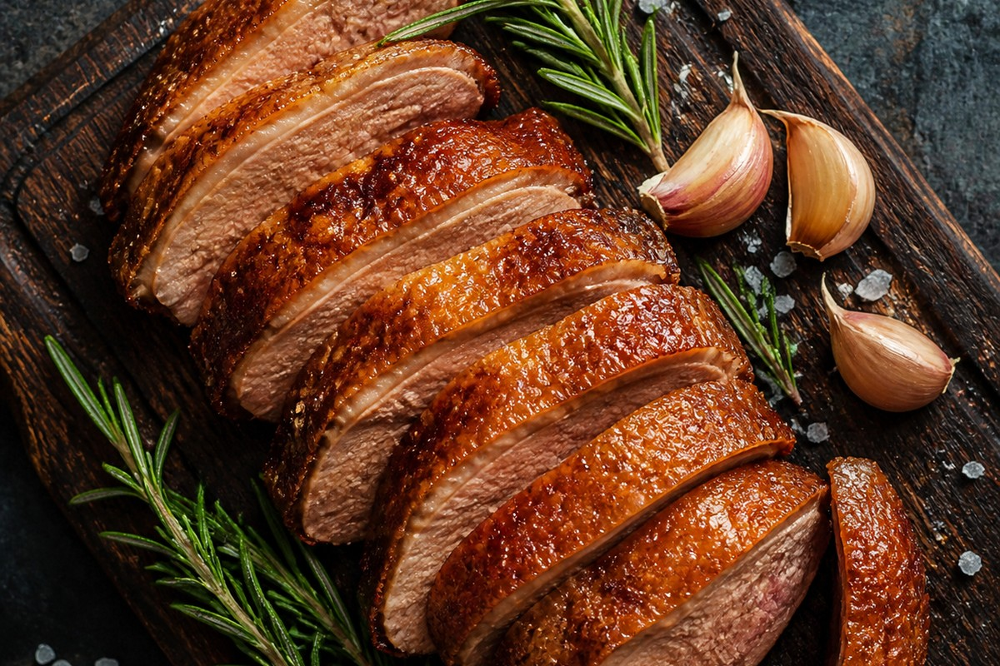

*▲ Duck meat only, raw, carries 135 calories, 18.3 g of protein, 5.95 g of fat and 2.4 mg of iron per 100 g. Add the skin and the same 100 g reaches 404 calories.*

Quick answer <strong>Duck meat without skin provides 135 calories, 18.28 g of protein, 5.95 g of fat, 2.4 mg of iron and 5.3 mg of niacin per 100 g raw.</strong> That is about a third of the calories of pork belly (372 kcal) with more protein, and a fat profile that is roughly two-thirds unsaturated. The number that matters most is the one people skip: <strong>with skin on, the same 100 g becomes 404 calories and 39 g of fat</strong>, so whether duck is a lean protein or a fat bomb is decided by the skin, not by the bird.

Duck sits in an odd place in the kitchen. It is dark, fatty poultry that nutrition tables list twice — once with skin and once without — and the two entries differ by a factor of three. Late autumn in Korea is duck season: *ori-baeksuk* (duck stuffed with glutinous rice and simmered), duck bulgogi, and sliced duck breast seared on a table grill all peak in November, and health segments repeat the line that duck is "rich in unsaturated fat, so it doesn't make you fat."

Three questions come up again and again. **Is duck 117 or 135 calories per 100 g?** Both figures are real and describe different things. **Is duck healthier than pork belly?** Yes, when the skin comes off. **Should you eat the duck fat?** In moderation, and with the calories counted.

Below are the USDA figures, the skin-on versus skin-off difference, what the unsaturated-fat claim really means for weight, why duck is unusually dense in iron and B vitamins, and how to cook it so the fat ends up in the pan instead of on your plate.

---

## 1. How Many Calories Are in Duck Meat? (135 kcal per 100 g)

The values below describe **domesticated duck, meat only, raw, skin and subcutaneous fat removed**, from USDA FoodData Central (FDC 172410, SR Legacy). The U.S. %DV column follows FDA Daily Values for a 2,000-calorie diet.

| Nutrient | Per 100 g | U.S. %DV |
| :--- | :--- | :--- |
| **Energy** | 135 kcal | — |
| **Water** | 73.8 g | No DV |
| **Protein** | 18.28 g | 37% |
| **Total fat** | 5.95 g | 8% |
| — Saturated fat | 2.32 g | 12% |
| — Monounsaturated fat | 1.54 g | No DV |
| — Polyunsaturated fat | 0.75 g | No DV |
| — Cholesterol | 77 mg | 26% |
| **Carbohydrate** | 0.94 g | 0% |
| — Dietary fiber | 0 g | 0% |
| — Total sugars | 0 g | No DV¹ |
| **Iron** | 2.40 mg | 13% |
| **Zinc** | 1.90 mg | 17% |
| **Selenium** | 13.9 µg | 25% |
| **Niacin (B3)** | 5.30 mg | 33% |
| **Riboflavin (B2)** | 0.45 mg | 35% |
| **Thiamin (B1)** | 0.36 mg | 30% |
| **Vitamin B6** | 0.34 mg | 20% |
| **Vitamin B12** | 0.40 µg | 17% |
| **Folate** | 25 µg | 6% |
| **Pantothenic acid** | 1.60 mg | 32% |
| **Phosphorus** | 203 mg | 16% |
| **Potassium** | 271 mg | 6% |
| **Magnesium** | 19 mg | 5% |
| **Calcium** | 11 mg | 1% |
| **Copper** | 0.25 mg | 28% |
| **Sodium** | 74 mg | 3% |

¹ Added sugars carry a 50 g Daily Value; total sugars in meat are zero. See note¹.
No DV — monounsaturated and polyunsaturated fat have no FDA Daily Value.

### How to read the table: the same duck in four numbers

Duck appears in composition tables under several descriptions, and mixing them up is the most common mistake:

- **135 kcal — meat only, raw (USDA).** Skin and subcutaneous fat removed. Fat 5.95 g.
- **117 kcal — lean duck, raw (Korean RDA table).** The domestic Korean figure, with fat at 3.07 g. Korean duck is often trimmed more aggressively and raised on a different cycle, which explains the lower fat.
- **242 kcal — skin on, raw (Korean RDA table).** Fat 18.99 g, of which 11.84 g unsaturated and 6.17 g saturated.
- **404 kcal — meat and skin, raw (USDA).** Fat 39.34 g.

Cooked meat only, roasted, comes to **201 kcal with 23.48 g of protein and 11.2 g of fat** per 100 g — higher than raw because water is lost, concentrating the solids. In other words, **the answer to "how many calories are in duck" spans 117 to 404 kcal depending on skin and cooking**, and any single number quoted without that context is misleading.

A practical conversion: one duck leg, skin removed, yields about 100–120 g of meat, or 135–160 calories with 18–22 g of protein. That is slightly leaner than a chicken thigh at roughly 180 calories.

---

## 2. Four Health Benefits and What the Evidence Supports

### Is duck actually healthier than pork belly?

On equal weights, the gap is large. **Pork belly: 372 kcal, 33.3 g fat, 13.9 g protein.** **Duck meat without skin: 135 kcal, 5.95 g fat, 18.28 g protein.** Duck delivers about a third of the calories, a sixth of the fat, and more protein.

The quality of the fat differs too. In the Korean table, skin-on duck contains **18.15 g of total fatty acids, of which 11.84 g (65%) are unsaturated and 6.17 g saturated**. Public health guidance from Korea's KDCA and the U.S. Dietary Guidelines both recommend replacing saturated fat with unsaturated fat to lower LDL cholesterol, and duck's ratio supports that substitution.

The caveat is the one the headline leaves out: **skin-on roast duck at 404 kcal per 100 g is more calorie-dense than pork belly.** Duck's advantage is created by trimming and rendering, not conferred by the species.

### Does unsaturated fat mean duck won't make you gain weight?

No. Fat delivers **9 kcal per gram regardless of saturation**, so "unsaturated" describes cardiovascular effect, not energy. Eating duck fat because it is "healthy fat" adds calories exactly as butter would.

Where the fat sits explains most of the variance. Removing the skin cuts calories by half or more and fat by roughly six-sevenths. For weight management, that single step matters more than choosing duck over pork in the first place.

There is a legitimate use for the rendered fat: its dominant monounsaturated fatty acid is **oleic acid**, the same one that gives olive oil its reputation. Replacing butter or lard with a teaspoon of duck fat when sautéing vegetables is a reasonable swap. A teaspoon is about 5 g and 45 kcal — that is the realistic budget per dish, not a ladle.

### Is duck's 2.4 mg of iron useful against anemia?

Duck meat delivers **2.4 mg of iron per 100 g**, roughly 13% of the U.S. Daily Value and about eight times the 0.3 mg in chicken breast, comparable to beef sirloin at 2.4–2.7 mg.

The form matters more than the number. Meat iron is **heme iron**, absorbed at two to three times the rate of the non-heme iron in spinach or lentils. Duck also brings **vitamin B12 (0.40 µg)** and **folate (25 µg)**, the other substrates for red cell production, and **copper (0.25 mg, 28% DV)**, which is required for iron mobilization.

If anemia is suspected, get a diagnosis before designing a diet around it. Iron-deficiency anemia and anemia of chronic disease call for opposite approaches, and neither is solved by choosing one protein over another.

### What do the B vitamins and minerals add up to?

Duck is one of the denser sources of B vitamins among poultry. **Niacin 5.30 mg (33% DV)**, **riboflavin 0.45 mg (35% DV)**, **thiamin 0.36 mg (30% DV)** and **pantothenic acid 1.60 mg (32% DV)** all clear a quarter of the daily value in a single 100 g serving, and these are the cofactors that convert food into usable energy.

The minerals are equally practical: **selenium 13.9 µg (25% DV)** as a component of glutathione peroxidase, **zinc 1.90 mg (17% DV)** for immune function and wound healing, and **phosphorus 203 mg (16% DV)**. For anyone whose protein intake falls in winter — a common pattern when meals get smaller and lighter — a single duck portion covers protein, iron and the B complex at once, at 135 calories when the skin is off.

---

## 3. Cooking to Keep the Fat in the Pan

- **Blanch first.** Put the duck in cold water, bring it to a boil and simmer for 5 minutes, then discard the water. This pulls surface fat and impurities out and removes most of the gamy smell before any searing.
- **Score the skin and render it.** If you keep the skin, score it in a crosshatch and start it skin-side down in a cold dry pan over medium-low heat. The fat renders gradually and the skin crisps without added oil.
- **Use a rack or a drain.** Roasting on a rack, or tilting the pan and spooning off accumulated fat, removes 30–50 calories per 100 g compared with cooking in its own fat.
- **Braise or steam for the leanest result.** *Ori-baeksuk* and duck poached in broth add no fat and lose more into the liquid. Chill the broth and lift the solidified fat off the surface before reheating.
- **Cook to 74 °C (165 °F) at the center.** Poultry carries *Campylobacter* and *Salmonella* risk. Duck breasts are thick enough that the surface can brown while the center stays under temperature; use a probe thermometer.
- **Treat smoked duck as processed meat.** Commercial smoked duck slices commonly exceed 800 mg of sodium per 100 g. Half a portion of 50 g is a reasonable serving, not a protein main.
- **Replace salt with aromatics.** Rosemary, black pepper, garlic and bay leaf cut the rich, fatty aroma of duck, so a pinch of salt per side is enough.
- **Pair with fiber.** Duck has zero fiber. Cabbage, broccoli or mushrooms on the same plate supply bulk and vitamin C, which also improves iron absorption.

---

## 4. Cautions and Side Effects

- **Cholesterol is not trivial.** Skinless duck has 77 mg per 100 g; skin-on portions pass 100 mg. With diagnosed hyperlipidemia, 100 g twice a week is a sensible ceiling.
- **Watch saturated fat against the day's total.** At 2.32 g per 100 g, duck uses 12% of a 2,000-calorie day's saturated fat allowance before any butter, cheese or pork enters the plate.
- **Smoked and cured duck is a sodium product.** Calories look modest, but sodium and nitrite come with them. For hypertension, fresh duck braised at home is the better route.
- **Gout patients should limit portions.** Duck is classified as a moderate-purine meat. Avoid it during acute flares and keep servings to 100 g otherwise.
- **Never serve duck rare.** Poultry must be fully cooked. Pregnant women, young children and immunocompromised people should eat only thoroughly cooked duck, and leftovers should be refrigerated and reheated within two days.
- **Too much rendered fat causes loose stools.** A large serving of fatty duck can trigger diarrhea and abdominal discomfort, particularly after gastric surgery or in people with gallbladder disease.
- **Poultry allergy is rare but real.** People with bird-meat allergy can react to duck. Urticaria or breathing difficulty after eating warrants medical assessment.

---

## 5. Frequently Asked Questions

**Q1. How much duck can I eat per day?**  
For skinless meat, **100–150 g a day, three to four times a week** is a reasonable pattern: 18–27 g of protein and 135–200 calories, with saturated fat held under 3.5 g. If you eat skin-on roast duck, keep the portion to 100 g.

**Q2. Should I eat the skin?**  
You can, but the calorie difference is decisive. Skin-on duck runs **242–404 kcal per 100 g**, two to three times the skinless figure. If you want the crackling, keep one piece and remove the rest, and pour off the rendered fat.

**Q3. Is duck soup really a health tonic?**  
Nutritionally, it supplies **protein, iron and B vitamins** in an easy-to-eat form, which is genuinely useful during recovery or in cold weather. The stronger claims about restoring vitality are not supported by clinical trials. Note that glutinous rice and jujube add carbohydrate and calories, so balance the ratio.

---

## 6. Synergistic Food Pairings

- **[Cabbage](/en/posts/cabbage-nutrition-benefits/):** duck has no fiber at all. Cabbage adds 1.4 g of fiber and about 40 mg of vitamin C per 100 g, balancing a fatty plate and cutting richness.
- **[Broccoli](/en/posts/broccoli-nutrition-benefits/):** broccoli's vitamin C boosts absorption of duck's heme iron, and its sulforaphane adds an antioxidant angle that meat lacks. Steam it briefly to preserve both.
- **[Pork Belly](/en/posts/pork-belly-nutrition-benefits/):** the direct comparison — 372 kcal and 33.3 g fat against duck's 135 kcal and 5.95 g — shows how much the cut and the skin decide.
- **[High-Protein Foods Ranking](/en/posts/high-protein-foods-ranking/):** places duck's 18.3 g of protein per 100 g against chicken breast, tofu and eggs, so you can compare protein per calorie rather than per weight.

  
📌 Related ranking guides

  <ul>
    <li><a href="/en/posts/high-protein-foods-ranking/">High-protein foods ranked</a></li>
    <li><a href="/en/posts/heart-blood-pressure-cholesterol-foods/">Foods that support blood pressure and cholesterol</a></li>
  </ul>

---

## 7. Key Takeaways

- Duck meat without skin is **135 calories, 18.28 g protein, 5.95 g fat, 2.4 mg iron and 5.3 mg niacin** per 100 g raw.
- **Skin changes everything**: 242 kcal (Korean table) to 404 kcal (USDA) per 100 g. Duck's health advantage begins at the skin.
- **Unsaturated fat is still fat** at 9 kcal per gram. "Duck doesn't make you fat" is a marketing line, not a mechanism.
- Iron is **heme iron at 2.4 mg**, about eight times chicken breast, with B12, folate and copper alongside.
- **B vitamins are a real strength**: niacin, riboflavin, thiamin and pantothenic acid each cover roughly a third of the daily value per 100 g.
- Cook it **blanched, scored, rendered and drained** to 74 °C; treat smoked duck as processed meat because of sodium.
- Check the **77 mg of cholesterol, 2.32 g of saturated fat and moderate purine load** if you have gout or hyperlipidemia.

