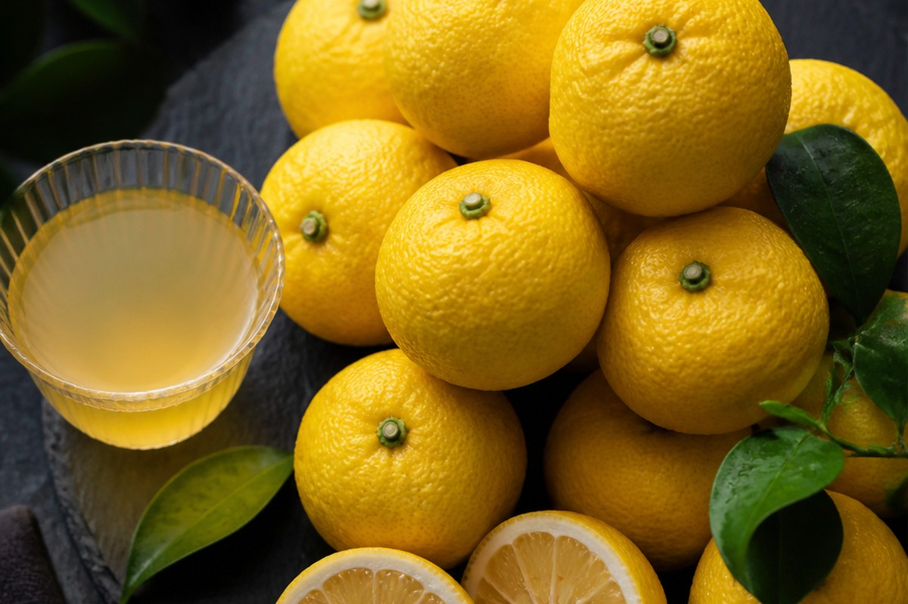

*▲ A whole yuzu carries 49 calories, 12.6 g of carbohydrate, 3.7 g of fiber and 95 mg of vitamin C per 100 g. Roughly 70% of that vitamin C sits in the peel, not the flesh.*

Quick answer <strong>Whole raw yuzu provides 49 calories, 12.6 g of carbohydrate, 3.7 g of fiber, 95 mg of vitamin C and 187 mg of potassium per 100 g.</strong> That is nearly twice the vitamin C of lemon (52 mg) at a fifth of the calories of a banana, and most of it is in the <strong>peel</strong> — 104.74 mg there against 50.77 mg in the flesh. The catch is how people actually eat it: 20 g of yuja-cheong, the sugar-preserved base of yuzu tea, carries about 12 g of sugar, so two cups a day means roughly five teaspoons of added sugar.

Yuzu (*Citrus junos*) is the small, thick-skinned, intensely aromatic citrus that marks the turn of the year in Korea and Japan. The fruit is too sour and seedy to eat out of hand, so it enters the kitchen whole: the peel and flesh are sliced into sugar to make *yuja-cheong*, steeped with honey for tea, fermented into vinegar, or frozen and grated over fish. Korean harvest runs from late October into December, and the fruit keeps for weeks in a cold room.

Three questions bring most readers to this page. **How many calories are in yuzu really?** 49 per 100 g, and almost none of them from fat. **Is yuzu higher in vitamin C than lemon?** Yes, close to double — but only if you use the peel. **Does yuzu tea raise blood sugar?** Substantially, and the sugar, not the fruit, is responsible.

Below are the composition figures, the peel-versus-flesh split, what the clinical literature does and does not support for colds and blood vessels, and how to prepare yuzu so its vitamin C survives.

---

## 1. How Many Calories Are in Yuzu? (49 kcal per 100 g)

The values below describe **whole raw yuzu, edible portion, peel included and seeds removed**, from the Korean National Standard Food Composition Table published by the Rural Development Administration (RDA). USDA FoodData Central has no yuzu entry; its nearest relative is citron (*Citrus medica*), a different species with a different acid and sugar profile, so the Korean table is the appropriate reference for *Citrus junos*. The U.S. %DV column is calculated against FDA Daily Values.

| Nutrient | Per 100 g | U.S. %DV |
| :--- | :--- | :--- |
| **Energy** | 49 kcal | — |
| **Water** | 86.0 g | No DV |
| **Carbohydrate** | 12.6 g | 5% |
| — Total sugars | 4.1 g | No DV¹ |
| — Dietary fiber | 3.7 g | 13% |
| **Protein** | 0.9 g | 2% |
| **Total fat** | 0.1 g | 0% |
| — Saturated fat | 0.02 g | 0% |
| — Cholesterol | 0 mg | 0% |
| **Vitamin C** | 95 mg | 106% |
| **Potassium** | 187 mg | 4% |
| **Calcium** | 36 mg | 3% |
| **Magnesium** | 12 mg | 3% |
| **Iron** | 0.2 mg | 1% |
| **Zinc** | 0.4 mg | 4% |
| **Folate** | 15 µg | 4% |
| **Sodium** | 3 mg | 0% |

¹ Added sugars carry a 50 g Daily Value; total sugars in fruit do not. See note¹.
No DV — energy has no Daily Value in U.S. labeling, and water is not a nutrient with a reference intake.

### How to read the table: the 100 g includes the peel

This is the point most yuzu charts get wrong. Yuzu is not a fruit you peel and discard the skin from — the skin is the reason it is used at all. So the "100 g" above is peel plus flesh, which is what a cook actually puts into the pot.

The same RDA analysis set, split by part, gives **104.74 mg of vitamin C per 100 g of peel, 50.77 mg per 100 g of flesh, and 95.03 mg for the whole fruit**. Peel therefore holds over 70% of the fruit's vitamin C. Juice the flesh and throw away the skin and you have discarded most of what you came for.

Two further cautions. The 49 calories describe **plain raw fruit**, not the preserved products made from it: yuja-cheong is layered 1:1 with sugar and lands above 250 kcal per 100 g. And a single yuzu weighs roughly 60–90 g depending on grade, so one fruit delivers about 30–45 calories and 55–85 mg of vitamin C — an estimate, since fruit size varies, not a label claim.

For scale, the same 100 g of yuzu carries **more vitamin C than lemon (52 mg), orange (55 mg), tangerine (48 mg) or grapefruit (31 mg)**, and it does so at 49 calories with 3.7 g of fiber, most of it pectin from the peel and albedo.

---

## 2. Four Health Benefits and What the Evidence Supports

### Does 95 mg of vitamin C actually prevent colds?

Vitamin C has been tested more thoroughly than almost any other nutrient, and the results are consistent. In the Cochrane review of placebo-controlled trials, regular vitamin C supplementation **did not reduce the incidence of colds in the general population**. The reductions that did appear were confined to people under extreme physical stress — marathon runners, soldiers training in subarctic conditions — who saw roughly half the usual cold frequency. In adults, supplementation shortened cold duration by about **8%**, roughly half a day.

That is the honest frame for yuzu. One 100 g serving delivers 95 mg, about 106% of the U.S. Daily Value and close to Korea's 100 mg recommended intake, which is enough to correct a shortfall but nowhere near the gram doses used in the trials that showed modest duration effects. The reliable benefit of yuzu is **closing a vitamin C gap with food rather than a pill**, which also brings fiber and flavonoids that a supplement does not.

### What do hesperidin and naringin in the peel do?

The bitter note in yuzu peel and the white pith comes from flavanone glycosides, chiefly **hesperidin** and **naringin**. These are the same compounds studied in citrus for capillary integrity — hesperidin is the flavonoid that gave "vitamin P" its name — and laboratory work on endothelial cells shows they reduce oxidative stress and improve barrier function at the cellular level.

Human evidence is much thinner. Hesperidin has been trialed as an isolated, high-dose supplement for chronic venous insufficiency and leg edema, with modest results. **No controlled trial has measured blood pressure or LDL cholesterol in people eating ordinary amounts of whole yuzu.** So the reasonable expectation is this: using the peel gives you vitamin C and flavanones together in a food matrix, which is a sensible habit, but yuzu tea is not a treatment for hypertension.

### Is yuzu tea good for a sore throat?

Yuzu's aroma comes from **limonene**, a monoterpene in the peel oil — the same oil that stains your fingers when you zest the fruit. The bitter, sharp taste of the peel comes from **limonoids**. In laboratory work limonene shows antimicrobial and anti-inflammatory activity, and citrus aroma has measurable effects on mood and perceived stress.

What actually soothes a sore throat, though, is mostly physical: **warm fluid hydrates the mucosa**, **steam loosens secretions**, and the aroma adds comfort. Yuzu peel oil contributes to that experience, but a spoon of cold cheong straight from the jar will not do the same job. Temperature also matters for nutrition: vitamin C degrades quickly above 60 °C (140 °F), so stirring cheong into boiling water destroys a meaningful share of it. Use water at 50–60 °C.

### Do the organic acids help with fatigue and digestion?

Yuzu is rich in citric, malic and tartaric acid. The popular claim that citric acid "breaks down lactic acid and relieves fatigue" rests on an outdated model: lactic acid is now understood as a fuel and signaling molecule, not the cause of post-exercise fatigue, which is driven by muscle damage, glycogen depletion and central nervous system fatigue.

The acids still do practical work. They **stimulate saliva and gastric secretion**, which is why a cup of yuzu tea after a fatty meal feels refreshing, and they make the fruit useful as a salt substitute in dressings. On the mineral side, yuzu's 187 mg of potassium is unremarkable against a banana's 350 mg, but at 49 calories the **potassium per calorie is high**, which matters for anyone building a blood-pressure-friendly plate without spending their calorie budget.

---

## 3. How to Prepare Yuzu So the Vitamin C Survives

- **Keep the peel.** Over 70% of the vitamin C and most of the flavanones are there. Slicing whole fruit into cheong, freezing whole fruit to grate later, or zesting over a dish all preserve that advantage.
- **Wash the peel with baking soda.** Dissolve one tablespoon of baking soda in a liter of water, soak the fruit for 2–3 minutes, then rinse under running water. This removes surface wax and grit without scrubbing the oil glands open.
- **Never use boiling water.** Vitamin C oxidizes rapidly above 60 °C (140 °F). Let boiled water cool a few minutes before adding cheong, or steep fresh slices in warm water.
- **Avoid reactive metal.** Iron and copper accelerate ascorbate oxidation. Use glass, ceramic or food-grade plastic, and store cheong in a glass jar.
- **Store at 0–5 °C for about a week.** Wrap whole fruit in newspaper and keep it in the crisper. Wash only just before use; soaking leaches water-soluble vitamins.
- **Ferment for a sugar-free option.** Blend whole yuzu with 1 g of dry yeast, cover with cloth and leave in a warm place for 3–4 months, then strain. The resulting yuzu vinegar is sharp and aromatic, with none of the sugar load of cheong.
- **Freeze whole, grate frozen.** Frozen yuzu grates into fine zest-and-flesh shavings that go straight into dressings, marinades and fish dishes, replacing both lemon juice and part of the salt.
- **Thin-slice the flesh for salads.** Yuzu flesh is too sour to eat alone but works as a thin garnish over greens, cutting the oil needed in a dressing.

---

## 4. Cautions and Side Effects

- **Yuja-cheong is a sugar product.** Layered 1:1 with sugar, 20 g of cheong contributes roughly 12 g of sugar and 60–70 kcal. Two cups a day adds about 24 g of sugar, nearly half the WHO's 50 g ceiling for a 2,000 kcal diet. People with diabetes should treat yuzu tea as a sweetened drink, not a fruit serving.
- **Avoid it on an empty stomach with reflux or gastritis.** The citric and malic acid load stimulates gastric secretion and can provoke burning or bloating. Take it after a meal, in small amounts.
- **Medication interactions are milder than grapefruit's, but not zero.** Yuzu is not the potent CYP3A4 inhibitor that grapefruit is, and no case reports link ordinary yuzu tea to drug toxicity. Concentrated peel extracts, however, have not been studied for interaction risk; discuss them with a pharmacist if you take narrow-therapeutic-index drugs.
- **Dental erosion is a sugar-plus-acid problem.** Rinse with water after drinking, and wait about 30 minutes before brushing so softened enamel can reharden.
- **Citrus peel oil can irritate skin.** Gloves are worth wearing when slicing kilos of fruit for cheong; limonene is a known contact irritant and sensitizer in some people.
- **Potassium is modest but relevant in kidney disease.** At 187 mg per 100 g, yuzu is far lower than kiwi or banana, so a serving is usually fine, but concentrated juice should be counted by anyone on a potassium restriction.
- **Fruit sugar is still sugar.** Yuzu's 4.1 g per 100 g is low, but cheong, marmalade and honey-preserved products multiply it several times over.

---

## 5. Frequently Asked Questions

**Q1. How much yuzu should I eat per day?**  
For healthy adults, **100 g of whole fruit** — about one to one and a half small yuzu — supplies 95% of Korea's vitamin C recommendation at 49 calories. If you drink it as tea, keep cheong to 20 g or less and one or two cups a day. With diabetes or during weight loss, prefer fresh fruit, frozen zest or yuzu vinegar.

**Q2. Does yuzu really have more vitamin C than lemon?**  
Yes, when the peel is included: **95 mg versus 52 mg per 100 g**, with orange at 55 mg and tangerine at 48 mg. Flesh alone drops to 50.77 mg, which is roughly lemon territory. The comparison only holds if you use the whole fruit.

**Q3. Can I make yuja-cheong with less sugar?**  
Fully removing sugar lowers the osmotic barrier that keeps the preserve safe. Using **50–60% of the fruit's weight in sugar** and ripening it in the refrigerator cuts sugar by 30–40%, provided you finish the jar within two to three weeks. For a longer shelf life without sugar, ferment yuzu into vinegar instead.

---

## 6. Synergistic Food Pairings

- **[Spanish Mackerel](/en/posts/spanish-mackerel-nutrition-benefits/):** the two peak in the same November week in Korea. Mackerel brings protein and omega-3s; yuzu brings vitamin C and organic acids that cut fishiness, letting you use less salt on the grill.
- **[Tangerine](/en/posts/tangerine-nutrition-benefits/):** tangerine is sweeter with 48 mg of vitamin C, yuzu is sharper with 95 mg. Keeping both on the counter lets you hit the vitamin C target without leaning on sweetness alone.
- **[Kiwi](/en/posts/kiwi-nutrition-benefits/):** kiwi pairs a high vitamin C load with fiber and actinidin, an enzyme that tenderizes protein. A yuzu-vinegar dressing over kiwi and greens replaces bottled dressing with acidity and aroma.
- **[Spinach](/en/posts/spinach-nutrition-benefits/):** yuzu's vitamin C improves absorption of the non-heme iron in spinach. A spinach salad dressed with yuzu juice and peel captures both.

  
📌 Related ranking guides

  <ul>
    <li><a href="/en/posts/liver-immunity-fatigue-recovery-foods/">Foods for liver, immunity and fatigue recovery</a></li>
    <li><a href="/en/posts/heart-blood-pressure-cholesterol-foods/">Foods that support blood pressure and cholesterol</a></li>
  </ul>

---

## 7. Key Takeaways

- Whole raw yuzu is **49 calories, 12.6 g carbohydrate, 3.7 g fiber, 95 mg vitamin C and 187 mg potassium** per 100 g.
- **The peel holds over 70% of the vitamin C** (104.74 mg versus 50.77 mg in flesh). Use the whole fruit.
- Yuzu beats lemon, orange and tangerine on vitamin C per 100 g — **but only peel included**.
- **Vitamin C does not prevent colds in the general population**; it shortens them by about 8%. Yuzu is a food source, not a prophylactic.
- Hesperidin and naringin are real, well-characterized flavanones, but **human outcome trials on whole yuzu are missing**. Keep expectations calibrated.
- **Yuja-cheong is sugar**: 20 g carries about 12 g of sugar. Two cups a day approaches half the WHO added-sugar ceiling.
- Brew at **50–60 °C in glass**, never boiling water in metal, and store fruit at 0–5 °C for about a week.
- For a sugar-free way to keep yuzu all winter, **ferment it into vinegar or freeze it whole** and grate as needed.

