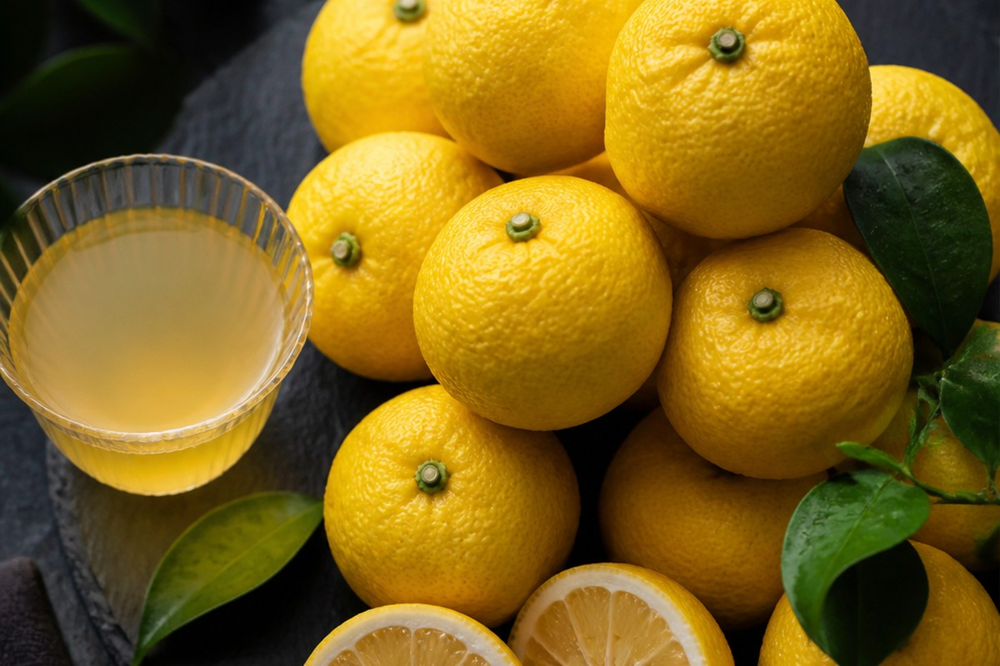

*▲ 유자 100g은 49kcal, 탄수화물 12.6g, 식이섬유 3.7g, 비타민C 95mg, 칼륨 187mg입니다. 비타민C의 70%가량은 과육이 아니라 껍질에 들어 있습니다.*

한 줄 결론 <strong>유자 100g은 49kcal에 탄수화물 12.6g, 식이섬유 3.7g, 비타민C 95mg, 칼륨 187mg입니다.</strong> 같은 무게의 레몬(52mg)보다 비타민C가 두 배 가까이 많고, 그 비타민C의 대부분은 <strong>과육이 아니라 껍질</strong>에 있습니다(껍질 104.74mg vs 과육 50.77mg). 문제는 먹는 방식입니다. 유자청 20g에는 당이 12g 안팎 붙어 있어서, <strong>유자차 두 잔이면 각설탕 다섯 개</strong>를 마시는 셈이 됩니다.

11월이면 마트 앞에 노란 유자 더미가 쌓입니다. 김장을 마치고 나면 유자청을 담그는 집이 많고, 겨울 내내 유자차를 타 마시게 됩니다. 그때마다 따라오는 말이 "유자는 비타민C 덩어리라 감기에 좋다", "유자차는 살찌는 음료다"입니다. 둘 다 절반만 맞습니다.

검색창에 실제로 들어오는 질문은 세 가지로 좁혀집니다. **"유자 칼로리가 정말 49kcal인가?"**, **"유자 비타민C가 레몬보다 많다는 게 사실인가?"**, **"유자차 마시면 당이 얼마나 오르나?"** 결론부터 말하면 유자는 **과일 중에서도 비타민C 밀도가 최상위권인 저열량 과일**이고, 유자차는 **유자 때문이 아니라 설탕 때문에** 열량이 올라갑니다.

아래에서는 농촌진흥청 국가표준식품성분표(유자, 전체, 생것)를 기준으로 유자 100g의 영양, 껍질과 과육의 비타민C 차이, 유자차·유자청의 실제 당량, 그리고 비타민C를 남기는 조리법을 정리했습니다.

---

## 1. 유자 칼로리와 영양성분은? (100g 49kcal)

아래 수치는 **유자(전체, 생것, 가식부) 100g** 기준입니다. 여기서 '전체'는 과육과 껍질을 모두 포함하고 씨를 제외한 무게입니다. 유자는 껍질째 쓰는 과일이라 이 기준이 실제 섭취량과 가장 가깝습니다.

| 영양 성분 (Nutrient) | 함량 (100g당) | 1일 권장 섭취량 비율 (한국인 성인 기준) |
| :--- | :--- | :--- |
| **열량 (Energy)** | 49 kcal | 2.5% |
| **수분 (Water)** | 86.0 g | 별도 표기¹ |
| **탄수화물 (Carbohydrates)** | 12.6 g | 3.9% |
| - 총 당류 (Total Sugars) | 4.1 g | 4.1% |
| - 식이섬유 (Dietary Fiber) | 3.7 g | 14.8% |
| **단백질 (Protein)** | 0.9 g | 1.6% |
| **지방 (Total Fat)** | 0.1 g | 0.2% |
| - 포화지방 (Saturated Fat) | 0.02 g | 0.1% |
| - 콜레스테롤 (Cholesterol) | 0 mg | 0.0% |
| **비타민C (Vitamin C)** | 95 mg | 95.0% |
| **칼륨 (Potassium)** | 187 mg | 5.3% |
| **칼슘 (Calcium)** | 36 mg | 5.1% |
| **마그네슘 (Magnesium)** | 12 mg | 3.8% |
| **철분 (Iron)** | 0.2 mg | 2.0% |
| **아연 (Zinc)** | 0.4 mg | 4.4% |
| **엽산 (Folate)** | 15 µg | 3.8% |
| **나트륨 (Sodium)** | 3 mg | 0.2% |

¹ 수분은 1일 권장 섭취량 기준치가 따로 설정되지 않은 항목입니다. 비율 대신 절대량으로만 표기했습니다.

### 표 읽는 법: 유자 100g은 껍질까지 포함한 무게입니다

유자 영양표를 읽을 때 가장 많이 틀리는 지점이 이 부분입니다. 유자는 **껍질을 벗겨 먹는 과일이 아니라 껍질째 청을 담그거나 즙을 내는 과일**이라, 표의 100g은 껍질과 과육이 함께 들어간 값입니다.

그래서 같은 유자라도 어느 부위를 먹느냐에 따라 비타민C가 두 배 차이 납니다. 국가표준식품성분 DB의 같은 분석 기록을 보면 **껍질만 100g에 104.74mg, 과육만 50.77mg, 전체로는 95.03mg**입니다. 즉 유자 비타민C의 70% 이상이 껍질 몫입니다. 껍질을 벗겨 과육만 짜서 먹으면 유자 영양의 절반을 버리는 셈입니다.

또 하나, **열량 49kcal는 조미하지 않은 생유자 기준**입니다. 시중 유자청은 설탕과 1:1로 재우기 때문에 같은 100g이라도 열량이 250kcal를 넘습니다. 뒤에서 따로 계산합니다.

### 실생활 환산: 유자 1개, 유자차 한 잔은 몇 kcal인가?

시판 유자는 품종과 등급에 따라 크기가 달라 한 개 무게가 대략 60~90g입니다. 이 범위로 환산하면 다음과 같습니다. 개별 무게는 저울로 재는 것이 정확하므로 아래 값은 **계산 예시**로 봐 주세요.

- **유자 1개(70g 가정):** 열량 34kcal, 탄수화물 8.8g, 비타민C 66mg. 하루 비타민C 권장량(100mg)의 66%입니다.
- **유자 100g(작은 것 1.5개):** 열량 49kcal, 비타민C 95mg. 권장량의 95%로, 이 한 번이면 하루치가 거의 채워집니다.
- **유자청 20g + 물 200mL(유자차 한 잔):** 유자 자체 열량은 10kcal 안팎이지만, 설탕 1:1 비율이면 **당류 12g 안팎, 열량 60~70kcal**가 됩니다. 설탕 3티스푼 수준입니다.
- **유자차 두 잔(위 기준):** 당류 24g, 열량 130kcal 전후. 세계보건기구(WHO)가 권고하는 하루 첨가당 상한(총열량의 10%, 2,000kcal 기준 50g)의 절반에 해당합니다.

정리하면 **유자는 분명히 저열량 과일인데, 유자차는 당 음료**입니다. 유자를 먹는 목적이 비타민C라면 청보다 생과·냉동·식초 쪽이 훨씬 유리합니다.

---

## 2. 과학적으로 입증된 4대 건강 효능

### 유자 비타민C 95mg은 감기 예방에 효과가 있나?

유자 100g의 비타민C는 **95mg**으로, 같은 무게의 레몬(52mg), 오렌지(55mg), 귤(48mg), 자몽(31mg)보다 두 배가량 많습니다. 성인 하루 권장량이 100mg이므로 유자 100g이면 거의 채워집니다.

다만 **"비타민C를 많이 먹으면 감기에 안 걸린다"는 명제는 임상시험에서 확인되지 않았습니다.** 코크란 리뷰 계열의 반복된 분석에서 비타민C 보충은 일반인의 감기 발생률을 낮추지 못했고, 효과가 보고된 것은 **극한 운동을 하는 사람이나 추운 환경에서 훈련하는 군인** 같은 특정 집단, 그리고 **감기 지속 기간을 8% 정도 줄이는 수준**이었습니다. 유자차가 목이 편해지는 것은 비타민C보다 **따뜻한 수분과 향기 성분**의 몫이 큽니다. 이 부분은 아래에서 다시 다룹니다.

그래도 유자가 유용한 이유는 따로 있습니다. 한국인의 비타민C 섭취는 과일·채소 섭취 감소로 권장량에 못 미치는 경우가 적지 않고, 유자는 **한 번에 100mg에 가까운 양을 저열량으로 먹을 수 있는 몇 안 되는 식품**입니다. 보충제 대신 식품으로 채우는 쪽이 식이섬유와 플라보노이드를 함께 얻습니다.

### 유자 껍질의 헤스페리딘·나린진은 혈관에 어떤 작용을 하나?

유자 껍질의 쌉싸름한 맛과 흰 속껍질에는 **헤스페리딘(hesperidin)** 과 **나린진(naringin)** 같은 플라보노이드가 들어 있습니다. 이 계열 성분은 모세혈관을 이루는 콜라겐 합성과 관련된 비타민P 활성 물질로 알려져 있고, 시험관 연구에서는 혈관 내피세포의 산화 스트레스를 줄이는 방향의 결과가 보고됐습니다.

근거 수준은 분명히 해 두어야 합니다. 유자 추출물을 세포에 처리한 실험, 동물에게 먹인 실험은 여러 편 있지만, **사람이 유자 1~2개를 먹었을 때 혈압이나 콜레스테롤 수치가 얼마나 개선되는지 측정한 임상시험은 거의 없습니다**. 감귤류 헤스페리딘 자체는 다리 부종(만성 정맥부전) 관련 보충제로 연구된 사례가 있으나, 그건 **정제된 고용량**을 쓴 결과입니다.

그래서 기대치는 이렇게 잡는 것이 맞습니다. 유자 껍질을 함께 먹으면 **비타민C와 플라보노이드를 동시에 얻는 식사 습관**이 되고, 이것이 혈관 건강에 나쁠 이유는 없습니다. 다만 유자차로 혈압을 낮추겠다는 목표는 근거가 부족합니다.

### 유자차가 목에 좋다는 말, 근거는 어디까지인가?

유자 특유의 향은 **리모넨(limonene)** 이라는 테르펜 계열 성분에서 옵니다. 껍질을 문지르면 손에 기름이 묻는 것이 이 정유 성분이고, 유자 껍질의 쓴맛은 **리모노이드**가 담당합니다. 시험관 연구에서 리모넨은 항균·항염 방향의 작용이 보고됐고, 향 자체가 후각을 통해 기분을 완화하는 효과는 잘 알려져 있습니다.

목이 아플 때 유자차가 편하게 느껴지는 데는 세 가지가 겹칩니다. **따뜻한 물이 점막을 적셔주는 물리적 효과**, **수증기가 기도를 촉촉하게 하는 효과**, **향에 따른 주관적 안정감**입니다. 여기에 유자 껍질의 정유가 더해집니다. 반대로 말하면, **차가운 유자청을 그대로 떠먹는 것으로는 같은 효과를 기대하기 어렵습니다**.

주의할 점은 온도입니다. 비타민C는 열에 약해서, 끓는 물에 유자청을 타면 비타민C 상당량이 파괴됩니다. **60℃ 이하의 미지근한 물**에 타는 것이 영양과 목의 편안함을 모두 챙기는 방법입니다.

### 유자는 피로 회복·소화에 도움이 되나?

유자에는 구연산, 사과산, 주석산 같은 유기산이 많습니다. "구연산이 젖산을 분해해 피로를 풀어준다"는 설명은 오래된 통설인데, **젖산이 피로의 직접 원인이라는 가설 자체가 현대 생리학에서 상당 부분 수정**됐습니다. 운동 후 피로는 젖산 축적보다 근육 손상·에너지 고갈·신경계 피로가 복합된 결과입니다.

그래도 유기산에는 실용적인 이점이 있습니다. **위산 분비를 자극해 식욕을 돋우고**, 신맛이 침 분비를 늘려 소화를 돕습니다. 기름진 식사 뒤 유자차 한 잔이 속이 개운하게 느껴지는 것은 이런 작용과 따뜻한 물의 조합입니다.

피로 회복 쪽에서 실제로 의미 있는 성분은 **비타민C의 콜라겐 합성 관여**와 **엽산·칼륨의 전해질 보충**입니다. 유자 100g의 칼륨은 187mg으로 바나나(약 350mg)의 절반 수준이지만, 열량이 49kcal뿐이라 **열량 대비 칼륨 밀도는 높은 편**입니다.

---

## 3. 비타민C를 남기는 조리·섭취 가이드

- **껍질을 버리지 마세요.** 유자 비타민C의 70% 이상이 껍질에 있습니다. 청을 담거나 즙을 낼 때 껍질을 함께 쓰는 것이 핵심입니다.
- **베이킹소다로 껍질을 닦으세요.** 유자는 껍질째 먹기 때문에 세척이 중요합니다. 물 1L에 베이킹소다 1큰술을 풀고 2~3분 담갔다가 흐르는 물에 헹구면 표면 왁스와 이물이 줄어듭니다.
- **끓는 물에 타지 마세요.** 비타민C는 60℃ 이상에서 빠르게 산화합니다. 유자청은 미지근한 물(50~60℃)에 타고, 끓는 물을 부었다면 식힌 뒤 마시는 편이 낫습니다.
- **금속 용기는 피하세요.** 철·구리 용기에 닿으면 비타민C 산화가 빨라집니다. 유리병이나 플라스틱 밀폐 용기를 쓰세요.
- **보관은 0~5℃에서 7일.** 껍질째 신문지에 싸서 냉장고 채소칸에 두면 일주일가량 갑니다. 물에 오래 담가두면 수용성 비타민이 빠져나가므로 세척은 먹기 직전에 짧게 하세요.
- **유자 식초는 설탕 없이.** 유자를 갈아 효모 1g을 넣고 3~4개월 발효시키면 당을 넣지 않은 유자 식초가 됩니다. 물에 희석하거나 샐러드 드레싱에 쓰면 유자차의 당 부담 없이 향과 유기산을 챙길 수 있습니다.
- **생과는 얇게 저며 드세요.** 유자 과육은 신맛이 강해 그대로 먹기 어렵습니다. 얇게 저며 꿀 없이 샐러드에 올리거나, 생선 요리에 곁들이면 소금·기름을 줄이는 역할을 합니다.
- **냉동은 껍질째.** 유자를 통째로 얼렸다가 반쯤 녹은 상태에서 채 썰면 껍질의 정유와 비타민C를 모두 살릴 수 있습니다. 해동 후 과육은 물러지므로 즙·청 용도로 쓰세요.

---

## 4. 섭취 시 주의사항 및 부작용

- **유자차는 하루 1~2잔까지.** 당류 12g이 한 잔에 붙습니다. 당뇨병이 있거나 체중 조절 중이라면 유자청 대신 유자 식초나 생과를 쓰세요. 당뇨 환자에게 "유자차는 과일이라 괜찮다"는 설명은 틀렸습니다.
- **위식도역류·위염이 있다면 공복 섭취를 피하세요.** 유자의 구연산과 유기산은 위산 분비를 촉진해 속 쓰림·더부룩함을 유발할 수 있습니다. 식후 30분 이후에 소량씩 드세요.
- **몸이 찬 사람은 양을 줄이세요.** 한의학적 설명이지만 실제로 유자는 찬 성질로 분류되어, 과다 섭취 시 설사·소화불량을 호소하는 사례가 있습니다. 생강처럼 따뜻한 성질의 재료와 함께 쓰면 완화됩니다.
- **약물을 복용 중이라면 농축 추출물은 상의하세요.** 유자는 자몽만큼 강한 약물 상호작용(CYP3A4 억제)이 보고되지는 않았지만, 감귤류 껍질 추출물을 고농도로 먹는 경우는 데이터가 충분하지 않습니다. 유자차 1~2잔 수준은 문제된 사례가 드뭅니다.
- **충치 위험은 신맛만의 문제가 아닙니다.** 유자청은 산성에 당까지 더해져 법랑질 부식에 불리합니다. 마신 뒤 물로 입을 헹구고, 바로 양치하기보다 30분 뒤에 닦는 편이 안전합니다.
- **감귤류 알레르기가 있으면 주의하세요.** 유자 껍질의 정유가 입술·손 피부 자극을 일으킬 수 있습니다. 청을 담글 때 장갑을 끼면 손이 트는 것을 줄일 수 있습니다.
- **신장질환자는 칼륨만 계산하면 됩니다.** 유자 187mg은 같은 무게의 귤(약 150mg)·키위(약 310mg)와 비교해 중간 수준이고 열량이 낮아, 100g 이내에서는 부담이 크지 않습니다. 다량의 유자즙 농축액은 피하세요.

---

## 5. 자주 묻는 질문 (FAQ)

**Q1. 유자는 하루에 얼마나 먹으면 좋나요?**  
건강한 성인은 **하루 100g(작은 유자 1~1.5개)** 이면 비타민C 권장량의 95%를 채웁니다. 유자차로 마실 때는 청 20g 이하로 1~2잔이 적당하고, 당뇨·체중 조절 중이라면 생과 50g 또는 유자 식초로 대체하세요.

**Q2. 유자 비타민C는 레몬보다 정말 많나요?**  
많습니다. 국가표준식품성분표 기준 **유자 95mg, 레몬 52mg, 오렌지 55mg, 귤 48mg**입니다(100g당). 단 유자 껍질까지 먹는 경우의 값이고, 껍질을 벗기면 50.77mg으로 레몬과 비슷해집니다.

**Q3. 유자청에 설탕을 줄일 수 있나요?**  
설탕을 완전히 빼면 삼투압이 낮아져 변질 위험이 커집니다. 대신 **유자 무게의 50~60%만 설탕을 쓰고 냉장 숙성**하면 당을 30~40% 줄일 수 있고, 2~3주 안에 먹으면 보관도 가능합니다. 더 줄이고 싶다면 설탕 대신 유자 식초 발효 쪽을 권합니다.

---

## 6. 유자와 함께 먹으면 좋은 음식

- **[삼치 (Spanish Mackerel)](/posts/spanish-mackerel-nutrition-benefits/):** 유자와 삼치는 수확 시기가 겹치는 11월의 대표 조합입니다. 삼치는 단백질과 오메가3를, 유자는 비타민C와 유기산을 담당합니다. 생선 비린내를 유자즙과 껍질로 잡으면 소금 사용량도 줄어듭니다.
- **[귤 (Tangerine)](/posts/tangerine-nutrition-benefits/):** 귤은 비타민C 48mg에 당도가 높고, 유자는 95mg에 신맛이 강합니다. 두 과일을 함께 두면 단맛 과다 없이 비타민C 총량을 채울 수 있어 겨울 간식 구성에 유리합니다.
- **[키위 (Kiwi)](/posts/kiwi-nutrition-benefits/):** 키위는 비타민C와 식이섬유가 많은 대표 과일입니다. 유자 식초 드레싱을 키위 샐러드에 쓰면 별도 소스 없이 신맛과 향을 더할 수 있습니다.
- **[시금치 (Spinach)](/posts/spinach-nutrition-benefits/):** 유자의 비타민C는 식물성 철분의 흡수를 돕습니다. 시금치 나물에 유자청을 조금 넣은 무침은 철분 흡수와 간을 동시에 잡는 방법입니다.

  
📌 관련 순위 가이드

  <ul>
    <li><a href="/posts/liver-immunity-fatigue-recovery-foods/">간 건강·면역·피로 회복에 좋은 음식</a></li>
    <li><a href="/posts/heart-blood-pressure-cholesterol-foods/">혈압·콜레스테롤 관리에 좋은 음식</a></li>
  </ul>

---

## 7. 유자 어떻게 먹을까? 핵심 요약

- 유자 100g은 **49kcal·탄수화물 12.6g·식이섬유 3.7g·비타민C 95mg·칼륨 187mg**입니다.
- 비타민C는 **껍질 104.74mg, 과육 50.77mg**으로 껍질에 70%가 몰려 있습니다. 껍질째 쓰는 것이 유자 영양의 핵심입니다.
- **유자차는 저열량 음료가 아닙니다.** 유자청 20g에 당류 12g이 붙어 두 잔이면 24g, 열량 130kcal 전후입니다.
- 비타민C는 **60℃ 이상에서 빠르게 파괴**됩니다. 미지근한 물에 타고, 금속 용기는 피하세요.
- 감기 예방 효과는 **비타민C 단독으로는 입증되지 않았습니다.** 목이 편해지는 것은 따뜻한 수분과 향의 효과가 큽니다.
- **위식도역류·위염 환자는 공복 섭취를 피하고**, 당 조절이 필요하면 유자 식초를 쓰세요.
- 11월 제철에는 **껍질째 냉동**해 두고 채 썰어 쓰면 겨울 내내 비타민C를 챙길 수 있습니다.

