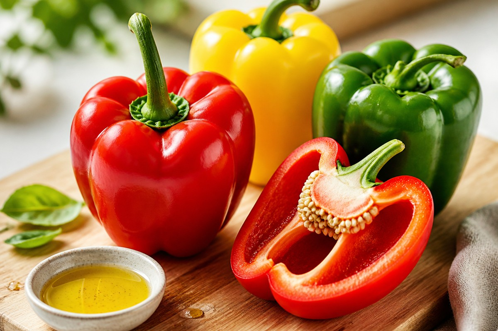

*▲ 파프리카 100g은 30kcal, 비타민C 119mg, 베타카로틴 3,052µg입니다. 색에 따라 비타민C와 카로티노이드 함량이 크게 달라집니다.*

한 줄 결론 <strong>빨간 파프리카 100g은 30kcal에 비타민C 119mg, 베타카로틴 3,052µg, 식이섬유 1.8g입니다.</strong> 비타민C는 하루 권장량의 119%로, 같은 무게의 레몬(52mg)과 오렌지(55mg)의 두 배가 넘습니다. 그런데 <strong>비타민C가 가장 많은 색은 빨강이 아니라 초록(162mg)</strong>이고, <strong>베타카로틴이 가장 많은 색은 빨강(3,052µg)</strong>입니다. 색깔마다 강점이 다르니 <strong>한 색만 사는 것이 가장 손해</strong>입니다.

파프리카는 피망을 달고 과육이 두껍게 개량한 품종입니다. 같은 고추(Capsicum annuum)지만 캡사이신이 거의 없어 매운맛이 없고, 대신 단맛과 아삭한 식감이 남았습니다. 국내에서는 진주·부여·강진 등지의 시설 재배로 연중 나오지만, <strong>노지 재배분이 맛을 올리는 10~11월</strong>이 사실상의 제철입니다.

검색창에 실제로 들어오는 질문은 세 가지입니다. **"파프리카 칼로리가 정말 30kcal인가?"**, **"색깔마다 영양이 다른가?"**, **"생으로 먹는 게 좋은가, 기름에 볶아야 하나?"** 결론부터 말하면 파프리카는 <strong>열량 대비 비타민C 밀도가 채소 중 최상위권</strong>이고, 색깔별 차이는 실제로 존재하며, <strong>카로티노이드는 기름과 함께 먹어야 흡수된다</strong>는 것이 핵심입니다.

아래에서는 농촌진흥청 국가표준식품성분표(파프리카, 적색, 생것)를 기준으로 영양, 색깔별 비교, 카로티노이드 흡수 원리, 그리고 비타민C를 살리는 조리법을 정리했습니다.

---

## 1. 파프리카 칼로리와 영양성분은? (100g 30kcal)

아래 수치는 <strong>파프리카(적색, 생것, 가식부) 100g</strong> 기준입니다. 꼭지와 씨를 제외하고 실제로 먹는 과육의 무게입니다.

| 영양 성분 (Nutrient) | 함량 (100g당) | 1일 권장 섭취량 비율 (한국인 성인 기준) |
| :--- | :--- | :--- |
| **열량 (Energy)** | 30 kcal | 1.5% |
| **수분 (Water)** | 91.8 g | 별도 표기¹ |
| **탄수화물 (Carbohydrates)** | 5.4 g | 1.7% |
| - 식이섬유 (Dietary Fiber) | 1.8 g | 7.2% |
| **단백질 (Protein)** | 1.5 g | 2.7% |
| **지방 (Total Fat)** | 0.8 g | 1.5% |
| **비타민C (Vitamin C)** | 119 mg | 119.0% |
| **베타카로틴 (Beta-carotene)** | 3,052 µg | 별도 표기¹ |
| **비타민A (Vitamin A)** | 509 µg RE | 72.7% |
| **비타민E (Vitamin E)** | 0.4 mg | 4.0% |
| **비타민B1 (Thiamin)** | 0.05 mg | 4.2% |
| **비타민B2 (Riboflavin)** | 0.12 mg | 8.0% |
| **나이아신 (Niacin)** | 1.2 mg | 8.0% |
| **칼슘 (Calcium)** | 3 mg | 0.4% |
| **인 (Phosphorus)** | 29 mg | 4.1% |
| **철분 (Iron)** | 1 mg | 10.0% |
| **칼륨 (Potassium)** | 157 mg | 4.5% |
| **나트륨 (Sodium)** | 8 mg | 0.4% |

¹ 수분과 베타카로틴은 1일 권장 섭취량 기준치가 따로 설정되지 않은 항목입니다. 베타카로틴은 비타민A로 전환되는 전구체라 비타민A 기준치(509µg RE, 72.7%)에 반영되어 있습니다.

*※ 데이터 기준: 표의 수치는 국내 국가표준식품성분표(식약처 식품영양성분 DB)의 파프리카, 적색, 생것, 가식부 분석값입니다. 같은 식품의 [USDA FoodData Central FDC 170108](https://fdc.nal.usda.gov/food-details/170108/nutrients) — Peppers, sweet, red, raw (SR Legacy)는 100g당 26 kcal·단백질 0.99 g입니다. 이 글의 30 kcal·단백질 1.5 g은 국내 파프리카 값이며, 품종과 재배 환경이 다릅니다.*

### 표 읽는 법: 100g은 큰 파프리카 한 개입니다

파프리카 한 개의 무게는 크기에 따라 130~200g입니다. 즉 <strong>100g은 큰 것 한 개, 또는 작은 것 한 개 반</strong>입니다. 반으로 갈라 두 조각을 먹으면 대략 영양표의 절반이 들어오는 셈입니다.

또 하나, 이 표는 <strong>빨간 파프리카</strong> 기준입니다. 파프리카는 숙성 정도에 따라 색이 달라지고, 색에 따라 영양 성분이 실제로 바뀝니다. 초록 파프리카는 덜 익은 상태, 빨강·노랑·주황은 완숙 상태이므로 같은 100g이라도 비타민C와 카로티노이드 함량이 다릅니다. 아래에서 색깔별로 나눠 정리합니다.

### 실생활 환산: 파프리카 한 개, 샐러드 한 접시는 몇 kcal인가?

- <strong>빨간 파프리카 1개(150g):</strong> 45kcal, 비타민C 178mg, 베타카로틴 4,578µg. 하루 비타민C 권장량의 178%입니다.
- <strong>파프리카 100g(큰 것 1개 또는 작은 것 1.5개):</strong> 30kcal, 비타민C 119mg. 이 한 번으로 하루치가 채워집니다.
- <strong>샐러드 한 접시(파프리카 80g + 잎채소 60g + 드레싱 15g):</strong> 채소만 40kcal 안팎이지만, 기름 드레싱 15g이 130kcal를 더합니다. 파프리카의 카로티노이드 흡수에는 기름이 필요하지만, <strong>양은 1작은술(5g, 45kcal)로 충분</strong>합니다.
- <strong>파프리카 볶음 1인분(파프리카 150g + 기름 10g):</strong> 135kcal. 파프리카 자체보다 기름이 열량의 3분의 2를 차지합니다.

정리하면 <strong>파프리카는 열량이 낮은 채소이고, 요리의 열량은 기름이 결정</strong>합니다. 카로티노이드 흡수를 위해 기름이 필요한 것은 맞지만, 많이 넣을수록 좋아지는 것은 아닙니다.

---

## 2. 과학적으로 입증된 4대 건강 효능

### 파프리카 비타민C 119mg은 채소 중 어느 정도인가?

빨간 파프리카 100g의 비타민C는 <strong>119mg</strong>입니다. 비교하면 레몬 52mg, 오렌지 55mg, 귤 48mg, 키위 62mg, 브로콜리 75mg입니다. <strong>오렌지의 두 배가 넘고, 같은 무게의 사과(4.6mg)의 26배</strong>입니다.

성인 하루 권장량이 100mg이므로 파프리카 100g 한 번이면 하루치를 넘깁니다. 비타민C는 콜라겐 합성에 필요한 효소 반응의 조효소이고, 식물성 식품의 비헴철 흡수를 돕습니다. 파프리카를 고기와 함께 먹으면 <strong>고기 속 철분 흡수까지 올라가는</strong> 이유가 여기에 있습니다.

주의할 점은 <strong>비타민C가 열과 물에 약하다</strong>는 것입니다. 파프리카를 끓는 물에 3분 데치면 비타민C의 30~40%가 물로 빠져나가고, 기름에 짧게 볶으면 손실이 10% 안쪽으로 줄어듭니다. 생으로 먹는 것이 가장 확실하지만, 조리한다면 <strong>짧게, 물 적게, 기름 살짝</strong>이 원칙입니다.

### 색깔별로 영양이 정말 다른가? (초록이 비타민C 1위)

결론부터 말하면 <strong>색깔별 차이는 실재하고, 방향이 통설과 반대</strong>입니다. 농촌진흥청 자료 기준 100g당 값은 다음과 같습니다.

| 색 | 열량 | 비타민C | 비타민A | 베타카로틴 |
| :--- | :--- | :--- | :--- | :--- |
| **초록** | 14 kcal | **162 mg** | 31 µg | 185 µg |
| **주황** | 24 kcal | 154 mg | 60 µg | 480 µg |
| **빨강** | 30 kcal | 119 mg | **509 µg** | **3,052 µg** |
| **노랑** | 24 kcal | 108~111 mg | 59 µg | 356 µg |

<strong>비타민C 1위는 초록 파프리카(162mg)</strong>입니다. 하루 권장량의 162%로, 빨강보다 36% 많습니다. 반대로 <strong>베타카로틴은 빨강이 압도적(3,052µg)</strong>으로, 초록의 16배입니다. 열량은 초록이 14kcal로 가장 낮습니다.

왜 이런 차이가 날까요. 파프리카는 익으면서 색소가 합성됩니다. 덜 익은 초록 단계에서는 엽록소와 비타민C가 많고, 익으면서 카로티노이드가 쌓이는데 <strong>빨강은 캡산틴·캡소루빈, 주황은 제아잔틴, 노랑·초록은 루테인</strong>이 주된 색소입니다. 국내 연구에서도 적색 파프리카의 캡산틴은 53.70mg/kg, 초록·노랑의 루테인은 4.65~5.19mg/kg으로 측정됐습니다.

즉 <strong>비타민C가 목적이면 초록, 눈 건강과 항산화가 목적이면 빨강·주황</strong>입니다. 샐러드에 세 색을 섞는 것이 미각뿐 아니라 영양학적으로도 합리적인 이유입니다.

한 가지 덧붙이면, 색과 비타민C의 순위는 <strong>품종과 재배 환경에 따라 뒤집힙니다</strong>. 미국 농무부(USDA) 자료에서는 노랑 파프리카가 183.5mg으로 가장 높고 초록이 80.4mg으로 가장 낮게 나옵니다. 국내 육성 품종과 재배 방식이 다르기 때문입니다. 그래서 "특정 색이 무조건 1등"이라고 외우기보다, <strong>여러 색을 번갈아 먹는 것</strong>이 어떤 표를 기준으로 봐도 안전한 선택입니다.

### 파프리카 베타카로틴 3,052µg은 눈과 피부에 어떤 작용을 하나?

베타카로틴은 체내에서 필요할 때 비타민A로 전환되는 카로티노이드입니다. 빨간 파프리카 100g의 3,052µg은 <strong>비타민A 환산 509µg RE</strong>에 해당해 하루 기준치의 73%입니다. 비타민A는 망막에서 로돕신을 만드는 재료이고, 피부 점막의 정상적인 분화를 유지합니다.

루테인과 제아잔틴은 망막의 황반에 축적되어 청색광과 산화 스트레스를 줄이는 것으로 알려져 있습니다. 다만 근거 수준은 구분해야 합니다. <strong>루테인·제아잔틴 보충제의 황반변성 진행 억제 효과는 대규모 임상(AREDS2)에서 일부 확인</strong>됐지만, <strong>파프리카를 먹으면 시력이 좋아진다는 임상 자료는 없습니다</strong>. 파프리카는 그 재료를 식사로 공급하는 역할입니다.

한 가지 실용적인 함정이 있습니다. 카로티노이드는 <strong>지용성</strong>이라 기름 없이 생으로 먹으면 흡수율이 10% 안팎으로 떨어집니다. 파프리카를 샐러드로 먹을 때 <strong>올리브유 1작은술이나 달걀노른자, 견과류</strong>를 곁들이면 흡수율이 몇 배로 올라갑니다.

### 파프리카는 혈관·피부·다이어트에 도움이 되나?

파프리카의 비타민C는 콜라겐 합성에 관여하고, 캡산틴·루테인 같은 카로티노이드는 항산화 작용을 합니다. 국내 연구에서 적색 파프리카 추출물이 다른 색보다 높은 라디칼 소거능을 보인 결과도 있습니다. 다만 이것은 <strong>시험관 실험</strong>이고, 사람이 파프리카를 먹었을 때 혈관이나 피부 지표가 얼마나 개선되는지 측정한 임상은 부족합니다.

다이어트 관점에서는 열량과 포만감이 실제 이점입니다. 100g에 30kcal, 식이섬유 1.8g, 수분 91.8%로 <strong>부피 대비 열량이 매우 낮아</strong> 접시를 채우는 재료로 적합합니다. 단, 파프리카만 먹는 식사는 단백질이 1.5g뿐이라 포만감이 오래가지 않습니다. 단백질 식품과 함께 구성해야 합니다.

---

## 3. 영양소를 살리는 조리·섭취 가이드

- <strong>생으로 먹을 때는 기름 1작은술.</strong> 카로티노이드 흡수를 위해 올리브유·참기름·견과류를 곁들이세요. 드레싱을 붓는 대신 <strong>찍먹</strong>하면 열량을 절반으로 줄일 수 있습니다.
- <strong>볶는다면 2~3분, 센 불에서.</strong> 비타민C 손실을 10% 안쪽으로 줄이는 방법입니다. 물을 붓고 오래 익히면 수용성 비타민이 국물로 빠져나갑니다.
- <strong>데치기는 피하세요.</strong> 끓는 물에 3분이면 비타민C의 30~40%가 손실됩니다. 데쳐야 한다면 <strong>물 양을 적게, 시간을 짧게</strong> 하고 데친 물을 국물에 쓰세요.
- <strong>전자레인지 90초가 의외로 유리합니다.</strong> 물에 담그지 않고 가열하므로 수용성 비타민 손실이 적습니다. 랩을 씌워 90초 돌린 뒤 기름을 살짝 두르면 됩니다.
- <strong>꼭지와 씨 주변 흰 부분도 먹으세요.</strong> 씨받이는 쓴맛이 적고 식이섬유가 많습니다. 잘라내는 습관이 영양 손실로 이어집니다.
- <strong>세척은 흐르는 물에 30초.</strong> 파프리카는 껍질째 먹으므로 표면 세척이 중요합니다. 베이킹소다 1작은술을 푼 물에 1분 담갔다 헹구면 잔류물 제거에 도움이 됩니다.
- <strong>보관은 키친타월에 싸서 냉장 5℃.</strong> 5℃ 이하로 떨어지면 표면에 반점이 생기고 씨가 변합니다. 냉장실 채소칸이 적당하고, <strong>일주일 안에</strong> 먹는 것이 좋습니다.
- <strong>파프리카 가루와 생파프리카는 다릅니다.</strong> 양념용 파프리카 가루는 건조·분쇄 과정에서 비타민C가 대부분 파괴됩니다. 색을 내는 용도로 쓰고, 영양은 생과로 챙기세요.

---

## 4. 섭취 시 주의사항 및 부작용

- <strong>가지과 알레르기가 있으면 주의하세요.</strong> 파프리카는 토마토·가지와 같은 가지과로, 드물게 교차 알레르기 반응이 보고됩니다. 입 주변이 가렵거나 붓는 증상이 있으면 중단하세요.
- <strong>신장질환이 있다면 칼륨을 계산하세요.</strong> 파프리카 100g의 칼륨은 157mg으로 낮은 편이지만, 여러 색을 한 번에 먹으면 양이 늘어납니다. 국물 요리보다 생과·볶음이 안전합니다.
- <strong>기름을 많이 쓰면 저열량 채소가 고열량 요리가 됩니다.</strong> 파프리카 100g(30kcal)에 기름 20g(180kcal)을 넣으면 전체 열량의 86%가 기름입니다. 카로티노이드 흡수를 위해서는 5g이면 충분합니다.
- <strong>비타민K·항응고제 복용자는 양을 일정하게.</strong> 파프리카의 비타민K는 100g에 4.9µg으로 많지 않지만, 잎채소와 함께 대량으로 먹으면 섭취량이 흔들릴 수 있습니다. 와파린 복용 중이라면 급격한 섭취량 변화를 피하세요.
- <strong>매운맛이 없다고 고추 성분이 0은 아닙니다.</strong> 파프리카에도 캡사이시노이드가 극미량 들어 있습니다. 위가 예민한 사람이 대량으로 먹으면 더부룩함을 호소할 수 있습니다.
- <strong>당뇨 관리 중이라면 조리 형태를 보세요.</strong> 파프리카 자체는 혈당지수가 낮지만, 단맛이 강한 숙성 파프리카를 주스로 여러 개 갈아 마시면 당 섭취가 빠르게 늘어납니다. 생과로 씹어 먹는 편이 낫습니다.
- <strong>볶음 팬의 기름 온도를 낮추세요.</strong> 파프리카는 당이 있어 200℃ 이상에서 쉽게 탑니다. 탄 부분은 피하는 것이 좋습니다.

---

## 5. 자주 묻는 질문 (FAQ)

**Q1. 파프리카는 하루에 얼마나 먹으면 좋나요?**  
건강한 성인은 <strong>하루 100~150g(큰 것 1개)</strong>이면 비타민C 권장량을 채우고 베타카로틴도 충분히 얻습니다. 색을 섞으면 영양소가 겹치지 않으므로, <strong>초록·빨강을 반씩</strong> 먹는 구성이 가장 효율적입니다.

**Q2. 파프리카와 피망은 같은 건가요?**  
같은 종(Capsicum annuum)이지만 다른 품종입니다. 피망은 매운맛과 특유의 향이 남아 있고 과육이 얇으며, 파프리카는 캡사이신이 거의 없고 과육이 두껍습니다. 영양은 파프리카가 비타민C와 카로티노이드에서 앞서는 편입니다.

**Q3. 파프리카를 기름에 볶으면 비타민C가 다 없어지나요?**  
전부 없어지지는 않습니다. 센 불에서 2~3분 볶으면 비타민C 손실은 10% 안쪽이고, 카로티노이드 흡수율은 크게 올라갑니다. 반면 끓는 물에 3분 데치면 손실이 30~40%입니다. <strong>짧게 볶는 쪽이 총합에서 유리</strong>합니다.

---

## 6. 파프리카와 함께 먹으면 좋은 음식

- <strong>[소고기 등심 (Beef Sirloin)](/posts/beef-sirloin-nutrition-benefits/):</strong> 파프리카의 비타민C는 고기의 비헴철 흡수를 돕고, 고기의 지방은 파프리카 카로티노이드의 흡수를 돕습니다. 서로의 흡수율을 동시에 올리는 조합입니다.
- <strong>[달걀 (Egg)](/posts/egg-nutrition-benefits/):</strong> 노른자의 지질이 베타카로틴 흡수를 돕습니다. 파프리카와 달걀을 함께 볶으면 별도 기름 없이도 지용성 영양소를 흡수할 수 있습니다.
- <strong>[브로콜리 (Broccoli)](/posts/broccoli-nutrition-benefits/):</strong> 비타민C와 엽산이 많은 채소 조합입니다. 두 채소를 살짝 데쳐 참기름 1작은술에 무치면 비타민C 손실과 지용성 흡수를 동시에 관리할 수 있습니다.
- <strong>[두부 (Tofu)](/posts/tofu-nutrition-benefits/):</strong> 파프리카의 비타민C가 두부의 식물성 철분 흡수를 돕습니다. 두부와 파프리카 볶음은 단백질과 비타민C를 한 접시에 담는 구성입니다.

  
📌 관련 순위 가이드

  <ul>
    <li><a href="/posts/antioxidant-anti-aging-foods-guide/">항산화·노화 방지에 좋은 음식</a></li>
    <li><a href="/posts/low-calorie-high-satiety-foods/">저칼로리 포만감 높은 음식</a></li>
  </ul>

---

## 7. 파프리카 어떻게 먹을까? 핵심 요약

- 빨간 파프리카 100g은 <strong>30kcal·비타민C 119mg·베타카로틴 3,052µg·식이섬유 1.8g</strong>입니다.
- <strong>비타민C 1위는 초록(162mg)</strong>, <strong>베타카로틴 1위는 빨강(3,052µg)</strong>입니다. 한 색만 사면 절반을 놓칩니다.
- 비타민C는 열과 물에 약합니다. <strong>생으로, 또는 센 불 2~3분 볶기</strong>가 손실을 10% 안쪽으로 줄입니다.
- 카로티노이드는 <strong>지용성</strong>이라 기름 5g(1작은술)이나 달걀노른자와 함께 먹어야 흡수됩니다.
- 열량은 30kcal로 낮지만, <strong>기름 20g을 넣으면 열량의 86%가 기름</strong>이 됩니다.
- 보관은 <strong>키친타월에 싸서 냉장 5℃, 일주일</strong>. 5℃ 이하에서는 반점이 생깁니다.
- 양념용 파프리카 가루는 비타민C가 거의 없으므로 <strong>색용</strong>으로만 쓰세요.

