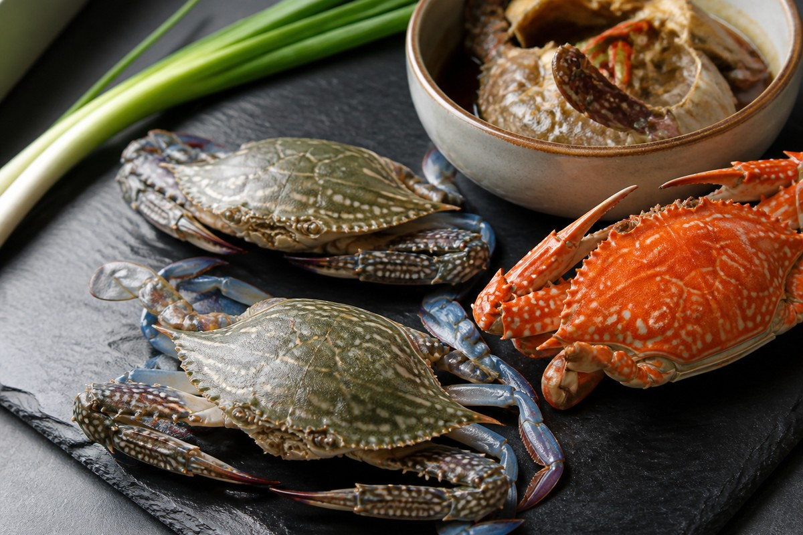

*▲ 꽃게 100g(가식부)은 77kcal, 단백질 16.2g, 지방 0.7g, 타우린 527mg, 아연 2.05mg, 비타민B12 4.30µg입니다. 껍질과 다리를 뺀 살 무게 기준입니다.*

한 줄 결론 <strong>꽃게 100g(가식부)은 77kcal에 단백질 16.2g, 지방 0.7g, 타우린 527mg, 아연 2.05mg, 비타민B12 4.30µg입니다.</strong> 같은 무게의 한우 등심(17.9g)과 단백질은 비슷한데 지방은 10분의 1 수준이라, <strong>고단백 저지방 식품</strong>으로 보면 맞습니다. 다만 꽃게 자체는 싱겁고, <strong>간장게장 100g에는 나트륨이 1,500mg 안팎</strong>(하루 기준치의 75%) 들어 있습니다. 꽃게가 아니라 <strong>간장이 문제</strong>입니다.

11월이면 수산시장에서 꽃게 철이 다시 시작됩니다. 봄에는 알을 밴 암꽃게가, 가을부터는 겨울을 나기 위해 먹이를 왕성하게 먹은 게가 살이 오릅니다. 실제로 11월에는 수꽃게보다 <strong>암꽃게의 살 수율이 더 좋다</strong>는 것이 유통 현장의 설명입니다. 겨울철 수요가 몰리기 전이라 가격도 1년 중 비교적 낮은 편입니다.

그런데 꽃게를 검색하는 이유는 대부분 두 가지입니다. **"꽃게 칼로리가 정말 낮은가?"**, **"간장게장은 왜 나쁘다고 하나?"** 결론부터 말하면 꽃게 살은 <strong>100g에 77kcal, 단백질 16.2g, 지방 0.7g</strong>의 고단백 저지방 식품이고, 문제는 조리 과정에서 붙는 <strong>간장·소금·설탕</strong>입니다.

아래에서는 국가표준식품성분표(게, 꽃게, 생것)를 기준으로 꽃게의 영양, 타우린·아연·비타민B12가 실제로 하는 일, 찜과 게장의 나트륨 차이, 그리고 꽃게를 안전하게 먹는 방법을 정리했습니다.

---

## 1. 꽃게 칼로리와 영양성분은? (100g 77kcal)

아래 수치는 <strong>꽃게(생것, 가식부) 100g</strong> 기준입니다. 여기서 '가식부'는 등딱지와 다리 껍질을 제외하고 실제로 먹는 살과 속내장의 무게입니다.

| 영양 성분 (Nutrient) | 함량 (100g당) | 1일 권장 섭취량 비율 (한국인 성인 기준) |
| :--- | :--- | :--- |
| **열량 (Energy)** | 77 kcal | 3.9% |
| **단백질 (Protein)** | 16.2 g | 29.5% |
| **지방 (Total Fat)** | 0.7 g | 1.3% |
| - 포화지방 (Saturated Fat) | 0.17 g | 1.1% |
| - 콜레스테롤 (Cholesterol) | 30 mg | 10.0% |
| - 오메가3 지방산 (Omega-3) | 0.30 g | 별도 표기¹ |
| **탄수화물 (Carbohydrates)** | 0.43 g | 0.1% |
| - 총 당류 (Total Sugars) | 0.41 g | 0.4% |
| - 식이섬유 (Dietary Fiber) | 0 g | 0.0% |
| **칼슘 (Calcium)** | 127 mg | 18.1% |
| **인 (Phosphorus)** | 137 mg | 19.6% |
| **철분 (Iron)** | 0.7 mg | 7.0% |
| **칼륨 (Potassium)** | 216 mg | 6.2% |
| **나트륨 (Sodium)** | 418 mg | 20.9% |
| **아연 (Zinc)** | 2.05 mg | 22.8% |
| **마그네슘 (Magnesium)** | 46 mg | 14.4% |
| **비타민B12 (Vitamin B12)** | 4.30 µg | 179.2% |
| **판토텐산 (Pantothenic acid)** | 2.01 mg | 40.2% |
| **비타민E (Vitamin E)** | 0.7 mg | 7.0% |
| **엽산 (Folate)** | 13 µg | 3.3% |
| **타우린 (Taurine)** | 527 mg | 별도 표기¹ |

¹ 오메가3 지방산과 타우린은 1일 권장 섭취량 기준치가 따로 설정되지 않은 항목입니다. 비율 대신 절대량으로만 표기했습니다.

### 표 읽는 법: 100g은 껍질을 뺀 '살' 무게입니다

꽃게 영양표를 읽을 때 가장 많이 틀리는 지점이 이 부분입니다. 꽃게 한 마리를 저울에 올리면 중간 크기가 200~300g 나가지만, 그중 <strong>먹을 수 있는 살은 60~100g</strong>입니다. 즉 <strong>꽃게 100g은 중간 크기 한 마리에서 나오는 살 전체</strong>에 해당합니다. 시장에서 두 마리를 사서 다 먹었다면 대략 영양표 값의 두 배를 먹은 셈입니다.

또 하나, 이 표는 <strong>생것</strong> 기준입니다. 찌면 수분이 빠지면서 단백질과 미네랄 밀도가 올라가 <strong>찐 꽃게 살 100g은 83kcal, 단백질 17.9g, 아연 3.8mg</strong> 수준이 됩니다. 표에 따라 71~85kcal로 조금씩 다르게 나오는 이유도 이 때문입니다. 조리 상태와 가식부 정의가 다르기 때문이지, 어느 한쪽이 틀린 값은 아닙니다.

### 실생활 환산: 꽃게 한 마리, 간장게장 한 마리는 몇 kcal인가?

- <strong>중간 크기 꽃게 1마리(살 80g 가정):</strong> 62kcal, 단백질 13g, 타우린 422mg. 하루 단백질 기준치의 약 24%입니다.
- <strong>큰 꽃게 1마리(살 120g):</strong> 92kcal, 단백질 19.4g. 밥 한 공기(약 300kcal)의 3분의 1 열량으로 단백질은 두 배 가까이 얻습니다.
- <strong>꽃게탕 1그릇(600g, 밥 제외):</strong> 60~110kcal 수준이지만 국물 간에 따라 나트륨이 1,000mg을 넘기 쉽습니다.
- <strong>간장게장 1마리(100g):</strong> 나트륨 1,500mg 안팎. 꽃게 자체 나트륨(418mg)의 <strong>3.5배</strong>로, 간장에 절이는 동안 소금이 살 속까지 들어간 결과입니다.

정리하면 <strong>꽃게는 열량이 낮은 식품이고, 꽃게 요리는 국물과 양념 때문에 열량이 아니라 나트륨이 문제</strong>입니다.

---

## 2. 과학적으로 입증된 4대 건강 효능

### 꽃게 단백질 16.2g은 소고기와 비교해 어느 정도인가?

국가표준식품성분표 기준으로 <strong>꽃게 100g의 단백질은 16.2g, 한우 등심은 17.9g</strong>입니다. 숫자만 보면 거의 같습니다. 차이는 지방에 있습니다. 등심 100g의 지방은 10g을 넘지만 꽃게는 <strong>0.7g</strong>입니다. 같은 단백질을 얻으면서 열량은 3분의 1 이하로 줄어드는 구조입니다.

꽃게 단백질의 아미노산 조성도 실용적입니다. 라이신과 아르기닌이 풍부해 <strong>곡류 위주 식사에서 부족해지기 쉬운 필수아미노산을 보충</strong>하는 역할을 합니다. 쌀밥에 꽃게탕을 곁들이는 한국 식사 조합이 영양학적으로 우연이 아닌 이유입니다.

### 꽃게 타우린 527mg은 간과 혈관에 어떤 작용을 하나?

꽃게 100g의 타우린은 <strong>527mg</strong>입니다. 비교하면 오징어(327mg)보다 많고 낙지(854mg)보다 적으며, 한우(40mg)의 13배 수준입니다. 타우린은 황을 포함한 아미노산 유사 물질로, 간에서 <strong>담즙산과 결합해 담즙염을 만드는 과정</strong>에 관여합니다. 담즙산은 지방과 지용성 비타민의 소화·흡수를 돕는 물질이라, 기름진 식사 뒤에 꽃게가 속이 편하다고 느껴지는 배경에는 이 경로가 있습니다.

근거 수준은 분명히 해 두어야 합니다. 타우린의 담즙산 결합은 확립된 생화학이지만, <strong>"꽃게를 먹으면 간 수치가 좋아진다"는 것을 사람 대상 임상시험으로 확인한 자료는 없습니다</strong>. 타우린 보충제 연구는 대부분 정제된 고용량을 쓴 것이고, 식품으로 500mg 안팎을 먹는 경우와 같지 않습니다.

### 꽃게 아연 2.05mg·비타민B12 4.30µg은 면역과 빈혈에 도움이 되나?

꽃게에서 눈에 띄는 미량영양소는 <strong>비타민B12</strong>입니다. 100g에 4.30µg으로 하루 기준치(2.4µg)의 <strong>179%</strong>입니다. 비타민B12는 적혈구 생성과 신경 섬유(미엘린) 보호에 관여하고, <strong>동물성 식품에만 들어 있어 채식 위주 식사에서 부족해지기 쉬운 영양소</strong>입니다. 꽃게를 포함한 조개·갑각류는 이 B12를 확실하게 공급하는 식품군입니다.

<strong>아연 2.05mg</strong>은 하루 기준치의 약 23%입니다. 아연은 면역세포 기능과 상처 회복, 미각 유지에 관여합니다. 여기에 <strong>구리 1.08mg</strong>과 <strong>셀레늄</strong>도 들어 있어, 항산화 효소(슈퍼옥사이드 디스무타제)의 구성 성분을 함께 공급합니다.

다만 빈혈을 꽃게로 해결하려는 접근은 권하지 않습니다. 꽃게 철분은 0.7mg으로 낮은 편이라, 철분 보충이 필요하다면 굴·홍합·소고기 쪽이 훨씬 효율적입니다.

### 꽃게 껍질의 아스타잔틴과 키토산, 실제로 먹을 수 있나?

꽃게를 삶으면 껍질이 새빨개집니다. 껍질에 들어 있던 <strong>아스타잔틴(astaxanthin)</strong>이 열에 의해 단백질과 분리되면서 붉은 색을 드러내기 때문입니다. 아스타잔틴은 강력한 항산화 물질로 알려져 있고, 실제로 연어나 새우의 붉은 색도 같은 성분입니다.

문제는 <strong>사람이 꽃게 껍질을 소화하지 못한다</strong>는 점입니다. 껍질의 주성분은 키틴이고, 이를 분해하는 효소(키티나아제)를 사람은 만들지 않습니다. 껍질에 붙은 아스타잔틴은 <strong>등딱지 안쪽의 속내장(게장·게알)과 살에 섞여 있는 양</strong>만 실제로 섭취됩니다. "게 껍질을 씹어 먹으면 키토산으로 지방이 빠진다"는 설명은 <strong>정제 키토산 보충제를 고용량으로 쓴 연구</strong>를 식품 섭취에 그대로 옮긴 것이고, 껍질째 씹어 먹는 것과는 다른 이야기입니다.

---

## 3. 타우린을 남기는 조리·섭취 가이드

- <strong>찌는 시간은 12~15분.</strong> 물이 끓기 시작한 뒤 중간 크기 꽃게 기준입니다. 오래 찌면 살이 질겨지고 수용성 성분이 찜물로 빠져나갑니다.
- <strong>찜물을 버리지 마세요.</strong> 타우린은 수용성이라 삶거나 찌면 국물로 녹아 나옵니다. 꽃게탕처럼 <strong>국물째 먹는 조리</strong>가 타우린 손실이 가장 적습니다.
- <strong>등딱지는 벗기지 말고 통째로 쪄 주세요.</strong> 등딱지를 가르면 속내장의 즙이 빠집니다. 살과 속내장을 함께 즐기는 것이 영양 손실을 줄이는 방법입니다.
- <strong>죽은 게는 사지 마세요.</strong> 게는 죽은 뒤 효소와 세균 작용으로 빠르게 변합니다. 살아 있는 것을 사서 바로 조리하거나, 손질 후 즉시 냉동하세요.
- <strong>해감은 소금물 30분.</strong> 물 1L에 굵은소금 1큰술을 풀고 30분 두면 표면 이물이 줄어듭니다. 오래 담그면 살이 물러집니다.
- <strong>냉동은 손질 후 60일.</strong> 찐 뒤 살을 발라 밀봉 냉동하면 두고두고 쓰기 좋습니다. 해동은 냉장실에서 12시간.
- <strong>간장게장은 간장을 줄여서.</strong> 간장 1컵에 물 1컵, 다시마·양파·마늘로 향을 내면 나트륨을 절반 가까이 낮출 수 있습니다. 절인 뒤 간장을 따라내고 냉장 보관하세요.
- <strong>양념게장은 고추장 양을 눈으로 재지 마세요.</strong> 고추장 2큰술에 나트륨이 1,000mg 넘게 들어 있습니다. 꽃게 2마리 기준 고추장 1큰술 이하로 잡으세요.

---

## 4. 섭취 시 주의사항 및 부작용

- <strong>갑각류 알레르기가 있으면 피하세요.</strong> 게 알레르기는 새우·랍스터와 교차 반응하고, 심한 경우 아나필락시스로 이어질 수 있습니다. 국물만 마셔도 반응이 나타날 수 있습니다.
- <strong>생게장은 임산부·고령자·면역저하자가 피해야 합니다.</strong> 날 꽃게에는 비브리오균과 폐흡충 위험이 있습니다. 간 질환이 있는 사람은 특히 주의해야 합니다.
- <strong>통풍이 있다면 양을 조절하세요.</strong> 갑각류는 퓨린이 중간 수준인 식품입니다. 급성 통풍 발작기에는 피하고, 평소에는 1회 1마리 이내로 잡는 편이 안전합니다.
- <strong>나트륨은 게장에서 옵니다.</strong> 혈압 관리가 필요하다면 게장 대신 <strong>찜이나 꽃게탕(간 약하게)</strong>을 고르세요. 꽃게 자체 나트륨 418mg은 하루 기준치의 21%로, 국물 간만 조절하면 부담이 크지 않습니다.
- <strong>콜레스테롤 30mg은 걱정할 수준이 아닙니다.</strong> 계란 1개(약 200mg)의 7분의 1입니다. 갑각류 콜레스테롤은 포화지방이 적어 혈중 콜레스테롤에 미치는 영향이 제한적이라는 것이 현재의 설명입니다.
- <strong>칼륨 216mg은 신장질환자에게는 계산이 필요합니다.</strong> 같은 무게의 바나나(약 350mg)보다 낮지만, 국물째 먹으면 양이 늘어납니다. 국물은 적게 드세요.
- <strong>먹고 남은 살은 2일 안에.</strong> 찬 음식으로 두면 비브리오 위험이 커집니다. 다음 날 먹을 양은 바로 냉동하세요.

---

## 5. 자주 묻는 질문 (FAQ)

**Q1. 꽃게는 하루에 몇 마리까지 먹어도 되나요?**  
건강한 성인 기준 <strong>하루 1~2마리(살 100~200g)</strong>가 적당합니다. 단백질 16~32g을 얻는 양이고 열량은 77~154kcal입니다. 다만 게장으로 먹는다면 나트륨이 문제이므로 <strong>1마리 이내</strong>로 줄이고, 국물은 남기는 편이 좋습니다.

**Q2. 11월에 암꽃게가 좋다고 하는데 사실인가요?**  
11월은 꽃게가 월동을 위해 먹이를 왕성하게 먹는 시기라 <strong>암꽃게의 살 수율이 높아집니다</strong>. 봄(4~6월)에는 산란을 앞둔 암꽃게의 알이 차고, 가을(9~11월)에는 살이 오른 게가 좋습니다. 다만 11월 암꽃게는 아직 알이 꽉 찬 상태는 아니므로, 알을 원한다면 봄을 기다리는 편이 맞습니다.

**Q3. 간장게장 나트륨을 줄이는 방법이 있나요?**  
간장과 물을 1:1로 희석하고 다시마·양파·마늘로 감칠맛을 보강하면 나트륨을 절반 가까이 낮출 수 있습니다. 절이는 시간도 12시간을 넘기지 마세요. 더 줄이고 싶다면 <strong>찜이나 꽃게탕</strong>으로 조리 방식을 바꾸는 것이 가장 확실합니다.

---

## 6. 꽃게와 함께 먹으면 좋은 음식

- <strong>[무 (Radish)](/posts/radish-nutrition-benefits/):</strong> 꽃게탕의 기본 재료입니다. 무의 칼륨과 소화효소가 게 국물의 짠맛을 희석하고, 무를 넣으면 같은 간으로도 국물 맛이 깊어져 소금 사용량을 줄일 수 있습니다.
- <strong>[마늘 (Garlic)](/posts/garlic-nutrition-benefits/):</strong> 게장 양념의 필수 재료입니다. 마늘의 알리신은 향과 감칠맛을 담당해 간장 양을 줄이는 역할을 합니다. 다만 마늘이 생게장의 세균 위험을 없애 주지는 않으므로, 신선도가 우선입니다.
- <strong>[김 (Laver)](/posts/laver-nutrition-benefits/):</strong> 게살과 김은 단백질·요오드·철분을 함께 채우는 조합입니다. 게살을 발라 김에 밥과 함께 싸면 간장 없이도 감칠맛이 살아납니다.
- <strong>[시금치 (Spinach)](/posts/spinach-nutrition-benefits/):</strong> 꽃게의 비타민B12·아연과 시금치의 엽산·식이섬유를 함께 얻을 수 있습니다. 게살 무침에 시금치를 더하면 나트륨 대비 채소 섭취량이 늘어납니다.

  
📌 관련 순위 가이드

  <ul>
    <li><a href="/posts/high-protein-foods-ranking/">단백질 많은 음식 순위</a></li>
    <li><a href="/posts/heart-blood-pressure-cholesterol-foods/">혈압·콜레스테롤 관리에 좋은 음식</a></li>
  </ul>

---

## 7. 꽃게 어떻게 먹을까? 핵심 요약

- 꽃게 100g(가식부)은 <strong>77kcal·단백질 16.2g·지방 0.7g·타우린 527mg·아연 2.05mg·비타민B12 4.30µg</strong>입니다.
- 단백질은 한우 등심(17.9g)과 비슷하고 <strong>지방은 10분의 1</strong>입니다. 고단백 저지방 식품으로 보면 맞습니다.
- <strong>비타민B12가 하루 기준치의 179%</strong>로, 채식 위주 식사에서 부족해지기 쉬운 영양소를 채우는 데 유리합니다.
- <strong>타우린 527mg은 오징어(327mg)보다 많습니다.</strong> 수용성이라 국물째 먹는 꽃게탕이 손실이 적습니다.
- <strong>문제는 게장입니다.</strong> 간장게장 100g의 나트륨은 1,500mg 안팎으로 하루 기준치의 75%입니다.
- 11월에는 <strong>살이 오른 암꽃게</strong>가 유리하고, 알을 원하면 봄(4~6월)이 맞습니다.
- <strong>죽은 게는 사지 말고</strong>, 생게장은 임산부·면역저하자가 피해야 합니다.

