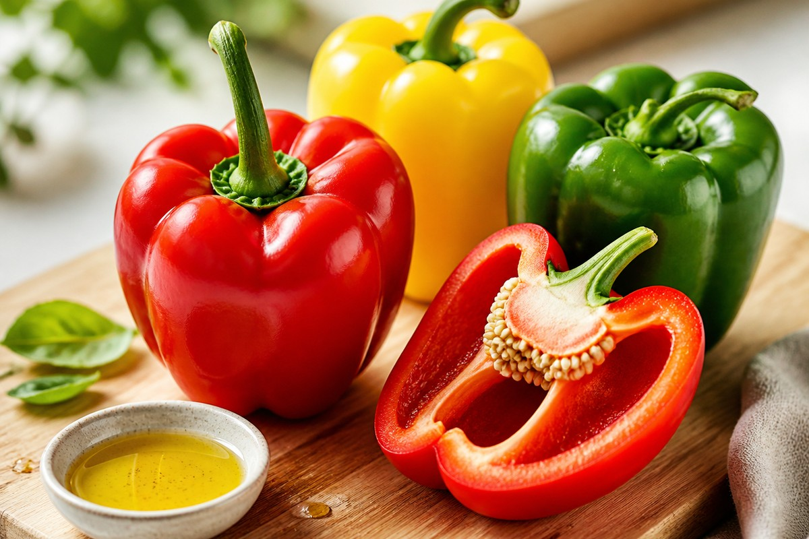

*▲ Raw red bell pepper provides 31 calories, 127.7 mg of vitamin C and 2.1 g of fiber per 100 g, with 1,624 µg of beta-carotene behind its color.*

Quick answer <strong>Raw red bell pepper contains 31 calories, 6.03 g of carbohydrate, 2.1 g of fiber and 127.7 mg of vitamin C per 100 g</strong> — 142% of the U.S. Daily Value, more than twice what an orange provides by weight. It also carries <strong>1,624 µg of beta-carotene and 157 µg RAE of vitamin A (17% DV)</strong>. The two rules that matter: vitamin C dies in boiling water, and carotenoids need a little fat to be absorbed at all.

The bell pepper (*Capsicum annuum*) is the same species as the chili, bred for sweetness instead of heat. Colors are not varieties so much as stages and cultivars: every pepper starts green, and those that carry the right genetics turn yellow, orange or red as carotenoid pigments accumulate over another three to five weeks on the plant. That ripening window is why red peppers cost more — and why they taste sweeter and hold more carotenoids than the green ones picked beside them.

Three questions bring readers here. **How much vitamin C is actually in a bell pepper?** 127.7 mg per 100 g raw for red, 183.5 mg for yellow, 80.4 mg for green, according to USDA. **Does cooking destroy it?** Boiling removes 30–40%; a two-minute stir-fry over high heat loses under 10%. **Are the carotenoids usable?** Only partly — absorption of beta-carotene from raw vegetables can be under 10% without fat at the same meal.

Below are the composition figures, the color comparison across two national databases, what capsanthin, lutein and beta-carotene do and do not do, and cooking methods that keep the vitamin C that makes peppers worth eating.

---

## 1. How Many Calories Are in a Red Bell Pepper? (31 kcal per 100 g)

The values below describe **raw sweet red pepper, edible portion** — stem and seeds removed — from USDA FoodData Central (SR Legacy record 11821). The U.S. %DV column follows FDA Daily Values for a 2,000-calorie diet.

| Nutrient | Per 100 g | U.S. %DV |
| :--- | :--- | :--- |
| **Energy** | 31 kcal | 2% |
| **Water** | 92.2 g | No DV |
| **Protein** | 0.99 g | 2% |
| **Total fat** | 0.30 g | 0% |
| — Saturated fat | 0.059 g | 0% |
| — Cholesterol | 0 mg | 0% |
| **Carbohydrate** | 6.03 g | 2% |
| — Total sugars | 4.20 g | No DV¹ |
| — Dietary fiber | 2.1 g | 8% |
| **Vitamin C** | 127.7 mg | 142% |
| **Vitamin A (RAE)** | 157 µg | 17% |
| — Beta-carotene | 1,624 µg | See note² |
| — Beta-cryptoxanthin | 490 µg | See note² |
| — Lutein + zeaxanthin | 51 µg | See note² |
| **Vitamin B6** | 0.291 mg | 17% |
| **Folate** | 46 µg DFE | 12% |
| **Vitamin E** | 1.58 mg | 11% |
| **Vitamin K** | 4.9 µg | 4% |
| **Niacin** | 0.979 mg | 6% |
| **Riboflavin** | 0.085 mg | 7% |
| **Thiamin** | 0.054 mg | 5% |
| **Potassium** | 211 mg | 4% |
| **Magnesium** | 12 mg | 3% |
| **Calcium** | 7 mg | 1% |
| **Iron** | 0.43 mg | 2% |
| **Zinc** | 0.25 mg | 2% |
| **Sodium** | 4 mg | 0% |

¹ Total sugars have no Daily Value; the FDA reference is 50 g of added sugars per day, and a pepper contains none added.

² Individual carotenoids have no Daily Value of their own. Beta-carotene is counted inside vitamin A activity, which is why the 157 µg RAE line already reflects part of it.

*※ Data basis: the figures above follow the Korean national food composition table (MFDS food nutrient database) for red bell pepper, raw, edible portion. The matching [USDA FoodData Central FDC 170108](https://fdc.nal.usda.gov/food-details/170108/nutrients) — Peppers, sweet, red, raw (SR Legacy) lists 26 kcal and 0.99 g protein per 100 g. The figures here follow the Korean analysis of domestic cultivars; variety and growing conditions explain the energy gap.*

### How to read the table: 100 g is one large pepper

A bell pepper weighs 120–200 g, so **100 g is about one large pepper, or one and a half small ones**. Half a pepper on a salad therefore supplies roughly half the column — still over 60 mg of vitamin C, which is 70% of a day's requirement.

Note what the table does not say. Red pepper is **not** a meaningful source of protein (0.99 g), iron (2% DV) or calcium (1% DV). Its value is vitamin C, vitamin A precursors, B6 and fiber in a package of 31 calories and 92% water. That combination is what makes it useful for volume and micronutrients rather than for satiety on its own.

### What one pepper, one cup and one stir-fry actually deliver

- **One large red pepper (150 g):** 47 kcal, 191 mg vitamin C (212% DV), 2,436 µg beta-carotene, 3.2 g fiber.
- **One cup chopped (149 g):** 46 kcal, 190 mg vitamin C. This is the USDA reference serving and a realistic salad portion.
- **A stir-fry with 10 g of oil (150 g pepper):** 47 kcal of pepper plus 90 kcal of oil — **two-thirds of the dish's calories are the cooking fat**.
- **A salad with 15 g of olive oil dressing:** the dressing adds about 130 kcal, nearly three times the pepper. Pouring half and dipping the rest keeps the fat where it is needed for carotenoid absorption without tripling the calories.

---

## 2. Four Health Effects Backed by Evidence

### How does 127.7 mg of vitamin C compare with other produce?

Per 100 g, raw red bell pepper delivers **127.7 mg**, against 53.2 mg for orange, 53 mg for lemon, 61 mg for kiwi, 89 mg for broccoli and 4.6 mg for apple. By weight it is the richest common kitchen source after a handful of herbs and chili.

Vitamin C is the cofactor for the enzymes that hydroxylate proline and lysine in collagen, which is why wound healing and gum health track intake. It also reduces non-heme iron — the iron in plants and eggs — to a form the intestine can absorb. That second role explains a pairing worth remembering: **peppers with beans, lentils or spinach raise the iron you actually get from them**, sometimes several-fold in controlled meal studies.

The fragility is the catch. Vitamin C is water-soluble and heat-labile. Boiling pepper for three minutes leaches 30–40% into the water; a quick high-heat stir-fry or 90 seconds in a microwave loses under 10%. **Raw is best, short-cooked is fine, long-boiled is a waste.**

### Do the colors really differ, and which one is healthiest?

They differ, and the ranking depends on the database — which is itself the useful finding. USDA lists vitamin C at **80.4 mg (green), 127.7 mg (red) and 183.5 mg (yellow)**; the Korean Rural Development Administration's table lists **162 mg (green), 154 mg (orange), 119 mg (red) and 108–111 mg (yellow)**. Cultivar and sunlight exposure move vitamin C more than color does, so no single "best" color survives every measurement.

The carotenoids split more cleanly, because they are the pigments themselves:

| Color | Dominant carotenoids | What it means |
| :--- | :--- | :--- |
| **Green** (unripe) | Chlorophyll, lutein | Lowest calories (20 kcal), highest in some tables for vitamin C |
| **Yellow** | Lutein, zeaxanthin, beta-carotene | Consistent macular-pigment contributors |
| **Orange** | Zeaxanthin, beta-cryptoxanthin | Highest total carotenoids in several Korean studies |
| **Red** (fully ripe) | **Capsanthin, capsorubin**, beta-carotene | Highest beta-carotene (1,624 µg USDA / 3,052 µg Korean table) and strongest measured antioxidant activity |

Red pepper's signature pigments, **capsanthin and capsorubin**, are ketocarotenoids found in no other common vegetable; Korean analyses measured capsanthin at 53.70 mg/kg fresh weight in red cultivars, against lutein at 4.65–5.19 mg/kg in green and yellow ones. A 2011 Korean study found red paprika had both the highest total carotenoids and the strongest radical-scavenging activity of the colors tested.

**Practical conclusion: eat more than one color.** Red for carotenoids, green and yellow for volume and vitamin C, and the mixed plate covers whichever table you happen to be reading.

### What do beta-carotene, lutein and capsanthin actually do?

**Beta-carotene** is provitamin A: the body cleaves it into retinol as needed. Red pepper's 1,624 µg is counted inside the 157 µg RAE of vitamin A (17% DV), which supports retinal rhodopsin formation and normal differentiation of skin and mucosal tissue.

**Lutein and zeaxanthin** concentrate in the macula and absorb blue light. The evidence here is stronger than for most plant pigments: AREDS2, a large randomized trial, found that a lutein plus zeaxanthin formulation slowed progression to advanced age-related macular degeneration in a subgroup. That trial used **purified supplements at 10 mg/2 mg**, not peppers — 100 g of pepper supplies only about 51 µg of lutein plus zeaxanthin. Peppers contribute to intake; they are not a treatment.

**Capsanthin** is the least-studied of the three. Cell and animal work reports antioxidant and anti-inflammatory activity, and human trials on whole red pepper are essentially absent. This is a real antioxidant in a real food, not a proven therapy.

### Is pepper useful for weight, blood sugar or skin?

For weight, the mechanism is volume rather than pharmacology: 31 kcal per 100 g at 92% water lets you fill a plate for almost nothing, and 2.1 g of fiber per 100 g adds modest bulk. Peppers alone do not satisfy hunger — 0.99 g of protein is not a meal — so pair them with a protein source.

For blood sugar, red pepper is low-glycemic and its fiber slows gastric emptying slightly. Juicing four sweet peppers into a glass removes that fiber and concentrates the sugar (4.2 g per 100 g), which is the one preparation worth avoiding if you are managing glucose.

For skin, vitamin C's role in collagen synthesis is established biochemically, but trials showing that eating peppers improves skin appearance are small and inconsistent. Adequate vitamin C supports normal collagen formation; extra vitamin C does not make more of it.

---

## 3. Cooking and Eating Guide That Preserves Vitamin C

- **Raw with a teaspoon of oil.** Carotenoid absorption from raw vegetables can be under 10% without fat. A teaspoon of olive oil (5 g, 45 kcal) or a few nuts is enough; you do not need a poured dressing.
- **Stir-fry 2–3 minutes over high heat.** Vitamin C loss stays under 10%, and the oil carries the carotenoids. Do not add water — steam leaches the water-soluble vitamins.
- **Skip the blanch.** Three minutes in boiling water costs 30–40% of the vitamin C. If a recipe demands blanching, use minimal water and keep that water for soup.
- **Microwave 90 seconds covered.** No water contact means less leaching than boiling, and the short time limits heat degradation. Add oil afterward.
- **Eat the white pith and seeds' surroundings.** The interior walls hold fiber and are only mildly bitter; trimming them out is a habit that throws away nutrition.
- **Wash 30 seconds under running water.** Peppers are eaten skin-on. A minute in water with a teaspoon of baking soda, then a rinse, helps remove surface residue and wax.
- **Store at about 5 °C, wrapped in paper, for a week.** Below 5 °C peppers develop pitting and the seeds darken. The crisper drawer is correct; the freezer is not, unless you plan to cook them.
- **Paprika powder is not the same food.** Drying and grinding destroys most of the vitamin C. Use ground paprika for color and flavor, and get the vitamin C from fresh peppers.

---

## 4. Cautions and Side Effects

- **Nightshade allergy.** Pepper belongs to the nightshade family with tomato, eggplant and potato. Cross-reactions are uncommon but reported; itching or swelling around the mouth means stop.
- **Watch the oil, not the pepper.** 100 g of pepper is 31 kcal; 20 g of oil is 180 kcal, or 86% of the finished dish. Carotenoid absorption needs about 5 g of fat, not 20.
- **Potassium in kidney disease.** At 211 mg per 100 g, pepper is moderate. A mixed plate of three colors plus leafy greens adds up; portion rather than free-pour.
- **Vitamin K and anticoagulants.** Pepper carries 4.9 µg per 100 g, low but not zero. On warfarin, keep intake steady rather than swinging between days.
- **Capsaicinoids are not zero.** Sweet peppers contain trace capsaicinoids; people with sensitive stomachs can feel bloating after large amounts, especially juiced.
- **Avoid charred skin.** Peppers are sugary and scorch above 200 °C. Blackened skin carries the compounds you would rather not eat; peel it off rather than serving it.
- **Juicing concentrates sugar.** Four peppers yield roughly 17 g of sugar in a glass with the fiber removed. Whole peppers are the better default.

---

## 5. Frequently Asked Questions

**Q1. How much bell pepper should I eat a day?**  
For healthy adults, **100–150 g (one large pepper)** covers the daily vitamin C requirement and provides useful beta-carotene and B6 for about 31–47 calories. Mixing colors covers different carotenoids, so half red and half green or yellow is a better default than one color alone.

**Q2. Is a red bell pepper the same as a green one?**  
Same species, different maturity and cultivar. Green peppers are harvested before full ripening, so they are lower in sugar and carotenoids but can be higher in vitamin C depending on the database. Red peppers ripen longer on the plant, turn sweet, and accumulate capsanthin and beta-carotene.

**Q3. Does cooking destroy the vitamin C in peppers?**  
Not all of it. A two- to three-minute high-heat stir-fry loses under 10%, while three minutes in boiling water loses 30–40% to leaching. Microwaving covered for 90 seconds also limits loss because there is no water to dissolve the vitamin C into.

---

## 6. Synergistic Food Pairings

- **[Beef Sirloin](/en/posts/beef-sirloin-nutrition-benefits/):** the pepper's vitamin C raises absorption of the heme and non-heme iron in beef, while the beef's fat carries the pepper's carotenoids. Each improves the other's absorption in the same bite.
- **[Egg](/en/posts/egg-nutrition-benefits/):** yolk lipids supply the fat that beta-carotene needs. A pepper-and-egg scramble gets fat-soluble vitamin A precursors absorbed without adding separate oil.
- **[Broccoli](/en/posts/broccoli-nutrition-benefits/):** two high-vitamin-C vegetables with complementary fiber and folate. Briefly steamed and tossed with a teaspoon of sesame oil, the pair limits vitamin C loss while making the carotenoids available.
- **[Tofu](/en/posts/tofu-nutrition-benefits/):** pepper's vitamin C improves absorption of the non-heme iron in soy, and tofu supplies the protein that peppers lack. A tofu and pepper stir-fry is a complete plate in one pan.

  
📌 Related ranking guides

  <ul>
    <li><a href="/en/posts/antioxidant-anti-aging-foods-guide/">Antioxidant and anti-aging foods</a></li>
    <li><a href="/en/posts/low-calorie-high-satiety-foods/">Low-calorie, high-satiety foods</a></li>
  </ul>

---

## 7. Key Takeaways

- Raw red bell pepper is **31 calories, 6.03 g carbohydrate, 2.1 g fiber and 127.7 mg vitamin C** per 100 g — 142% DV of vitamin C.
- **100 g is roughly one large pepper.** Half a pepper still covers most of a day's vitamin C.
- **Color rankings shift with cultivar and database.** USDA: yellow highest in vitamin C; Korean RDA table: green highest. Red leads on beta-carotene either way (1,624–3,052 µg).
- **Capsanthin and capsorubin** are red pepper's unique pigments; lutein and zeaxanthin dominate yellow and green.
- **Carotenoids are fat-soluble**: without about 5 g of fat at the meal, absorption can fall below 10%.
- **Boiling costs 30–40% of the vitamin C**; a 2–3 minute stir-fry or 90 seconds covered in the microwave costs under 10%.
- **The calories are in the oil, not the pepper** — 20 g of oil makes up 86% of a finished pepper dish.
- **Ground paprika is a colorant, not a vitamin C source**; drying destroys most of it.

