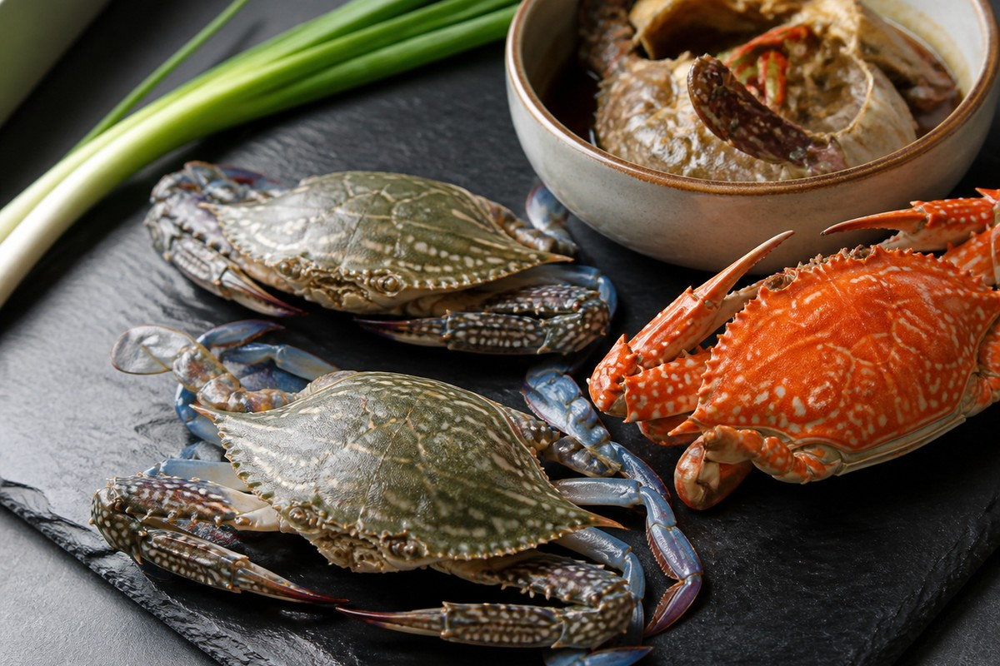

*▲ Cooked blue crab meat carries 83 calories, 17.9 g of protein and just 0.7 g of fat per 100 g, plus 139% of the daily value for vitamin B12 in a single serving.*

Quick answer <strong>Cooked blue crab meat provides 83 calories, 17.88 g of protein, 0.74 g of fat and no carbohydrate per 100 g.</strong> That is 36% of the U.S. Daily Value for protein at less than 5% of a 2,000-calorie day, with <strong>139% DV of vitamin B12, 35% DV of zinc, 90% DV of copper and 78% DV of selenium</strong>. The catch is not the crab: it is what the crab is served in. Soy-marinated raw crab (<em>ganjang-gejang</em>) carries roughly 1,500 mg of sodium per 100 g — about 65% of the daily limit — and the salt, not the shellfish, is what raises blood pressure.

Blue crab (*Callinectes sapidus* on the U.S. Atlantic and Gulf coasts, *Portunus trituberculatus* in Korea and Japan) is the small, blue-green, hard-shelled swimming crab that anchors autumn and winter tables in both countries. In Korea the season runs twice: spring brings females heavy with roe, and from September through November the crabs feed hard before winter and their meat yield climbs. By November, fish-market sellers in Korea will tell you the female crabs are the better buy — the meat-to-shell ratio is higher, because the females have absorbed the energy the males spent.

Three questions bring most readers here. **How many calories are in crab?** 83 per 100 g of cooked meat, almost all of it protein. **Is crab high in cholesterol?** It has 97 mg per 100 g, but very little saturated fat, and dietary cholesterol moves blood cholesterol far less than once believed. **Is raw marinated crab safe?** Not for everyone — raw crab carries *Vibrio* and, in East Asia, lung fluke risk.

Below are the composition figures, how the serving size actually works out on a whole crab, what the B12, zinc, copper, selenium and taurine in crab do in the body, and how to cook and store it without losing the water-soluble nutrients.

---

## 1. How Many Calories Are in Blue Crab? (83 kcal per 100 g)

The values below describe **blue crab, cooked by moist heat, edible portion only** — shell and cartilage removed — from USDA FoodData Central (SR Legacy record 174205). The U.S. %DV column is calculated against FDA Daily Values for a 2,000-calorie diet.

| Nutrient | Per 100 g | U.S. %DV |
| :--- | :--- | :--- |
| **Energy** | 83 kcal | 4% |
| **Water** | 79.69 g | No DV |
| **Protein** | 17.88 g | 36% |
| **Total fat** | 0.74 g | 1% |
| — Saturated fat | 0.16 g | 1% |
| — Cholesterol | 97 mg | 31% |
| — Omega-3 fatty acids | 0.30 g | See note¹ |
| **Carbohydrate** | 0 g | 0% |
| — Total sugars | 0 g | No DV² |
| — Dietary fiber | 0 g | 0% |
| **Calcium** | 91 mg | 7% |
| **Phosphorus** | 234 mg | 19% |
| **Iron** | 0.50 mg | 3% |
| **Potassium** | 259 mg | 6% |
| **Sodium** | 395 mg | 17% |
| **Zinc** | 3.81 mg | 35% |
| **Copper** | 0.814 mg | 90% |
| **Magnesium** | 36 mg | 9% |
| **Selenium** | 42.9 µg | 78% |
| **Vitamin B12** | 3.33 µg | 139% |
| **Vitamin B6** | 0.156 mg | 9% |
| **Niacin** | 2.747 mg | 17% |
| **Folate** | 51 µg DFE | 13% |
| **Choline** | 80.9 mg | 15% |
| **Vitamin E** | 1.84 mg | 12% |
| **Vitamin A** | 1 µg RAE | 0% |
| **Taurine** | ~500 mg | See note¹ |

¹ Omega-3 fatty acids and taurine have no established Daily Value; the percentages are omitted and absolute amounts given instead.

² Total sugars have no Daily Value. The FDA reference is 50 g of added sugars per day, and crab contains none.

*※ Source: [USDA FoodData Central FDC 171966](https://fdc.nal.usda.gov/food-details/171966/nutrients) — Crustaceans, crab, blue, canned (SR Legacy). The 83 kcal and 17.88 g protein per 100 g in the table above are this entry’s values; a different cooking state changes them.*

### How to read the table: 100 g is meat, not crab

This is the point most crab nutrition pages get wrong. A whole medium blue crab weighs 150–250 g, but **only 60–100 g of that is edible meat**. So the 100 g column above represents roughly **one whole medium crab, picked clean** — not one crab split with someone else.

Two consequences follow. First, eating two crabs means double every number, including 790 mg of sodium. Second, comparing "crab" to "beef" by weight flatters crab on fat but not on protein: per 100 g, cooked blue crab gives 17.88 g of protein against roughly 26 g for cooked sirloin, with 0.74 g of fat against 10 g or more. Per calorie, crab wins clearly — 21.5 g of protein per 100 calories, one of the highest ratios in the shellfish aisle.

The Korean national table lists raw blue crab at 77 kcal with 16.2 g of protein; the difference from the USDA cooked figure comes from water loss during cooking and from slightly different edible-portion definitions. Both are correct for the state they describe.

### What one crab, one bowl and one marinade actually deliver

- **One medium crab (80 g meat):** 66 kcal, 14.3 g protein, 3.0 mg zinc, 2.7 µg B12. About a quarter of a day's protein for the calories of half an apple.
- **One large crab (120 g meat):** 100 kcal, 21.5 g protein. Roughly the protein of three eggs at the calories of one and a half.
- **Crab stew, one bowl (600 g, no rice):** 60–110 kcal, but sodium can pass 1,000 mg depending on how the broth is seasoned.
- **Soy-marinated raw crab, 100 g:** about 1,500 mg sodium — 3.8 times the sodium of plain crab meat, absorbed from the soy during marination.

The pattern is consistent: **the crab is lean and low in calories; the dish is high in sodium.**

---

## 2. Four Health Effects Backed by Evidence

### Does crab protein compare with beef?

Per 100 g of cooked meat, blue crab delivers **17.88 g of protein** — roughly 70% of what cooked beef sirloin provides, at a fraction of the fat. The limiting factor in most diets is not total protein but the calories and saturated fat that come with it, and crab separates the two.

Crab protein is also well supplied with **lysine and arginine**, the amino acids that run short when rice or wheat dominates the plate. That is why rice plus crab stew is a more complete meal than rice alone, and why crab appears in so many coastal cuisines alongside grains rather than bread.

### What does 139% DV of vitamin B12 actually do?

This is the number that makes crab unusual. **3.33 µg of vitamin B12 per 100 g** is 139% of the Daily Value, from a food that supplies almost no fat. B12 is required for red blood cell formation, for myelin — the sheath around nerve fibers — and for DNA synthesis. It occurs naturally almost exclusively in animal foods, so **people eating little or no meat, and adults over 60 with reduced stomach acid, are the groups most likely to run short**.

Shellfish are among the most reliable sources: clams and oysters exceed crab, but crab alone covers a day's requirement in a single picked crab. Symptoms of deficiency — fatigue, tingling in the hands and feet, memory trouble — develop slowly and are easily attributed to age, which is why the intake matters more than the symptom.

### Do crab's zinc, copper and selenium matter, or are they rounding errors?

They are not rounding errors. **Zinc at 3.81 mg (35% DV)** supports immune cell function, wound healing and taste perception. **Copper at 0.814 mg (90% DV)** is a cofactor for copper-zinc superoxide dismutase, one of the body's main antioxidant enzymes, and for the enzymes that cross-link collagen. **Selenium at 42.9 µg (78% DV)** sits inside glutathione peroxidase, which neutralizes lipid peroxides.

What crab does **not** do well is iron. At **0.50 mg (3% DV)** it is a poor choice for anyone treating iron-deficiency anemia; oysters, mussels and red meat are far more efficient. This matters because "seafood is good for anemia" is a common assumption that holds for bivalves but not for crab.

### Are the astaxanthin and chitosan in the shell usable?

Crab shells turn bright red when cooked because **astaxanthin**, a carotenoid bound to protein in the live shell, is released by heat. Astaxanthin is a genuine antioxidant, and it is the same pigment that colors salmon and shrimp.

The shell itself, however, is **chitin**, and humans do not produce chitinase. The astaxanthin you actually absorb is the portion bound in the meat and in the Hepatopancreas — the yellow-green "mustard" inside the shell, which Korean diners eat and most Western cooks discard. Claims that eating crab shells burns fat come from trials using **purified chitosan supplements at gram doses**, not from chewing shells, and should not be transferred to the dinner table.

One more figure worth correcting: **cholesterol at 97 mg per 100 g** sounds alarming until it is compared with an egg (about 186 mg) or shrimp (about 190 mg). Crab is low in saturated fat (0.16 g), and saturated and trans fat drive blood LDL far more than dietary cholesterol does. Current dietary guidance no longer sets a strict daily cholesterol ceiling for healthy adults for this reason.

---

## 3. Cooking and Eating Guide That Preserves Taurine

- **Steam 12–15 minutes** from boiling, for a medium crab. Longer cooking toughens the meat and leaches water-soluble compounds into the steaming liquid.
- **Do not throw away the cooking liquid.** Taurine is water-soluble; boiling or steaming moves it into the broth. Crab stew, where the broth is eaten, retains the most.
- **Cook crabs whole.** Splitting the shell before cooking lets the juices and the taurine-rich interior drain out. Steam whole, then clean.
- **Never cook a dead crab.** Crabs deteriorate rapidly after death as enzymes and bacteria act on the flesh. Buy live, or buy cleaned and frozen.
- **Purge 30 minutes in salt water.** One tablespoon of coarse salt per liter of water for 30 minutes reduces surface debris. Longer soaking softens the meat.
- **Freeze cleaned meat for up to 60 days.** Pick the meat after steaming, pack it airtight, and thaw overnight in the refrigerator.
- **Cut the soy in marinades.** A 1:1 soy-to-water base with kelp, onion and garlic carries roughly half the sodium of straight soy sauce and tastes nearly as deep.
- **Watch the gochujang, not just the soy.** Two tablespoons of Korean chili paste can carry over 1,000 mg of sodium. For two crabs, keep it to one tablespoon.

---

## 4. Cautions and Side Effects

- **Shellfish allergy.** Crab allergy cross-reacts with shrimp and lobster and can cause anaphylaxis. Cooking broth can trigger reactions in sensitive people, so avoid the steam and the stock as well as the meat.
- **Raw marinated crab is not for everyone.** Raw crab carries *Vibrio* species and, in East Asia, the lung fluke *Paragonimus*. Pregnant women, older adults, people with liver disease and anyone immunocompromised should avoid it. Freezing at −20 °C for 24 hours reduces but does not eliminate the risk.
- **Gout.** Crustaceans are moderate-purine foods. Avoid crab during an acute flare; otherwise keep portions to one crab at a time and hydrate well.
- **Sodium is the real constraint.** At 395 mg per 100 g, plain crab already carries 17% DV. Soy-marinated crab multiplies that nearly fourfold. If you are managing blood pressure, choose steamed crab or a lightly seasoned stew.
- **Potassium in kidney disease.** At 259 mg per 100 g crab is moderate, but broth concentrates it. Portion the meat rather than drinking the stock.
- **Keep leftovers under two days.** Cooked crab is a favorable medium for bacteria at refrigerator temperatures. Freeze what you will not finish the next day.

---

## 5. Frequently Asked Questions

**Q1. How much crab can I eat in a day?**  
For healthy adults, **one to two crabs (100–200 g of meat)** is a reasonable daily portion, supplying 18–36 g of protein for 83–166 calories. If the crab is soy-marinated, keep it to one and leave the marinade behind — the sodium, not the crab, is the limiting factor.

**Q2. Is November really the best month for female crab?**  
In Korea, yes for meat yield. From September to November crabs feed heavily before winter, and the females' meat-to-shell ratio rises. Spring (April to June) is when females carry roe. So the answer depends on which you want: **roe in spring, meat in late autumn**.

**Q3. Can I reduce the sodium in soy-marinated crab?**  
Yes. Dilute soy sauce 1:1 with water and rebuild the flavor with kelp, onion, garlic and a little apple or pear. Marinate no longer than 12 hours, then pour the liquid off before storing. The most reliable reduction, though, is to change the dish: steamed crab or a lightly salted stew.

---

## 6. Synergistic Food Pairings

- **[Radish](/en/posts/radish-nutrition-benefits/):** the backbone of Korean crab stew. Radish adds potassium and volume, which lets you season the broth more lightly for the same depth of flavor — the simplest way to cut sodium without losing taste.
- **[Garlic](/en/posts/garlic-nutrition-benefits/):** essential in crab marinades. Allicin supplies aroma and savory depth so less soy is needed. It does not sterilize raw crab, though; freshness still decides safety.
- **[Laver](/en/posts/laver-nutrition-benefits/):** crab meat and toasted laver combine protein, iodine and iron in one bite. Wrapped with rice, the pair needs no soy sauce at all.
- **[Spinach](/en/posts/spinach-nutrition-benefits/):** pairs crab's B12 and zinc with folate and fiber. A spinach and crab salad raises vegetable intake relative to sodium, which is exactly the trade most crab dishes get wrong.

  
📌 Related ranking guides

  <ul>
    <li><a href="/en/posts/high-protein-foods-ranking/">High-protein foods ranked</a></li>
    <li><a href="/en/posts/heart-blood-pressure-cholesterol-foods/">Foods that support blood pressure and cholesterol</a></li>
  </ul>

---

## 7. Key Takeaways

- Cooked blue crab is **83 calories, 17.88 g protein, 0.74 g fat and 0 g carbohydrate** per 100 g.
- It delivers **139% DV vitamin B12, 35% DV zinc, 90% DV copper and 78% DV selenium** — an unusually dense micronutrient profile for the calories.
- **100 g means picked meat**, roughly one medium whole crab. Two crabs double everything, including sodium.
- **Taurine (~500 mg per 100 g)** is water-soluble: steam whole and eat the broth rather than discarding it.
- **Cholesterol (97 mg) is not the problem**; saturated fat is 0.16 g per 100 g. Sodium is the number to watch.
- **Soy-marinated raw crab carries about 1,500 mg sodium per 100 g** and should be avoided by pregnant, older, immunocompromised and liver-disease patients.
- **Late autumn favors female crabs for meat; spring favors them for roe.**
- Iron is low (3% DV), so crab is not an anemia food — oysters and mussels are.

