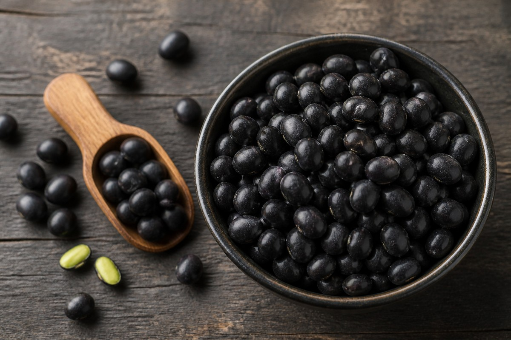

*▲ 서리태 100g은 413kcal에 단백질 38.7g, 식이섬유 20.8g, 칼륨 1,848mg입니다. 알을 갈라 보면 속이 파랗습니다.*

한 줄 결론 <strong>마른 서리태 100g은 413kcal에 단백질 38.7g, 식이섬유 20.8g, 칼륨 1,848mg, 철분 6.19mg입니다.</strong> 단백질 비중이 38.7%로 <strong>쌀(6.8%)의 6배, 두부(8.1%)의 5배</strong>입니다. 다만 이 수치는 <strong>물에 불리지 않은 마른콩 기준</strong>이라, 실제로 먹는 삶은콩 100g으로 환산하면 단백질이 15g 안팎으로 떨어집니다. 검은콩의 진짜 무기는 단백질량보다 <strong>껍질의 안토시아닌(시아니딘-3-글루코사이드)</strong>과 식이섬유입니다.

콩은 한국 밥상에서 가장 오래된 단백질 공급원입니다. 그중에서도 서리태는 <strong>첫서리가 내리는 상강(10월 하순) 무렵에 수확한다</strong>고 해서 붙은 이름입니다. 껍질은 검지만 속이 파래서 '속청'이라고도 부르고, 알이 굵고 단맛이 강해 콩밥·콩자반·서리태 콩물로 가장 선호되는 품종입니다.

같은 검은콩이라도 부르는 이름이 다릅니다. <strong>서리태</strong>는 알이 크고 속이 초록이며, <strong>흑태</strong>는 껍질과 속이 모두 검고, <strong>쥐눈이콩(서목태)</strong>은 알이 작고 검은 껍질에 흰 점이 있습니다. 영양 성분은 서로 비슷하지만 안토시아닌 함량과 식감에서 차이가 나고, 가격은 서리태가 가장 높습니다.

검색창에 실제로 들어오는 질문은 세 가지입니다. <strong>"검은콩이 노란콩보다 정말 좋은가?"</strong>, <strong>"하루에 얼마나 먹어야 하나?"</strong>, <strong>"콩을 먹으면 가스가 차고 소화가 안 되는데 어떻게 해야 하나?"</strong> 결론부터 말하면 검은콩과 노란콩은 <strong>단백질·식이섬유·무기질이 거의 같고, 검은콩에만 안토시아닌이 더 있습니다.</strong> 하루 적정량은 <strong>마른콩 30g(삶아서 70g 안팎)</strong>이고, 가스와 소화 문제는 <strong>충분히 불리고 오래 삶는 것</strong>으로 대부분 해결됩니다.

아래에서는 농촌진흥청 국가표준식품성분표(콩, 서리태, 말린 것)를 기준으로 영양 성분, 마른콩과 삶은콩의 환산, 안토시아닌·이소플라본의 실제 근거, 그리고 소화를 살리는 조리법을 정리했습니다.

---

## 1. 서리태 칼로리와 영양성분은? (100g 413kcal)

아래 수치는 <strong>마른 서리태(가식부) 100g</strong> 기준입니다. 물에 불리지 않고 말린 상태의 무게이므로, 밥에 넣거나 콩자반을 만들 때의 원물 기준이라고 보면 됩니다.

| 영양 성분 (Nutrient) | 함량 (100g당) | 1일 권장 섭취량 비율 (한국인 성인 기준) |
| :--- | :--- | :--- |
| **열량 (Energy)** | 413 kcal | 20.7% |
| **수분 (Water)** | 10.3 g | 별도 표기¹ |
| **탄수화물 (Carbohydrates)** | 30.5 g | 9.4% |
| - 당류 (Sugars) | 6.45 g | 6.5% |
| - 식이섬유 (Dietary Fiber) | 20.8 g | 83.2% |
| **단백질 (Protein)** | 38.7 g | 70.4% |
| **지방 (Total Fat)** | 15.9 g | 29.4% |
| **칼륨 (Potassium)** | 1,848 mg | 52.8% |
| **칼슘 (Calcium)** | 199 mg | 28.4% |
| **철분 (Iron)** | 6.19 mg | 61.9% |
| **인 (Phosphorus)** | 653 mg | 93.3% |
| **엽산 (Folate)** | 485 µg | 121.3% |
| **비타민C (Vitamin C)** | 6.72 mg | 6.7% |
| **티아민 (Thiamin, B1)** | 0.17 mg | 14.2% |
| **리보플라빈 (Riboflavin, B2)** | 0.68 mg | 48.6% |
| **나이아신 (Niacin)** | 1.42 mg | 9.5% |
| **나트륨 (Sodium)** | 1 mg | 0.1% |

¹ 수분은 1일 권장 섭취량 기준치가 따로 설정되지 않은 항목입니다. 마른콩의 수분 10.3%는 저장성이 좋다는 뜻이기도 합니다.

### 표 읽는 법: 마른콩 100g은 생각보다 많은 양입니다

서리태 한 알의 무게는 0.25~0.35g입니다. 즉 <strong>마른콩 100g은 300~400알</strong>이고, 밥 한 공기에 얹는 콩이 10~15g인 것을 생각하면 <strong>100g은 7~10끼 분량</strong>입니다. 영양표의 숫자는 '한 끼에 이만큼 먹는다'는 뜻이 아니라 '원물 100g을 기준으로 잰 값'으로 읽어야 합니다.

이 표에서 중요한 세 가지를 짚습니다.

- <strong>단백질 38.7g은 식물성 식품 중 최상위권입니다.</strong> 같은 무게의 쇠고기 등심(20.6g), 달걀(12.6g), 두부(8.1g)보다 많습니다. 다만 <strong>열량도 413kcal</strong>이라 단백질 1g당 열량으로 보면 닭가슴살보다 불리합니다.
- <strong>식이섬유 20.8g은 하루 기준치의 83%입니다.</strong> 마른콩 30g만 먹어도 6.2g으로, 채소 두 접시에 맞먹습니다.
- <strong>칼륨 1,848mg과 인 653mg은 신장질환자에게는 부담</strong>입니다. 이 두 항목이 콩을 '건강식'과 '주의식'으로 동시에 만드는 이유입니다.

### 실생활 환산: 마른콩 30g은 삶은콩 몇 g인가?

콩은 물을 흡수하면 무게가 2.2~2.5배로 늘어납니다. 그래서 <strong>마른콩과 삶은콩을 같은 무게로 비교하면 영양이 절반 이하로 보입니다.</strong> 실제 식탁 단위로 환산하면 다음과 같습니다.

- <strong>마른 서리태 30g(약 100알, 124kcal):</strong> 단백질 11.6g, 식이섬유 6.2g, 칼륨 554mg, 철분 1.9mg.
- <strong>삶은 서리태 70g(마른콩 30g 상당, 130~150kcal):</strong> 콩자반 한 접시, 또는 콩밥 한 그릇에 들어가는 콩의 양입니다.
- <strong>콩밥 1공기(쌀 150g + 마른콩 20g):</strong> 밥 열량 540kcal에 콩 83kcal가 더해져 620kcal 안팎. 단백질은 콩에서 7.7g, 쌀에서 10g가량 들어옵니다.
- <strong>서리태 콩물 1잔(250ml, 마른콩 25g 사용):</strong> 103kcal, 단백질 9.7g. 시판 두유(단백질 3~6g/200ml)보다 진한 대신 <strong>식이섬유가 그대로 남아 있어</strong> 포만감이 큽니다.
- <strong>볶은 검은콩 한 줌(20g):</strong> 83kcal, 단백질 7.7g. 견과류 대신 견과 크기로 집어 먹는 간식입니다.

정리하면 <strong>하루 한 끼에 콩 30g(마른 무게)을 넣으면 단백질 11.6g과 식이섬유 6.2g을 확보</strong>합니다. 413kcal라는 숫자에 겁먹을 필요는 없고, 대신 <strong>한 번에 100g씩 먹는 일은 없다</strong>는 것을 기억하면 됩니다.

---

## 2. 과학적으로 입증된 4대 건강 효능

### 검은콩과 노란콩은 무엇이 다른가? (안토시아닌 C3G)

결론부터 말하면 <strong>단백질·식이섬유·무기질은 사실상 같고, 차이는 껍질 색소 하나입니다.</strong> 검은콩이 '블랙푸드'로 따로 취급되는 이유는 껍질에 축적된 <strong>안토시아닌</strong>입니다.

국내에서 육성된 검은콩 16품종을 2년에 걸쳐 분석한 연구에서, <strong>종피(껍질)의 총 안토시아닌은 g당 2.3~14.4mg</strong>으로 품종 간 차이가 6배 이상 났습니다. 그중 <strong>77%가 시아니딘-3-글루코사이드(C3G)</strong>였고, 나머지는 델피니딘-3-글루코사이드(20%)와 페투니딘-3-글루코사이드(3%)가 차지했습니다. 같은 연구에서 <strong>이소플라본은 g당 795~4,195µg</strong>으로, 100g 기준 79~420mg에 해당합니다.

이 숫자가 의미하는 바는 두 가지입니다.

- <strong>품종에 따라 색소 함량이 크게 다릅니다.</strong> "검은콩이면 안토시아닌이 많다"는 말은 맞지만, 어느 품종이냐에 따라 6배 차이가 납니다. 알이 작고 껍질 비중이 큰 쥐눈이콩이 단위 무게당 색소는 유리할 수 있습니다.
- <strong>껍질을 벗기면 안토시아닌은 사라집니다.</strong> 검은콩을 갈아 즙을 내고 체에 걸러 껍질을 버리면, 남는 것은 노란콩과 거의 같은 액체입니다. <strong>검은콩의 강점을 살리려면 껍질째 먹어야</strong> 합니다.

안토시아닌의 작용은 시험관·동물 연구에서 항산화, LDL 산화 억제, 혈관내피 기능 개선으로 반복 보고됩니다. 사람을 대상으로 한 임상은 규모가 작고 연구마다 결과가 엇갈립니다. 즉 <strong>검은콩은 '항산화 색소를 껍질째 먹는 식품'으로서 가치가 있고, 특정 질병을 치료하는 식품은 아닙니다.</strong>

### 단백질 38.7g은 쇠고기보다 많은가? (질과 양의 차이)

양으로만 보면 그렇습니다. 마른콩 100g의 단백질 38.7g은 쇠고기 등심(20.6g)의 약 1.9배입니다. 그런데 <strong>단백질을 평가할 때는 양보다 아미노산 조성과 소화율</strong>을 봐야 합니다.

콩 단백질은 <strong>라이신이 풍부하고 메티오닌이 부족</strong>합니다. 반대로 쌀·보리는 라이신이 부족하고 메티오닌이 충분합니다. 그래서 <strong>콩밥, 콩+잡곡, 두부+밥 같은 조합</strong>이 영양학적으로 오래 권장된 이유가 여기에 있습니다. 부족한 아미노산을 서로 채워 단백질 이용률을 끌어올리는 것입니다.

소화율은 동물성 단백질보다 낮습니다. 콩에는 <strong>트립신 억제제와 피트산</strong>이 들어 있어 단백질 분해를 방해하고 무기질 흡수를 붙잡습니다. 이 둘은 <strong>물에 불리고 가열하면 상당 부분 파괴</strong>됩니다. 생콩을 먹으면 소화가 안 되고 배가 아픈 이유가 바로 트립신 억제제입니다. <strong>콩은 반드시 익혀 먹어야 하는 식품</strong>이고, 익힌 콩의 단백질 소화율은 80~90%까지 올라갑니다.

한 가지 실용적인 계산을 덧붙이면, <strong>마른콩 30g의 단백질 11.6g</strong>은 달걀 1.5개, 닭가슴살 50g과 비슷한 양입니다. 고기 없이 단백질을 채우려는 식사에서 <strong>밥에 콩 30g을 넣는 것</strong>만으로 반찬 하나를 대신할 수 있습니다.

### 식이섬유 20.8g과 콜레스테롤·혈당은 어떤 관계인가?

마른콩 100g의 식이섬유 20.8g은 <strong>하루 충분섭취량 25g의 83%</strong>입니다. 이 섬유질은 대부분 <strong>불용성 섬유와 수용성 섬유가 섞인 형태</strong>로, 콩 특유의 작용을 만듭니다.

- <strong>담즙산 결합.</strong> 수용성 섬유는 장에서 담즙산과 결합해 배설을 늘리고, 간이 콜레스테롤로 담즙산을 다시 만들면서 혈중 LDL이 낮아집니다. 콩 단백질 자체도 LDL 저하에 기여한다는 메타분석이 있습니다(하루 25g 콩 단백질에서 LDL 약 3~5% 감소).
- <strong>혈당 완만.</strong> 콩의 전분은 소화가 느리고 섬유질이 포도당 흡수를 늦춥니다. 밥에 콩을 섞으면 같은 양의 쌀밥보다 혈당 곡선이 완만해지는데, 이는 잡곡밥이 권장되는 핵심 이유와 같습니다.
- <strong>포만감.</strong> 식이섬유 6.2g(마른콩 30g)과 단백질 11.6g이 함께 들어오면 위 배출이 느려져 다음 식사까지의 허기가 줄어듭니다.

주의할 점도 있습니다. <strong>식이섬유를 갑자기 크게 늘리면 복통·가스·변비가 생길 수 있습니다.</strong> 콩을 처음 늘리는 사람은 하루 15~20g(마른콩)부터 시작해 2주에 걸쳐 30g으로 올리는 편이 안전합니다.

### 칼륨 1,848mg·철분 6.19mg은 누구에게 유리하고 누구에게 위험한가?

<strong>유리한 쪽은 철분이 부족한 사람</strong>입니다. 콩의 철분 6.19mg은 하루 권장량의 62%로, 식물성 식품 중에서도 많은 편입니다. 다만 <strong>비헴철</strong>이라 흡수율이 5~10%에 그칩니다. 여기에 <strong>비타민C를 곁들이면 흡수율이 2~3배로 올라갑니다.</strong> 콩자반에 파프리카나 깍두기를 곁들이는 식사가 실제로 합리적인 이유입니다.

<strong>위험한 쪽은 신장질환자</strong>입니다. 칼륨 1,848mg과 인 653mg은 만성콩팥병 환자에게 부담이 되는 수치입니다. 콩은 '건강에 좋은 식품'이지만 <strong>칼륨·인 제한 식이 중인 사람에게는 양을 정해 먹어야 하는 식품</strong>입니다. 투석 환자라면 콩밥보다 흰밥 위주로 가고 콩은 주 1~2회 소량으로 조절하는 것이 일반적인 지침입니다.

통풍에 대한 오해도 짚어 둡니다. 콩류는 퓨린을 함유하지만, <strong>역학 연구에서는 콩 섭취가 통풍 발작 위험을 높인다는 일관된 결과가 나오지 않았습니다.</strong> 오히려 통풍 환자에게 위험한 것은 맥주와 내장육, 과당 음료입니다. 다만 발작기에는 어떤 단백질도 과량 섭취를 피하는 것이 원칙입니다.

---

## 3. 소화를 살리는 조리·섭취 가이드

- <strong>불리기는 8시간, 냉장고에서.</strong> 마른콩을 3배 부피의 물에 8시간 담그면 피트산과 올리고당이 물로 빠져나갑니다. 여름에는 냉장고에서 불려야 발효로 신맛이 나지 않습니다. <strong>불린 물은 버리고 새 물로 조리</strong>하세요.
- <strong>삶기는 끓인 뒤 20~25분, 압력솥은 10분.</strong> 트립신 억제제는 100℃에서 10분 이상 가열하면 대부분 파괴됩니다. 중간에 <strong>거품을 걷어내면</strong> 사포닌 거품과 함께 쓴맛이 빠집니다.
- <strong>콩밥은 쌀 3컵에 마른콩 1/2컵.</strong> 콩을 6시간 불린 뒤 쌀과 함께 넣고 물은 평소보다 10%만 늘립니다. 콩이 많으면 밥이 질어지고 소화가 어려워집니다.
- <strong>볶은 검은콩은 저온에서.</strong> 팬에 넣고 약불에서 8~10분, 알이 톡톡 튀고 껍질이 갈라지면 꺼냅니다. 센 불에 태우면 껍질의 안토시아닌이 파괴되고 쓴맛이 납니다.
- <strong>콩물은 껍질째 갈아야 검은콩입니다.</strong> 체에 걸러 껍질을 버리면 안토시아닌과 식이섬유를 함께 버리는 셈입니다. 곱게 갈아 그대로 마시거나, 끓여서 콩국수 물로 쓰세요.
- <strong>식초·레몬을 조금.</strong> 콩의 무기질은 피트산 때문에 흡수가 막히는데, 산성 환경과 비타민C가 이를 일부 완화합니다. 콩자반에 식초 몇 방울, 또는 파프리카 곁들이기가 여기에 해당합니다.
- <strong>처음 2주는 15~20g부터.</strong> 장내 세균이 콩의 올리고당에 적응하는 데 시간이 걸립니다. 가스가 심하면 <strong>된장·낫토 같은 발효콩</strong>으로 바꾸면 올리고당이 이미 분해돼 있어 편합니다.
- <strong>보관은 밀폐·냉장.</strong> 마른콩은 수분 10%라 상온에서도 오래가지만, 여름철 습기와 벌레를 피하려면 밀폐용기에 담아 냉장 보관이 안전합니다. 삶은 콩은 냉동으로 1개월, 소분해 두고 꺼내 쓰세요.

---

## 4. 섭취 시 주의사항 및 부작용

- <strong>반드시 익혀 드세요.</strong> 생콩에는 트립신 억제제와 사포닌이 있어 단백질 소화를 막고 구토·복통을 일으킬 수 있습니다. 콩물도 반드시 끓여야 합니다.
- <strong>콩 알레르기가 있으면 피하세요.</strong> 콩은 주요 알레르기 유발 식품 중 하나입니다. 두드러기·입안 가려움·호흡 곤란이 나타나면 즉시 중단하고 진료를 받으세요.
- <strong>신장질환자는 칼륨·인을 계산하세요.</strong> 마른콩 100g에 칼륨 1,848mg, 인 653mg입니다. 칼륨 제한 식이 중이라면 콩밥의 콩 양을 절반으로 줄이고 국물은 마시지 않는 편이 안전합니다.
- <strong>갑상선 약 복용자는 시간을 띄우세요.</strong> 콩 단백질과 이소플라본은 레보티록신(갑상선호르몬제)의 흡수를 방해할 수 있습니다. 약 복용 후 <strong>최소 4시간</strong> 뒤에 콩 식품을 드세요. 요오드가 충분한 사람에게 콩이 갑상선 기능을 해친다는 근거는 약합니다.
- <strong>과민성대장증후군이면 양을 조절하세요.</strong> 콩의 라피노스·스타키오스는 사람이 소화하지 못해 대장에서 발효됩니다. 가스가 심하면 20g 이하로 줄이거나 발효콩으로 대체하세요.
- <strong>퓨린·요산을 걱정한다면 과당을 먼저 줄이세요.</strong> 콩 자체보다 과당 음료와 술이 통풍 위험에 더 크게 기여합니다. 발작기에는 콩 섭취도 소량으로 줄이세요.
- <strong>철분 보충제와는 간격을 두세요.</strong> 콩의 피트산이 철분 흡수를 방해합니다. 철분제는 공복에, 콩 식사와는 2시간 이상 띄우는 것이 좋습니다.
- <strong>한 번에 100g을 먹지 마세요.</strong> 마른콩 100g은 413kcal에 식이섬유 20.8g입니다. 갑자기 이 양을 먹으면 복부 팽만과 설사가 생깁니다.

---

## 5. 자주 묻는 질문 (FAQ)

**Q1. 검은콩은 하루에 얼마나 먹어야 하나요?**  
<strong>마른콩 기준 30g(삶으면 70g 안팎, 약 100알)</strong>이 적정합니다. 단백질 11.6g, 식이섬유 6.2g, 철분 1.9mg을 확보하는 양입니다. 처음에는 15~20g에서 시작해 2주에 걸쳐 늘리세요. 100g까지 늘리면 열량 413kcal와 식이섬유 20.8g이 한꺼번에 들어와 배가 불편해집니다.

**Q2. 검은콩과 노란콩(백태)은 영양이 다른가요?**  
단백질·식이섬유·무기질은 거의 같습니다. 차이는 <strong>껍질의 안토시아닌</strong>입니다. 검은콩 종피에는 시아니딘-3-글루코사이드를 중심으로 한 안토시아닌이 g당 2.3~14.4mg 들어 있고, 노란콩에는 거의 없습니다. 항산화 색소를 원한다면 검은콩, 부드러운 맛과 콩나물용이라면 노란콩입니다.

**Q3. 검은콩을 생으로 먹거나 콩물로 마셔도 되나요?**  
생으로는 안 됩니다. 트립신 억제제와 사포닌 때문에 소화가 되지 않고 복통·구토가 생길 수 있습니다. 콩물도 <strong>반드시 끓여서</strong> 마셔야 합니다. 불린 콩을 갈아 끓이면 트립신 억제제가 파괴되고, 껍질째 갈면 안토시아닌과 식이섬유까지 그대로 섭취할 수 있습니다.

---

## 6. 검은콩과 함께 먹으면 좋은 음식

- <strong>[두부 (Tofu)](/posts/tofu-nutrition-benefits/):</strong> 같은 콩이지만 가공 방식이 다릅니다. 두부는 응고제로 칼슘이 보강되어 100g에 350mg이 들어 있고, 콩의 피트산이 줄어 흡수가 쉽습니다. 검은콩밥에 두부 반찬을 더하면 단백질과 칼슘을 한 끼에 채웁니다.
- <strong>[낫토 (Natto)](/posts/natto-nutrition-benefits/):</strong> 발효 과정에서 올리고당이 분해되어 콩이 부담스러운 사람에게 대안이 됩니다. 비타민K2와 나토키나아제가 더해지는 것도 발효콩만의 특징입니다.
- <strong>[병아리콩 (Chickpea)](/posts/chickpea-nutrition-benefits/):</strong> 콩류를 섞으면 아미노산 조성이 넓어지고 식감이 다양해집니다. 두 콩을 함께 삶아 샐러드로 무치면 식이섬유와 단백질을 한 접시에 담을 수 있습니다.
- <strong>[파프리카 (Bell Pepper)](/posts/bell-pepper-nutrition-benefits/):</strong> 비타민C 119mg이 콩의 비헴철 흡수를 돕습니다. 콩자반에 파프리카를 곁들이는 것이 실제로 철분 흡수에 유리한 조합입니다.

  
📌 관련 순위 가이드

  <ul>
    <li><a href="/posts/high-protein-foods-ranking/">단백질 높은 음식 순위</a></li>
    <li><a href="/posts/heart-blood-pressure-cholesterol-foods/">심장·혈압·콜레스테롤에 좋은 음식</a></li>
  </ul>

---

## 7. 검은콩 어떻게 먹을까? 핵심 요약

- 마른 서리태 100g은 <strong>413kcal·단백질 38.7g·식이섬유 20.8g·칼륨 1,848mg</strong>입니다. 단백질 비중이 38.7%로 식물성 식품 중 최상위권입니다.
- 영양표는 <strong>마른콩 기준</strong>입니다. 삶으면 무게가 2.2~2.5배로 늘어 같은 100g의 단백질은 15g 안팎으로 떨어집니다.
- 하루 적정량은 <strong>마른콩 30g(삶아서 70g, 약 100알)</strong>. 단백질 11.6g과 식이섬유 6.2g을 확보합니다.
- 검은콩과 노란콩의 차이는 <strong>껍질의 안토시아닌(C3G)</strong>입니다. 껍질을 걸러내면 그 강점이 사라집니다.
- 콩 단백질은 <strong>라이신이 많고 메티오닌이 적습니다</strong>. 쌀·보리와 함께 먹어야 이용률이 올라갑니다.
- <strong>생콩은 먹지 마세요.</strong> 트립신 억제제와 사포닌은 8시간 불리기와 20분 이상 가열로 대부분 파괴됩니다.
- <strong>신장질환자는 칼륨·인</strong>, <strong>갑상선약 복용자는 4시간 간격</strong>을 지키세요. 그 외에는 하루 30g이 안전한 범위입니다.
