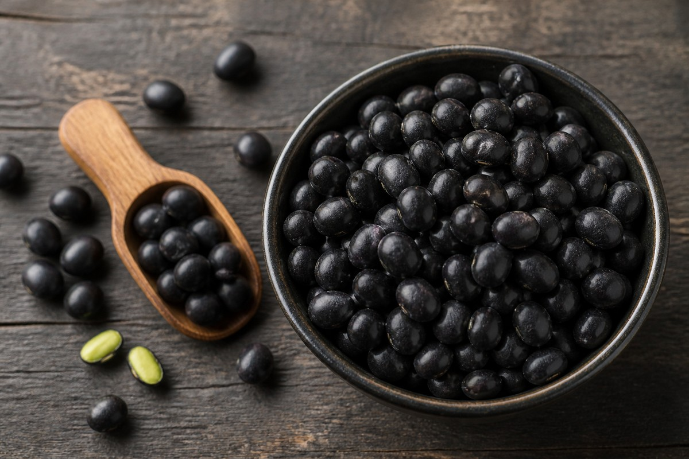

*▲ Dry black soybeans deliver 36 g of protein, 20.6 g of fiber and 1,800 mg of potassium per 100 g, with the green interior hidden under a black seed coat.*

Quick answer <strong>Dry black soybeans contain 381 calories, 36 g of protein, 20.6 g of fiber and 1,800 mg of potassium per 100 g</strong> — a protein share of 36%, roughly five times that of tofu and six times that of cooked rice. But these numbers describe <strong>dry beans</strong>. Once soaked and boiled, the same 100 g carries about 15 g of protein, because beans absorb two to two and a half times their weight in water. The real edge over yellow soybeans is not protein at all: it is the <strong>anthocyanins in the seed coat, 77% of them cyanidin-3-glucoside</strong>.

Soybean has been the backbone of East Asian protein for millennia. Among the black varieties, Korean *seoritae* takes its name from the first frost (*seori*) that arrives around late October, when it is harvested. The seeds are large, sweet, and green inside under a black coat — the reason Koreans also call them *sokcheong*, "green core." They are the preferred bean for mixed rice, soy glaze and black soybean milk.

Names matter when you shop. **Seoritae** is large with a green interior; **heuktae** is black all the way through; **jwinnuni-kong** is small with a black coat and a white eye. Nutrition is close across all three, but anthocyanin content and cooking texture differ, and seoritae commands the highest price.

Three questions bring readers here. **Are black soybeans actually better than yellow ones?** Yes, but only in one respect. **How much should I eat a day?** Thirty grams dry is the practical answer. **Why do beans cause gas, and how do I stop it?** Soaking and long boiling handle most of it.

Below is the composition of dry black soybeans, the conversion between dry and cooked weight, what the anthocyanins and isoflavones do and do not do, and how to prepare beans that digest comfortably.

---

## 1. How Many Calories Are in Black Soybeans? (381 kcal per 100 g)

The values below describe **dry, mature black soybean seeds**, the form you buy and store. U.S. %DV follows FDA Daily Values for a 2,000-calorie diet; potassium and other minerals use the FDA's 4,700 mg potassium reference.

| Nutrient | Per 100 g | U.S. %DV |
| :--- | :--- | :--- |
| **Energy** | 381 kcal | 19% |
| **Water** | 9 g | No DV |
| **Protein** | 36.0 g | 72% |
| **Total fat** | 15.9 g | 20% |
| — Saturated fat | 2.2 g | 11% |
| — Cholesterol | 0 mg | 0% |
| **Carbohydrate** | 33.6 g | 12% |
| — Total sugars | 7.0 g | No DV¹ |
| — Dietary fiber | 20.6 g | 74% |
| **Potassium** | 1,800 mg | 38% |
| **Phosphorus** | 630 mg | 50% |
| **Magnesium** | 200 mg | 48% |
| **Calcium** | 140 mg | 11% |
| **Iron** | 6.8 mg | 38% |
| **Zinc** | 3.7 mg | 34% |
| **Folate** | 350 µg DFE | 88% |
| **Vitamin B6** | 0.50 mg | 29% |
| **Riboflavin** | 0.23 mg | 18% |
| **Niacin** | 2.5 mg | 16% |
| **Vitamin E** | 3.1 mg | 21% |
| **Vitamin C** | 3 mg | 3% |
| **Sodium** | 1 mg | 0% |

¹ Total sugars have no Daily Value; the FDA reference applies to added sugars, and a dry bean contains none.

*※ Data basis: the figures follow the Korean national food composition table entry for seoritae, a Korean black soybean. The USDA entry Beans, black, mature seeds, raw (FDC 173734) lists 341 kcal and 21.6 g protein for a different cultivar (black turtle bean), so it is not cited as the source here.*

### What 30 g of dry beans, one handful and one cup deliver

Black soybeans are stored dry and eaten cooked, and water roughly doubles the weight, so the dry weight is the number to log.

| Portion | Edible weight | Energy | Protein |
| :--- | :--- | :--- | :--- |
| 1 handful, roasted (20 g) | 20 g | 76.2 kcal | 7.20 g |
| 30 g dry (about 100 beans) | 30 g | 114.3 kcal | 10.80 g |
| 1 cup, dry | 194 g | 739.1 kcal | 69.84 g |

*Note: 30 g of dry seoritae (about 100 beans) is 114 kcal and about 11 g of protein. One cup of dry beans (194 g) is a week of servings, not one.*

### How to read the table: 100 g dry is a week of beans

A single black soybean weighs about 0.3 g, so **100 g dry is roughly 300 to 400 beans** — seven to ten servings, not one. The column describes the raw ingredient, not a plate.

Three things in this table decide how you should use it.

- **The protein is dense but so are the calories.** At 36% protein, black soybeans beat beef sirloin (about 21%), eggs (13%) and tofu (8%). But 381 kcal per 100 g means protein calories come with fat and carbohydrate; per gram of protein, chicken breast is the cheaper choice.
- **The fiber is exceptional.** 20.6 g per 100 g is 74% of the Daily Value. Thirty grams of dry beans — one serving — supplies 6.2 g, about two bowls of vegetables.
- **Potassium and phosphorus are high enough to matter clinically.** 1,800 mg of potassium and 630 mg of phosphorus are why beans are simultaneously a health food and a food to portion in kidney disease.

### Dry to cooked: what 30 g of beans actually gives you

Beans absorb two to two and a half times their weight in water, so **comparing dry and cooked weight directly makes cooked beans look like half the food they are.** In real portions:

- **30 g dry (about 100 beans, 114 kcal):** 10.8 g protein, 6.2 g fiber, 540 mg potassium, 2 mg iron.
- **70 g cooked (from 30 g dry, 130–150 kcal):** one small bowl of soy glaze, or the beans in one bowl of mixed rice.
- **A bowl of black soybean rice (150 g rice + 20 g dry beans):** about 610 kcal total, with roughly 7 g of protein from the beans and 10 g from the rice.
- **Black soybean milk, 250 ml (from 25 g dry beans):** about 95 kcal and 9 g of protein — nearly double the protein of commercial soy milk at 3–6 g per 200 ml, and with the fiber left in.
- **A handful of roasted black beans (20 g):** 76 kcal and 7 g of protein, a nut-sized snack that outperforms most trail mixes on protein.

The practical takeaway: **30 g of dry beans in one meal delivers 10.8 g of protein and 6.2 g of fiber.** Nobody eats 100 g at once, so the 381-kcal headline should not scare you — but portioning does matter.

---

## 2. Four Health Effects Backed by Evidence

### Are black soybeans really better than yellow ones? (Cyanidin-3-glucoside)

In composition, almost no. Protein, fiber and minerals are effectively identical between black and yellow soybeans. The difference is pigment: **anthocyanins accumulate in the black seed coat**.

A two-year study of sixteen Korean black soybean cultivars measured **2.3 to 14.4 mg of total anthocyanins per gram of seed coat** — a six-fold spread between varieties. Of that total, **77% was cyanidin-3-glucoside**, with delphinidin-3-glucoside at 20% and petunidin-3-glucoside at 3%. The same work put **isoflavones at 795 to 4,195 µg per gram**, which is 79 to 420 mg per 100 g.

Two conclusions follow.

- **Cultivar matters as much as color.** "Black soybean is high in anthocyanins" is true, but which cultivar can swing the content six-fold. Small-seeded varieties, with a higher skin-to-kernel ratio, tend to deliver more pigment per gram.
- **Remove the skin and the advantage disappears.** Grind black soybeans, strain out the skins, and what remains is essentially yellow soybean liquid. **The skin is the point.**

Human trials on anthocyanins from whole black soybeans are small and inconsistent. Cell and animal studies report antioxidant activity, reduced LDL oxidation and improved endothelial function. The fair statement is that black soybeans are **a food that delivers antioxidant pigment with the fiber intact**, not a treatment for any condition.

### Is 36 g of protein more than beef? (Quantity versus quality)

By weight, yes: 36 g against about 21 g for beef sirloin. But protein quality is about amino acid pattern and digestibility, not grams.

Soy protein is **rich in lysine and low in methionine**. Rice and wheat are the reverse — low in lysine, adequate in methionine. That is why **beans with rice** has been a nutritional staple for centuries: the two proteins complete each other's limiting amino acid and raise the overall score.

Digestibility is lower than animal protein. Raw soybeans contain **trypsin inhibitors and phytate**, which block protein breakdown and bind minerals. Both are largely destroyed by soaking and heat, which is why **raw or undercooked soybeans cause stomach pain and nausea.** Cooked soybean protein reaches 80–90% digestibility.

For meal planning, 30 g of dry beans delivers about **10.8 g of protein — roughly one and a half eggs or 50 g of chicken breast.** Adding that to a bowl of rice replaces a side dish.

### Do 20.6 g of fiber help cholesterol and blood sugar?

At 20.6 g per 100 g, black soybean fiber covers 74% of the Daily Value. It is a mix of soluble and insoluble fiber, and the soluble portion does specific work.

- **Bile acid binding.** Soluble fiber binds bile acids and carries them out, forcing the liver to synthesize replacements from cholesterol and lowering LDL. Soy protein itself contributes: meta-analyses of about 25 g of soy protein a day report LDL reductions of roughly 3–5%.
- **Slower glucose rise.** Bean starch digests slowly, and fiber slows glucose absorption further. Mixing beans into rice flattens the post-meal glucose curve — the same reason mixed-grain rice is recommended.
- **Satiety.** 6.2 g of fiber and 10.8 g of protein in a single serving slow gastric emptying and blunt hunger before the next meal.

Increase fiber gradually. Jumping straight to 30 g of beans from a low-fiber diet causes gas, cramping and paradoxically constipation. **Start at 15–20 g dry and build over two weeks.**

### Who benefits from 1,800 mg of potassium, and who should be careful?

**People short on iron benefit.** At 6.8 mg per 100 g, black soybeans supply 38% of the Daily Value, high for a plant food. But it is non-heme iron, absorbed at only 5–10% — unless **vitamin C is on the same plate**, which can double or triple uptake. Soy glaze with bell pepper is a genuinely good pairing, not a garnish.

**People with kidney disease should be careful.** 1,800 mg of potassium and 630 mg of phosphorus are a real load for anyone on a renal diet. Beans are healthy food that must be **portioned** in advanced kidney disease, and dialysis patients are usually advised to favor white rice and limit beans to small amounts once or twice a week.

One myth worth clearing: soy foods contain purines, but **epidemiological studies have not shown consistent increases in gout flare risk from soy.** Beer, organ meat and fructose-sweetened drinks are the stronger drivers. During an active flare, though, it is reasonable to keep any protein moderate.

---

## 3. Preparation and Eating Guide for Better Digestion

- **Soak 8 hours in the refrigerator.** Three times the volume of water, overnight, cold — this leaches phytate and oligosaccharides, and prevents the sour fermentation that happens at room temperature in summer. **Discard the soaking water** and cook in fresh water.
- **Boil 20–25 minutes after the boil starts, or 10 minutes in a pressure cooker.** Trypsin inhibitors are largely destroyed after 10 minutes at 100 °C. Skim the foam that rises; it carries saponins and a bitter edge.
- **For mixed rice, three cups of rice to half a cup of dry beans.** Soak six hours, add, and increase water by only 10%. Too many beans makes the rice gluey and harder to digest.
- **Roast over low heat, 8–10 minutes.** The beans should pop and the skins split. High heat scorches the coat, destroys anthocyanins and turns the batch bitter.
- **Blend the skins in.** Straining black soybean milk removes the anthocyanins and much of the fiber. Grind whole, then boil — the milk should be dark, not cream-colored.
- **Add a little acid and vitamin C.** Phytate blocks mineral absorption; an acidic environment and vitamin C partially offset it. A few drops of vinegar in soy glaze, or bell pepper on the side.
- **Start at 15–20 g dry for two weeks.** Gut bacteria adapt to bean oligosaccharides slowly. If gas persists, switch to **fermented soy** such as doenjang, miso or natto, where the sugars are already broken down.
- **Store dry beans airtight and cool; freeze cooked beans.** Dry beans keep for months at 10% moisture, but airtight refrigeration protects against humidity and pests. Cooked beans freeze well for a month in small portions.

---

## 4. Cautions and Side Effects

- **Always cook them.** Raw soybeans contain trypsin inhibitors and saponins that block protein digestion and can cause vomiting and abdominal pain. Black soybean milk must be boiled, not just blended.
- **Soy allergy.** Soy is a major allergen. Hives, mouth itching or breathing difficulty means stop and seek care.
- **Kidney disease.** 1,800 mg potassium and 630 mg phosphorus per 100 g dry. On a restricted diet, halve the beans in mixed rice and skip the broth.
- **Thyroid medication.** Soy protein and isoflavones can interfere with levothyroxine absorption. **Separate the dose by at least four hours.** In people with adequate iodine, soy does not appear to harm thyroid function.
- **Irritable bowel syndrome.** Raffinose and stachyose are fermented by gut bacteria because humans cannot digest them. Reduce to 20 g or switch to fermented soy.
- **Gout.** Soy does not appear to raise flare risk consistently, but during a flare keep portions small and address alcohol and fructose first.
- **Iron supplements.** Phytate reduces absorption. Take iron on an empty stomach, at least two hours away from bean meals.
- **Do not eat 100 g at once.** That is 381 kcal and 20.6 g of fiber in a single sitting — a reliable route to bloating and diarrhea.

---

## 5. Frequently Asked Questions

**Q1. How many black soybeans should I eat a day?**  
**About 30 g dry — roughly 70 g cooked, or 100 beans.** That supplies 10.8 g of protein, 6.2 g of fiber and 2 mg of iron. Start at 15–20 g and build over two weeks. Going to 100 g dry in one day loads 381 kcal and 20.6 g of fiber at once, which most people cannot tolerate comfortably.

**Q2. Are black soybeans nutritionally different from yellow soybeans?**  
Protein, fiber and minerals are nearly identical. The difference is **anthocyanins in the seed coat**: 2.3–14.4 mg per gram of coat, with cyanidin-3-glucoside making up about 77%. Yellow soybeans have almost none. Choose black for the pigment, yellow for milder flavor and bean sprouts.

**Q3. Can you eat black soybeans raw or as unboiled milk?**  
No. Trypsin inhibitors and saponins make raw beans indigestible and can cause cramping and vomiting. Black soybean milk must be **boiled after blending**. Boiling destroys the inhibitors, and blending whole beans keeps the anthocyanins and fiber that straining would discard.

---

## 6. Synergistic Food Pairings

- **[Tofu](/en/posts/tofu-nutrition-benefits/):** the same bean, processed differently. Calcium salts used in setting raise tofu to 350 mg of calcium per 100 g, and phytate is reduced, so minerals are easier to absorb. Black soybean rice plus a tofu side covers protein and calcium in one meal.
- **[Natto](/en/posts/natto-nutrition-benefits/):** fermentation breaks down the oligosaccharides that cause gas, making natto a gentler option for sensitive guts, with vitamin K2 and nattokinase added.
- **[Chickpea](/en/posts/chickpea-nutrition-benefits/):** mixing legumes broadens the amino acid pattern and the texture. Cook both and toss them into one salad to stack fiber and protein.
- **[Bell Pepper](/en/posts/bell-pepper-nutrition-benefits/):** 127 mg of vitamin C improves absorption of the non-heme iron in soy. Soy glaze with pepper is a real absorption strategy, not decoration.

  
📌 Related ranking guides

  <ul>
    <li><a href="/en/posts/high-protein-foods-ranking/">High-protein foods ranking</a></li>
    <li><a href="/en/posts/heart-blood-pressure-cholesterol-foods/">Foods for heart, blood pressure and cholesterol</a></li>
  </ul>

---

## 7. Key Takeaways

- Dry black soybeans are **381 kcal, 36 g protein, 20.6 g fiber, 1,800 mg potassium and 6.8 mg iron** per 100 g.
- The table describes **dry beans**. Cooked weight is two to two and a half times heavier, so 100 g cooked carries about 15 g of protein.
- **30 g dry per day** — about 70 g cooked — gives 10.8 g of protein and 6.2 g of fiber.
- Black and yellow soybeans differ only in the **seed coat anthocyanins**, 77% cyanidin-3-glucoside. Strain off the skins and the advantage goes with them.
- Soy protein is **high in lysine, low in methionine**; pairing with rice or wheat raises the overall protein score.
- **Never eat raw soybeans.** Eight hours of soaking plus 20 minutes of boiling destroys most trypsin inhibitors and phytate.
- Kidney disease patients must portion for **potassium and phosphorus**; thyroid medication should be taken **four hours apart**.
