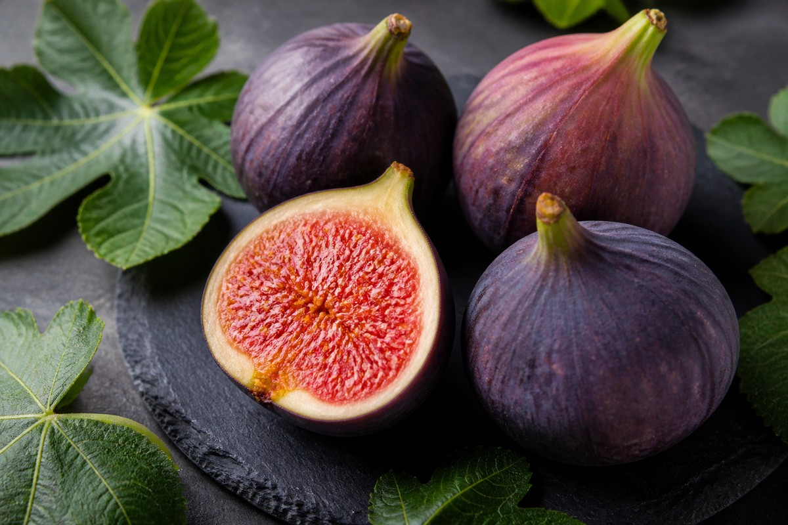

*▲ Fresh figs run 47–74 kcal per 100 g across national databases, with 1.3–2.9 g of fiber and 176–232 mg of potassium.*

Quick answer <strong>Raw figs provide 74 calories, 19.18 g of carbohydrate, 2.9 g of fiber and 232 mg of potassium per 100 g in the USDA database</strong> — or 47 kcal and 1.3 g of fiber in the Korean national table, a gap that comes from cultivar and analytical method, not from error. Figs do help with constipation, but <strong>not because of their fiber alone</strong>: 86% water, pectin, potassium and the habit of chewing the skin do most of the work. The enzyme <strong>ficin is inactivated below pH 3</strong>, so it never survives the stomach.

The fig (*Ficus carica*) is a syconium, an inverted flower cluster whose florets line the inside of the fruit — which is why you must cut one open to see the red interior. Commercial cultivars such as Kadota and Brown Turkey set fruit without pollination, so no fig wasp is required.

Season runs from late summer into November. In Korea, November is the month when 12% of the annual wholesale volume arrives and prices fall about 19% below the yearly average, which makes late November the cheapest and sweetest window before imports and strawberries take over the shelf.

Three questions bring readers to this page. **How many calories are in a fig?** Anywhere from 47 to 74 per 100 g depending on the table you read. **Are figs actually good for constipation?** Partly — the mechanism is not the one usually cited. **Why are dried figs so much sweeter?** Because drying removes water and leaves the sugar behind, roughly quadrupling it by weight.

Below is the composition of raw figs across two national databases, what ficin, pectin and anthocyanins do and do not do, and how to eat figs so that the fiber and minerals actually count.

---

## 1. How Many Calories Are in a Fig? (74 kcal per 100 g)

The table below describes **raw figs, edible portion**, from USDA FoodData Central (SR Legacy), with U.S. %DV from FDA Daily Values for a 2,000-calorie diet.

| Nutrient | Per 100 g | U.S. %DV |
| :--- | :--- | :--- |
| **Energy** | 74 kcal | 4% |
| **Water** | 79.1 g | No DV |
| **Protein** | 0.75 g | 2% |
| **Total fat** | 0.30 g | 0% |
| — Saturated fat | 0.060 g | 0% |
| — Cholesterol | 0 mg | 0% |
| **Carbohydrate** | 19.18 g | 7% |
| — Total sugars | 16.26 g | No DV¹ |
| — Dietary fiber | 2.9 g | 10% |
| **Potassium** | 232 mg | 6% |
| **Calcium** | 35 mg | 3% |
| **Magnesium** | 17 mg | 4% |
| **Phosphorus** | 14 mg | 1% |
| **Iron** | 0.37 mg | 2% |
| **Zinc** | 0.15 mg | 1% |
| **Vitamin C** | 2.0 mg | 2% |
| **Vitamin K** | 4.7 µg | 4% |
| **Folate** | 6 µg DFE | 2% |
| **Vitamin B6** | 0.113 mg | 7% |
| **Thiamin** | 0.060 mg | 5% |
| **Riboflavin** | 0.050 mg | 4% |
| **Niacin** | 0.400 mg | 3% |
| **Vitamin A (RAE)** | 7 µg | 1% |
| **Sodium** | 1 mg | 0% |

¹ Total sugars and water have no Daily Value. The FDA reference for added sugars is 50 g a day, and a fig contains none added — its sugar is intrinsic.

### How to read the table: 100 g is two medium figs

A fresh fig weighs 40–80 g, so **100 g is roughly two medium figs**. A single fig on a cheese board is therefore about half the column: 37 kcal, 8 g of sugar, 1.5 g of fiber.

Two things in this table deserve attention.

- **The sugar is concentrated.** 16.26 g of sugar per 100 g is high for a fruit — higher than an apple (10.4 g) or an orange (9.4 g). Figs taste mild because their sugar is balanced by water and a low acid load, not because there is little of it.
- **The databases disagree by a wide margin.** USDA reports 74 kcal and 2.9 g fiber; the Korean Rural Development Administration table for the domestic cultivar Seungjeong Dauphin reports 47 kcal and 1.3 g fiber. Both are correct for what they measured. USDA's sample represents a different cultivar at a later ripeness stage, and the two agencies use different fiber assays. **If a diet plan built on the Korean table says 47 kcal, it is not wrong — it is measuring a different fig.**

### What one fig, one cup and one dried fig actually deliver

- **One medium fig (50 g):** 37 kcal, 8 g sugar, 1.5 g fiber, 116 mg potassium.
- **Two figs (100 g):** 74 kcal, 16 g sugar. This is your realistic snack portion.
- **One cup chopped (149 g):** 110 kcal, 24 g sugar — the USDA reference serving, and easy to eat without noticing.
- **Dried figs, 100 g:** 249–320 kcal and over 45 g of sugar, because 70% of the water is gone. Four dried figs (about 40 g) carry roughly the sugar of six fresh ones.
- **Fig jam, one tablespoon (20 g):** 40–50 kcal, most of it added sugar. Do not count jam as fruit.

The practical rule: **fresh figs are a low-calorie fruit; dried figs are a sugar concentrate that happens to contain fiber.** Same name, different food.

---

## 2. Four Health Effects Backed by Evidence

### Are figs really good for constipation?

Partly — and the honest answer is more useful than the marketing one. Per 100 g, USDA gives 2.9 g of fiber and the Korean table 1.3 g. Against prunes at 7.1 g of fiber per 100 g, figs are not a fiber powerhouse by any measure.

What figs do have is a combination that works through four separate routes.

- **Water, 79–86%.** Much of constipation is simple dehydration. Eating a wet, chewy fruit contributes fluid and the chewing itself signals the gut.
- **Pectin.** The jammy interior is soluble fiber that forms a gel, softening stool and binding bile acids, which lowers cholesterol reabsorption. The total fiber number is modest, but **the share that is viscous soluble fiber is high** — that is the difference from an apple's crunchier, more insoluble fiber.
- **Potassium, 232 mg.** Potassium supports normal smooth-muscle contraction in the gut wall. Low potassium slows motility, a long-standing clinical observation in patients on diuretics.
- **Eating the skin.** Figs are one of the few fruits eaten whole. Unpeeled, unprocessed fruit at a meal triggers the gastrocolic reflex — the wave of colonic activity that follows eating.

The counterpoint matters too: **ripe figs are high in fermentable sugars**, so people with irritable bowel syndrome may get gas and bloating instead of relief. That is why fig advice works for one person and backfires for another.

If the goal is specifically constipation, **prunes have the stronger evidence base**, because they combine 7.1 g of fiber with sorbitol, a sugar alcohol that pulls water into the bowel by osmosis. Figs contain almost no sorbitol. Choosing figs means eating **two or three a day with a glass of water**, consistently.

### Does ficin, the fig enzyme, actually help digestion?

Ficin is a cysteine protease in the fig's latex, and it does real work — in a kitchen and in industry, where it tenderizes meat and clots milk. A green fig of 10–15 g contains 100–150 mg of protease.

The problem is survival. Ficin is active between **pH 5.0 and 8.0 and is completely inactivated below pH 3.0**, while fasting gastric acid sits at pH 1–2. **Most of the ficin in a swallowed fig loses activity in the stomach.** A comparison of commercial fruit enzyme products found fig preparations among the lowest in proteolytic activity, well below pineapple and papaya.

So ficin's practical value is culinary. Chopped fig or fig leaf in a marinade breaks down surface protein and softens meat. The reason figs feel digestive has more to do with **fiber, water and organic acids such as malic and citric acid** than with the enzyme.

One more thing: ficin is also an **allergen**. The stinging, reddened fingertips from picking or peeling unripe figs are contact dermatitis from the latex. Ripe flesh contains almost none, but gloves are sensible when handling figs straight off a tree.

### What do 232 mg of potassium and the polyphenols do?

Figs supply **potassium 232 mg, calcium 35 mg and magnesium 17 mg** per 100 g. The calcium is a third of what 100 ml of milk provides, but it is high for a fruit, which matters for people who eat little dairy.

Potassium balances sodium and helps regulate blood pressure. The adequate intake for adults is about 3,400–4,700 mg a day, so 100 g of figs supplies 5–6% of it. **You would need about 2 kg of figs to meet potassium needs** — figs are a supporting player in a blood-pressure-friendly diet, not a source.

The polyphenols are more varied: **gallic acid, quercetin, rutin, anthocyanins and benzaldehyde**, with the anthocyanins responsible for the red interior. Test-tube and animal studies consistently report radical-scavenging activity and protection of LDL from oxidation.

The evidence level has to be stated plainly. A small randomized crossover trial in 10 healthy adults found that a **standardized fig fruit extract** added to a glucose drink lowered the glycemic index by 24–25%. That is an extract, in ten people, not a fig. **No human trial shows that eating figs rejuvenates blood vessels.** Figs are a good ingredient in a vascular-healthy diet, not a treatment.

### Are 16 g of sugar per 100 g a problem for blood sugar or weight loss?

For most people, no — but the form matters more than the number. Fresh figs pair their sugar with fiber and water, so glucose rises more slowly than with the same grams of table sugar. The Korean table's 47 kcal and USDA's 74 kcal both describe a fruit that is **moderate in sugar and low in fat**.

The problem is dried figs. At over 45 g of sugar per 100 g and a soft, moreish texture, five dried figs (60 g) deliver about 27 g of sugar — **more than half the FDA's 50 g daily added-sugar reference**, eaten as a "healthy" snack.

For weight management, the real value of figs is substitution, not pharmacology. Two figs at 74 kcal replacing a 250-kcal bag of chips cuts the snack by two-thirds. But 0.75 g of protein will not hold you, so **pair them with Greek yogurt, cheese or nuts** to make the satiety last.

If you monitor glucose: eat fresh figs, keep to two at a time, take them as a post-meal snack, and do not juice several into a glass. Juicing removes the chewing and the fiber buffer that slow absorption.

---

## 3. Cooking and Eating Guide That Preserves the Nutrition

- **Eat the skin, rinse 30 seconds under running water.** The white bloom on a fig is natural sugar or wax, not residue. Soaking leaches sugar and water-soluble nutrients; a short rinse does not.
- **Wash just before eating and finish within two or three days.** The open stem end makes figs perishable. Store them unwashed in the crisper drawer at 7–10 °C; below 5 °C the flesh goes mealy and the aroma dies.
- **Ripen at room temperature for two days.** Firm figs wrapped in paper towel soften within 48 hours. They are ready when a gentle press leaves a slight indent.
- **Serve at room temperature.** The aroma compounds volatilize better when warm, so ten minutes out of the fridge makes figs taste sweeter — and removes the urge to add honey.
- **Use them as a marinade, not a digestive aid.** One chopped fig with olive oil and salt, 30 minutes on chicken or pork, is ficin doing the job it is actually good at.
- **Add acid and a teaspoon of oil to a salad.** Pectin and anthocyanins are stable in acid; balsamic or lemon plus olive oil keeps the color and helps absorb fat-soluble compounds.
- **Portion dried figs into 30 g servings.** Leaving the bag open is the main cause of sugar overshoot. Three or four a day is plenty.

---

## 4. Cautions and Side Effects

- **Latex and pollen allergy.** Ficin cross-reacts with natural rubber latex. People allergic to rubber gloves or balloons may react to figs, kiwi and papaya, and birch or mugwort pollen allergy is linked to oral allergy syndrome after eating figs.
- **Irritable bowel syndrome.** Fermentable sugars can trigger gas and bloating. Start with one fig and watch the response.
- **Kidney disease.** At 232 mg per 100 g, fresh figs are moderate in potassium; **dried figs concentrate it two- to threefold**. On a potassium-restricted diet, portion carefully.
- **Kidney stone history.** Figs contain oxalate. Two or three a day with good fluid intake is generally not a problem, but people who form stones repeatedly should avoid eating large amounts at once.
- **Anticoagulants.** Vitamin K is low at 4.7 µg per 100 g, but sudden large amounts of dried figs or fig leaf tea can shift intake. Keep it steady on warfarin.
- **Unripe figs.** The latex makes them acrid and upsetting to the stomach. A hard, green, latex-leaking fig is not ready.

---

## 5. Frequently Asked Questions

**Q1. How many figs should I eat a day?**  
For healthy adults, **two to three fresh figs (100–150 g)** fit comfortably: 74–110 kcal and 16–24 g of sugar, within a normal snack budget. For dried figs, keep to **three or four (25–30 g)** because sugar is four to five times denser by weight.

**Q2. Can you eat fig skin?**  
Yes — the skin carries much of the anthocyanin and pectin. Rinse for 30 seconds and eat it. Figs picked straight from a tree can sting the mouth because of latex in the skin, so handle them with gloves and peel those.

**Q3. Are dried figs or fresh figs healthier?**  
It depends on the goal. For calories and blood sugar, **fresh**: 47–74 kcal and 16 g sugar per 100 g. For concentrated fiber and minerals, **dried** — but at five to seven times the calories and over 45 g of sugar per 100 g, so weigh out 25–30 g rather than eating from the bag.

---

## 6. Synergistic Food Pairings

- **[Apple](/en/posts/apple-nutrition-benefits/):** apple brings 2.4 g of fiber per 100 g and a firmer, more insoluble texture. Half an apple and two figs raise total fiber while lowering the sweetness of the plate.
- **[Asian Pear](/en/posts/asian-pear-nutrition-benefits/):** 88% water and luteolin make pear a good partner for figs in dry, cold months, when both are also at their best.
- **[Tofu](/en/posts/tofu-nutrition-benefits/):** figs supply only 0.75 g of protein, so a fig salad is not a meal. Tofu adds 8.1 g of protein and 350 mg of calcium per 100 g and turns it into one.
- **[Egg](/en/posts/egg-nutrition-benefits/):** protein and fat blunt the glucose rise from 16 g of fig sugar. One boiled egg with two figs is a balanced 120-kcal snack.

  
📌 Related ranking guides

  <ul>
    <li><a href="/en/posts/heart-blood-pressure-cholesterol-foods/">Foods for heart, blood pressure and cholesterol</a></li>
    <li><a href="/en/posts/low-gi-foods-blood-sugar-guide/">Low-GI foods for blood sugar</a></li>
  </ul>

---

## 7. Key Takeaways

- Raw figs are **74 kcal, 19.18 g carbohydrate, 2.9 g fiber and 232 mg potassium** per 100 g (USDA); the Korean table for a domestic cultivar gives **47 kcal and 1.3 g fiber**. Different cultivar, different assay.
- **100 g is about two medium figs.** One fig is half the table.
- **Fig fiber is real but modest.** The constipation benefit comes from water, pectin, potassium and eating the skin — not from bulk fiber volume.
- **Ficin is inactivated below pH 3** and never survives the stomach. Its real use is tenderizing meat.
- **Dried figs are the risk**: five to seven times the calories and over 45 g of sugar per 100 g. Weigh out 25–30 g.
- **Two to three fresh figs a day** is a sensible amount; pair them with protein to stay full.
- Check potassium and oxalate if you have kidney disease or a stone history, and keep intake steady on warfarin.
