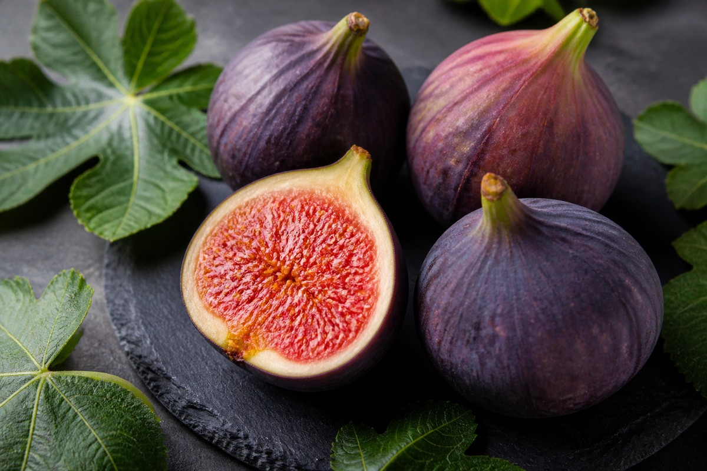

*▲ 무화과 100g은 47kcal, 식이섬유 1.3g, 칼륨 176mg입니다. 껍질과 과육 사이의 붉은 젤리가 펙틴과 안토시아닌이 모인 자리입니다.*

한 줄 결론 <strong>무화과 100g은 47kcal에 식이섬유 1.3g, 칼륨 176mg, 당류 10.6g입니다.</strong> 칼로리는 사과(52kcal)보다 낮지만, <strong>변비에 좋다는 통설은 절반만 맞습니다</strong>. 식이섬유 1.3g은 사과(2.4g)의 절반이고, 소화를 돕는다는 <strong>피신(ficin) 효소는 위산(pH 3 이하)에서 완전히 불활성화</strong>됩니다. 그런데도 무화과가 장에 도움이 되는 이유는 따로 있습니다 — 수분 86.5%, 펙틴, 칼륨, 그리고 껍질째 씹어 먹는 식감입니다.

무화과는 뽕나무과 무화과속(*Ficus carica*)의 열매로, 꽃이 겉으로 피지 않고 열매 속에서 피는 은화과(隱花果)입니다. 잘라야만 안쪽의 붉은 꽃받침 다발이 보이고, 국내에서 재배하는 승정도후인·봉래시는 수정 없이 열매가 맺히는 품종입니다.

제철은 8월부터 11월까지입니다. 한국농수산식품유통공사 도매시장 정산 자료를 보면 <strong>11월은 무화과 반입량의 12%가 몰리면서 kg당 도매가가 한 해 평균보다 19% 낮은 달</strong>입니다. 11월 하순은 사실상 끝물이라 당도가 가장 높고 값이 가장 싸며, 12월부터는 물량이 끊겨 그 자리를 딸기가 대신합니다.

검색창에 실제로 들어오는 질문은 세 가지입니다. <strong>"무화과 칼로리가 정말 47kcal인가?"</strong>, <strong>"무화과가 정말 변비에 좋은가?"</strong>, <strong>"말린 무화과는 왜 이렇게 단가?"</strong> 결론부터 말하면 무화과는 <strong>열량이 낮고 칼륨이 적당한 과일</strong>이지만, 식이섬유와 단백질 분해효소 효과는 흔히 알려진 것보다 작고, <strong>건조 무화과로 바뀌는 순간 당류가 4~5배로 뛴다</strong>는 것이 핵심입니다.

---

## 1. 무화과 칼로리와 영양성분은? (100g 47kcal)

아래 수치는 <strong>무화과(승정도후인, 생것, 가식부) 100g</strong> 기준입니다. 국내에서 가장 많이 유통되는 품종의 껍질과 과육을 합친 무게입니다.

| 영양 성분 (Nutrient) | 함량 (100g당) | 1일 권장 섭취량 비율 (한국인 성인 기준) |
| :--- | :--- | :--- |
| **열량 (Energy)** | 47 kcal | 2.4% |
| **수분 (Water)** | 86.5 g | 별도 표기¹ |
| **탄수화물 (Carbohydrates)** | 12.1 g | 3.7% |
| - 당류 (Sugars) | 10.6 g | 10.6% |
| - 식이섬유 (Dietary Fiber) | 1.3 g | 5.2% |
| **단백질 (Protein)** | 0.8 g | 1.5% |
| **지방 (Total Fat)** | 0.1 g | 0.2% |
| **칼륨 (Potassium)** | 176 mg | 5.0% |
| **칼슘 (Calcium)** | 41 mg | 5.9% |
| **마그네슘 (Magnesium)** | 14 mg | 4.0% |
| **철분 (Iron)** | 0.3 mg | 3.0% |
| **엽산 (Folate)** | 25 µg | 6.3% |
| **비타민C (Vitamin C)** | 2 mg | 2.0% |
| **베타카로틴 (Beta-carotene)** | 15 µg | 별도 표기¹ |
| **나트륨 (Sodium)** | 0 mg | 0.0% |

¹ 수분과 베타카로틴은 1일 권장 섭취량 기준치가 따로 설정되지 않은 항목입니다. 베타카로틴은 비타민A로 전환되는 전구체이지만 함량이 적어 비타민A 환산치에 거의 기여하지 않습니다.

### 표 읽는 법: 100g은 무화과 두 개입니다

무화과 한 개의 무게는 품종과 등급에 따라 45~80g입니다. 즉 <strong>100g은 무화과 한 개 반에서 두 개</strong>입니다. 접시에 두 알 올렸다면 영양표 한 줄을 통째로 먹은 셈이고, 열량은 47kcal, 당류는 10.6g입니다.

이 표에서 눈여겨볼 것은 세 가지입니다.

- <strong>열량은 낮지만 당류는 높습니다.</strong> 100g에 당류 10.6g은 사과(10.4g)와 비슷하고 귤(8.0g)보다 많습니다. 열량이 낮은 이유는 지방이 0.1g뿐이기 때문이지, 당이 적기 때문이 아닙니다.
- <strong>식이섬유는 과일 중 적은 편입니다.</strong> 1.3g은 사과 2.4g, 배 1.7g, 바나나 2.6g보다 적습니다. 무화과가 '변비 과일'로 불리는 근거는 식이섬유량만으로는 설명되지 않습니다.
- <strong>칼륨은 중간 수준입니다.</strong> 176mg은 바나나(358mg)의 절반, 귤(101mg)의 1.7배입니다. 혈압 관리에 도움이 되는 양이지만 이것 하나로 하루 칼륨을 채울 수는 없습니다.

### 실생활 환산: 생무화과 두 개, 말린 무화과 한 줌은 몇 kcal인가?

- <strong>생무화과 2개(약 100g):</strong> 47kcal, 당류 10.6g. 간식으로 가장 무난한 단위입니다.
- <strong>생무화과 4개(약 200g):</strong> 94kcal, 당류 21g. 과일 두 종류를 먹은 것과 같은 당 섭취량입니다.
- <strong>말린 무화과 100g:</strong> 254~319kcal, 당류가 45g을 넘습니다. 수분이 빠지면서 영양이 농축되기 때문에 <strong>같은 무게로 비교하면 열량이 5~7배</strong>입니다. 한 줌(30g)이면 80~95kcal, 당류 14g 안팎입니다.
- <strong>무화과 통조림 100g:</strong> 78kcal. 시럽에 담겨 나오므로 과육보다 설탕물이 열량을 더합니다. 시럽을 따라내면 30~40%가 줄어듭니다.
정리하면 <strong>생무화과는 저열량 과일, 말린 무화과는 당 농축식품</strong>입니다. 같은 이름으로 검색되지만 영양표는 전혀 다른 식품이라고 봐야 합니다.

---

## 2. 과학적으로 입증된 4대 건강 효능

### 무화과는 변비에 정말 좋을까? 식이섬유 1.3g의 진실

결론부터 말하면 <strong>무화과는 변비에 '도움이 되는' 과일이지만, 식이섬유 힘으로 그런 것은 아닙니다.</strong> 100g당 식이섬유 1.3g은 사과의 절반, 말린 자두(7.1g)의 5분의 1 수준입니다. 변비 완화를 식이섬유 양으로만 따진다면 무화과는 상위권이 아닙니다.

그런데도 무화과가 장에 작용하는 경로는 있습니다.

- <strong>수분 86.5%.</strong> 변비의 상당 부분은 수분 부족에서 옵니다. 물기를 머금은 과일을 씹어 먹는 행위 자체가 대변의 수분 유지에 기여합니다.
- <strong>펙틴.</strong> 과육의 젤리 같은 질감은 수용성 식이섬유인 펙틴에서 나옵니다. 장에서 젤을 형성해 내용물의 이동을 부드럽게 하고, 담즙산과 결합해 콜레스테롤 흡수를 줄입니다. 총량은 적어도 <strong>점성 섬유질의 비중이 높다</strong>는 점이 사과와 다릅니다.
- <strong>칼륨 176mg.</strong> 나트륨 배출을 돕고 장관 평활근 수축에 관여합니다. 칼륨 부족이 장 운동을 둔하게 만든다는 것은 오래된 임상 관찰입니다.
- <strong>껍질째 씹는 식감.</strong> 무화과는 껍질을 벗기지 않고 먹습니다. 생과일을 씹는 습관은 식후 위-대장 반사(위산에 반응해 대장이 움직이는 반사)를 자극합니다.

반대로 짚어야 할 점도 있습니다. <strong>잘 익은 무화과는 발효되기 쉬운 당이 많아</strong> 과민성대장증후군(FODMAP 민감성)이 있는 사람에게는 가스와 복통을 유발할 수 있습니다. 변비가 있는 사람에게 듣는 경우와 복부 팽만이 있는 사람에게 역효과가 나는 경우가 갈리는 이유입니다.

변비 완화 목적이라면 <strong>말린 자두(푸룬)</strong>가 근거 면에서 더 앞섭니다. 식이섬유 7.1g에 더해 <strong>소르비톨</strong>이 장 내용물에 물을 끌어들이기 때문입니다. 무화과를 고른다면 <strong>하루 2~3개를 물 한 컵과 함께</strong> 규칙적으로 먹는 쪽이 효과적입니다.

### 피신(ficin) 단백질 분해효소는 소화를 도와주나?

무화과의 소화 촉진 효과로 가장 많이 인용되는 것이 <strong>피신</strong>입니다. 피신은 무화과나무의 유액(라텍스)에 들어 있는 시스테인 단백질분해효소로, 고기를 부드럽게 하는 원료로 산업에서도 쓰입니다. 실제로 미성숙 무화과 10~15g에는 단백질분해효소가 100~150mg 들어 있습니다.

그런데 <strong>사람이 무화과를 먹었을 때 이 효소가 위에서 살아남는지</strong>가 문제입니다. 피신의 활성 pH 범위는 5.0~8.0이고, <strong>pH 3.0 이하에서는 완전히 불활성화</strong>됩니다. 위산의 pH는 공복에 1~2입니다. 즉 <strong>무화과를 먹고 위를 통과하는 동안 피신은 대부분 활성을 잃습니다.</strong> 단백질분해효소 제품을 비교한 연구에서도 무화과 제품의 활성은 파인애플·파파야 제품보다 낮은 그룹에 속했습니다.

그래서 피신의 실질적인 쓰임은 <strong>요리</strong>입니다. 잘게 다진 무화과를 고기 marinade에 넣으면 표면 단백질이 분해되어 질감이 부드러워집니다. 반면 <strong>"무화과를 먹으면 소화가 잘 된다"는 기대는 효소보다 섬유질·수분·유기산(사과산·시트르산)의 몫</strong>으로 보는 것이 정확합니다.

피신은 <strong>알레르기 유발 단백질</strong>이기도 합니다. 익지 않은 무화과를 따거나 만질 때 손끝이 따갑고 붉어지는 것은 피신에 의한 접촉 피부염입니다. 잘 익은 과육에는 라텍스가 거의 없지만, 나무에서 직접 딴 무화과를 다룰 때는 장갑을 끼는 편이 안전합니다.

### 칼륨 176mg과 폴리페놀은 혈압·혈관에 어떤 작용을 하나?

무화과의 무기질 조합은 <strong>칼륨 176mg, 칼슘 41mg, 마그네슘 14mg</strong>입니다. 칼슘 41mg은 우유 100ml(113mg)의 3분의 1 수준이지만, <strong>과일 중에서는 비교적 높은 편</strong>입니다. 유제품을 먹지 않는 사람에게는 작은 보탬이 됩니다.

칼륨은 나트륨과 균형을 이루며 혈압을 조절합니다. 성인 칼륨 충분섭취량이 3,500mg인데 무화과 100g은 그 5%입니다. <strong>무화과만으로 칼륨을 채우려면 2kg을 먹어야 하므로</strong>, '칼륨 공급원'이라기보다 <strong>나트륨이 많은 식사에 곁들이는 균형 재료</strong>로 보는 것이 맞습니다.

폴리페놀 쪽은 성분이 더 다양합니다. 무화과에는 <strong>몰식자산(갈산), 퀘르세틴, 루틴, 안토시아닌, 벤즈알데히드</strong>가 들어 있고, 붉은 과육의 색은 안토시아닌에서 나옵니다. 시험관 연구에서는 무화과 추출물의 라디칼 소거능과 LDL 산화 억제가 반복적으로 보고됐습니다.

다만 근거 수준은 구분해야 합니다. <strong>무화과 열매 추출물을 표준화해 포도당 음료에 넣은 소규모 인체시험(10명)</strong>에서 혈당지수가 24~25% 낮아진 결과가 있었지만, 이것은 <strong>과육 자체를 먹은 시험이 아니고 대상자 수도 적습니다.</strong> "무화과를 먹으면 혈관이 젊어진다"는 식의 주장은 아직 인체 근거가 부족합니다. 무화과는 <strong>혈관 건강에 유리한 식사 패턴의 한 재료</strong>이고, 그 자체가 치료가 되지는 않습니다.

### 무화과 당류 10.6g, 혈당·다이어트에 괜찮을까?

무화과 100g의 당류는 <strong>10.6g</strong>입니다. 과일 중에서는 중간보다 조금 높은 편입니다(사과 10.4g, 귤 8.0g, 딸기 4.7g). 그러나 <strong>열량은 47kcal로 낮고 식이섬유와 펙틴이 함께 들어 있어</strong>, 같은 양의 당을 설탕으로 먹을 때보다 혈당 상승이 완만합니다.

실제로 문제가 되는 지점은 생무화과가 아니라 <strong>건조 무화과</strong>입니다. 수분이 빠지면서 당류가 100g당 45g을 넘고, 말랑한 식감 때문에 몇 개씩 집어 먹기 쉽습니다. 말린 무화과 5개(약 60g)면 당류 27g으로, <strong>하루 첨가당 권장량(50g)의 절반 이상</strong>을 과일로 채우는 셈입니다.

다이어트 관점에서 무화과의 진짜 장점은 열량이 아니라 <strong>대체 효과</strong>입니다. 47kcal짜리 과일 두 개를 오후 간식으로 먹으면 과자 한 봉지(200~300kcal)보다 총열량이 5분의 1로 줄어듭니다. 단백질이 0.8g뿐이라 포만감은 오래가지 않으므로 <strong>그릭요거트나 견과류를 곁들이는 조합</strong>이 실질적으로 오래 버팁니다.

혈당을 관리한다면 <strong>생과일로, 한 번에 두 개를 넘기지 않고, 식후 간식으로</strong> 먹으면 됩니다. 주스로 갈아 여러 개를 한 번에 마시는 것만 피하세요. 씹는 과정과 섬유질의 완충이 사라져 당 흡수가 빨라집니다.

---

## 3. 영양소를 살리는 조리·섭취 가이드

- <strong>껍질째 먹되, 흐르는 물에 30초 씻으세요.</strong> 무화과는 껍질을 벗기지 않는 과일입니다. 표면의 흰 가루는 자연 당분이 결정된 것이거나 과분이라 씻으면 사라지고, 남아 있어도 해롭지 않습니다. 물에 오래 담그면 당과 수용성 성분이 빠져나가므로 흐르는 물에 짧게 헹굽니다.
- <strong>먹기 직전에 씻고, 그날 안에 드세요.</strong> 무화과는 꼭지 부분이 열려 있어 무르기 쉽습니다. 냉장 보관은 2~3일이 한계이고, 5℃ 이하에서는 과육이 물러지고 향이 죽습니다. 냉장실 채소칸(7~10℃)이 가장 무난합니다.
- <strong>후숙은 실온에서 이틀.</strong> 단단하게 왔을 때는 키친타월에 싸서 실온에 두세요. 눌렀을 때 살짝 들어가면 먹을 때입니다.
- <strong>냉장고에서 꺼내 10분 두세요.</strong> 향 성분은 상온에서 더 잘 퍼져 훨씬 달게 느껴지고, 설탕이나 꿀을 더할 이유가 줄어듭니다.
- <strong>고기 요리에 쓰면 피신이 일합니다.</strong> 닭가슴살·돼지고기 marinade에 다진 무화과 1개와 올리브유·소금을 넣고 30분 재우면 표면이 부드러워집니다. 이때 피신은 '소화 효소'가 아니라 '요리 도구'로 쓰이는 것입니다.
- <strong>샐러드에는 산과 기름을 1작은술씩.</strong> 펙틴과 안토시아닌은 산성에서 안정합니다. 발사믹·레몬즙과 올리브유를 곁들이면 색이 유지되고 지용성 성분 흡수도 올라갑니다.
- <strong>건조 무화과는 30g 단위로 덜어 드세요.</strong> 봉지째 두고 집어 먹는 습관이 당 과잉의 주된 원인입니다. 하루 3~4개(25~30g)면 충분합니다. 무화과청을 만들 때 과육과 설탕을 1:1로 두는 조리법이 흔한데, 그 경우 열량의 본체는 원물이 아니라 설탕입니다.

---

## 4. 섭취 시 주의사항 및 부작용

- <strong>라텍스·꽃가루 알레르기에 주의하세요.</strong> 피신은 라텍스 교차 알레르기 항원의 하나입니다. 고무장갑·풍선에 알레르기가 있는 사람은 입안 가려움이나 접촉 피부염을 겪을 수 있고, 자작나무·쑥 꽃가루에 민감한 사람에게서는 구강 알레르기 증후군이 보고됩니다.
- <strong>과민성대장증후군이 있으면 소량부터.</strong> 무화과에는 발효되기 쉬운 당이 많아 복부 팽만·가스를 유발할 수 있습니다. 처음에는 한 개로 시작해 반응을 보세요.
- <strong>신장질환이 있다면 칼륨을 계산하세요.</strong> 176mg은 낮은 편이지만, 말린 무화과는 같은 무게에 칼륨이 2~3배로 농축됩니다. 투석 중이거나 칼륨 제한 식이 중이라면 생과 위주로, 양을 정해 드세요.
- <strong>결석 병력자는 대량 섭취를 피하세요.</strong> 무화과에는 수산염이 소량 들어 있습니다. 물을 충분히 마시고 하루 2~3개 수준을 지키면 일반적으로 문제가 되지 않지만, 신장결석을 반복한 사람은 한 번에 많이 먹지 않는 편이 안전합니다.
- <strong>항응고제 복용자는 섭취량을 일정하게.</strong> 무화과의 비타민K는 적지만, 잎차나 건조 무화과를 갑자기 많이 먹으면 섭취량이 흔들릴 수 있습니다. 와파린 복용 중에는 급격한 변화를 피하세요.
- <strong>설사 중이거나 덜 익은 무화과는 피하세요.</strong> 수분과 발효성 당이 많아 장 운동이 항진된 상태에서는 증상을 악화시킵니다. 껍질이 초록빛이고 단단하며 유액이 나오면 아직 익지 않은 열매로, 라텍스 때문에 입안이 얼얼하고 위가 불편해집니다.

---

## 5. 자주 묻는 질문 (FAQ)

**Q1. 무화과는 하루에 몇 개가 적당한가요?**  
건강한 성인은 <strong>하루 2~3개(100~150g)</strong>가 무난합니다. 열량 47~70kcal, 당류 10~16g으로 하루 간식 기준에 들어옵니다. 말린 무화과라면 같은 무게에서 당류가 4~5배이므로 <strong>3~4개(25~30g)</strong>를 넘기지 마세요.

**Q2. 무화과 껍질째 먹어도 되나요?**  
됩니다. 오히려 껍질에 안토시아닌과 펙틴이 더 많습니다. 흐르는 물에 30초 씻어 물기를 털어내고 드세요. 다만 나무에서 직접 딴 무화과는 껍질의 라텍스 때문에 입안이 얼얼할 수 있으니, 장갑으로 만지고 벗겨 먹는 편이 안전합니다.

**Q3. 말린 무화과와 생무화과 중 어느 쪽이 몸에 좋나요?**  
목적에 따라 다릅니다. <strong>열량·당 관리가 목적이면 생무화과</strong>입니다(100g 47kcal, 당류 10.6g). <strong>식이섬유와 무기질을 농축해서 챙기고 싶다면 말린 무화과</strong>이지만, 열량이 5~7배이고 당류가 45g을 넘으므로 25~30g 단위로 덜어 드세요. 변비 목적이라면 둘 다 물과 함께 먹는 것이 전제입니다.

---

## 6. 무화과와 함께 먹으면 좋은 음식

- <strong>[사과 (Apple)](/posts/apple-nutrition-benefits/):</strong> 사과의 식이섬유는 2.4g으로 무화과의 두 배입니다. 두 과일을 반씩 먹으면 단맛의 강도는 낮추고 섬유질 총량은 올릴 수 있습니다. 껍질째 먹는 습관도 같습니다.
- <strong>[배 (Asian Pear)](/posts/asian-pear-nutrition-benefits/):</strong> 수분 88%에 루테올린이 들어 있어 목이 건조한 계절에 무화과와 짝을 이룹니다. 두 과일 모두 씹는 식감이 좋아 식후 단 음식 대체용으로 쓰기 좋습니다.
- <strong>[두부 (Tofu)](/posts/tofu-nutrition-benefits/):</strong> 무화과는 단백질이 0.8g뿐이라 한 끼로는 부족합니다. 두부의 단백질 8.1g과 칼슘 350mg을 더하면 무화과 샐러드가 간식이 아니라 식사가 됩니다.
- <strong>[달걀 (Egg)](/posts/egg-nutrition-benefits/):</strong> 무화과의 당류 10.6g은 단백질·지방과 함께 먹을 때 혈당 상승이 완만해집니다. 삶은 달걀 하나와 무화과 두 개면 120kcal 안팎의 균형 잡힌 간식이 됩니다.

  
📌 관련 순위 가이드

  <ul>
    <li><a href="/posts/heart-blood-pressure-cholesterol-foods/">심장·혈압·콜레스테롤에 좋은 음식</a></li>
    <li><a href="/posts/low-gi-foods-blood-sugar-guide/">혈당 낮추는 저GI 음식 가이드</a></li>
  </ul>

---

## 7. 무화과 어떻게 먹을까? 핵심 요약

- 무화과 100g은 <strong>47kcal·당류 10.6g·식이섬유 1.3g·칼륨 176mg</strong>입니다. 열량은 낮지만 당은 적지 않습니다.
- <strong>식이섬유 1.3g은 사과(2.4g)의 절반</strong>입니다. 변비에 좋다는 말은 섬유질량이 아니라 <strong>수분 86.5%·펙틴·칼륨·껍질째 씹는 습관</strong>으로 설명됩니다.
- <strong>피신 효소는 위산(pH 3 이하)에서 완전히 불활성화</strong>됩니다. 소화 효과는 기대보다 작고, 진짜 쓰임은 고기 marinade입니다.
- <strong>말린 무화과는 열량 5~7배, 당류 45g 이상.</strong> 한 번에 25~30g만 덜어 드세요.
- 하루 적정량은 <strong>생무화과 2~3개</strong>입니다. 물과 함께, 식후 간식으로.
- 라텍스·꽃가루 알레르기, 과민성대장증후군, 신장질환자는 <strong>소량부터</strong> 시작하세요.
- 보관은 <strong>씻지 않은 채 냉장 7~10℃에서 2~3일</strong>. 먹기 직전에 씻고, 상온에 10분 두면 더 달게 느껴집니다.
