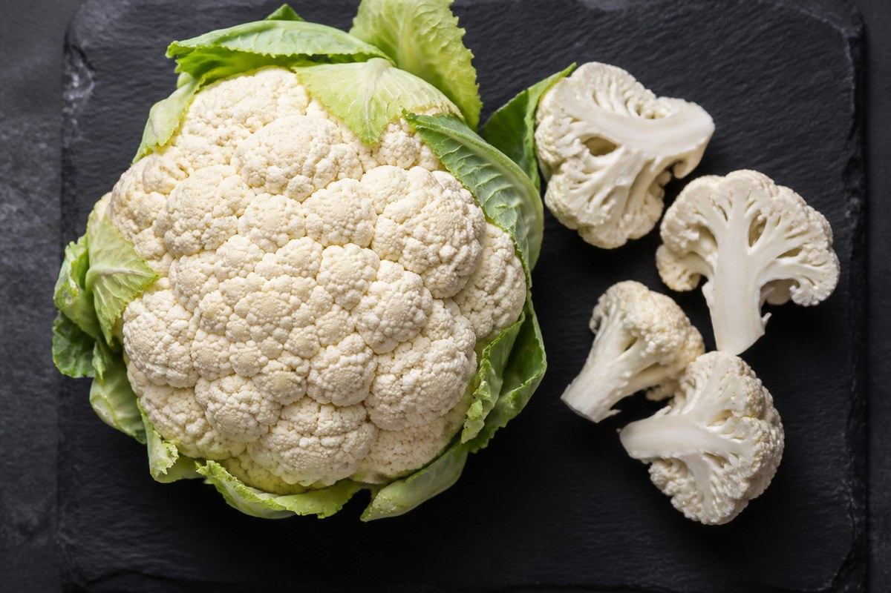

*▲ 콜리플라워 100g은 27kcal, 식이섬유 4.6g, 비타민C 33mg입니다. 먹는 부분은 꽃봉오리(화구)이고, 겉잎은 버리는 부분으로 잡힙니다.*

한 줄 결론 <strong>콜리플라워 생것 100g은 한국 자료 기준 27kcal, 식이섬유 4.6g, 비타민C 33mg입니다.</strong> 한 연구의 20분 조리 조건에서 설포라판은 삶을 때 76.2%, 찔 때 66.1% 감소했습니다. 조리 시간과 조건에 따라 결과는 달라집니다.

콜리플라워는 배추과(*Brassica oleracea* var. *botrytis*)의 꽃봉오리를 먹는 채소입니다. 브로콜리와 같은 종이고, 먹는 부위만 다릅니다. 브로콜리는 꽃봉오리가 초록으로 자란 것이고, 콜리플라워는 꽃이 피기 전 흰 화구(花球)를 수확합니다.

제철은 11월부터 이듬해 3월까지입니다. 제주 애월·한림·한경 지역의 겨울 콜리플라워가 11월 중순부터 출하되고, 이 시기 유통 물량이 가장 많습니다. 겨울 콜리플라워는 꽃송이가 단단하고 단맛이 올라, 여름 시설 재배품보다 조리 후 단맛이 강합니다.

검색창에 실제로 들어오는 질문은 세 가지입니다. <strong>"콜리플라워 칼로리가 정말 27kcal인가?"</strong>, <strong>"콜리플라워가 다이어트에 좋다는 게 사실인가?"</strong>, <strong>"삶아 먹으면 영양이 다 없어지나?"</strong> 결론부터 말하면 콜리플라워는 <strong>열량이 낮고 식이섬유가 많은 채소</strong>가 맞지만, 그 장점은 <strong>생으로 먹거나 쪄 먹을 때만 유지</strong>됩니다. 삶아서 물을 버리는 조리법은 이 채소의 가장 비싼 성분을 함께 버리는 일입니다.

---

## 1. 콜리플라워 칼로리와 영양성분은? (100g 27kcal)

아래 수치는 <strong>농촌진흥청 국가표준식품성분표의 '꽃양배추(콜리플라워), 생것' 가식부 100g</strong> 기준입니다. 꽃봉오리와 줄기를 합친, 실제로 먹는 부분의 무게입니다.

| 영양 성분 (Nutrient) | 함량 (100g당) | 1일 기준치 비율 (2,000kcal 기준) |
| :--- | :--- | :--- |
| **열량 (Energy)** | 27 kcal | 1.4% |
| **수분 (Water)** | 91.4 g | 별도 표기¹ |
| **탄수화물 (Carbohydrates)** | 4.84 g | 1.5% |
| - 당류 (Sugars) | 2.28 g | 2.3% |
| - 식이섬유 (Dietary Fiber) | 4.6 g | 18.4% |
| **단백질 (Protein)** | 2.17 g | 3.9% |
| **지방 (Total Fat)** | 0.48 g | 0.9% |
| **칼륨 (Potassium)** | 403 mg | 11.5% |
| **칼슘 (Calcium)** | 14 mg | 2.0% |
| **마그네슘 (Magnesium)** | 23 mg | 7.3% |
| **인 (Phosphorus)** | 62 mg | 8.9% |
| **철분 (Iron)** | 0.33 mg | 2.8% |
| **나트륨 (Sodium)** | 13 mg | 0.7% |
| **비타민C (Vitamin C)** | 33.44 mg | 33.4% |
| **비타민B1 (Thiamin)** | 0.21 mg | 17.5% |
| **비타민B2 (Riboflavin)** | 0.101 mg | 7.2% |
| **엽산 (Folate)** | 64 µg DFE | 16.0% |
| **몰리브덴 (Molybdenum)** | 10.22 µg | 40.9% |

¹ 수분은 1일 기준치가 따로 설정되지 않은 항목입니다. 비타민C·식이섬유·몰리브덴의 비율은 식품 표시용 1일 영양성분 기준치(2,000kcal) 대비입니다.

### 표 읽는 법: 100g은 꽃송이 한 줌, 반 통의 3분의 1입니다

콜리플라워 한 통의 무게는 600~900g입니다. 겉잎과 심을 떼면 가식부가 70~75%이므로, <strong>한 통에서 실제로 먹는 양은 450~650g</strong>입니다. 100g은 <strong>꽃송이로 다섯~여섯 개, 밥그릇으로 가득 한 공기의 절반</strong> 정도입니다.

이 표에서 눈여겨볼 것은 네 가지입니다.

- <strong>열량 27kcal는 채소 중에서도 낮은 편입니다.</strong> 같은 무게의 감자(약 63kcal)의 절반 이하이고, 브로콜리(31kcal)보다도 조금 낮습니다. 낮은 열량의 이유는 <strong>수분 91.4%</strong>입니다. 무게의 대부분이 물이기 때문입니다.
- <strong>식이섬유 4.6g은 채소 중 상위권입니다.</strong> 양배추(1.9g)의 2.4배, 당근(2.6g)의 1.8배입니다. 100g으로 하루 식이섬유 기준치의 18%를 채웁니다.
- <strong>비타민C 33mg은 '1일 기준치의 3분의 1'이지만 조건부입니다.</strong> 생것 기준이고, 가열과 물에 매우 취약합니다. 뒤에서 따로 다룹니다.
- <strong>칼륨 403mg은 채소 중 많은 편입니다.</strong> 바나나(358mg)보다 많고, 같은 무게 토마토(약 250mg)의 1.6배입니다. 나트륨이 적은(13mg) 점과 함께 혈압 관리 식사에 유리한 조합입니다.

### 같은 콜리플라워인데 왜 미국 자료는 식이섬유가 2.0g인가?

USDA FoodData Central의 콜리플라워(생것) 100g은 <strong>25kcal, 식이섬유 2.0g, 비타민C 48.2mg</strong>입니다. 한국 표와 비교하면 열량과 단백질은 비슷한데 <strong>식이섬유는 2.3배, 비타민C는 1.4배 차이</strong>가 납니다.

이 차이는 콜리플라워가 다른 채소가 아니라 <strong>분석법과 시료가 다르기 때문</strong>입니다. 식이섬유는 측정 방식(총식이섬유 효소중량법과 AOAC 991.43)에 따라 값이 크게 달라지고, 비타민C는 수확 후 유통 기간에 따라 30~50%까지 떨어집니다. 마트에 도착한 콜리플라워의 비타민C는 표의 값보다 적다고 보는 편이 현실적입니다.

그래서 표를 읽을 때는 <strong>한 자료 안에서 비교하는 것</strong>이 안전합니다. 이 글에서는 국내 유통품에 가까운 한국 표를 기준으로 삼고, 미국 자료와 비교가 필요한 곳에만 USDA 값을 병기합니다.

### 실생활 환산: 한 통, 꽃송이 10개, 콜리플라워 라이스 한 공기는 몇 kcal인가?

- <strong>생 콜리플라워 100g:</strong> 27kcal, 식이섬유 4.6g, 비타민C 33mg.
- <strong>꽃송이 10개(약 200g):</strong> 54kcal, 식이섬유 9.2g. 하루 식이섬유의 37%를 이 한 접시로 채웁니다.
- <strong>콜리플라워 반 통(가식부 300g):</strong> 81kcal, 단백질 6.5g. 반찬 두 가지 분량입니다.
- <strong>콜리플라워 라이스 100g:</strong> 생것을 잘게 다져 볶은 것으로 30~40kcal. 같은 무게의 밥(약 130kcal, 탄수화물 29g)과 비교하면 <strong>열량은 3분의 1, 탄수화물은 6분의 1</strong>입니다.
- <strong>삶은 콜리플라워 100g:</strong> 26kcal로 열량은 거의 같습니다. 문제는 열량이 아니라 <strong>비타민C와 글루코시놀레이트의 손실</strong>입니다.

정리하면 콜리플라워는 <strong>'열량을 줄이면서 부피와 식이섬유를 채우는 채소'</strong>입니다. 단백질이 2.17g뿐이라 이것만으로 한 끼를 대신할 수는 없고, 밥의 부피를 줄이는 대체재로 쓰는 것이 맞습니다.

### 콜리플라워 라이스 200g은 몇 kcal인가? 물기 빼는 팬 건식 볶음법

콜리플라워 라이스를 찾는 사람이 실제로 먹는 양은 100g이 아니라 **한 공기, 200g 남짓**입니다. 생것 200g을 기준으로 계산하면 이렇습니다.

| 항목 | 생 콜리플라워 200g | 기름 없이 건식으로 볶은 뒤(130~150g) |
| :--- | :--- | :--- |
| 열량 | 54 kcal | 54 kcal (기름을 넣지 않았으므로 그대로) |
| 탄수화물 | 9.7 g | 9.7 g |
| 식이섬유 | 9.2 g | 9.2 g |
| 단백질 | 4.3 g | 4.3 g |
| 비타민C | 66.9 mg (조리 전) | 열과 시간에 따라 감소 |
| 100g당 열량 | 27 kcal | 약 36~42 kcal (수분이 빠져 무게가 줄었기 때문) |

여기서 헷갈리기 쉬운 지점이 있습니다. **건식으로 볶으면 100g당 열량은 올라가지만, 한 접시 전체의 열량은 54kcal 그대로**입니다. 수분이 빠져 무게가 줄었을 뿐 고형분은 변하지 않기 때문입니다. 기름을 두르면 이야기가 달라집니다.

- **기름 없이(건식):** 54 kcal
- **올리브유 1작은술(5g, 약 45kcal):** 약 99 kcal
- **올리브유 1큰술(약 14g, 120kcal):** 약 174 kcal

같은 무게의 흰밥 200g(공기 한 그릇)이 약 260kcal·탄수화물 57g이므로, 콜리플라워 라이스 200g은 **열량 약 5분의 1, 탄수화물 약 6분의 1**입니다. 다만 큰술 기름을 넣으면 밥의 3분의 2 수준까지 올라가므로, '밥 대신'이라고 기름을 넉넉히 두르면 열량 이득은 대부분 사라집니다.

**물기 빼는 팬 건식 볶음법 (200g 기준)**

1. 꽃송이만 씨앗과 함께 잘게 다지거나 푸드프로세서로 '밥알 크기'로 갈아 줍니다. 너무 곱게 갈면 죽처럼 됩니다.
2. 소금 2g을 골고루 섞어 10분 두었다가 면보에 싸서 물기를 꼭 짭니다. 이 단계에서 무게가 10~20g 줄어듭니다.
3. 넓은 팬을 센 불에 2분 예열하고 **기름은 넣지 않은 채** 콜리플라워를 펼칩니다. 뭉치면 김이 차서 볶아지는 대신 쪄집니다.
4. 젓지 말고 2~3분 그대로 두었다가 한 번 뒤집고, 다시 2~3분. 전체 5~7분이면 충분합니다. 오래 익힐수록 비타민C 손실이 커집니다.
5. 간은 불을 끄고 마지막에. 물에 데치는 방식보다 물로 빠지는 손실은 적지만, 열 자체로 인한 비타민C 손실은 남습니다.

---

## 2. 콜리플라워의 4가지 영양 포인트와 근거 수준

### 콜리플라워 비타민C 33mg, 실제로 몸에 얼마나 들어올까?

콜리플라워 100g의 비타민C는 <strong>33.44mg</strong>으로 1일 기준치의 33%입니다. 레몬 100g(약 50mg)보다 적지만, 귤(약 30mg)과 비슷하고 사과(약 4mg)의 8배입니다. 채소 하나로 하루 비타민C의 3분의 1을 채운다는 점은 분명한 장점입니다.

문제는 <strong>조리 손실</strong>입니다. 비타민C는 수용성이고 열에 약합니다. 콜리플라워를 물에 넣고 삶으면 비타민C가 상당 부분 손실되는데(문헌에 따라 40% 안팎 보고), 손실의 상당 부분은 파괴가 아니라 <strong>삶은 물로 빠져나간 것</strong>입니다. 증기로 쪄내거나 전자레인지로 익히면 손실이 더 적습니다.

같은 계산을 적용하면 삶은 콜리플라워 100g에서 얻는 비타민C는 20mg 안팎, 쪄서 먹으면 28~30mg 정도로 추정됩니다(손실률 가정에 따른 계산치). 조리법을 바꾸면 같은 재료로 더 많은 비타민C를 얻을 수 있습니다.

한 가지 덧붙이면, <strong>비타민C는 철분 흡수를 돕습니다.</strong> 콜리플라워 자체의 철분은 0.33mg으로 적지만, 식사에 함께 있는 비헴철(식물성 철분)의 흡수율을 올리는 역할을 합니다. 시금치나 콩 요리에 콜리플라워를 곁들이는 이유가 여기에 있습니다.

### 글루코시놀레이트와 설포라판: 항암 효과는 어디까지 입증됐나?

콜리플라워가 '항암 채소'로 불리는 근거는 <strong>글루코시놀레이트</strong>입니다. 세포가 부서질 때 이 성분이 <strong>미로시나아제</strong>라는 효소와 만나 <strong>이소티오시아네이트</strong>로 바뀌고, 그중 대표가 <strong>설포라판</strong>입니다.

함량은 품종과 분석법에 따라 편차가 큽니다. 생 콜리플라워의 설포라판을 HPLC로 측정한 연구에서는 <strong>154.59mg/kg(100g당 약 15mg)</strong>이 검출됐고, 다른 리뷰는 <strong>건조 중량 100g당 1.82~3.48mg</strong>으로 보고합니다. 측정 조건이 달라 수치를 그대로 비교할 수는 없지만, 어느 쪽이든 <strong>브뤼셀콩나물·적양배추보다는 적고 브로콜리와 비슷한 대역</strong>입니다.

중요한 것은 조리 손실입니다. 같은 연구에서 콜리플라워를 20분 삶으면 설포라판이 <strong>160.19mg/kg에서 38.14mg/kg으로 76.2% 감소</strong>했습니다. 쪄면 <strong>54.37mg/kg(66.1% 감소)</strong>, 팬에 볶으면 <strong>25.67mg/kg(84.0% 감소)</strong>였습니다. 삶은 물에서 검출된 설포라판이 119.57mg/kg이었으니, <strong>사라진 성분의 대부분은 물로 빠져나간 것</strong>입니다.

그렇다면 인체 효과는 어디까지 확인됐을까요. 설포라판은 세포·동물 실험에서 항산화·항염 경로(Nrf2)를 활성화하는 것이 반복 확인됐지만, <strong>사람에서 암 발생을 줄인다는 임상시험 근거는 아직 없습니다</strong>. 관찰 연구에서 배추과 채소 섭취가 많은 집단의 일부 암 위험이 낮게 나타나는 정도입니다. 정확한 표현은 <strong>"배추과 채소를 꾸준히 먹는 식사 패턴이 유리하다"</strong>이지, 콜리플라워가 치료제라는 뜻이 아닙니다.

그래도 실천적인 결론은 분명합니다. <strong>설포라판을 살리려면 쪄라.</strong> 그리고 잘게 썬 뒤 <strong>10분쯤 두었다가 익히면</strong> 미로시나아제가 먼저 작용해 이소티오시아네이트가 만들어집니다. 미로시나아제는 열에 약해서, 익힌 뒤에는 효소가 죽어 있습니다.

### 식이섬유 4.6g과 낮은 탄수화물, 다이어트에 왜 쓰이나?

콜리플라워가 저탄수화물 식단에서 각광받는 이유는 <strong>탄수화물 4.84g 중 4.6g이 식이섬유</strong>라는 구성입니다. USDA 기준으로 계산하면 <strong>순탄수화물(총탄수화물-식이섬유)은 약 3g</strong>입니다. 같은 무게의 밥(탄수화물 29g)과 비교하면 10분의 1입니다.

포만감은 식이섬유에서 옵니다. 콜리플라워의 식이섬유는 <strong>불용성 4.3g, 수용성 0.3g</strong>으로 불용성 비중이 압도적입니다. 불용성 섬유질은 부피를 키워 위를 채우고 장 통과 시간을 줄입니다. 변비 경향이 있는 사람에게는 도움이 되지만, 반대로 <strong>과민성대장증후군이 있는 사람에게는 가스·복부 팽만</strong>의 원인이 됩니다.

콜리플라워 라이스가 다이어트에 쓰이는 이유도 여기 있습니다. 밥 200g(약 260kcal)을 콜리플라워 라이스 200g(약 60kcal)으로 바꾸면 <strong>한 끼 열량이 200kcal 줄어듭니다</strong>. 다만 단백질과 지방도 함께 줄어들기 때문에, <strong>달걀이나 두부·닭가슴살을 곁들이지 않으면</strong> 두 시간 뒤 배고픔이 돌아옵니다.

한 가지 주의할 점이 있습니다. 콜리플라워 라이스를 만들 때 <strong>기름에 볶으면 열량이 3배로 뜁니다</strong>. 200g을 올리브유 2큰술(약 240kcal)에 볶으면 밥과 열량이 비슷해집니다. 물에 데쳐 물기를 짜거나, 마른 팬에 수분을 날리는 방식이 실제로 열량을 줄이는 방법입니다.

### 칼륨 403mg과 나트륨 13mg, 혈압에 어떤 의미인가?

콜리플라워의 무기질 조합은 <strong>칼륨 403mg, 나트륨 13mg, 마그네슘 23mg</strong>입니다. 칼륨과 나트륨의 비율이 31대 1로, 나트륨 배출을 돕는 방향으로 기울어 있습니다.

성인 칼륨 충분섭취량이 3,500mg이므로 콜리플라워 100g은 그 12%입니다. 우유 한 컵(약 380mg)과 비슷하고, 바나나 한 개(약 400mg)와 같은 수준입니다. <strong>국물이나 소금 간이 많은 식사에 콜리플라워 반찬을 곁들이면</strong> 나트륨과 칼륨의 균형이 잡힙니다. 이것이 혈압 관리 식사에서 채소를 강조하는 이유 중 하나입니다.

미량 영양소도 무시할 수 없습니다. <strong>몰리브덴 10.22µg은 식품 표시 기준치의 약 41%</strong>로, 콜리플라워가 가장 대표적인 공급원 중 하나입니다. 몰리브덴은 황 함유 아미노산 대사에 관여하는 효소의 보조인자입니다. 여기에 <strong>비타민B1 0.21mg(기준치 18%), 엽산 64µg DFE(16%)</strong>가 더해집니다.

다만 <strong>신장질환으로 칼륨 제한을 받는 사람</strong>에게는 403mg이 부담이 될 수 있습니다. 콜리플라워는 칼륨이 많은 편이지만, 물에 데쳐 물을 버리면 칼륨이 일부 줄어듭니다(문헌에 따라 30~40% 보고). 이 경우에는 <strong>오히려 데치는 조리법이 맞습니다</strong>. 영양 손실보다 칼륨 관리가 우선인 상황이 있기 때문입니다.

---

## 3. 영양소를 살리는 조리·섭취 가이드

- <strong>쪄서 익히기:</strong> 꽃송이를 4~5분 정도 쪄 식감을 확인하세요. 20분 조리 연구의 손실률을 4~5분 조리에 그대로 적용할 수는 없습니다.
- <strong>삶아야 한다면 물의 양을 줄이고 시간을 줄이세요.</strong> 물 1L에 20분 삶는 방식은 성분이 물로 빠져나가는 구조입니다. 물 반 컵에 뚜껑을 덮고 3분 데치는 쪽이 손실이 적습니다. 데친 물은 버리지 말고 된장국이나 수프에 쓰면 빠져나간 성분을 되돌려 먹을 수 있습니다.
- <strong>자르고 10분 두세요.</strong> 꽃송이를 먹기 좋게 자른 뒤 실온에 10분 두면 세포가 부서지며 미로시나아제가 작용해 이소티오시아네이트가 만들어집니다. 이 상태에서 살짝 익히면 효소가 만든 성분은 남습니다.
- <strong>씻는 순서를 지키세요.</strong> 콜리플라워는 꽃봉오리 사이에 물과 흙이 고입니다. <strong>먹기 직전에</strong> 꽃송이를 뒤집어 소금물에 2~3분 담갔다가 흐르는 물에 헹구세요. 미리 씻어 두면 수분이 스며들어 볶을 때 눅눅해지고, 보관 중 곰팡이가 생기기 쉽습니다.
- <strong>생으로 먹으면 손실이 가장 적습니다.</strong> 작게 자른 꽃송이를 그릭요거트·레몬즙·올리브유에 찍어 먹는 방식은 설포라판과 비타민C 손실을 최소화합니다. 다만 생 콜리플라워는 소화가 무거우므로 한 번에 많은 양을 먹지 마세요.
- <strong>볶을 때는 기름을 계량하세요.</strong> 콜리플라워는 스펀지처럼 기름을 빨아들입니다. 100g(27kcal)에 기름 1큰술(약 120kcal)을 더하면 한 접시 열량이 5배 이상이 됩니다. 팬에 물 2큰술을 넣고 볶다가 마지막에 기름 1작은술만 두르는 방식이 열량을 지키면서 갈색을 냅니다.
- <strong>줄기와 겉잎도 버리지 마세요.</strong> 줄기는 꽃봉오리보다 식이섬유와 단맛이 많아 슬라이스해 볶음밥·수프에 쓰기 좋습니다. 겉잎은 배추과 잎채소와 같은 성분 구성을 가지고 있어 데쳐서 나물로 먹을 수 있습니다.
- <strong>보관은 키친타월과 함께 냉장 4~7일.</strong> 콜리플라워는 씻지 않은 채 키친타월로 감싸 비닐에 느슨히 넣어 냉장 보관합니다. 꽃봉오리에 검은 점이 생기면 산화된 것으로, 잘라내고 먹으면 됩니다.

---

## 4. 섭취 시 주의사항 및 부작용

- <strong>갑상선 질환이 있다면 양을 조절하세요.</strong> 콜리플라워에는 <strong>프로고이트린</strong>이 들어 있어 체내에서 <strong>고이트린</strong>으로 바뀌며 갑상선의 요오드 흡수를 방해할 수 있습니다. 다만 일반적인 식사량(하루 100~200g)에서는 문제가 되지 않고, <strong>가열 조리로 이 성분이 상당 부분 감소</strong>합니다. 갑상선기능저하증으로 약을 복용 중이라면 <strong>생 콜리플라워 주스나 분말을 상시 섭취하는 것</strong>은 피하고, 요오드 섭취가 충분한지 함께 점검하세요.
- <strong>과민성대장증후군·복부 팽만이 있으면 소량부터.</strong> 콜리플라워에는 <strong>만니톨</strong>과 발효성 올리고당이 들어 있어 장내 세균이 분해하며 가스를 만듭니다. 처음에는 50g으로 시작하고, 삶아서 먹으면 증상이 줄어듭니다.
- <strong>신장질환자는 칼륨을 계산하세요.</strong> 100g에 칼륨 403mg은 만성콩팥병 3기 이상 식이에서 무시할 수 없는 양입니다. 데쳐 물을 버리면 일부 줄지만, 정확한 감소량은 담당 의사·영양사와 상의하세요.
- <strong>항응고제(와파린) 복용자는 섭취량을 일정하게.</strong> 콜리플라워의 비타민K는 13.45µg으로 적지만, <strong>갑자기 즙이나 분말로 농축 섭취</strong>하면 섭취량이 흔들립니다. 와파린 복용 중에는 급격한 변화를 피하고 정해진 양을 꾸준히 드세요.
- <strong>갑상선 약은 콜리플라워와 시간을 두세요.</strong> 레보티록신은 공복에 복용하는 약입니다. 식이섬유가 많은 식사와 함께 먹으면 흡수가 떨어지므로 <strong>복용 후 30~60분 뒤</strong> 식사하도록 안내됩니다.
- <strong>생 콜리플라워는 소화가 무겁습니다.</strong> 위가 약하거나 위절제 수술을 받은 사람은 생채소보다 익힌 것을, 한 번에 100g 이하로 드세요.
- <strong>알레르기는 드뭅니다.</strong> 다만 배추과 채소에 민감한 사람은 입안 가려움이나 피부 발진을 겪을 수 있습니다. 증상이 나타나면 섭취를 중단하세요.

---

## 5. 자주 묻는 질문 (FAQ)

**Q1. 콜리플라워는 하루에 얼마나 먹어야 하나요?**  
100g은 영양성분을 비교하기 위한 기준량입니다. 갑상선질환, 신장질환 또는 와파린 복용 등으로 식사 조절이 필요하다면 일률적으로 100g을 권할 수 없으며 의료진의 지침을 따르세요.

**Q2. 콜리플라워를 삶으면 영양이 다 없어지나요?**  
모든 영양소가 사라지는 것은 아닙니다. 한 연구의 20분 조리에서 설포라판은 삶기 76.2%, 찌기 66.1% 감소했습니다. 다른 조리 시간이나 품종의 손실률은 달라질 수 있습니다.

**Q3. 콜리플라워 라이스는 정말 다이어트에 도움이 되나요?**  
밥을 대체할 때만 도움이 됩니다. 콜리플라워 100g은 27kcal, 밥 100g은 약 130kcal입니다. 같은 부피로 바꾸면 한 끼 열량이 200kcal 줄어듭니다. 다만 <strong>단백질이 2.17g뿐</strong>이라 달걀·두부·닭가슴살을 곁들이지 않으면 금방 배가 고프고, 기름에 볶으면 열량 차이가 거의 사라집니다.

---

## 6. 콜리플라워와 함께 먹으면 좋은 음식

- <strong>[브로콜리 (Broccoli)](/posts/broccoli-nutrition-benefits/):</strong> 같은 종의 다른 부위라 글루코시놀레이트 구성이 겹치면서도 설포라판 전구체인 글루코라파닌은 브로콜리가 더 많습니다. 두 가지를 함께 데쳐 한 접시에 담으면 배추과 채소 성분을 넓게 가져갈 수 있습니다.
- <strong>[달걀 (Egg)](/posts/egg-nutrition-benefits/):</strong> 콜리플라워의 비타민C 33mg은 달걀의 비헴철 흡수를 돕고, 달걀의 콜린(100g당 약 250mg)은 콜리플라워만으로는 부족한 성분입니다. 콜리플라워 볶음에 달걀 두 개를 넣으면 단백질 14g이 보강됩니다.
- <strong>[두부 (Tofu)](/posts/tofu-nutrition-benefits/):</strong> 콜리플라워의 칼륨 403mg과 두부의 칼슘 350mg은 혈압 관리 식사에서 짝을 이루는 조합입니다. 콜리플라워와 두부를 같은 크기로 썰어 들기름에 볶으면 열량 200kcal 안팎의 반찬이 됩니다.
- <strong>[케일 (Kale)](/posts/kale-nutrition-benefits/):</strong> 콜리플라워에는 적은 비타민K를 케일이 채워 줍니다. 두 재료를 오븐 200℃에서 12분 구우면 기름을 거의 쓰지 않고도 갈색이 나는 반찬이 됩니다.

  
📌 관련 순위 가이드

  <ul>
    <li><a href="/posts/low-calorie-high-satiety-foods/">칼로리 낮고 포만감 높은 음식</a></li>
    <li><a href="/posts/heart-blood-pressure-cholesterol-foods/">심장·혈압·콜레스테롤에 좋은 음식</a></li>
  </ul>

---

## 7. 콜리플라워 어떻게 먹을까? 핵심 요약

- 콜리플라워 100g은 <strong>27kcal·식이섬유 4.6g·비타민C 33mg·칼륨 403mg</strong>입니다. 수분 91.4%가 낮은 열량의 이유입니다.
- <strong>삶기보다 찌기.</strong> 한 연구의 20분 조리에서 삶으면 설포라판이 76.2% 줄었고, 쪄도 66.1% 줄었습니다. 손실을 줄이려면 조리 시간을 짧게 가져가는 것이 중요합니다.
- <strong>자르고 10분 뒤 익히면</strong> 미로시나아제가 먼저 작용해 이소티오시아네이트가 만들어집니다.
- <strong>항암 효과는 세포·동물 실험 단계</strong>입니다. 사람에서 암 발생을 줄인다는 임상 근거는 아직 없고, 배추과 채소 중심 식사가 유리하다는 수준이 정확한 표현입니다.
- <strong>콜리플라워 라이스는 밥 대체용</strong>입니다. 기름에 볶으면 열량 차이가 사라지므로 물에 데쳐 물기를 짜세요.
- 갑상선질환·신장질환·항응고제 복용 등으로 식사 조절이 필요하다면 의료진과 상담하세요.

**조리 연구 원문:** [Impact of thermal processing and freezing on sulforaphane levels in selected brassica vegetables (2026)](https://doi.org/10.1007/s00217-026-05180-y).