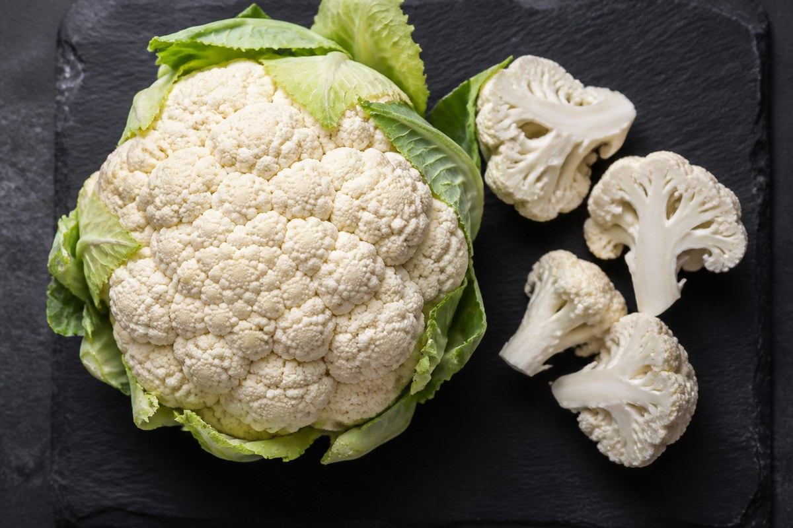

*▲ Raw cauliflower is 25 kcal per 100 g, with 48.2 mg of vitamin C (54% DV) and 2.0 g of fiber. One head weighs 600–900 g before trimming.*

Quick answer <strong>Raw cauliflower supplies 25 calories, 4.97 g carbohydrate, 2.0 g fiber and 48.2 mg vitamin C per 100 g in USDA data.</strong> In one 20-minute cooking study, sulforaphane decreased by 76.2% after boiling and 66.1% after steaming. These are study-specific results, not universal cooking losses.

Cauliflower is the flower bud of *Brassica oleracea* var. *botrytis* — the same species as broccoli, cabbage and kale. The edible part is the arrested inflorescence, called the curd, harvested while the florets are still tightly packed. That structure is the reason it behaves so differently from leafy brassicas in the kitchen: a dense surface-to-volume ratio that holds water, hides grit, and soaks up oil.

Peak season in Korea runs from November to March, when Jeju's winter crop reaches markets. Cold-grown curds are firmer and sweeter than summer greenhouse heads, which is why late-autumn cauliflower caramelizes better when roasted.

The questions people actually type are narrow: <strong>“Is cauliflower really only 25 calories?”</strong>, <strong>“Does boiling destroy its nutrients?”</strong>, and <strong>“Is cauliflower rice actually better than rice?”</strong> The short version: the calorie figure is real, the nutrient loss from boiling is real, and cauliflower rice only helps if it replaces rice rather than being added alongside it.

---

## 1. Cauliflower Nutrition Facts (per 100 g)

Values below are the USDA FoodData Central SR Legacy entry for raw cauliflower, edible portion.

| Nutrient | Per 100 g | U.S. %DV |
| :--- | :--- | :--- |
| Energy | 25 kcal | 1% |
| Water | 92.07 g | No DV¹ |
| Protein | 1.92 g | 4% |
| Total fat | 0.28 g | 0% |
| — Saturated fat | 0.13 g | 1% |
| Total carbohydrate | 4.97 g | 2% |
| — Dietary fiber | 2.0 g | 7% |
| — Total sugars | 1.91 g | No DV¹ |
| Calcium | 22 mg | 2% |
| Iron | 0.42 mg | 2% |
| Magnesium | 15 mg | 4% |
| Phosphorus | 44 mg | 4% |
| Potassium | 299 mg | 6% |
| Sodium | 30 mg | 1% |
| Zinc | 0.27 mg | 2% |
| Manganese | 0.155 mg | 7% |
| Selenium | 0.6 µg | 1% |
| Vitamin C | 48.2 mg | 54% |
| Thiamin (B1) | 0.05 mg | 4% |
| Riboflavin (B2) | 0.06 mg | 5% |
| Niacin (B3) | 0.507 mg | 3% |
| Vitamin B6 | 0.184 mg | 11% |
| Folate | 57 µg DFE | 14% |
| Choline | 44.3 mg | 8% |
| Vitamin E | 0.08 mg | 1% |
| Vitamin K | 15.5 µg | 13% |

¹ Water and total sugars have no Daily Value. “No DV” means the FDA has not set a reference amount — it does not mean zero.

### How to read the table

Three things stand out, and one of them is a trap.

- <strong>Vitamin C is the headline.</strong> 48.2 mg is 54% of the 90 mg Daily Value in a single 25-calorie serving. A 100 g portion delivers more vitamin C than a medium orange, gram for gram, though oranges are usually eaten in larger portions.
- <strong>Fiber is modest, not exceptional.</strong> 2.0 g per 100 g is respectable but below cabbage (2.5 g) and far below legumes. Korean food composition tables list 4.6 g for the same vegetable, a gap explained below.
- <strong>Protein is negligible for meal planning.</strong> 1.92 g per 100 g means a 300 g plate adds 5.8 g of protein. Cauliflower does not substitute for a protein source no matter how it is riced.
- <strong>The trap is glycemic load math.</strong> With 4.97 g of total carbohydrate and 2.0 g of fiber, net carbohydrate is about 3 g per 100 g. That is genuinely low — but it only matters when cauliflower <em>replaces</em> a starch, not when it is eaten on top of one.

### Why Korean tables say 4.6 g of fiber and USDA says 2.0 g

The Korean national food composition table lists raw cauliflower at 27 kcal, 2.17 g protein, 4.6 g dietary fiber, 403 mg potassium and 33.44 mg vitamin C. Calories and protein agree with USDA within rounding. Fiber differs by 2.3× and vitamin C by 1.4× in the other direction.

This is a measurement difference, not a different vegetable. Fiber depends on the assay: total dietary fiber by enzymatic-gravimetric methods captures resistant starch and some oligosaccharides that older AOAC procedures miss, and sample handling changes the result. Vitamin C is destroyed during storage and transport, so the 48.2 mg measured on a fresh USDA sample is likely higher than what reaches a supermarket shelf after weeks of cold chain.

The practical rule: <strong>compare within one table, not across two.</strong> This article uses USDA values for the %DV column and cites Korean figures only where the comparison itself is the point.

### Portion math: a head, a cup, and a “rice” bowl

- <strong>One floret:</strong> roughly 12–15 g, so about 3–4 calories. Ten florets is 120–150 g, or 30–38 calories.
- <strong>One cup of chopped florets (107 g):</strong> 27 calories, 51.6 mg vitamin C, 2.1 g fiber.
- <strong>One medium head (600–900 g whole, 588 g edible):</strong> about 147 calories for the entire head — the reason cauliflower is popular for bulk cooking.
- <strong>Cauliflower rice, 100 g:</strong> 25–35 calories raw; pan-fried in a tablespoon of oil it becomes 145–155 calories, because oil contributes 120 of them.
- <strong>Boiled 100 g:</strong> 23 calories. Calories barely change; what changes is everything else.

---

## 2. Four Evidence-Based Health Benefits

### Does cauliflower really deliver half your vitamin C?

Yes, in its raw form, and less reliably after cooking. Vitamin C is water-soluble and heat-labile, so both temperature and the amount of cooking water matter. Boiling florets for five minutes leaches a substantial share into water that is usually poured down the drain; steaming keeps the vegetable out of the water entirely, and stir-frying limits both time and contact.

Measured cooking trials on brassicas show ascorbic acid losses of roughly 39–42% after water blanching and boiling, but significantly smaller losses after steaming, microwave cooking and stir-frying. In practical terms, 100 g of boiled cauliflower may deliver 28–30 mg of vitamin C rather than 48 mg, while the same 100 g steamed delivers 38–44 mg.

There is a second reason to care beyond the vitamin itself. Vitamin C is a potent enhancer of non-heme iron absorption. Cauliflower's own iron is only 0.42 mg, but eaten alongside spinach, lentils or tofu, its vitamin C raises the fraction of plant iron that actually crosses the intestine — from roughly 2–5% toward 8–10% in a mixed meal.

### Glucosinolates and sulforaphane: how strong is the cancer claim?

Cauliflower contains glucosinolates — glucoraphanin, glucobrassicin, sinigrin, progoitrin, gluconapin — which convert to isothiocyanates when cells are damaged and the enzyme myrosinase is released. The best-known product is sulforaphane.

Content varies enormously by cultivar and assay. One HPLC study measured 154.59 mg/kg of sulforaphane in raw cauliflower (about 15 mg per 100 g); a review of plant sources reports 1.82–3.48 mg per 100 g dry weight. Neither number should be treated as a dose you can plan around. What is consistent is the ranking: cauliflower sits below Brussels sprouts, red cabbage and white cabbage, roughly level with broccoli.

The cooking data are the useful part. In the same 20-minute cooking trial, sulforaphane in cauliflower fell from 160.19 to 38.14 mg/kg after boiling (a 76.2% loss), to 54.37 mg/kg after steaming (66.1%), and to 25.67 mg/kg after pan-frying (84.0%). Crucially, 119.57 mg/kg of sulforaphane was recovered <em>in the boiling water</em> — the compound left rather than degraded. A separate Korean study found glucosinolate, polyphenol and flavonoid concentrations ranked raw &gt; steamed &gt; boiled, with steaming preserving far more than boiling.

On human outcomes the honest answer is narrower than the headlines. Sulforaphane activates the Nrf2 antioxidant pathway in cells and animals, and higher cruciferous vegetable intake is associated with lower risk for some cancers in observational studies. <strong>There is no clinical trial showing that eating cauliflower prevents cancer in people.</strong> The defensible claim is that a diet built around cruciferous vegetables is favorable, not that cauliflower is medicine.

One practical trick: chop first, wait ten minutes, then cook. Cutting ruptures cells and lets myrosinase generate isothiocyanates before heat denatures the enzyme.

### Is cauliflower rice actually useful for weight loss?

Only as a replacement. At 25 calories and roughly 3 g of net carbohydrate per 100 g, cauliflower stands in for rice at about one-fifth the calories and one-tenth the carbohydrate: 100 g of cooked white rice is about 130 calories and 28 g of carbohydrate.

The fiber profile explains the satiety. Cauliflower is 4.3 g insoluble and 0.3 g soluble fiber per 100 g in Korean data — overwhelmingly insoluble, meaning it adds bulk and speeds transit rather than forming gel. That helps constipation; it is also why people with irritable bowel syndrome report gas and bloating from large portions.

The failure mode is preparation. Cauliflower absorbs oil like a sponge. Ricing 200 g and frying it in two tablespoons of olive oil adds 240 calories, which erases the entire advantage over rice. Dry-toasting in a nonstick pan, or blanching and squeezing out water, is what actually preserves the calorie gap. And because protein is only 1.92 g per 100 g, cauliflower rice needs eggs, tofu or chicken or hunger returns within two hours.

### What do potassium and choline add?

Potassium is 299 mg per 100 g — 6% DV, comparable to a small banana and higher than tomato. With sodium at just 30 mg, the ratio favors potassium, which is the mechanism behind vegetable-rich diets lowering blood pressure. It is not a dramatic number, but it is a favorable ratio in a food people eat by the bowl.

Choline at 44.3 mg per 100 g (8% DV) is less discussed and more interesting. Choline is a precursor to acetylcholine and phosphatidylcholine, and intake in the U.S. population sits below recommendations on average. Cauliflower is not a top source — eggs and liver are — but it is one of the better vegetable sources, which matters for people who avoid animal foods.

Folate (57 µg DFE, 14% DV) and vitamin K (15.5 µg, 13% DV) round out the micronutrient profile. Vitamin K is low enough that warfarin patients do not need to avoid cauliflower, but consistency still matters more than the absolute amount.

---

## 3. Cooking and Eating Guide That Preserves Nutrients

- <strong>Steaming:</strong> try four to five minutes for texture, checking the stems. The reported 20-minute experimental losses cannot be extrapolated to this shorter cooking time.
- <strong>If you boil, boil briefly in little water.</strong> Three minutes with a lid in half a cup of water beats twenty minutes in a liter. Use the cooking water in soup or a stew and you recover much of what leached out.
- <strong>Chop, wait ten minutes, then apply heat.</strong> This lets myrosinase act before it is denatured, so the isothiocyanates are already formed.
- <strong>Wash just before cooking, not before storing.</strong> Invert florets in lightly salted water for two to three minutes to float out grit, then rinse. Water trapped in the curd makes the vegetable soggy when roasted and encourages mold in the drawer.
- <strong>Roast at 220°C (425°F) on a dry surface.</strong> Toss with one teaspoon of oil per 100 g rather than pouring. High dry heat produces browning without the oil load that pan-frying requires.
- <strong>Measure oil when “frying” cauliflower rice.</strong> One tablespoon is 120 calories — five times the calories in the vegetable itself.
- <strong>Eat some of it raw.</strong> Crudité with yogurt-lemon dip delivers 100% of the vitamin C and glucosinolates. Keep raw portions to about 100 g if your gut is sensitive.
- <strong>Use the stem and leaves.</strong> The stem is sweeter and higher in fiber than the florets; slice it into stir-fries. Outer leaves cook like collards.
- <strong>Store unwashed, wrapped, 4–7 days.</strong> A paper towel inside a loosely closed bag in the crisper prevents condensation. Black speckles are oxidation — trim and eat.

---

## 4. Cautions and Side Effects

- <strong>Thyroid disease:</strong> cauliflower contains progoitrin, which can convert to goitrin and interfere with iodine uptake by the thyroid. At normal intakes of 100–200 g per day this is not a clinical concern, and cooking reduces the compound substantially. People with hypothyroidism on levothyroxine should avoid <em>habitual juicing or powdered</em> cruciferous supplements rather than the vegetable itself, and should ensure iodine intake is adequate.
- <strong>IBS and bloating:</strong> cauliflower contains mannitol and fermentable oligosaccharides. Start at 50 g, and prefer cooked over raw if symptoms appear.
- <strong>Chronic kidney disease:</strong> 299 mg potassium per 100 g is not trivial under a potassium-restricted diet. Boiling and discarding the water removes 30–40%.
- <strong>Warfarin:</strong> vitamin K is low (15.5 µg), so no avoidance is needed — but do not jump from none to daily large portions or from cooked to powdered.
- <strong>Thyroid medication timing:</strong> levothyroxine should be taken on an empty stomach, 30–60 minutes before a high-fiber meal, because fiber reduces absorption.
- <strong>Raw cauliflower is hard to digest.</strong> With gastroparesis or after gastric surgery, keep portions small and cooked.
- <strong>Allergy is rare</strong> but reported in people sensitive to other brassicas; oral itching or rash means stop.

---

## 5. Frequently Asked Questions

**How much cauliflower should I eat per day?**  
A 100 g serving is a useful reference for nutrition comparisons, not a prescribed daily amount. If thyroid disease, kidney disease or warfarin use requires dietary adjustments, follow advice from your clinician or dietitian.

**Does boiling cauliflower destroy its nutrients?**  
Not all nutrients disappear. In one 20-minute trial, sulforaphane decreased by 76.2% after boiling and 66.1% after steaming. Actual losses vary by cooking conditions and cultivar.

**Is cauliflower rice good for weight loss?**  
Only when it replaces rice. 100 g of cauliflower is 25 calories against about 130 for cooked white rice, so a straight swap cuts roughly 200 calories from a meal. It fails when pan-fried in oil (adds 120 calories per tablespoon) or eaten alongside rice instead of replacing it, and its 1.92 g protein per 100 g will not keep you full on its own.

---

## 6. Synergistic Food Pairings

- **[Broccoli](/en/posts/broccoli-nutrition-benefits/):** same species, different organ. Broccoli carries more glucoraphanin, the direct sulforaphane precursor, while cauliflower delivers more vitamin C per calorie. Steam both together and dress with lemon.
- **[Egg](/en/posts/egg-nutrition-benefits/):** cauliflower supplies 48 mg of vitamin C, eggs supply 250 mg of choline per 100 g — each covers what the other lacks. Two eggs plus 200 g of cauliflower is a 12 g protein side dish.
- **[Tofu](/en/posts/tofu-nutrition-benefits/):** calcium-set tofu brings 350 mg of calcium per 100 g against cauliflower's 22 mg, and both are low-sodium, high-potassium foods suited to blood-pressure eating patterns.
- **[Kale](/en/posts/kale-nutrition-benefits/):** cauliflower is low in vitamin K, kale is high; roasting the two together at 200°C for twelve minutes gives browning with almost no oil.

  
📌 Related ranking guides

  <ul>
    <li><a href="/en/posts/low-calorie-high-satiety-foods/">Low-calorie, high-satiety foods</a></li>
    <li><a href="/en/posts/heart-blood-pressure-cholesterol-foods/">Foods for heart, blood pressure and cholesterol</a></li>
  </ul>

---

## 7. Key Takeaways

- Raw cauliflower is **25 kcal, 4.97 g carbohydrate, 2.0 g fiber and 48.2 mg vitamin C (54% DV)** per 100 g.
- **Steam it.** Twenty minutes of boiling costs 76.2% of its sulforaphane and about 40% of its vitamin C; steaming cuts those losses substantially.
- **Chop ten minutes before cooking** so myrosinase can generate isothiocyanates while the enzyme is still active.
- The **cancer claim stops at cell and animal studies** plus observational associations — no human trial shows cauliflower prevents cancer.
- **Cauliflower rice works only as a replacement.** With oil, the calorie advantage disappears, and 1.92 g protein per 100 g will not hold you until the next meal.
- If thyroid disease, kidney disease or warfarin use requires diet changes, follow your clinician's advice rather than a fixed daily serving.

**Cooking study:** [Impact of thermal processing and freezing on sulforaphane levels in selected brassica vegetables (2026)](https://doi.org/10.1007/s00217-026-05180-y).