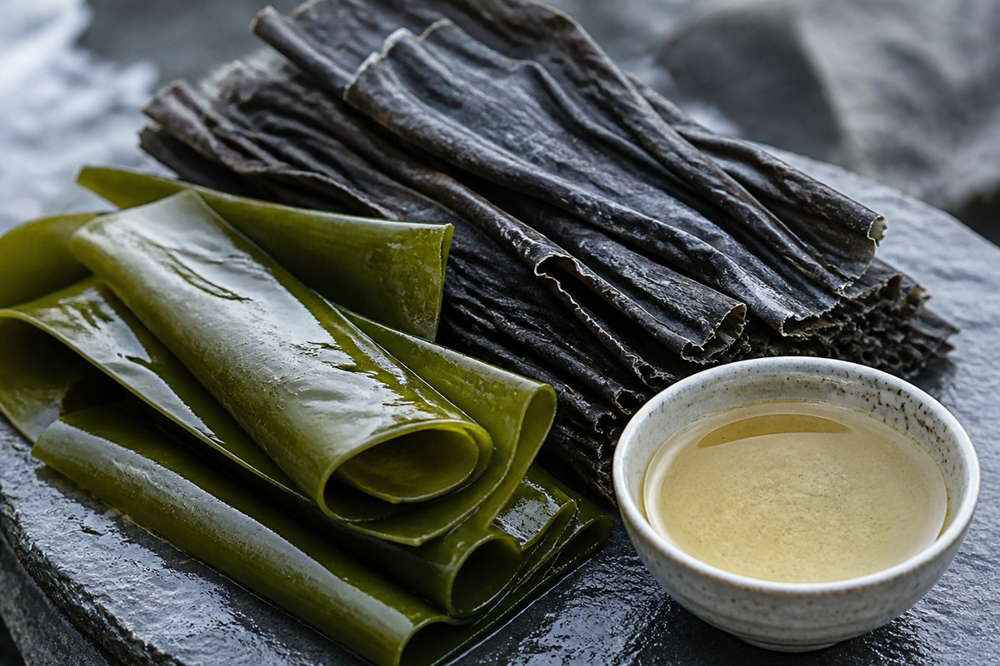

*▲ Raw kelp is 43 kcal per 100 g, with 168 mg calcium, 121 mg magnesium and 2.85 mg iron. Its iodine content is not a fixed number — it ranges across four orders of magnitude.*

Quick answer <strong>Raw kelp provides 43 calories, 9.57 g of carbohydrate, 168 mg of calcium (13% DV), 121 mg of magnesium (29% DV), 2.85 mg of iron (16% DV) and 180 µg of folate (45% DV) per 100 g.</strong> It is also the most iodine-dense food people eat. A single 3×5 cm strip of dried kelp, about 1–2 g, can carry <strong>1,790–3,580 µg of iodine</strong> — above the U.S. tolerable upper intake level of 1,100 µg per day. Kelp is not a food to eat by portion size; it is a food to use by the gram.

Kelp is the common name for large brown algae of the order Laminariales — *Saccharina* (sugar kelp, kombu), *Laminaria*, *Macrocystis* (giant kelp) and *Undaria* (wakame, though wakame is technically a different order). In Korea the edible form is *dashima*, sold fresh, dried, or salt-preserved, and used mainly to build broth rather than as a vegetable.

What separates kelp from other sea vegetables is glutamate. Korean and Japanese cooking traditions use it precisely because dried kelp holds 200–3,400 mg of glutamic acid per 100 g, one of the highest concentrations in any food. That is the compound Kikunae Ikeda isolated from kombu broth in 1908, which became the basis of monosodium glutamate.

The questions that bring people here are practical, not academic: <strong>“How much iodine is in kelp?”</strong>, <strong>“Is kelp bad for your thyroid?”</strong>, and <strong>“Does kelp really help with cholesterol?”</strong> The answers are, in order: an enormous and highly variable amount; not for most people, but yes for some; and only weakly, with the evidence mostly mechanistic.

---

## 1. Kelp Nutrition Facts (per 100 g)

Values below are the USDA FoodData Central SR Legacy entry for raw kelp (FDC 168457), edible portion. Dried kelp is a different product with roughly two and a half times the solids per gram.

| Nutrient | Per 100 g | U.S. %DV |
| :--- | :--- | :--- |
| Energy | 43 kcal | 2% |
| Water | 81.58 g | No DV¹ |
| Protein | 1.68 g | 3% |
| Total fat | 0.56 g | 1% |
| Total carbohydrate | 9.57 g | 3% |
| — Dietary fiber | 1.3 g | 5% |
| — Total sugars | 0.6 g | No DV¹ |
| Calcium | 168 mg | 13% |
| Iron | 2.85 mg | 16% |
| Magnesium | 121 mg | 29% |
| Phosphorus | 42 mg | 3% |
| Potassium | 89 mg | 2% |
| Sodium | 233 mg | 10% |
| Zinc | 1.23 mg | 11% |
| Copper | 0.13 mg | 14% |
| Manganese | 0.20 mg | 9% |
| Selenium | 0.7 µg | 1% |
| Vitamin A | 6 µg RAE | 1% |
| Vitamin C | 3 mg | 3% |
| Thiamin (B1) | 0.05 mg | 4% |
| Riboflavin (B2) | 0.15 mg | 12% |
| Niacin (B3) | 0.47 mg | 3% |
| Folate | 180 µg DFE | 45% |
| Vitamin E | 0.87 mg | 6% |
| Vitamin K | 66 µg | 55% |
| Iodine | 16–8,000 µg per gram dry weight | See note¹ |

### What one sheet, one spoonful and one bowl of broth deliver

Kelp is a seasoning, not a vegetable serving: a 10 × 10 cm sheet weighs 3–5 g.

| Portion | Edible weight | Energy | Protein |
| :--- | :--- | :--- | :--- |
| 1 sheet (10 × 10 cm) | 4 g | 1.7 kcal | 0.07 g |
| 2 tbsp, cut (10 g) | 10 g | 4.3 kcal | 0.17 g |
| 1 side portion, 20 g | 20 g | 8.6 kcal | 0.34 g |

*Note: one sheet in a litre of broth adds 1–2 kcal and 93–155 mg sodium. The number that matters is iodine: a 3 g spoonful of kelp powder carries about 5,370 µg, more than twice the daily upper limit.*

¹ Water and total sugars have no Daily Value. Iodine has no Daily Value either, because content in kelp is not a fixed property of the food: published values across species, harvest sites and seasons span 16 to 8,000 µg per gram of dry weight. See the note below for measured figures that can be used for planning.

### How to read the table

- <strong>Magnesium is the strongest mineral claim.</strong> 121 mg per 100 g is 29% DV — more than spinach or almonds per 100 g. Together with 168 mg calcium, 2.85 mg iron and 1.23 mg zinc, kelp is genuinely mineral-dense.
- <strong>The fibers are not ordinary fiber.</strong> Most of the 9.57 g carbohydrate is alginate, laminarin and mannitol, not starch or sugar. Sugars total just 0.6 g, which is why kelp is not a glycemic concern.
- <strong>Sodium is 233 mg per 100 g</strong> — 10% DV — but nobody eats 100 g of raw kelp in one sitting. A 5 g piece in broth adds about 12 mg. Salt-preserved kelp is a different story entirely, with sodium in the thousands of mg per 100 g.
- <strong>Iodine is the number that governs how you should use this food</strong>, and it is the one number the table cannot give you as a single value.

### The iodine note: why the range spans four orders of magnitude

Iodine in kelp depends on species, water chemistry, harvest depth and season. Measured values for dried Korean *dashima* reach <strong>179,060 µg per 100 g</strong> — that is 179 mg of iodine per 100 g of dried kelp, according to the iodine table published in the Korean Thyroid Association's patient guide. Fresh kelp in the same table is 136,500 µg per 100 g, and dried wakame (*Undaria*) is only 11,600 µg.

Translated into serving terms, using the dried figure:

- <strong>3×5 cm strip (1–2 g):</strong> 1,790–3,580 µg iodine.
- <strong>10×10 cm broth piece (3–5 g):</strong> 5,370–8,950 µg iodine.
- <strong>One 100 g package of dried kelp:</strong> 179,060 µg — 163 times the U.S. upper limit.

These are upper-bound calculations, not what your body absorbs. Not all iodine is extracted during steeping, and discarding the first soaking water removes a substantial fraction. But the order of magnitude is why kelp sits in a different regulatory category from other vegetables in several countries.

For reference points: the U.S. Recommended Dietary Allowance for iodine is 150 µg/day for adults, 220 µg during pregnancy and 290 during lactation. The U.S. tolerable upper intake level is <strong>1,100 µg/day</strong>. Korea sets its upper level at <strong>2,400 µg/day</strong>, reflecting a population that already eats seaweed daily.

---

## 2. Four Evidence-Based Health Benefits

### Iodine and the thyroid: benefit and risk from the same molecule

Iodine is a structural requirement: thyroid hormone T4 contains four iodine atoms and T3 contains three. Without enough iodine, the thyroid enlarges (goiter) and hormone production falls. Iodine deficiency remains the world's leading preventable cause of intellectual disability, which is why salt iodization exists in most countries.

Korea is on the opposite end of the distribution. In a 2020 reanalysis of the 2013–2015 Korea National Health and Nutrition Examination Survey, the median iodine intake of Korean adults was <strong>352 µg/day</strong>, and <strong>55.7% of that intake came from seaweed</strong>. Among seaweed consumers, the median was 495.7 µg/day versus 241.2 µg among non-consumers, and <strong>8.0% of men and 6.3% of women in the seaweed-eating group exceeded the 2,400 µg upper level</strong>.

The thyroid has an autoregulatory mechanism — the Wolff-Chaikoff effect — that temporarily reduces iodine uptake when supply is high, so a single iodine-rich meal does not destabilize a healthy gland. That protection is why most people can eat kelp broth without consequence. It is also why the risk concentrates in specific groups: autoimmune thyroiditis (Hashimoto's), Graves' disease, nodular goiter, prior thyroid surgery, and pregnancy.

### Alginate and laminarin: real mechanism, thin human evidence

Alginate is the polysaccharide that makes kelp slippery. It forms a viscous gel in the gut, slowing gastric emptying and the absorption of glucose and fat, and it is the reason kelp is marketed for cholesterol and weight.

The mechanism is well described; the human trials are small. Studies using alginate-enriched breads and drinks have reported reduced energy intake and altered postprandial glucose, but sample sizes are typically a few dozen people, formulations differ in alginate dose and molecular weight, and none of it establishes a clinical benefit from eating kelp as food. Alginate is not on Korea's list of pre-approved health-functional ingredients, which is a useful reality check on marketing claims.

Laminarin, kelp's storage glucan, is a low-sweetness carbohydrate that digests slowly. Fucoidan, a sulfated polysaccharide in brown algae, has antiviral and immunomodulatory activity in cell and animal models; human data are essentially absent.

There is one practical consequence worth knowing. <strong>If you strain out the kelp and keep only the broth, you leave most of the fiber behind.</strong> Alginate gives the broth its body, but the polysaccharide mass stays in the leaf. Slicing the steeped kelp into a salad is how you actually get the fiber you were told about.

### Calcium, magnesium and iron: dense on paper, moderate in practice

Kelp's mineral numbers are impressive, and absorption is the caveat. Alginates and other seaweed polysaccharides bind divalent minerals in the gut, so calcium and iron from kelp are less bioavailable than the same milligrams from dairy or meat. Kelp iron is non-heme, absorbed at roughly 2–10% depending on the meal.

Pairing with vitamin C improves non-heme iron uptake, which is the logic behind dressings vinegar and lemon on kelp salads. Pairing with tea or coffee within the same hour does the opposite.

For people taking medication, timing matters more than the mineral count: viscous fibers and alginates can bind drugs and delay absorption. Levothyroxine in particular should be taken on an empty stomach and separated from kelp by <strong>at least four hours</strong>.

### Glutamate and mannitol: umami as a sodium-reduction tool

The most underrated property of kelp is not nutritional. Dried kelp contains 200–3,400 mg of glutamate per 100 g, and glutamate delivers savory taste that lets you use less salt for the same perceived seasoning. A broth built on kelp and anchovy tastes fully salted at a lower sodium concentration than a broth built on salt alone.

For anyone managing blood pressure, that is a more reliable benefit than any supplement claim. The sodium figure in the table (233 mg per 100 g raw) looks high until you notice that 5 g of kelp contributes about 12 mg to a liter of broth, while replacing a teaspoon of salt that would have contributed 2,300 mg.

The white powder on the surface of dried kelp is mannitol, a sugar alcohol — not mold. Wiping it off with a dry cloth removes flavor. Rinse it and you lose the sweetness and part of the umami.

---

## 3. Cooking and Eating Guide That Preserves Nutrients

- <strong>Steep at 60–80°C, not at a rolling boil.</strong> Glutamate extracts best below boiling. Put kelp into cold water, heat gently, and remove it just before the water boils. Boiling longer than five minutes releases alginate and bitter compounds that cloud the broth.
- <strong>Cold-steep for one hour in summer, three in winter.</strong> Cold water extracts glutamate cleanly with almost no bitterness. If you are short on time, use the gentle-heat method above.
- <strong>Discarding soaking water:</strong> may reduce iodine, but does not establish a safe iodine concentration in a subsequent broth.
- <strong>Do not wash off the white powder.</strong> Mannitol carries sweetness. Wipe visible grit with a damp cloth instead.
- <strong>Steeped kelp:</strong> retains fiber and may retain substantial iodine. Eating both broth and kelp can increase total iodine intake.
- <strong>Portion size:</strong> no universal gram-scale daily ceiling can be guaranteed because iodine concentration and extraction vary substantially.
- <strong>Skip kelp powders, capsules and juices</strong> unless a clinician directs them. Concentrates compress weeks of iodine into a spoonful, and the dosing is not standardized.
- <strong>Store dried kelp airtight, frozen for long term.</strong> It absorbs moisture and odors readily.

---

## 4. Cautions and Side Effects

- <strong>Thyroid disease:</strong> people with thyroid conditions may be more susceptible to excess iodine. Discuss kelp concentrates, broth and food portions with a clinician.
- <strong>Pregnancy and lactation:</strong> iodine needs rise to 220–290 µg/day, but the upper limit does not. Kelp is a poor way to supplement because the dose cannot be controlled; prenatal supplements with defined iodine are safer.
- <strong>Kidney disease:</strong> the USDA figure for potassium is modest (89 mg), but dried kelp is far more concentrated and Korean tables list 7,500 mg potassium per 100 g dried. Under a potassium restriction, weigh portions rather than eyeballing them.
- <strong>Sodium in salt-preserved kelp:</strong> salt-cured products can exceed 10,000 mg sodium per 100 g. Soak and rinse thoroughly before use.
- <strong>Acute iodine excess</strong> causes mouth, throat and abdominal pain, fever, nausea and vomiting. Chronic excess can cause thyroid dysfunction. Regulatory guidance in Korea is not to exceed 2.4 mg (2,400 µg) per day.
- <strong>Levothyroxine interaction:</strong> separate by at least four hours.
- <strong>Arsenic:</strong> brown algae can accumulate arsenic, and one species — hijiki (*Hizikia fusiforme*) — contains inorganic arsenic at levels that led the UK Food Standards Agency and other authorities to advise against eating it. Kelp species are lower, but buying from suppliers who publish heavy-metal testing is prudent.
- <strong>Radiation claims are false:</strong> Korea's Ministry of Food and Drug Safety has publicly classified marketing that iodine-rich seaweed "flushes radiation" as false and exaggerated advertising. Increasing kelp intake for that purpose only adds iodine.

---

## 5. Frequently Asked Questions

**How much iodine is in a piece of kelp?**  
At the cited measured concentration of 179,060 µg per 100 g of dried kelp, a 1–2 g piece contains about 1,790–3,580 µg before preparation. Concentration and transfer to broth vary, so this is an estimate rather than a universal serving value.

**Can I drink kelp broth every day?**  
Daily kelp broth cannot be assumed safe. Using the cited dry-kelp measurement, 1–2 g contains about 1,790–3,580 µg of iodine before preparation, above the US adult upper limit of 1,100 µg and potentially above the Korean adult limit of 2,400 µg. The amount transferred into broth varies. If you have thyroid disease, discuss intake with your clinician.

**Does kelp lower cholesterol?**  
Probably a little, through alginate's viscosity, but the evidence is weak. Small trials with alginate-enriched foods show reduced energy intake and slower glucose absorption; there is no large trial showing that eating kelp lowers LDL in a clinically meaningful way. Treat kelp as a low-calorie, high-mineral seasoning rather than a lipid-lowering intervention.

---

## 6. Synergistic Food Pairings

- **[Anchovy](/en/posts/anchovy-nutrition-benefits/):** kelp supplies glutamate, anchovy supplies inosinate, and the two combine into a much stronger umami signal than either alone. Stronger umami means less salt for the same taste — the most practical blood-pressure strategy in Korean cooking.
- **[Radish](/en/posts/radish-nutrition-benefits/):** radish brings about 300 mg potassium per 100 g and its own digestive enzymes, balancing kelp's 233 mg sodium in a soup pot.
- **[Laver (Nori)](/en/posts/laver-nutrition-benefits/):** laver holds 3,800 µg iodine per 100 g dried, roughly one-fiftieth of kelp. If you want seaweed regularly but want to limit iodine, laver is the better daily choice.
- **[Mackerel](/en/posts/mackerel-nutrition-benefits/):** simmering mackerel in kelp stock combines omega-3 fats with kelp's minerals while cutting the salt needed to season the fish.

  
📌 Related ranking guides

  <ul>
    <li><a href="/en/posts/heart-blood-pressure-cholesterol-foods/">Foods for heart, blood pressure and cholesterol</a></li>
    <li><a href="/en/posts/liver-immunity-fatigue-recovery-foods/">Foods for liver, immunity and fatigue recovery</a></li>
  </ul>

---

## 7. Key Takeaways

- Raw kelp is **43 kcal, 168 mg calcium, 121 mg magnesium (29% DV), 2.85 mg iron and 180 µg folate (45% DV)** per 100 g.
- **Iodine is the variable that decides how to use kelp.** Dried kelp measures 179,060 µg per 100 g; a single 3×5 cm strip carries 1,790–3,580 µg.
- U.S. upper limit is **1,100 µg/day**, Korea's is **2,400 µg/day**. Korean adults already average 352 µg/day, with 55.7% from seaweed.
- **Steep at 60–80°C and remove before boiling** for clean umami; discard the first soak to cut iodine.
- **Eat the steeped leaf, not just the broth** — that is where alginate, calcium and iron remain.
- Avoid **powders, capsules and juices**; keep food use to grams, and separate kelp from **levothyroxine by four hours**.
- Do not wash off the white powder: it is **mannitol**, and it carries sweetness.

**Additional references:** [NIH ODS iodine fact sheet](https://ods.od.nih.gov/factsheets/iodine-HealthProfessional/) and [iodine in Korean brown seaweed and kelp broth (2024)](https://pmc.ncbi.nlm.nih.gov/articles/PMC11156764/).