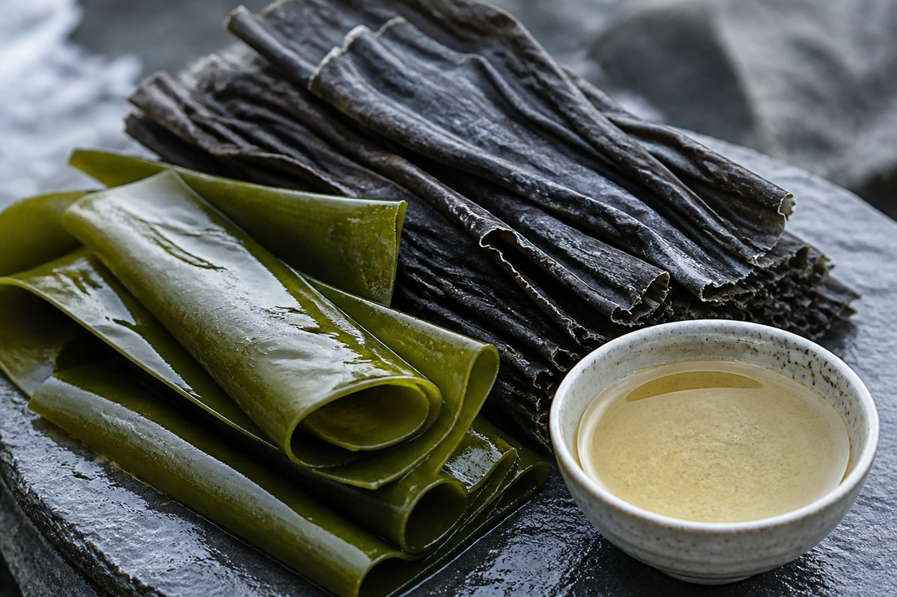

*▲ 마른 다시마 100g은 110kcal, 칼슘 708mg, 요오드 179,060μg입니다. 실제 한 끼에 쓰는 양은 3×5cm 한 장(1~2g)입니다.*

한 줄 결론 <strong>마른 다시마 100g은 110kcal에 칼슘 708mg, 철 6.3mg, 요오드 179,060μg입니다.</strong> 그런데 이 숫자를 그대로 겁먹을 필요는 없습니다. <strong>한 번에 먹는 양이 3×5cm 한 장(1~2g)</strong>이기 때문입니다. 다만 그 한 장에 <strong>요오드가 1,790~3,580μg</strong> 들어 있어, 하루 상한(2,400μg)에 견주면 <strong>한 장으로 이미 넘길 수 있습니다</strong>. 다시마는 '영양이 많은 식품'이 아니라 <strong>'소량으로 강하게 작용하는 식품'</strong>입니다.

다시마는 갈조류 다시마과의 바닷말입니다. 우리나라에서는 완도·포항·기장 등 남해안과 동해안에서 양식하며, 국물을 내는 재료이자 쌈·튀각·다시마쌈으로 먹는 반찬 재료입니다. 같은 해조류인 미역·김과 달리 <strong>감칠맛 성분인 글루탐산이 압도적으로 많아</strong> 국물 재료로 따로 쓰입니다.

유통 형태는 세 가지입니다. <strong>생다시마</strong>는 물기를 머금어 무겁고, <strong>마른 다시마</strong>는 수분을 12%까지 말려 보관성과 감칠맛을 높인 것이며, <strong>염장 다시마</strong>는 소금에 절여 저장한 것입니다. 영양표는 보통 마른 다시마를 기준으로 하고, 요오드는 건조 과정에서 수분이 빠지며 농축되어 <strong>생것 100g 136,500μg에서 마른 것 179,060μg</strong>으로 올라갑니다.

다시마는 요오드가 매우 풍부합니다. 제품과 조리 조건에 따라 함량이 달라지므로 한 장을 국물로 우린다는 이유만으로 안전한 하루 섭취량을 정할 수 없습니다.

---

## 1. 다시마 칼로리와 영양성분은? (마른 것 100g 110kcal)

아래 수치는 <strong>국립수산과학원 표준수산물성분표와 국가표준식품성분표의 '다시마, 말린 것' 가식부 100g</strong> 기준입니다. 요오드는 대한갑상선학회가 안내서에 실은 분석값을 따랐습니다.

| 영양 성분 (Nutrient) | 함량 (100g당) | 1일 기준치 비율 (2,000kcal 기준) |
| :--- | :--- | :--- |
| **열량 (Energy)** | 110 kcal | 5.5% |
| **수분 (Water)** | 12.3 g | 별도 표기¹ |
| **탄수화물 (Carbohydrates)** | 45.2 g | 14.0% |
| - 식이섬유 (Dietary Fiber) | 4.1 g | 16.4% |
| - 당류 (Sugars) | 별도 표기¹ | 별도 표기¹ |
| **단백질 (Protein)** | 7.4 g | 13.5% |
| **지방 (Total Fat)** | 1.1 g | 2.0% |
| **칼슘 (Calcium)** | 708 mg | 101.1% |
| **칼륨 (Potassium)** | 7,500 mg | 214.3% |
| **철분 (Iron)** | 6.3 mg | 52.5% |
| **나트륨 (Sodium)** | 3,100 mg | 155.0% |
| **비타민A (Vitamin A)** | 48 µg RAE | 6.9% |
| **비타민C (Vitamin C)** | 18 mg | 18.0% |
| **요오드 (Iodine)** | 179,060 µg | 별도 표기¹ |
| **글루탐산 (Glutamic acid)** | 약 2,500 mg | 별도 표기¹ |

¹ 수분·요오드·글루탐산은 1일 기준치가 설정되지 않은 항목이고, 당류는 국립수산과학원 분석 항목에 별도 수치가 없어 '별도 표기'로 두었습니다. 요오드는 대한갑상선학회 「갑상선결절 환자 안내서」의 식품별 요오드 표(다시마, 말린 것 100g당 179,060µg)를 인용했습니다. 글루탐산은 수산물안전정보서비스 성분표의 다시마 2,501mg/100g 값입니다.

*※ 데이터 기준: 표의 수치는 국내 국가표준식품성분표(식약처 식품영양성분 DB)의 다시마, 말린 것, 가식부 분석값입니다. 같은 식품의 [USDA FoodData Central FDC 168457](https://fdc.nal.usda.gov/food-details/168457/nutrients) — Seaweed, kelp, raw (SR Legacy)는 100g당 43 kcal·단백질 1.68 g입니다. 이 글의 110 kcal는 건다시마 값입니다. 건조하면 수분이 빠져 100g당 열량과 단백질이 함께 올라갑니다.*

### 표 읽는 법: 다시마 100g은 한 달 치입니다

이 표에서 가장 중요한 것은 <strong>100g을 먹을 일이 없다</strong>는 사실입니다. 다시마 100g은 <strong>3×5cm 크기로 50~100장</strong>입니다. 냉장고에 있는 다시마 한 봉지(보통 100~200g)를 다 먹는 양입니다.

실제 사용 단위로 환산하면 이렇게 됩니다.

- <strong>3×5cm 한 장(1~2g):</strong> 1.1~2.2kcal, 칼슘 7~14mg, 나트륨 31~62mg, <strong>요오드 1,790~3,580µg</strong>.
- <strong>국물용 10×10cm 한 장(3~5g):</strong> 3.3~5.5kcal, 칼슘 21~35mg, 글루탐산 75~125mg, <strong>요오드 5,370~8,950µg</strong>.
- <strong>다시마쌈 한 접시(20g):</strong> 22kcal, 칼슘 142mg, 요오드 35,800µg대.

이 환산에서 드러나는 것이 <strong>요오드의 무게</strong>입니다. 3×5cm 한 장만으로도 성인 1일 상한섭취량(2,400µg)에 근접하거나 넘습니다. 칼로리와 칼슘은 적당해 보이는데 요오드만 자릿수가 다른, 특이한 식품입니다.

### 생다시마와 마른 다시마는 얼마나 다른가?

| 구분 | 열량 | 단백질 | 탄수화물 | 나트륨 | 요오드 |
| :--- | :--- | :--- | :--- | :--- | :--- |
| **다시마, 생것 100g** | 12 kcal | 1.1 g | 4.2 g | 75 mg | 136,500 µg |
| **다시마, 말린 것 100g** | 110 kcal | 7.4 g | 45.2 g | 3,100 mg | 179,060 µg |
| **다시마, 염장 100g** | 16 kcal | 1.2 g | 6.0 g | 10,854 mg | 별도 표기¹ |

표에서 보듯 마른 다시마의 열량과 나트륨이 높은 것은 <strong>수분이 12%로 줄어 농축됐기 때문</strong>입니다. 같은 무게로 비교하면 마른 것이 9배 무겁게 보이지만, <strong>한 장을 물에 불리면 원래 무게의 5~7배</strong>로 돌아옵니다. 다이어트 관점에서 다시마는 <strong>열량이 아니라 부피와 점성으로 포만감을 주는 식품</strong>입니다.

### 실생활 환산: 국물 한 냄비, 다시마쌈 한 접시, 튀각 한 줌

- <strong>국물 1L(10×10cm 한 장, 3~5g):</strong> 3~6kcal. 열량은 사실상 0에 가깝고, 여기에 <strong>나트륨이 93~155mg</strong> 더해집니다. 소금 0.3g과 비슷한 양입니다.
- <strong>다시마쌈 20g:</strong> 22kcal, 식이섬유 0.8g. 쌈으로 먹으면 식이섬유와 칼슘을 함께 가져갑니다.
- <strong>튀각 30g:</strong> 100~150kcal. 다시마 자체보다 <strong>튀긴 기름이 열량의 대부분</strong>입니다. 다이어트 중이라면 튀각은 피하고 건조 다시마를 그대로 쓰세요.
- <strong>다시마 환·분말 1스푼(3g):</strong> 3.3kcal지만 <strong>요오드 5,370µg</strong>입니다. 농축 제품이 위험한 이유가 이 한 줄에 있습니다.

정리하면 다시마는 <strong>'국물과 쌈으로 소량 쓰는 조미 채소'</strong>입니다. 영양표의 큰 숫자는 100g 기준일 뿐이고, 실제 섭취량에서는 요오드가 유일하게 문제되는 성분입니다.

---

## 2. 다시마의 4가지 쟁점과 근거 수준

### 요오드: 갑상선에 필요한데 왜 다시마가 문제인가?

요오드는 갑상선호르몬(T4·T3)의 원료입니다. 성인 권장섭취량은 <strong>하루 150µg</strong>, 상한섭취량은 <strong>2,400µg</strong>입니다. 결핍되면 갑상선종과 기능저하가 생기고, 임신 중 결핍은 태아 뇌 발달에 영향을 줍니다.

한국은 반대 문제를 가진 나라입니다. 2013~2015년 국민건강영양조사 자료를 다시 분석한 연구에서 <strong>한국 성인의 요오드 섭취량 중앙값은 352µg/일</strong>이었고, <strong>섭취량의 55.7%가 해조류에서 왔습니다</strong>. 해조류를 먹는 군의 중앙값은 495.7µg으로, 먹지 않는 군(241.2µg)의 두 배였습니다. 같은 연구에서 <strong>해조류 섭취군의 8.0%(남)·6.3%(여)가 상한섭취량을 초과</strong>했습니다.

즉 한국인에게 요오드는 <strong>'부족해서 챙겨야 하는 영양소'가 아니라 '이미 넘치게 먹는 영양소'</strong>입니다. 다시마는 그 중심에 있습니다. 다시마 100g의 요오드 179,060µg은 <strong>하루 상한의 74배</strong>이고, 3×5cm 한 장으로도 상한에 닿습니다.

갑상선 질환이 있는 사람은 과잉 요오드에 더 민감할 수 있습니다. 다시마 환·분말과 같은 농축 제품 및 육수 섭취는 주치의와 상의하세요. 일반인도 반복적인 과잉 섭취는 피해야 합니다.

### 알긴산과 라미나린: 콜레스테롤·혈당에 실제로 작용하나?

다시마의 탄수화물 45.2g은 대부분 <strong>알긴산</strong>과 <strong>라미나린</strong> 같은 해조 다당류입니다. 알긴산은 물을 잡아 젤을 만드는 수용성 섬유질로, 장에서 <strong>당과 지방의 흡수 속도를 늦추고</strong> 포만감을 오래 유지합니다. 다시마 국물이 미끈한 것도 알긴산 때문입니다.

기전은 분명하지만 인체 근거는 아직 얇습니다. 알긴산을 넣은 빵·음료를 먹인 소규모 인체시험이 몇 건 보고됐고, 식후 혈당 상승 폭이나 포만감이 달라졌다는 결과가 있지만 <strong>대상자 수가 적고 제품마다 알긴산 함량이 달라 일반화하기 어렵습니다</strong>. 건강기능식품 원료로도 알긴산 자체는 고시형 기능성 원료 목록에 없습니다. 다시마를 먹어서 콜레스테롤이 내려간다는 기대는 <strong>'섬유질이 많은 식사의 일부'라는 수준</strong>으로 두는 것이 정확합니다.

라미나린은 다시마 특유의 저장 다당류입니다. 단맛이 약하고 소화가 느려 <strong>혈당을 급격히 올리지 않는 탄수화물</strong>로 분류됩니다. 다만 다시마를 100g씩 먹을 일이 없으므로 실제 섭취량은 미미합니다.

우린 다시마에는 섬유질과 일부 무기질이 남지만 요오드도 남을 수 있습니다. 국물과 건더기를 함께 먹으면 총 요오드 섭취량이 늘 수 있으므로 무조건 먹으라고 권하지 않습니다.

### 칼슘 708mg·철 6.3mg, 흡수율은 얼마나 될까?

마른 다시마 100g의 칼슘 708mg은 우유 100ml(약 113mg)의 6배입니다. 철 6.3mg은 소고기 등심 100g(약 2.6mg)의 2.4배입니다. 숫자만 보면 '최고의 무기질 식품'입니다.

그러나 <strong>무기질은 흡수율이 관건</strong>입니다. 해조류의 칼슘·철분은 <strong>알긴산과 피트산에 붙잡혀 흡수율이 낮아집니다</strong>. 다시마의 철분은 비헴철이라 흡수율이 대체로 낮고, 알긴산은 장에서 칼슘·철과 결합해 배출을 늘릴 수 있다는 연구가 있습니다.

그래서 다시마를 무기질 공급원으로 기대하기보다는 <strong>식사에 곁들이는 보조 재료</strong>로 보는 편이 맞습니다. 흡수율을 조금이라도 올리려면 <strong>비타민C가 있는 식재료와 함께</strong> 드세요. 다시마 초무침에 식초와 레몬을 넣는 조리법은 맛의 이유만이 아니라 <strong>비헴철 흡수를 돕는 조합</strong>이기도 합니다.

갑상선호르몬제 등 약물을 복용 중이라면 식사와 복용 간격을 처방 안내에 따라 지키고, 다시마 섭취와 관련해 약사나 주치의에게 문의하세요.

### 글루탐산 2,500mg과 만니트: 감칠맛은 영양인가?

마른 다시마 100g의 글루탐산은 <strong>약 2,500mg</strong>입니다. 아지노모토가 정리한 자료에서도 다시마의 글루탐산염은 <strong>100g당 200~3,400mg</strong>으로, 식품 중 최상위군입니다. 1908년 이케다 기쿠나에가 다시마 국물에서 감칠맛 성분을 분리해 낸 것이 MSG의 시작입니다.

글루탐산은 <strong>단백질을 구성하는 아미노산</strong>이므로 그 자체가 몸에 해로운 물질이 아닙니다. 다시마 국물의 실용적인 가치는 <strong>소금을 줄이는 데</strong> 있습니다. 감칠맛이 있으면 같은 짠맛을 내는 데 필요한 소금의 양을 줄일 수 있습니다. 국물 요리에 다시마를 쓰면 조미료·소금을 덜 넣게 되는 경우가 많지만, 실제 나트륨 감소량은 조리법과 양념에 따라 달라 일정한 비율로 말할 수 없습니다. 나트륨 관리가 필요한 사람에게는 이 점이 가장 큰 장점입니다.

또 하나, 다시마 표면의 흰 가루는 곰팡이가 아니라 <strong>만니트(mannit)</strong>라는 당알코올입니다. 씻어내면 감칠맛과 단맛이 함께 사라지므로, <strong>마른 행주로 먼지만 닦고 그대로 쓰는 것</strong>이 정석입니다.

---

## 3. 영양소를 살리는 조리·섭취 가이드

- <strong>국물은 60~80℃에서 우려내세요.</strong> 글루탐산은 100℃ 끓는 물보다 <strong>60~80℃에서 더 잘 우러납니다</strong>. 찬물에 다시마를 넣고 약한 불에 올려, <strong>물이 끓기 직전(기포가 바닥에서 올라올 때)</strong> 건져내는 것이 감칠맛과 쓴맛의 경계입니다.
- <strong>끓이면 알긴산이 녹아 국물이 미끈해집니다.</strong> 5분 이상 팔팔 끓이면 점액질과 쓴맛 성분이 나와 국물이 탁해집니다. 맑은 국물을 원한다면 <strong>끓기 전에 반드시 건지세요</strong>.
- <strong>우림 후 건더기:</strong> 섬유질이 남아 있지만 요오드도 남을 수 있습니다. 섭취를 제한해야 한다면 건더기까지 먹는 것은 피하세요.
- <strong>표면의 흰 가루는 씻지 마세요.</strong> 만니트 성분으로 감칠맛의 일부입니다. 물기를 짠 행주로 먼지만 닦아 사용합니다.
- <strong>요오드를 줄이려면:</strong> 불린 물을 버리는 방법으로 일부 요오드를 줄일 수 있으나, 제품별 차이가 크고 새 육수에도 요오드가 용출됩니다. 안전한 농도를 보장하지 않습니다.
- <strong>쌈·무침용은 5분 불려 쓰세요.</strong> 마른 다시마를 그대로 쌈으로 쓰면 질기고 짭니다. 찬물에 5분 불려 부드러워진 뒤 초장·들기름에 찍어 먹으면 <strong>나트륨도 함께 빠져</strong> 짠맛이 줄어듭니다.
- <strong>튀각은 열량을 확인하세요.</strong> 다시마 자체는 100g에 110kcal이지만, 튀각은 기름을 머금어 30g에 100~150kcal입니다. 같은 다시마라도 <strong>조리법이 열량을 3~4배 바꿉니다.</strong>
- <strong>보관은 밀폐·냉동.</strong> 마른 다시마는 습기를 먹으면 곰팡이와 냄새가 생깁니다. 밀폐 용기에 담아 서늘한 곳이나 냉동 보관하고, <strong>먹을 만큼만 꺼내</strong> 쓰세요.

---

## 4. 섭취 시 주의사항 및 부작용

- <strong>갑상선 질환:</strong> 다시마 농축 제품과 반복적인 고요오드 식품 섭취는 주치의와 상의하세요. 특정 크기나 횟수를 안전하다고 단정할 수 없습니다.
- <strong>임신·수유:</strong> 요오드 필요량은 늘지만 과잉도 문제가 될 수 있습니다. 함량이 불규칙한 다시마를 보충제처럼 먹지 말고 의료진과 상의하세요.
- <strong>신장질환:</strong> 칼륨 제한 여부와 허용 섭취량은 개인마다 다릅니다. 다시마와 육수의 섭취를 의료진 또는 임상영양사와 상의하세요.
- <strong>나트륨 3,100mg을 기억하세요.</strong> 국물 한 장(3~5g)이면 93~155mg으로 문제가 없지만, <strong>염장 다시마</strong>는 100g에 10,854mg입니다. 염장 제품은 물에 충분히 불려 소금기를 빼고 쓰세요.
- <strong>요오드 과다의 급성 증상</strong>은 입·목·복부 통증, 발열, 구역·구토입니다. 장기간 과다 섭취는 갑상선 기능 장애로 이어질 수 있습니다. 식약처는 <strong>하루 2.4mg(2,400µg)을 넘기지 말 것</strong>을 안내합니다.
- <strong>갑상선호르몬제:</strong> 복용 시점과 식사 간격은 처방과 약사 안내를 따르세요.
- <strong>해조류의 방사능 배출 효과는 사실이 아닙니다.</strong> 식약처는 "요오드 함유 해조류가 방사능을 배출한다"는 주장을 <strong>허위·과대광고</strong>로 규정했습니다. 이 목적으로 다시마 섭취를 늘리면 요오드 과잉만 남습니다.
- <strong>중금속 검사 성적서를 확인하세요.</strong> 해조류는 해양 환경의 비소·카드뮴을 흡수할 수 있습니다. 국내 유통 제품은 기준치 이내로 관리되지만, <strong>출처가 불분명한 수입 건조 해조류</strong>는 피하는 편이 좋습니다.

---

## 5. 자주 묻는 질문 (FAQ)

**Q1. 다시마 국물을 매일 마셔도 되나요?**  
매일 마셔도 안전하다고 단정할 수 없습니다. 마른 다시마 1~2g의 요오드 함량 추정치는 1,790~3,580µg이며, 한국 성인 상한 2,400µg에 근접하거나 초과합니다. 육수로 이동하는 양은 제품·우림 조건·실제 섭취량에 따라 다릅니다. 갑상선 질환이 있다면 의료진과 상의하세요.

**Q2. 다시마 1장에는 요오드가 얼마나 들어 있나요?**  
건조 다시마 100g당 179,060µg이라는 특정 분석값을 적용하면 1~2g에 약 1,790~3,580µg입니다. 실제 함량과 국물로 용출되는 양은 달라질 수 있으며, 우린 국물이 안전하다는 의미는 아닙니다.

**Q3. 갑상선 약을 먹는데 다시마를 끊어야 하나요?**  
갑상선 질환 및 복용 약에 따라 적정 요오드 섭취량이 달라집니다. 다시마 농축 제품은 피하고 육수와 건더기 섭취량 및 복용 간격을 주치의나 약사와 상의하세요.

---

## 6. 다시마와 함께 먹으면 좋은 음식

- <strong>[멸치 (Anchovy)](/posts/anchovy-nutrition-benefits/):</strong> 다시마의 글루탐산과 멸치의 이노신산이 만나 감칠맛이 몇 배로 커집니다. 국물의 감칠맛이 세지면 소금을 줄일 수 있어, 나트륨 관리 식사에서 가장 실용적인 조합입니다.
- <strong>[무 (Radish)](/posts/radish-nutrition-benefits/):</strong> 다시마 국물에 무를 넣으면 무의 칼륨(100g당 약 300mg)이 다시마의 나트륨과 균형을 이룹니다. 무의 소화효소는 다시마의 단단한 섬유질 소화도 돕습니다.
- <strong>[김 (Laver)](/posts/laver-nutrition-benefits/):</strong> 미역·김·다시마는 요오드 함량이 15~47배 차이 납니다. 김 100g(3,800µg)은 다시마의 50분의 1 수준이라, <strong>요오드를 줄이면서 해조류를 먹는 방법</strong>으로 김을 고를 수 있습니다.
- <strong>[고등어 (Mackerel)](/posts/mackerel-nutrition-benefits/):</strong> 다시마 국물로 고등어 조림을 하면 나트륨을 줄이면서 오메가3를 함께 섭취합니다. 다시마의 칼륨과 고등어의 단백질이 한 접시에서 만납니다.

  
📌 관련 순위 가이드

  <ul>
    <li><a href="/posts/heart-blood-pressure-cholesterol-foods/">심장·혈압·콜레스테롤에 좋은 음식</a></li>
    <li><a href="/posts/liver-immunity-fatigue-recovery-foods/">간·면역·피로 회복에 좋은 음식</a></li>
  </ul>

---

## 7. 다시마 어떻게 먹을까? 핵심 요약

- 마른 다시마 100g은 <strong>110kcal·칼슘 708mg·철 6.3mg·요오드 179,060µg</strong>입니다. 실제 한 끼 사용량은 3×5cm 한 장(1~2g)입니다.
- <strong>요오드가 이 식품의 핵심 변수</strong>입니다. 한 장에 1,790~3,580µg으로 하루 상한(2,400µg)에 닿습니다.
- 한국인 요오드 섭취 중앙값은 <strong>352µg/일</strong>이고 <strong>55.7%가 해조류</strong>에서 옵니다. 부족보다 과잉이 문제인 나라입니다.
- 국물은 <strong>60~80℃에서 우려 끓기 직전에 건지세요</strong>. 100℃에서 오래 끓이면 알긴산이 녹아 국물이 미끈해지고 쓴맛이 납니다.
- 우린 건더기와 육수 모두 요오드를 포함할 수 있습니다. 섭취량을 함께 고려하세요.
- 갑상선 질환자는 농축 제품을 피하고, 섭취량과 약물 복용 간격을 의료진과 상의하세요.
- 표면의 흰 가루는 <strong>만니트</strong>입니다. 씻지 말고 행주로 먼지만 닦으세요.

**추가 근거:** [한국 시판 해조류 및 다시마 육수의 요오드 분석 연구 (2024)](https://pmc.ncbi.nlm.nih.gov/articles/PMC11156764/). 육수에도 상당한 요오드가 이동할 수 있습니다.