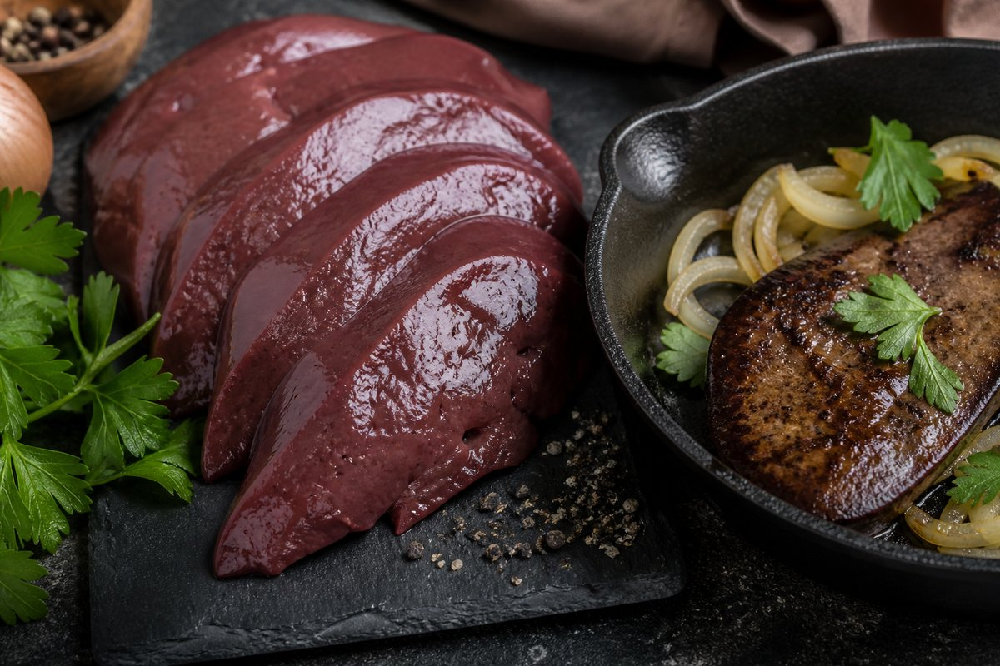

*▲ 소간 생것 100g은 135kcal, 단백질 20.4g, 철분 4.9mg, 비타민A 4,968μg RAE입니다. 비타민A는 100g 한 번으로 성인 상한섭취량(3,000μg)을 넘습니다.*

한 줄 결론 <strong>소간(쇠간) 생것 100g은 135kcal에 단백질 20.4g, 철분 4.9mg, 비타민B12 59.3μg, 비타민A 4,968μg RAE, 구리 9.76mg입니다.</strong> 영양 밀도로는 최상위 식품이지만, <strong>비타민A는 이 한 번으로 성인 상한섭취량(3,000μg RAE)의 1.66배</strong>가 되고 <strong>구리도 상한(10mg)에 닿습니다</strong>. 그래서 소간은 <strong>'100g씩 먹는 식품'이 아니라 1회 50g, 주 1회 이하로 쓰는 농축 식품</strong>입니다. 임신 중에는 섭취를 피하는 것이 국제 권고의 기본입니다.

쇠간은 소의 간을 이르는 말로, 마트에서는 보통 <strong>'소간'</strong>으로 표기됩니다. 선지해장국에 들어가고, 간전·간장전으로 부쳐 먹으며, 볶음이나 회(생간)로도 소비됩니다. 같은 부위를 쓰는 요리라도 조리법에 따라 열량과 영양 밀도가 크게 달라집니다.

소간에 대한 정보는 양극단으로 갈립니다. 한쪽은 "철분과 비타민A가 가장 많은 슈퍼푸드"라 하고, 다른 쪽은 "독소가 쌓이는 부위"라 합니다. 둘 다 절반만 맞습니다. <strong>소간은 실제로 영양이 압도적으로 많은 식품이고, 동시에 상한섭취량을 쉽게 넘기는 식품</strong>입니다. 이 글은 그 두 사실을 숫자로 정리합니다.

---

## 1. 소간 칼로리와 영양성분 (생것 100g 135kcal)

아래 수치는 <strong>농촌진흥청 국가표준식품성분 DB의 '소 부산물, 간, 생것' 가식부 100g</strong> 기준이며, USDA FoodData Central(원료 169451) 값과 일치합니다. 비율은 식품의약품안전처 1일 영양성분 기준치(2,000kcal)로 계산했습니다.

| 영양 성분 (Nutrient) | 함량 (100g당) | 1일 기준치 비율 (2,000kcal 기준) |
| :--- | :--- | :--- |
| **열량 (Energy)** | 135 kcal | 6.8% |
| **수분 (Water)** | 70.8 g | 별도 표기¹ |
| **탄수화물 (Carbohydrates)** | 3.9 g | 1.2% |
| - 당류 (Sugars) | 0 g | 0.0% |
| **단백질 (Protein)** | 20.4 g | 37.1% |
| **지방 (Total Fat)** | 3.6 g | 6.7% |
| - 포화지방 (Saturated Fat) | 1.2 g | 8.2% |
| **콜레스테롤 (Cholesterol)** | 275 mg | 91.7% |
| **나트륨 (Sodium)** | 69 mg | 3.5% |
| **칼륨 (Potassium)** | 313 mg | 8.9% |
| **칼슘 (Calcium)** | 5 mg | 0.7% |
| **인 (Phosphorus)** | 387 mg | 55.3% |
| **철분 (Iron)** | 4.9 mg | 40.8% |
| **아연 (Zinc)** | 4.0 mg | 47.1% |
| **구리 (Copper)** | 9.76 mg | 별도 표기¹ |
| **셀레늄 (Selenium)** | 39.7 µg | 72.2% |
| **비타민A (Vitamin A)** | 4,968 µg RAE | 709.7% |
| **비타민B1 (Thiamin)** | 0.19 mg | 15.8% |
| **비타민B2 (Riboflavin)** | 2.75 mg | 196.4% |
| **나이아신 (Niacin)** | 13.2 mg | 88.0% |
| **비타민B6 (Vitamin B6)** | 1.08 mg | 72.0% |
| **엽산 (Folate)** | 290 µg DFE | 72.5% |
| **비타민B12 (Vitamin B12)** | 59.3 µg | 2,470.8% |
| **판토텐산 (Pantothenic Acid)** | 7.17 mg | 143.4% |
| **비타민C (Vitamin C)** | 1.3 mg | 1.3% |
| **비타민D (Vitamin D)** | 1.2 µg | 12.0% |
| **비타민E (Vitamin E)** | 0.4 mg | 3.6% |
| **콜린 (Choline)** | 333 mg | 별도 표기¹ |

¹ 수분·구리·콜린은 1일 기준치가 설정되지 않은 항목입니다. 구리와 비타민A는 기준치보다 <strong>상한섭취량</strong>과 비교해야 합니다. 비타민A의 미국 %DV는 900μg RAE를 기준으로 해서 <strong>552%</strong>로 표시됩니다. 국내 기준치(700μg RAE)로 계산하면 709.7%입니다.

*※ 출처: [USDA FoodData Central FDC 169451](https://fdc.nal.usda.gov/food-details/169451/nutrients) — Beef, variety meats and by-products, liver, raw (SR Legacy). 표의 100g당 열량 135 kcal과 단백질 20.4 g은 이 항목의 값이며, 조리 상태가 다르면 값도 달라집니다.*

### 표 읽는 법: 100g에 하루치가 여러 개 들어 있습니다

이 표는 <strong>단백질 식품표가 아니라 농축 미량영양소표</strong>입니다. 열량은 135kcal로 닭가슴살보다 낮은데, 비타민과 미네랄은 몇 배에서 수십 배입니다.

- <strong>비타민B12 59.3μg:</strong> 1일 기준치(2.4μg)의 <strong>24.7배</strong>입니다.
- <strong>비타민A 4,968μg RAE:</strong> 기준치의 7배, <strong>상한섭취량(3,000μg)의 1.66배</strong>입니다.
- <strong>구리 9.76mg:</strong> 미국 상한섭취량 10mg에 <strong>거의 도달</strong>합니다.
- <strong>리보플라빈 2.75mg·판토텐산 7.17mg:</strong> 각각 기준치의 2배·1.4배입니다.

반대로 <strong>칼슘 5mg, 비타민C 1.3mg</strong>은 거의 없습니다. 소간을 <strong>비타민A·B12·구리·철의 공급원</strong>으로 보고, 다른 영양소는 다른 식품에서 채우는 구성이 맞습니다.

### 1회 50g으로 환산하면 얼마나 될까

한국인이 한 끼에 먹는 소간 양은 30~50g 정도입니다. 간전 한 조각, 선지해장국에 든 간 몇 점이 이 범위입니다.

- <strong>50g:</strong> 68kcal, 단백질 10.2g, 철분 2.5mg, 비타민B12 29.7μg, 비타민A 2,484μg RAE, 구리 4.9mg, 콜레스테롤 138mg.
- <strong>30g:</strong> 41kcal, 단백질 6.1g, 철분 1.5mg, 비타민A 1,490μg RAE.

<strong>50g만 먹어도 비타민A는 상한의 83%</strong>입니다. 같은 날 다른 식사에서 달걀·버터·강화우유를 먹으면 쉽게 넘습니다. 소간의 적정량을 정할 때 기준이 되는 숫자가 이것입니다.

### 생것과 구운 간, 100g당 영양은 어떻게 달라지나

| 구분 | 열량 | 단백질 | 지방 | 콜레스테롤 | 비타민A | 구리 |
| :--- | :--- | :--- | :--- | :--- | :--- | :--- |
| **생것 100g** | 135 kcal | 20.4 g | 3.6 g | 275 mg | 4,968 µg RAE | 9.76 mg |
| **팬구이 100g** | 175 kcal | 26.5 g | 4.7 g | 381 mg | 7,744 µg RAE | 14.59 mg |

표의 차이는 <strong>조리 중 수분이 빠져 같은 무게에 고기가 더 담기기 때문</strong>입니다. 생것 100g을 구우면 무게가 70~80g으로 줄어, 구운 100g은 생것 <strong>130g 분량</strong>에 해당합니다. 그래서 "구운 간 100g"의 비타민A와 구리는 생것 100g보다 훨씬 많습니다.

---

## 2. 소간의 4가지 건강 포인트와 근거 수준

### 비타민A 4,968μg, 시력과 면역에는 필요하지만 상한이 문제다

비타민A는 망막의 로돕신 합성, 상피세포 유지, 면역 기능에 필수입니다. 결핍되면 야맹증과 감염 취약성이 생깁니다. 소간은 이 비타민을 <strong>가장 농축한 식품</strong> 중 하나입니다.

문제는 비타민A가 <strong>지용성이라 체내에 축적된다</strong>는 점입니다. NIH 식이보충제 사무국(ODS)은 성인 상한섭취량을 <strong>하루 3,000μg RAE</strong>로 제시합니다. 소간 100g의 4,968μg은 이 선을 넘습니다. 만성 과잉은 두통, 피부 건조와 가려움, 식욕 저하, 간 효소 상승, <strong>골밀도 감소</strong>로 이어질 수 있습니다.

임신 중에는 기준이 더 엄격합니다. <strong>임신 초기 고용량의 레티놀(동물성 비타민A)은 태아 기형 위험과 연관</strong>됩니다. 그래서 여러 보건기관은 임신 중 <strong>간과 간 제품(간장·파테 포함)을 제한하거나 피하도록</strong> 안내합니다. 임신을 준비하거나 임신 중이라면 소간 섭취는 주치의와 먼저 상의하세요.

반대로 <strong>베타카로틴(식물성 비타민A)은 필요할 때만 전환</strong>되므로 당근·시금치로는 이 상한 문제가 생기지 않습니다. 소간의 위험은 <strong>이미 활성형인 레티놀을 대량으로 먹는 데서</strong> 옵니다.

### 비타민B12 59.3μg와 리보플라빈, 신경과 조혈의 핵심

비타민B12는 신경 수초 형성과 적혈구 성숙에 필요합니다. 결핍되면 빈혈과 말초신경 증상이 생기고, 고령자·채식인·위 절제 수술을 받은 사람에서 흔합니다.

소간 100g의 B12 59.3μg은 기준치의 24.7배입니다. 다만 <strong>한 번에 흡수되는 양에는 한계</strong>가 있습니다. B12는 위의 내인성인자와 결합해 회장에서 흡수되는 경로가 <strong>1회 1~2μg 수준에서 포화</strong>되고, 나머지는 수동 확산으로 1% 안팎만 흡수됩니다. 그래서 59μg을 먹어도 체내에 모두 들어가지는 않습니다.

리보플라빈 2.75mg(기준치의 2배)은 에너지 대사와 항산화 효소의 조효소로 쓰입니다. 소간이 <strong>'B군 비타민 덩어리'</strong>라고 불리는 이유가 여기에 있습니다.

### 헴철 4.9mg, 흡수율이 다른 철분이다

식품의 철은 <strong>헴철</strong>(동물성)과 <strong>비헴철</strong>(식물성)로 나뉩니다. 문헌이 제시하는 흡수율 범위는 헴철 <strong>15~35%</strong>, 비헴철 2~20%입니다(Hurrell &amp; Egli, Am J Clin Nutr 2010). 단일 값이 아니라 측정 조건에 따라 갈리는 범위이며, 실제 흡수량은 개인의 철 상태와 같은 끼니의 구성(비타민C·탄닌·칼슘)에 따라 크게 달라집니다. 소간의 철 4.9mg은 전부에 가깝게 헴철입니다.

그래서 숫자만 비교하면 착각하기 쉽습니다. 시금치 100g의 철은 2.7mg으로 소간의 절반이지만, <strong>옥살산에 묶여 흡수율이 낮습니다</strong>. 소간 50g(철 2.5mg)이 시금치 100g보다 실제로 흡수되는 철이 많을 수 있습니다. 철결핍 빈혈을 진단받은 사람에게 소간이 자주 권해지는 이유입니다.

다만 <strong>헤모크로마토시스</strong>처럼 철 대사 이상이 있는 사람에게는 반대입니다. 철이 과잉 축적되는 질환이 있으면 소간을 피해야 합니다.

### 구리 9.76mg과 콜린 333mg, 상한에 가까운 미량영양소

구리는 철의 운반과 콜라겐 합성, 항산화 효소(SOD) 작용에 필요합니다. 결핍은 드물지만, 과잉은 <strong>간 손상과 신경 증상</strong>을 일으킵니다. 미국 상한섭취량은 <strong>하루 10mg</strong>이고, 소간 100g의 9.76mg은 여기에 거의 닿습니다.

특히 <strong>윌슨병</strong>(구리 대사 이상 질환)이 있는 사람은 소간을 절대 피해야 합니다. 일반인도 소간을 매일 먹으면 구리가 누적될 수 있습니다.

콜린 333mg은 세포막 구성과 간의 지방 운반에 관여합니다. 미국 기준(남 550mg)의 61%로, <strong>간 건강과 관련해 소간의 덜 알려진 장점</strong>입니다. 다만 콜린은 계란·대두로도 충분히 채울 수 있습니다.

---

## 3. 소간 조리·섭취 가이드

- <strong>1회 50g, 주 1회 이하를 기준으로 잡으세요.</strong> 비타민A와 구리 상한 때문입니다. 50g이면 간전 한 조각, 해장국 간 몇 점 정도입니다.
- <strong>우유나 소금물에 20~30분 담그세요.</strong> 남은 혈액과 비린내가 빠져 맛이 부드러워집니다. 담근 뒤 물기를 닦고 조리합니다.
- <strong>두께 1cm로 썰어 센 불에서 앞뒤 1분 30초씩</strong> 익히세요. 속까지 익히면서 촉촉함을 남기는 방법입니다. 오래 익히면 단단해지고 퍽퍽해집니다.
- <strong>중심 온도 71℃ 이상</strong>을 확인하세요. 덜 익힌 간은 세균·바이러스 위험이 있어 생간은 권하지 않습니다.
- <strong>간전은 열량이 올라갑니다.</strong> 밀가루와 달걀물을 입히면 100g당 열량이 1.5~2배가 됩니다. 열량을 관리한다면 밀가루 없이 구이나 볶음으로 드세요.
- <strong>식사에 비타민C를 곁들이세요.</strong> 소간의 헴철 흡수는 이미 좋지만, 같은 끼의 식물성 철 흡수를 돕고 전체 철 균형에 유리합니다. 파프리카·양파·레몬이 실용적입니다.
- <strong>차와 커피는 식후 1시간 뒤에.</strong> 탄닌과 폴리페놀이 철 흡수를 방해합니다. 다만 헴철에는 영향이 작아 소간 섭취 후에는 치명적이지 않습니다.
- <strong>보관은 냉동 -18℃에서 2주 이내.</strong> 해동은 냉장실에서 천천히 하고, 해동한 간은 다시 얼리지 마세요.

---

## 4. 섭취 시 주의사항 및 부작용

- <strong>임신·수유:</strong> 레티놀 과잉이 태아 기형과 연관됩니다. 임신 중에는 소간과 간 제품을 피하고, 필요하면 주치의와 상의하세요.
- <strong>비타민A 과잉:</strong> 100g 한 번으로 상한을 넘습니다. 매일 먹으면 두통, 피부 건조, 간 효소 상승, 골밀도 감소가 나타날 수 있습니다.
- <strong>윌슨병:</strong> 구리 대사 이상 질환에서는 소간이 금기입니다. 구리 9.76mg은 상한에 가까운 양입니다.
- <strong>통풍·고요산혈증:</strong> 간은 <strong>퓨린이 매우 많은 부위</strong>입니다. 급성 통풍 발작기에는 피하고, 평소에도 소량만 드세요.
- <strong>고지혈증·심혈관 질환:</strong> 콜레스테롤 275mg과 포화지방 1.2g이 들어 있습니다. 하루 콜레스테롤 300mg을 권고받는 경우 소간 한 번으로 대부분을 쓰게 됩니다.
- <strong>철 과잉(헤모크로마토시스):</strong> 철이 축적되는 질환이 있으면 소간을 피해야 합니다.
- <strong>"간에 독소가 쌓인다"는 절반만 맞습니다.</strong> 간은 독소를 <strong>처리하는 기관</strong>이지 저장고가 아닙니다. 다만 카드뮴 같은 중금속은 간·신장에 축적될 수 있어, 국내 유통 제품은 기준치 이내로 관리됩니다. 출처가 불분명한 수입 간은 피하는 편이 좋습니다.
- <strong>조리 전 위생:</strong> 생간을 만진 손과 도마는 세척하고, 다른 식재료와 분리하세요.

---

## 5. 자주 묻는 질문 (FAQ)

**Q1. 소간 100g을 매일 먹어도 되나요?**  
권하지 않습니다. 소간 100g의 비타민A 4,968μg RAE는 성인 상한섭취량(3,000μg)의 1.66배이고 구리 9.76mg도 상한(10mg)에 닿습니다. 1회 50g, 주 1회 이하를 기준으로 하고, 임신 중에는 섭취를 피하세요.

**Q2. 소간의 철분은 흡수가 잘 되나요?**  
소간의 철은 대부분 헴철이고, 문헌에서 인용하는 헴철 흡수율 범위(15~35%)는 비헴철(2~20%)보다 높습니다. 다만 실제 흡수량은 개인의 철 상태와 식사 구성에 따라 달라지며, 차·커피의 탄닌은 철 흡수를 방해하므로 식후 1시간은 피하는 편이 좋습니다.

**Q3. 간에 독소가 쌓인다는 말이 사실인가요?**  
간은 독소를 처리하는 기관이지 독소를 저장하는 곳이 아닙니다. 다만 카드뮴 같은 중금속이 간에 축적될 수 있어, 국내 유통 제품은 기준치 이내로 관리됩니다. 출처가 분명한 제품을 고르고 1회 50g 이내로 드세요.

---

## 6. 소간과 함께 먹으면 좋은 음식

- <strong>[파프리카 (Bell Pepper)](/posts/bell-pepper-nutrition-benefits/):</strong> 파프리카 100g의 비타민C는 100mg대로, 같은 끼에 먹은 식물성 철의 흡수를 돕습니다. 소간 볶음에 파프리카를 넣으면 색과 영양이 모두 채워집니다.
- <strong>[시금치 (Spinach)](/posts/spinach-nutrition-benefits/):</strong> 시금치는 철과 엽산이 많지만 옥살산 때문에 흡수율이 낮습니다. 소간과 함께 먹으면 헴철이 주력이 되고 시금치는 엽산·식이섬유를 담당하는 구성이 됩니다.
- <strong>[무 (Radish)](/posts/radish-nutrition-benefits/):</strong> 무의 소화효소는 간의 단단한 조직을 부드럽게 하고, 칼륨이 국물의 나트륨과 균형을 이룹니다. 선지해장국에 무를 넣는 이유입니다.

  
📌 관련 순위 가이드

  <ul>
    <li><a href="/posts/liver-immunity-fatigue-recovery-foods/">간·면역·피로 회복에 좋은 음식</a></li>
    <li><a href="/posts/high-protein-foods-ranking/">단백질 많은 음식 순위</a></li>
  </ul>

---

## 7. 소간 어떻게 먹을까? 핵심 요약

- 소간 생것 100g은 <strong>135kcal, 단백질 20.4g, 철분 4.9mg, 비타민B12 59.3μg</strong>입니다.
- <strong>비타민A 4,968μg RAE는 상한(3,000μg)의 1.66배</strong>, <strong>구리 9.76mg은 상한(10mg)에 도달</strong>합니다. 1회 50g이 기준입니다.
- 50g이면 <strong>68kcal, 철 2.5mg, 비타민A 2,484μg(상한의 83%)</strong>입니다.
- 철은 대부분 <strong>헴철</strong>이며, 문헌상 흡수율 범위는 15~35%입니다. 철결핍 빈혈 식사에 실질적이지만, 헤모크로마토시스에서는 피합니다.
- <strong>임신 중에는 간과 간 제품을 피하세요.</strong> 레티놀 과잉이 태아 기형과 연관됩니다.
- <strong>통풍·윌슨병·고지혈증</strong>이 있으면 소량만, 또는 피하세요.
- <strong>우유에 30분 담그고 1cm 두께로 센 불 1분 30초</strong>, 중심 71℃ 이상이 조리의 기본입니다.

**추가 근거:** [NIH 식이보충제 사무국 비타민A 사실표](https://ods.od.nih.gov/factsheets/VitaminA-HealthProfessional/)(상한 3,000μg RAE·임신 중 주의), [USDA FoodData Central](https://fdc.nal.usda.gov/)(원료 간 169451·팬구이 168627), 농촌진흥청 국가표준식품성분 DB '소 부산물, 간, 생것', 헴철·비헴철 흡수율 범위는 [Hurrell R, Egli I. Iron bioavailability and dietary reference values. Am J Clin Nutr 2010;91(5):1461S-1467S](https://doi.org/10.3945/ajcn.2010.28674f).
