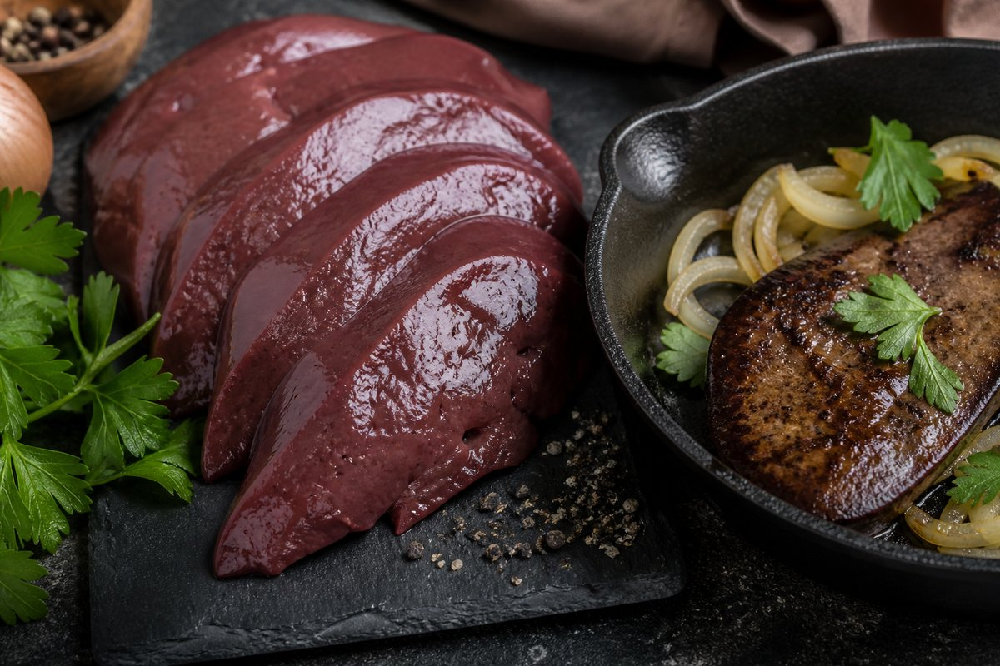

*▲ Raw beef liver is 135 kcal per 100 g, with 20.4 g protein, 4.9 mg iron, 59.3 µg vitamin B12 and 4,968 µg RAE vitamin A — more than 1.6 times the adult upper limit for vitamin A in a single portion.*

Quick answer <strong>Raw beef liver provides 135 calories, 20.4 g protein, 4.9 mg iron (27% DV), 59.3 µg vitamin B12 (2,471% DV), 9.76 mg copper (1,084% DV) and 4,968 µg RAE vitamin A (552% DV) per 100 g.</strong> It is one of the most nutrient-dense foods available, and it is also one of the few foods where a normal portion exceeds a safety ceiling: <strong>100 g delivers 1.66 times the adult upper limit for preformed vitamin A (3,000 µg RAE) and nearly the entire 10 mg upper limit for copper</strong>. Beef liver is a <strong>50 g, once-a-week food</strong>, and it is avoided in pregnancy.

Beef liver is the organ that processes everything the animal absorbs: it stores iron, converts carotene into retinol, packages vitamin B12 and detoxifies compounds arriving from the gut. That metabolic role is exactly why its nutrient density is unmatched — and why the “liver stores toxins” claim is only half true.

The internet treats liver in extremes. One camp calls it nature's multivitamin; another calls it a toxin sponge. The data support a narrower conclusion: <strong>liver is extremely nutrient-dense, and its limiting factor is not protein or iron but vitamin A and copper</strong>. This article lays out the numbers, then the portion size they imply.

---

## 1. Beef Liver Nutrition Facts (per 100 g)

Values are from the USDA FoodData Central SR Legacy entry for raw beef liver (FDC 169451), edible portion. Percentages use U.S. Daily Values for a 2,000-calorie diet.

| Nutrient | Per 100 g | U.S. %DV |
| :--- | :--- | :--- |
| Energy | 135 kcal | 7% |
| Water | 70.81 g | No DV¹ |
| Protein | 20.36 g | 41% |
| Total fat | 3.63 g | 5% |
| — Saturated fat | 1.23 g | 6% |
| Total carbohydrate | 3.89 g | 1% |
| — Dietary fiber | 0 g | 0% |
| — Total sugars | 0 g | No DV¹ |
| Cholesterol | 275 mg | 92% |
| Sodium | 69 mg | 3% |
| Potassium | 313 mg | 7% |
| Calcium | 5 mg | 0% |
| Iron | 4.9 mg | 27% |
| Magnesium | 18 mg | 4% |
| Phosphorus | 387 mg | 31% |
| Zinc | 4.0 mg | 36% |
| Copper | 9.755 mg | 1,084% |
| Manganese | 0.31 mg | 13% |
| Selenium | 39.7 µg | 72% |
| Vitamin A (RAE) | 4,968 µg | 552% |
| Thiamin (B1) | 0.189 mg | 16% |
| Riboflavin (B2) | 2.755 mg | 212% |
| Niacin (B3) | 13.175 mg | 82% |
| Pantothenic acid (B5) | 7.173 mg | 143% |
| Vitamin B6 | 1.083 mg | 64% |
| Folate | 290 µg DFE | 73% |
| Vitamin B12 | 59.3 µg | 2,471% |
| Choline | 333.3 mg | 61% |
| Vitamin C | 1.3 mg | 1% |
| Vitamin D | 1.2 µg | 6% |
| Vitamin E | 0.38 mg | 3% |
| Vitamin K | 3.1 µg | 3% |

¹ Water and total sugars have no Daily Value. Vitamin A's %DV uses the FDA reference of 900 µg RAE; the adult upper limit is a separate figure of <strong>3,000 µg RAE per day</strong>, and 100 g of liver provides 1.66 times that. Copper has a Daily Value of 0.9 mg and an upper limit of <strong>10 mg per day</strong>; 100 g supplies 9.76 mg.

### How to read the table

- <strong>The calorie count is low; the micronutrient count is not.</strong> At 135 kcal per 100 g, liver has fewer calories than chicken breast, while carrying 24 times the vitamin B12 and nearly 1,100% DV of copper.
- <strong>Vitamin A is the number that sets the portion size.</strong> Everything else in the table could be eaten daily without concern.
- <strong>Riboflavin at 212% DV and pantothenic acid at 143% DV</strong> explain why liver is called a B-vitamin concentrate: one small portion covers the B-complex for days.
- <strong>Cholesterol is 275 mg</strong> — 92% of the 300 mg daily figure still used on labels, though dietary cholesterol now has no strict U.S. limit for healthy adults.
- <strong>Iron is 4.9 mg but almost entirely heme iron</strong>, absorbed at 15–35% rather than the 2–20% typical of plant iron. The effective dose is far higher than the milligram figure suggests.
- <strong>Calcium and vitamin C are negligible.</strong> Liver is not a complete food, despite the marketing.

### What a 50 g portion actually delivers

Most people eat liver in 30–50 g increments: a slice of pan-fried liver, a few pieces in a soup, a spoonful of pâté.

- <strong>50 g:</strong> 68 kcal, 10.2 g protein, 2.45 mg iron, 29.7 µg B12, 2,484 µg RAE vitamin A (83% of the upper limit), 4.9 mg copper, 138 mg cholesterol.
- <strong>30 g:</strong> 41 kcal, 6.1 g protein, 1.47 mg iron, 1,490 µg RAE vitamin A (50% of the upper limit).

Even 50 g uses 83% of the vitamin A ceiling for the day. Add an egg, butter, whole milk or a fortified cereal and the limit is passed without any obvious sign.

### Raw versus pan-fried: why the cooked numbers are higher

| Form | Energy | Protein | Fat | Cholesterol | Vitamin A | Copper |
| :--- | :--- | :--- | :--- | :--- | :--- | :--- |
| Raw, 100 g | 135 kcal | 20.4 g | 3.6 g | 275 mg | 4,968 µg RAE | 9.76 mg |
| Pan-fried, 100 g | 175 kcal | 26.5 g | 4.7 g | 381 mg | 7,744 µg RAE | 14.59 mg |

Cooking removes water, so 100 g of cooked liver represents roughly 130 g of raw liver. The cooked column is not a different food; it is a more concentrated version of the same one. Anyone counting vitamin A should weigh liver <strong>raw</strong>, before cooking.

---

## 2. Four Evidence-Based Health Points

### Vitamin A: essential, and the reason liver has a ceiling

Vitamin A is required for rhodopsin formation in the retina, epithelial integrity, immune function and reproduction. Preformed vitamin A (retinol) from animal foods is absorbed efficiently — typically 70–90% — and stored in the liver.

The NIH Office of Dietary Supplements sets the adult upper intake level at <strong>3,000 µg RAE per day</strong> for preformed vitamin A. Chronic excess causes headaches, dry and itchy skin, hair loss, anorexia, raised liver enzymes, and <strong>reduced bone mineral density</strong> with higher fracture risk. Acute toxicity produces nausea, blurred vision and dizziness within hours.

Pregnancy is where the ceiling matters most. <strong>High-dose retinol in early pregnancy is associated with birth defects</strong>, which is why public health agencies in the UK and elsewhere advise pregnant women to avoid liver and liver products, including liver pâté and liver sausage. A 50 g portion of beef liver is roughly 2,500 µg RAE — close to the limit before any other source is counted.

Beta-carotene from plants does not create this problem, because conversion to retinol is regulated by the body. The risk is specific to <strong>preformed retinol taken in large single doses</strong>.

### Vitamin B12 and riboflavin: nerve and red-cell infrastructure

Vitamin B12 is required for myelin synthesis and red blood cell maturation. Deficiency causes megaloblastic anemia and peripheral neuropathy, and it is common in older adults, vegans, and anyone after gastric surgery or long-term metformin use.

Liver's 59.3 µg per 100 g is 2,471% DV. Absorption, however, is capped: the intrinsic-factor pathway saturates at roughly <strong>1–2 µg per dose</strong>, and the remainder crosses passively at about 1%. A 50 g portion therefore delivers far more than the body will absorb in one sitting — which is why liver is an efficient but not unlimited B12 strategy.

Riboflavin at 2.755 mg per 100 g (212% DV) is a cofactor for the electron transport chain and for glutathione recycling. Together with niacin, B6, folate and pantothenic acid, it makes liver the densest B-complex food in ordinary diets.

### Heme iron: the part of liver that changes clinical advice

Iron in food comes in two forms. Heme iron, bound in hemoglobin and myoglobin, is absorbed at <strong>15–35%</strong>. Non-heme iron from plants is absorbed at 2–20% depending on the meal, and is inhibited by phytates, calcium and polyphenols.

Liver's 4.9 mg is nearly all heme. That makes it one of the most effective foods for iron-deficiency anemia, which affects roughly a third of women of reproductive age worldwide. Comparing milligrams across foods is misleading: 50 g of liver (2.45 mg heme iron) can deliver more absorbed iron than 100 g of spinach (2.7 mg non-heme iron, much of it bound by oxalate).

The exception is hereditary hemochromatosis and other iron-loading conditions, where any heme-rich food must be limited.

### Copper and choline: the nutrients nobody counts

Copper is required for ceruloplasmin (iron export from cells), collagen cross-linking, and superoxide dismutase. The U.S. upper limit is <strong>10 mg per day</strong>; liver's 9.755 mg per 100 g nearly reaches it in one serving. Chronic copper excess causes liver damage and neurological symptoms, and in <strong>Wilson disease</strong> — a genetic disorder of copper excretion — liver is effectively contraindicated.

Choline, at 333 mg per 100 g (61% DV), is the least discussed benefit. It is needed for cell membranes, neurotransmitter synthesis and <strong>hepatic lipid export</strong>, and most people do not meet the adequate intake. Eggs and soy are the usual sources; liver is the densest.

---

## 3. Prep and Cooking Guide

- <strong>Set the portion before you cook: 50 g per person, once a week.</strong> That keeps vitamin A near 2,500 µg RAE and copper near 5 mg, leaving room for the rest of the day.
- <strong>Soak in milk or salted water for 20–30 minutes.</strong> This draws out residual blood and reduces the metallic bitterness. Pat dry before searing, or the surface will steam instead of browning.
- <strong>Slice 1 cm thick and sear 90 seconds per side over high heat.</strong> Liver should be just set in the center — grey and springy, not dry. Overcooking turns it chalky and grainy.
- <strong>Cook to at least 71°C (160°F) in the center.</strong> Undercooked liver carries a real risk of bacterial infection and, for pork liver in particular, hepatitis E. Raw liver dishes are not a safe home preparation.
- <strong>Keep the flour and egg wash for occasional frying.</strong> Breading roughly doubles the calories per 100 g. For a lighter plate, sear with onions and finish with vinegar or lemon.
- <strong>Add vitamin C at the same meal.</strong> Peppers, onions or a squeeze of lemon improve non-heme iron absorption from any plant food on the plate and support the overall iron balance.
- <strong>Move tea and coffee an hour away.</strong> Tannins and polyphenols inhibit iron absorption; the effect on heme iron is smaller but still measurable.
- <strong>Freeze raw liver at −18°C for up to two months</strong>, wrapped tightly. Thaw in the refrigerator and never refreeze.
- <strong>Handle it like raw poultry.</strong> Separate board, wash hands and surfaces, and do not let juices contact ready-to-eat food.

---

## 4. Cautions and Side Effects

- <strong>Pregnancy and breastfeeding:</strong> avoid liver and liver products. Preformed vitamin A in high doses is linked to birth defects; the upper limit does not increase during pregnancy.
- <strong>Vitamin A toxicity:</strong> 100 g exceeds the adult upper limit. Daily consumption can cause headaches, skin changes, liver enzyme elevation and bone loss.
- <strong>Wilson disease:</strong> liver is contraindicated because of its copper content (9.755 mg per 100 g against a 10 mg upper limit).
- <strong>Gout and hyperuricemia:</strong> organ meats are among the highest-purine foods. Avoid during flares and keep portions small otherwise.
- <strong>Iron-loading disorders:</strong> hereditary hemochromatosis and repeated transfusions require limiting heme iron.
- <strong>Cholesterol and saturated fat:</strong> 275 mg cholesterol and 1.23 g saturated fat per 100 g matter for people on a strict lipid-lowering diet.
- <strong>“Liver stores toxins” is half true.</strong> The liver detoxifies compounds; it does not warehouse them. It can, however, accumulate cadmium and other heavy metals over an animal's lifetime, which is why commercial supplies are monitored against residue limits. Buying from suppliers who publish testing is reasonable.
- <strong>Vitamin A supplements:</strong> do not stack a liver meal with a high-dose retinol supplement or cod liver oil — the totals add up faster than most labels suggest.

---

## 5. Frequently Asked Questions

**Is it safe to eat beef liver every day?**  
Daily 100 g portions are not advisable: one 100 g serving supplies 4,968 µg RAE of vitamin A, 1.66 times the 3,000 µg upper limit, and 9.76 mg copper against a 10 mg limit. A 50 g portion once a week is a more defensible pattern, and pregnancy is a reason to avoid liver entirely.

**Is the iron in beef liver well absorbed?**  
Yes. Almost all of liver's 4.9 mg iron per 100 g is heme iron, absorbed at 15–35%, compared with 2–20% for plant iron. Tea and coffee reduce absorption, so keep them an hour away from the meal.

**Does liver store toxins?**  
The liver processes and detoxifies compounds rather than storing them, so the common claim is misleading. It can accumulate cadmium and other heavy metals over time, which is why marketed liver is tested against residue limits. Choose a traceable source and keep portions to 50 g.

---

## 6. Synergistic Food Pairings

- **[Bell Pepper](/en/posts/bell-pepper-nutrition-benefits/):** peppers add 80–130 mg vitamin C per 100 g, which improves non-heme iron absorption from the rest of the plate and gives a liver stir-fry color and crunch without extra fat.
- **[Spinach](/en/posts/spinach-nutrition-benefits/):** spinach contributes folate and fiber while its oxalates limit its own iron. Paired with liver, the heme iron does the heavy lifting and the spinach adds volume.
- **[Beef Sirloin](/en/posts/beef-sirloin-nutrition-benefits/):** for people who want red meat without the vitamin A load, sirloin supplies heme iron and zinc at a fraction of liver's retinol — a useful comparison when planning weekly iron intake.

  
📌 Related ranking guides

  <ul>
    <li><a href="/en/posts/liver-immunity-fatigue-recovery-foods/">Foods for liver, immunity and fatigue recovery</a></li>
    <li><a href="/en/posts/high-protein-foods-ranking/">High-protein foods ranked</a></li>
  </ul>

---

## 7. Key Takeaways

- Raw beef liver is **135 kcal, 20.4 g protein, 4.9 mg iron, 59.3 µg B12 and 4,968 µg RAE vitamin A** per 100 g.
- **Vitamin A is the limiting nutrient**: 100 g is 1.66 times the 3,000 µg upper limit. **Copper at 9.76 mg** nearly reaches its 10 mg limit.
- **50 g** supplies 68 kcal, 2.45 mg iron and 2,484 µg RAE vitamin A — still 83% of the daily ceiling.
- **Almost all of the iron is heme iron**, absorbed at 15–35%, which is why liver outperforms iron-matched plant foods.
- **Avoid liver in pregnancy** because of preformed vitamin A, and in **Wilson disease** because of copper.
- **Weigh it raw**: pan-fried 100 g equals about 130 g of raw liver and concentrates the vitamin A.
- **Soak 20–30 minutes, sear 1 cm slices 90 seconds a side, cook to 71°C**, and keep tea and coffee an hour away.

**Additional references:** [NIH Office of Dietary Supplements, vitamin A fact sheet](https://ods.od.nih.gov/factsheets/VitaminA-HealthProfessional/) (upper limit 3,000 µg RAE, pregnancy caution) and [USDA FoodData Central](https://fdc.nal.usda.gov/) entries for raw liver (FDC 169451) and pan-fried liver (FDC 168627).
