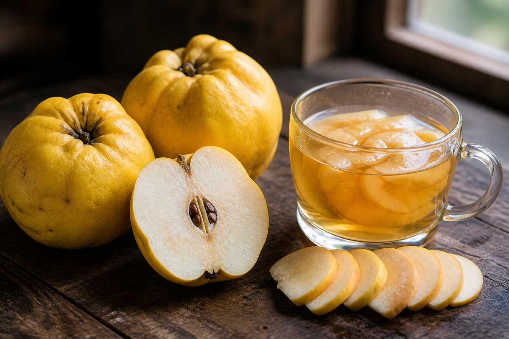

*▲ Raw quince is 57 kcal per 100 g, with 15 mg vitamin C, 197 mg potassium and 1.9 g fiber. Almost nobody eats 100 g raw — the fruit is hard, astringent and usually cooked.*

Quick answer <strong>Raw quince provides 57 calories, 0.4 g protein, 15.3 g carbohydrate, 1.9 g fiber, 15 mg vitamin C (17% DV), 197 mg potassium and 11 mg calcium per 100 g.</strong> Those numbers describe a fruit that is almost never eaten raw: the flesh is woody and astringent until heat and sugar break down its tannins. The form most people actually consume is <strong>quince paste or quince tea</strong>, where a single tablespoon of 1:1 sugar preserve carries about <strong>10 g of sugar</strong> and roughly 5 g of fruit. Quince is a <strong>pectin and aroma ingredient</strong>, not a vitamin-C vehicle.

Quince (*Cydonia oblonga*) is a pome fruit in the rose family, ripe from late September through November in the northern hemisphere. The Korean and Japanese fruit sold as *mogwa* is a close relative, *Pseudocydonia sinensis* (Chinese quince), with the same hard flesh, dense perfume and high pectin.

That distinction matters more than it sounds, because the nutrition tables differ. USDA lists raw quince at 57 kcal and 15 mg vitamin C per 100 g. Korea's national food composition table lists *mogwa* at 78 kcal and 81 mg vitamin C. Both are real measurements of related but different fruit, taken decades apart — a point this article returns to below.

The practical questions people ask are narrow: <strong>“Is quince healthy?”</strong>, <strong>“Can you eat quince raw?”</strong>, <strong>“Does quince tea help a cough?”</strong> and <strong>“How much sugar is in quince paste?”</strong> The short answers: yes, with caveats; technically but rarely; not on the strength of human evidence; and about 10 g per tablespoon.

---

## 1. Quince Nutrition Facts (per 100 g)

Values below are from the USDA FoodData Central SR Legacy entry for raw quinces (FDC 168163), edible portion.

| Nutrient | Per 100 g | U.S. %DV |
| :--- | :--- | :--- |
| Energy | 57 kcal | 3% |
| Water | 83.8 g | No DV¹ |
| Protein | 0.4 g | 1% |
| Total fat | 0.1 g | 0% |
| Total carbohydrate | 15.3 g | 6% |
| — Dietary fiber | 1.9 g | 7% |
| — Total sugars | No DV¹ | No DV¹ |
| Calcium | 11 mg | 1% |
| Iron | 0.7 mg | 4% |
| Magnesium | 8 mg | 2% |
| Phosphorus | 17 mg | 1% |
| Potassium | 197 mg | 4% |
| Sodium | 4 mg | 0% |
| Zinc | 0.04 mg | 0% |
| Copper | 0.13 mg | 14% |
| Selenium | 0.6 µg | 1% |
| Vitamin C | 15 mg | 17% |
| Thiamin (B1) | 0.02 mg | 2% |
| Riboflavin (B2) | 0.03 mg | 2% |
| Niacin (B3) | 0.2 mg | 1% |
| Pantothenic acid (B5) | 0.08 mg | 2% |
| Vitamin B6 | 0.04 mg | 2% |
| Folate | 3 µg DFE | 1% |
| Vitamin A | 2 µg RAE | 0% |

¹ Water has no Daily Value. The USDA entry does not break out total sugars separately for quince, so the value is marked as unavailable rather than estimated. Percentages use the U.S. Daily Values for a 2,000-calorie diet.

### How to read the table

- <strong>Nothing here is spectacular except copper.</strong> At 0.13 mg per 100 g, quince supplies 14% DV of copper — the one micronutrient where it outranks most fruit. Copper supports iron transport and antioxidant enzymes.
- <strong>Vitamin C is modest.</strong> 15 mg is 17% DV, less than half of what an orange delivers per 100 g. Quince's reputation as a vitamin C fruit comes from Korean and Japanese tables, which read much higher (see below).
- <strong>Fiber is 1.9 g, not the 8.9 g sometimes quoted.</strong> The higher figure appears in Korean *mogwa* tables, which record total dietary fiber by a different analytical method on a different species. Both numbers are “true” for their own sample; neither tells you what one serving of quince paste contains.
- <strong>Sugar is not separated out, and that is the real story for how quince is eaten.</strong> The fruit has roughly 15 g of carbohydrate per 100 g, but the preserve made from it is mostly added sucrose.
- <strong>Potassium is 197 mg and sodium 4 mg</strong> — a potassium-rich, sodium-poor ratio, which is one genuine nutritional argument for the fruit itself.

### Why Korean mogwa tables read 78 kcal and 81 mg vitamin C

If you search quince nutrition in Korean, you will find *mogwa* at 78 kcal, 20 g carbohydrate, 8.9 g fiber and 81 mg vitamin C per 100 g. That is a five-fold difference in vitamin C from the USDA figure, and it confuses people comparing sources.

Three things explain it. First, the species are different: *Pseudocydonia sinensis* versus *Cydonia oblonga*. Second, the Korean entry is a much older analysis, which matters because vitamin C degrades in stored samples and analytical methods have changed. Third, cultivar and ripeness alone can shift vitamin C several-fold in pome fruit.

The practical reading is a range: <strong>quince vitamin C falls somewhere between 15 and 81 mg per 100 g</strong>, depending on species and sample. Either way, the amount that reaches your body from a cup of quince tea is small, because the tea contains about 10 g of fruit.

### Raw quince vs quince preserve vs quince tea

| Form | Portion | Energy | Sugar |
| :--- | :--- | :--- | :--- |
| Raw quince | 100 g | 57 kcal | not differentiated¹ |
| Quince paste (*cheong*, 1:1 sugar) | 1 tbsp, about 20 g | about 55 kcal | about 10 g |
| Quince tea (1 tbsp preserve + 200 mL water) | 1 cup | about 55 kcal | about 10 g |
| Dried quince tea (no sugar) | 25 g dried fruit + 1 L water | about 70 kcal | 0 g added |

A cup of quince tea and 100 g of raw quince carry similar calories, but the tea contains one-tenth of the fruit. The calories come from the sugar, not the quince. That single comparison resolves most of the confusion around this fruit.

---

## 2. Four Evidence-Based Health Points

### Vitamin C: modest in the fruit, minimal in the tea

Vitamin C is a water-soluble antioxidant and a cofactor for collagen synthesis and non-heme iron absorption. Quince's 15 mg per 100 g is a useful contribution but not a reason to choose the fruit.

The pathway from fruit to cup removes most of it. Peeling and coring discards the vitamin-C-rich outer tissue; two weeks of steeping in sugar allows oxidation; and pouring hot water over the preserve degrades what remains, because ascorbic acid breaks down rapidly above 60°C.

If vitamin C is the goal, <strong>stir the preserve into cool or lukewarm water</strong> rather than boiling water, and eat fresh citrus alongside. Quince tea is a comfort drink with aroma, not a supplement.

### Polyphenols: 4.7× in the peel, 2.1× after boiling

Quince's astringency and perfume come from tannins and other polyphenols. Two measurements are worth knowing.

A comparison published in *Molecules* measured total polyphenols at <strong>about 247 mg per 100 g in raw quince, 508 mg in quince boiled for 40 minutes, and 365 mg in quince juice</strong>. Boiling raised extractable polyphenols to 2.1 times the raw value, because heat breaks cell walls and releases bound compounds. A separate study in *Scientia Horticulturae* found <strong>peel polyphenols averaged 4.7 times the flesh concentration</strong> across cultivars.

The caveat is standard for polyphenol research: <strong>more extractable polyphenols in a lab measurement is not the same as more antioxidant activity in your body</strong>. Absorption depends on the food matrix, gut bacteria and the rest of the meal. What the data does support is a cooking decision: <strong>leave the peel on and cook the fruit</strong> if you want to keep its phenolic content.

### Pectin and fiber: what 1.9 g can and cannot do

Quince is one of the highest-pectin fruits, which is why it sets into a firm paste with no added pectin and why it has been used as a setting agent for centuries.

Pectin is a soluble fiber that forms a gel in the gut, slowing gastric emptying and the absorption of glucose and fat. The American Heart Association's position is that adding <strong>5–10 g of soluble fiber per day lowers LDL cholesterol by roughly 5%</strong>. That is a real but modest effect, and it requires grams of soluble fiber, not the 0.2 g in a tablespoon of preserve.

So quince's fiber story is genuinely useful only in the form most people skip: <strong>the cooked fruit itself</strong>, eaten as a poached dessert or a chutney rather than strained out of a drink. Quince paste contributes sugar and pectin in roughly equal measure, and the sugar dominates the metabolic effect.

### Quince for cough: tradition versus evidence

Quince has been used for coughs and sore throats in Korean, Chinese and European herbal traditions, and it appears in classical Korean medical texts. That is a documented tradition, not proof of efficacy.

<strong>No human trial shows that quince tea resolves a cough.</strong> Warm liquid does soothe an irritated throat by hydrating the mucosa, and the aroma is pleasant, which is a legitimate reason to drink it. But the benefit is largely the warmth and the fluid, not a pharmacological action of quince.

Red flags that mean the tea is not the answer: a cough lasting more than three weeks, breathlessness, blood in the sputum, or a fever above 38°C for more than three days. Those need medical assessment.

---

## 3. Prep, Cooking and Eating Guide

- <strong>Scrub the fuzz off, do not peel.</strong> Quince skin carries a sticky wax layer that traps dust. Rub with baking soda or coarse salt, then rinse well. Keeping the skin keeps the polyphenols.
- <strong>Remove seeds and the core entirely.</strong> Quince seeds contain amygdalin, the cyanogenic glycoside also found in apple and apricot seeds, and they taste bitter. Cut around the core rather than scooping after slicing.
- <strong>Poach at 85–90°C, not at a rolling boil.</strong> Halved or thickly sliced quince needs 40–60 minutes in light syrup until the flesh turns from white to pink and yields to a knife. Boiling hard makes the outside mushy before the center softens.
- <strong>For maximum polyphenols, boil cubed fruit for 40 minutes</strong> following the *Molecules* protocol: peel on, seeds removed, 2 cm pieces. The flesh becomes tender enough to eat with a spoon.
- <strong>For quince paste, use equal weights of fruit and sugar</strong> and cook slowly until the mixture pulls away from the pan. One tablespoon (about 20 g) carries roughly 10 g of sugar, so keep it to one or two tablespoons a day.
- <strong>For sugar-free tea, dry thin slices and simmer 20–30 g in 1 L of water for 20 minutes.</strong> Add a few jujubes if you want sweetness without sucrose.
- <strong>Quince loves fat and acid.</strong> Roast quarters alongside pork, lamb or duck; the fruit's malic acid cuts richness and its tannins firm up the sauce.
- <strong>Store wrapped in paper in the refrigerator.</strong> Quince softens within days at room temperature. A fruit that has gone soft is not improved by cooking.

---

## 4. Cautions and Side Effects

- <strong>Diabetes and blood sugar:</strong> quince tea and paste are sugary drinks and preserves. One cup carries about 10 g of sugar; three cups, about 30 g, or 60% of the 50 g added-sugar budget for a 2,000-calorie diet.
- <strong>Seeds:</strong> remove them. Amygdalin releases cyanide when metabolized, and while a few accidentally swallowed seeds are not dangerous, they should never be crushed into a preserve.
- <strong>Sensitive stomach:</strong> tannins and malic acid can irritate an empty stomach. Eat quince after a meal if you have gastritis or reflux.
- <strong>Rose-family allergy:</strong> people allergic to apple, pear or peach may react to quince, including oral itching. Stop if symptoms appear.
- <strong>Kidney disease:</strong> 197 mg potassium per 100 g is moderate, but reduced preserves and juices concentrate it. Follow your potassium allowance.
- <strong>Infants:</strong> do not give honey-based preserves to children under 12 months because of botulism risk, and avoid added sugar before age two.
- <strong>Teeth:</strong> the sugar and acid combination in quince tea is hard on enamel. Rinse with water afterwards.

---

## 5. Frequently Asked Questions

**Can you eat quince raw?**  
Technically yes, but the flesh is hard, sour and astringent, so raw quince is rarely eaten. If you try it, remove the seeds and core and slice it very thin. Most quince is cooked into paste, tea, chutney or poached desserts.

**How much sugar is in quince tea?**  
Using a 1:1 fruit-to-sugar preserve, one tablespoon (about 20 g) contains roughly 10 g of sugar, so one or two cups a day is a reasonable ceiling. Three cups at two tablespoons each would supply about 60 g of sugar, above the recommended added-sugar limit.

**Does quince tea help a cough?**  
Warm quince tea soothes a sore throat mainly by hydrating the mucosa; no human trial shows that quince itself treats a cough. Seek medical care if a cough lasts more than three weeks, or comes with breathlessness, blood in the sputum or a persistent fever.

---

## 6. Synergistic Food Pairings

- **[Yuzu](/en/posts/yuzu-nutrition-benefits/):** both are late-autumn fruits whose peel carries the aroma and polyphenols. Mixing a little yuzu preserve into quince tea brightens the flavor but adds sugar; for a low-sugar version, steep dried quince with a strip of fresh yuzu peel instead.
- **[Asian Pear](/en/posts/asian-pear-nutrition-benefits/):** pear brings water and potassium, quince brings acid and pectin. Simmered together they make a traditional soothing drink that needs no added sugar.
- **[Tangerine](/en/posts/tangerine-nutrition-benefits/):** tangerine supplies about 31 mg vitamin C per 100 g, covering the vitamin C that quince tea lacks. A peeled tangerine beside the cup is a better strategy than a second tablespoon of preserve.

  
📌 Related ranking guides

  <ul>
    <li><a href="/en/posts/antioxidant-anti-aging-foods-guide/">Foods for antioxidant and anti-aging support</a></li>
    <li><a href="/en/posts/low-gi-foods-blood-sugar-guide/">Low-GI foods for steadier blood sugar</a></li>
  </ul>

---

## 7. Key Takeaways

- Raw quince is **57 kcal, 15 mg vitamin C, 1.9 g fiber, 197 mg potassium and 0.13 mg copper (14% DV)** per 100 g.
- Korean *mogwa* tables list **78 kcal and 81 mg vitamin C** because they describe a related species measured decades ago. Treat the true value as a range.
- **The preserve, not the fruit, is what most people eat**: one tablespoon of 1:1 quince paste carries about **10 g of sugar** and 5 g of fruit.
- **Peel polyphenols are 4.7× the flesh**, and **boiling fruit for 40 minutes raises extractable polyphenols 2.1×** — so cook it with the skin on.
- **Pectin explains quince's culinary value**, but a 5% LDL effect requires 5–10 g of soluble fiber a day, far more than a drink provides.
- **Quince tea is a comfort drink**, not a cough treatment. Red flags: three weeks of cough, breathlessness, blood, persistent fever.
- **Remove the seeds** (amygdalin) and keep preserves to one or two tablespoons a day.

**Additional references:** [USDA FoodData Central, quinces, raw (FDC 168163)](https://fdc.nal.usda.gov/) and [polyphenol changes in raw, boiled and juiced quince (*Molecules*)](https://www.mdpi.com/journal/molecules), with the Korean national food composition entry for *mogwa* used for the cross-table comparison.
