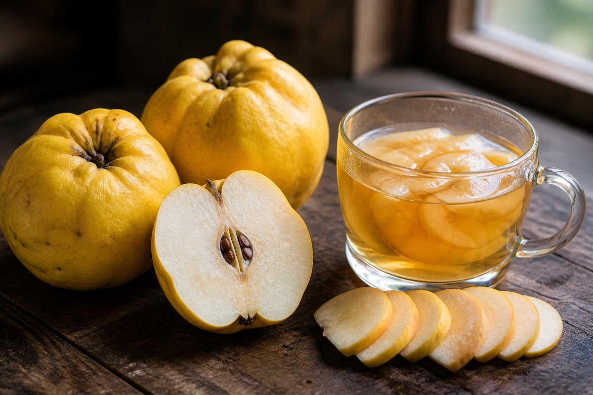

*▲ 모과 생것 100g은 78kcal, 비타민C 81mg, 식이섬유 8.9g, 칼륨 247mg입니다. 다만 실제로 먹는 양은 대부분 설탕에 재운 모과청 한두 큰술입니다.*

한 줄 결론 <strong>모과 생것 100g은 78kcal에 비타민C 81mg(성인 권장섭취량의 81%), 식이섬유 8.9g, 칼륨 247mg, 나트륨 2mg입니다.</strong> 숫자만 보면 훌륭한 과일이지만, 모과는 <strong>단단하고 떫어서 생으로 100g을 먹는 경우가 거의 없습니다</strong>. 실제 섭취는 <strong>모과청 1큰술(약 20g)에 당류 10g</strong> 형태이고, 그래서 모과의 영양보다 <strong>청에 들어간 설탕</strong>이 더 큰 변수입니다. 모과는 '영양 과일'이 아니라 <strong>'향과 산미를 쓰는 조미 과일'</strong>로 이해하는 편이 정확합니다.

모과는 장미과 모과나무의 열매로, 늦가을인 <strong>9월 중순부터 11월</strong>까지 노랗게 익습니다. 과육이 돌처럼 단단해 "과일 망신은 모과가 시킨다"는 말이 있지만, 향기만은 가을 과일 중에서도 손에 꼽힙니다.

유통되는 모과는 대부분 모과청이나 모과차, 모과 술로 소비됩니다. 생과는 한 개에 <strong>300~500g</strong>이고, 폐기율은 <strong>9%</strong>로 씨와 꼭지 주변만 도려내면 됩니다.

많이 검색되는 질문은 <strong>"모과 칼로리"</strong>, <strong>"모과를 생으로 먹어도 되나"</strong>, <strong>"모과청은 하루 얼마나"</strong>입니다. 결론부터 말하면 <strong>모과 자체는 저열량·고섬유 과일</strong>이고, <strong>문제가 되는 것은 거의 항상 청과 차에 들어간 당</strong>입니다.

---

## 1. 모과 칼로리와 영양성분 (생것 100g 78kcal)

아래 수치는 <strong>농촌진흥청 국가표준식품성분표의 '모과, 생것' 가식부 100g</strong> 기준입니다. 모과는 국내 성분표에서 분석 항목이 많지 않은 과일이라, 표에 없는 값은 별도 표기로 두었습니다.

| 영양 성분 (Nutrient) | 함량 (100g당) | 1일 기준치 비율 (2,000kcal 기준) |
| :--- | :--- | :--- |
| **열량 (Energy)** | 78 kcal | 3.9% |
| **수분 (Water)** | 78.3 g | 별도 표기¹ |
| **탄수화물 (Carbohydrates)** | 20.0 g | 6.2% |
| - 식이섬유 (Dietary Fiber) | 8.9 g | 35.6% |
| - 당류 (Sugars) | 별도 표기¹ | 별도 표기¹ |
| **단백질 (Protein)** | 0.7 g | 1.3% |
| **지방 (Total Fat)** | 0.4 g | 0.7% |
| **칼슘 (Calcium)** | 21 mg | 3.0% |
| **인 (Phosphorus)** | 18 mg | 2.6% |
| **철분 (Iron)** | 0.5 mg | 4.2% |
| **칼륨 (Potassium)** | 247 mg | 7.1% |
| **나트륨 (Sodium)** | 2 mg | 0.1% |
| **비타민A (Vitamin A)** | 1 µg RE | 0.1% |
| **비타민B1 (Thiamin)** | 0.02 mg | 1.7% |
| **비타민B2 (Riboflavin)** | 0.01 mg | 0.7% |
| **나이아신 (Niacin)** | 0.3 mg | 2.0% |
| **비타민C (Vitamin C)** | 81 mg | 81.0% |

¹ 수분과 당류는 1일 기준치가 설정되지 않은 항목입니다. 국내 성분표에는 모과의 당류 세부 수치가 별도로 실려 있지 않아 '별도 표기'로 두었습니다. 비율은 식품의약품안전처 1일 영양성분 기준치(2,000kcal)로 계산했습니다.

*※ 데이터 기준: 표의 수치는 국내 국가표준식품성분표(식약처 식품영양성분 DB)의 모과, 생것, 가식부 분석값입니다. 같은 식품의 [USDA FoodData Central FDC 168163](https://fdc.nal.usda.gov/food-details/168163/nutrients) — Quinces, raw (SR Legacy)는 100g당 57 kcal·단백질 0.4 g입니다. 이 글의 78 kcal·단백질 0.7 g은 국내 모과 값이며, 품종과 분석 항목이 다릅니다.*

### 표 읽는 법: 100g은 모과 4분의 1개입니다

이 표에서 먼저 기억할 것은 <strong>모과 100g이 생각보다 큰 양</strong>이라는 점입니다. 모과 한 개가 300~500g이므로 <strong>100g은 4분의 1~3분의 1개</strong>입니다.

영양적으로 눈에 띄는 것은 두 가지입니다.

- <strong>비타민C 81mg:</strong> 성인 권장섭취량(100mg)의 81%입니다. 같은 무게의 레몬(52mg)이나 귤(31mg)보다 많습니다.
- <strong>식이섬유 8.9g:</strong> 1일 기준치(25g)의 36%입니다. 사과(2.4g)의 3.7배 수준으로, 과일 중에서는 매우 높은 편입니다.

반대로 <strong>단백질 0.7g, 지방 0.4g</strong>으로 다른 영양소는 거의 없습니다. 모과는 <strong>'비타민C와 식이섬유만 강한 과일'</strong>입니다.

### 국내 81mg과 미국 15mg, 어느 쪽이 맞나

같은 모과인데 미국 USDA FoodData Central의 'Quinces, raw'는 비타민C가 <strong>100g당 15mg</strong>이고 열량은 57kcal, 식이섬유는 1.9g입니다. 국내 표(81mg)와 <strong>5배 이상 차이</strong>가 납니다.

이유는 두 가지입니다. 첫째, <strong>분석한 식물이 완전히 같지 않습니다</strong>. 우리가 먹는 모과는 <em>Pseudocydonia sinensis</em>(중국모과)이고, USDA 자료는 <em>Cydonia oblonga</em>(서양모과)를 분석한 것입니다. 둘째, <strong>국내 모과 자료는 1996년 분석값</strong>으로 오래됐습니다. 품종·성숙도·재배지·분석 시점이 모두 다르면 같은 이름의 과일도 이 정도 차이가 납니다.

실용적인 결론은 <strong>"모과의 비타민C는 15~81mg 사이 어딘가"</strong>로 보는 것입니다. 어느 쪽이든 <strong>모과청 1큰술에 들어가는 모과는 10g 남짓</strong>이므로, 청으로 먹을 때 실제로 얻는 비타민C는 <strong>2~8mg</strong> 수준입니다. 표의 81mg을 근거로 "모과차 한 잔으로 비타민C를 채운다"고 기대하면 안 됩니다.

### 생과·모과청·모과차 열량 비교

| 섭취 형태 | 1회 분량 | 열량 | 당류 |
| :--- | :--- | :--- | :--- |
| **모과 생것** | 100 g | 78 kcal | 별도 표기¹ |
| **모과청 (설탕 1:1)** | 1큰술 20 g | 약 55 kcal | 약 10 g |
| **모과차 (청 1큰술 + 물 200mL)** | 1잔 | 약 55 kcal | 약 10 g |
| **말린 모과차 (설탕 없음)** | 말린 모과 25 g + 물 1L | 약 70 kcal | 설탕 0 g |

표에서 보듯 <strong>모과 생것 100g과 모과차 한 잔의 열량이 비슷합니다</strong>. 그런데 모과차 한 잔에는 <strong>모과가 10g</strong>밖에 들어 있지 않습니다. 열량의 출처가 완전히 다르다는 뜻입니다.

모과청을 1:1로 담그면 <strong>1큰술(20g)에 당류 약 10g</strong>이 들어갑니다. 각설탕 3개 남짓입니다. 모과차를 하루 3잔 마시면 <strong>당류 30g</strong>으로, 첨가당 권고량(2,000kcal 기준 하루 50g의 10% 이내)의 60%를 음료에서 쓰게 됩니다.

---

## 2. 모과의 4가지 건강 포인트와 근거 수준

### 비타민C 81mg, 청으로 먹으면 얼마나 남나

비타민C는 콜라겐 합성과 항산화, <strong>비헴철 흡수 촉진</strong>에 관여하는 수용성 비타민입니다. 모과 100g의 81mg은 하루 권장량에 가까운 양이지만, 세 가지 손실 경로를 지나야 합니다.

껍질을 벗기고 씨를 도려내는 과정에서 일부가 빠지고, <strong>설탕에 재우는 2주</strong> 동안 산화로 줄며, <strong>뜨거운 물에 타면 열에 의해 더 줄어듭니다</strong>. 비타민C는 60℃ 이상에서 빠르게 분해되는 영양소입니다.

그래서 모과 비타민C를 조금이라도 더 얻고 싶다면 <strong>찬물이나 미지근한 물에 타는 쪽</strong>이 낫습니다. 비타민C가 목적이라면 <strong>귤·유자 생과를 함께 먹는 편</strong>이 현실적입니다.

### 껍질 폴리페놀은 과육의 4.7배, 삶으면 2.1배로 늘어난다

모과의 떫은맛과 향은 <strong>탄닌산을 비롯한 폴리페놀</strong>에서 옵니다. 농식품정보누리는 모과에 탄닌산, 사과산 같은 유기산과 <strong>클로로겐산·신남산</strong>이 들어 있다고 정리합니다.

조리법에 따라 이 성분은 크게 달라집니다. 학술지 <em>Molecules</em> 연구에서 <strong>총 폴리페놀은 생모과 100g당 약 247mg, 40분 삶은 모과 508mg, 모과즙 365mg</strong>으로 측정됐습니다. 삶은 모과가 생모과의 <strong>2.1배</strong>입니다. 가열로 세포벽이 무너지면서 결합형 폴리페놀이 빠져나오기 때문으로 해석됩니다. 같은 기사에서 인용한 <em>Scientia Horticulturae</em> 연구는 <strong>껍질의 총 폴리페놀이 과육보다 평균 4.7배</strong> 높다고 보고했습니다.

다만 폴리페놀 <strong>함량</strong>이 늘었다는 것과 <strong>몸에서 항산화 효과가 커졌다</strong>는 것은 다릅니다. 시험관 측정값이고, 흡수량은 위산·장내세균·식사 조합에 따라 달라집니다. <strong>껍질째 얇게 썰어 익히면 폴리페놀을 버리지 않는다</strong> 정도로 이해하면 충분합니다.

### 식이섬유 8.9g과 펙틴, 콜레스테롤에 어디까지 기대할 수 있나

모과 100g의 식이섬유 8.9g은 과일 중 최상위군입니다. 모과가 잼으로 잘 굳는 것도 <strong>펙틴</strong>이 많기 때문입니다. 펙틴은 물을 잡아 젤을 만드는 수용성 섬유질로, 장에서 <strong>당과 지방의 흡수 속도를 늦추고</strong> 포만감을 오래 유지합니다.

콜레스테롤에 대한 근거는 <strong>'섬유질 섭취를 늘리면 소폭 개선'</strong> 수준입니다. 미국심장협회(AHA)는 <strong>수용성 섬유질을 하루 5~10g 더 먹으면 LDL 콜레스테롤이 약 5% 낮아진다</strong>고 안내합니다. 효과 크기는 크지 않습니다.

문제는 <strong>모과로 그 섬유질을 채우기 어렵다</strong>는 점입니다. 모과청의 과육은 10g뿐이라 섬유질이 1g 남짓입니다. 모과 섬유질을 얻으려면 <strong>모과를 익혀 과육째 먹는 조리법</strong>이어야 합니다. 청과 차는 <strong>향과 단맛을 위한 음료</strong>입니다.

### 모과차가 기침에 좋다는 말, 근거는 어디까지인가

모과는 예부터 기침과 목 불편감에 쓰였고, 동의보감에도 모과의 효능이 기록돼 있습니다. 다만 이는 <strong>전통적 활용</strong>이며, <strong>모과차가 기침을 낫게 한다는 사람 대상 임상 연구는 확인되지 않습니다</strong>.

따뜻한 차를 마시면 목이 편해지는 것은 사실이지만, 그 효과는 <strong>따뜻한 수분으로 점막을 적시는 데서 오는 부분</strong>이 큽니다. 모과 고유 성분의 약리 효과로 단정할 수 없습니다. 한방에서 쓰는 모과는 정해진 처방과 용량 안의 약재이고, 집에서 마시는 모과차와 같은 것을 기대하기 어렵습니다.

그래서 실용적인 기준은 이렇습니다.

- 목이 칼칼할 때 <strong>따뜻한 모과차 한 잔</strong>은 수분과 향으로 도움이 됩니다.
- <strong>기침이 3주 이상</strong> 이어지거나 숨이 차고 가래에 피가 섞이거나, <strong>38℃ 이상 열이 사흘 이상</strong> 지속되면 모과차로 버티지 말고 진료를 받으세요.

---

## 3. 모과 손질과 조리·섭취 가이드

- <strong>껍질의 끈적한 막은 베이킹소다로 문질러 씻으세요.</strong> 표면의 왁스층에 먼지가 잘 붙습니다. 굵은 소금이나 베이킹소다로 문지른 뒤 흐르는 물에 여러 번 헹구세요.
- <strong>씨와 심은 반드시 도려내세요.</strong> 모과 씨에는 사과·살구 씨와 같은 <strong>시안 배당체(아미그달린)</strong>가 알려져 있고 쓴맛도 강합니다. 씨 주변의 질긴 심까지 제거하면 청의 맛이 깔끔해집니다.
- <strong>폴리페놀을 원하면 껍질째 얇게 썰어 익히세요.</strong> 씨를 뺀 모과를 2cm 크기로 썰어 <strong>물에서 40분 삶으면</strong> 폴리페놀이 생것의 2배 수준으로 올라갑니다. 껍질에 성분이 많으므로 벗기지 않는 것이 핵심입니다.
- <strong>비타민C를 원하면 가열을 줄이세요.</strong> 폴리페놀과 비타민C는 서로 반대 조건입니다. 삶으면 폴리페놀은 늘고 비타민C는 줄어듭니다. 목적을 하나 정해서 조리법을 고르세요.
- <strong>모과청은 설탕 1:1, 1큰술이 기준량입니다.</strong> 씻어 물기를 완전히 말린 모과를 얇게 썰어 같은 무게의 설탕과 버무리고, 소독한 병에 담아 <strong>실온 하루, 냉장 1~2주</strong> 숙성합니다. 1큰술(20g)에 당류 약 10g이므로 <strong>하루 1~2큰술</strong>이 무난합니다.
- <strong>설탕을 줄이고 싶으면 말린 모과를 쓰세요.</strong> 얇게 썰어 바싹 말린 모과 <strong>20~30g을 물 1L에 넣고 약불에서 20분</strong> 끓이면 설탕 없이 차가 됩니다. 단맛이 부족하면 대추 몇 알을 더합니다.
- <strong>썬 모과는 바로 설탕에 버무리세요.</strong> 금방 갈변합니다. 단단해 칼질이 힘들면 전자레인지에 1분 돌려 살짝 부드럽게 한 뒤 썰어도 됩니다.
- <strong>보관은 신문지에 싸서 냉장.</strong> 실온에 두면 며칠 만에 물러집니다. 상해도 향은 진해지지만 먹을 수 없다는 뜻입니다.

---

## 4. 섭취 시 주의사항 및 부작용

- <strong>당뇨가 있다면 모과차는 '건강차'가 아니라 '단 음료'입니다.</strong> 1:1 청 한 잔에 당류 10g이 들어 있습니다. 하루 양을 정해 두고, 마신 뒤 혈당이 평소보다 높게 나오면 섭취량을 조정하세요.
- <strong>첨가당 한도는 하루 50g(2,000kcal 기준)입니다.</strong> 모과차 3잔이면 30g으로 한도의 60%입니다. 다른 단 음료·간식도 함께 계산해야 합니다.
- <strong>씨는 먹지 마세요.</strong> 아미그달린은 다량 섭취 시 시안화물을 만들 수 있습니다. 청·차·잼 어느 쪽이든 씨와 심을 제거하는 것이 원칙입니다.
- <strong>위가 예민하면 공복에 피하세요.</strong> 탄닌과 유기산이 많아 공복에 다량 먹으면 속이 쓰릴 수 있습니다. 위염·역류성 식도염이 있으면 식후에 소량 드세요.
- <strong>장미과 과일 알레르기가 있으면 주의하세요.</strong> 사과·배·복숭아 알레르기가 있으면 모과에도 반응할 수 있습니다. 입이 가렵거나 목이 붓으면 섭취를 중단하세요.
- <strong>신장질환자는 칼륨을 확인하세요.</strong> 모과 100g의 칼륨은 247mg으로 높지 않지만, 청으로 농축하면 달라집니다. 칼륨 제한 식사 중이라면 의료진과 상의하세요.
- <strong>돌 이전 아기에게 꿀 청은 주지 마세요.</strong> 영아 보툴리누스증 위험이 있습니다. 설탕 청도 단맛에 익숙해지므로 돌 전에는 권하지 않습니다.
- <strong>기침이 오래가면 진료가 먼저입니다.</strong> 모과차는 목을 편하게 하는 음료이지 기침 치료제가 아닙니다.

---

## 5. 자주 묻는 질문 (FAQ)

**Q1. 모과를 생으로 먹어도 되나요?**  
먹을 수는 있지만 과육이 매우 단단하고 떫고 시어서 생으로 먹는 경우는 드뭅니다. 먹는다면 씨와 심을 반드시 제거하고 얇게 썰어 소량만 맛보세요. 대부분은 청이나 차, 말랭이로 가공해 먹습니다.

**Q2. 모과차는 하루에 몇 잔이 적당한가요?**  
설탕과 1:1로 담근 모과청을 쓴다면 하루 1~2잔, 청 1~2큰술(당류 10~20g)이 무난합니다. 2큰술씩 3잔을 마시면 당류가 약 60g으로 첨가당 권고량을 넘을 수 있습니다. 당뇨가 있다면 한 잔으로 정하고 혈당 변화를 확인하세요.

**Q3. 모과 비타민C는 81mg인가요, 15mg인가요?**  
국내 국가표준식품성분표의 모과 생것은 100g당 81mg, 미국 USDA의 'Quinces, raw'는 15mg입니다. 분석한 종과 시점이 달라 생긴 차이로, 실제 값은 그 사이 범위로 보는 것이 안전합니다. 어느 쪽이든 모과청 1큰술에 들어가는 모과는 10g 남짓이라 얻는 비타민C는 2~8mg 수준입니다.

---

## 6. 모과와 함께 먹으면 좋은 음식

- <strong>[유자 (Yuzu)](/posts/yuzu-nutrition-benefits/):</strong> 모과와 유자 모두 늦가을 제철에 껍질에 폴리페놀이 많은 과일입니다. 모과청에 유자청을 섞으면 향은 살아나지만 <strong>당류도 늘어납니다</strong>. 당이 신경 쓰인다면 건조 모과차에 유자 껍질만 얇게 넣으세요.
- <strong>[배 (Asian Pear)](/posts/asian-pear-nutrition-benefits/):</strong> 배는 수분과 칼륨이 많고, 모과와 함께 삶으면 산미와 단맛이 균형을 이룹니다. 설탕 없이 마실 수 있는 조합입니다.
- <strong>[귤 (Tangerine)](/posts/tangerine-nutrition-benefits/):</strong> 모과차의 비타민C가 아쉬우면 생귤을 곁들이세요. 귤 100g의 비타민C 31mg이 청 1큰술의 2~8mg을 보완해 줍니다.

  
📌 관련 순위 가이드

  <ul>
    <li><a href="/posts/antioxidant-anti-aging-foods-guide/">항산화·노화 방지에 좋은 음식</a></li>
    <li><a href="/posts/low-gi-foods-blood-sugar-guide/">혈당을 천천히 올리는 저GI 음식</a></li>
  </ul>

---

## 7. 모과 어떻게 먹을까? 핵심 요약

- 모과 생것 100g은 <strong>78kcal, 비타민C 81mg, 식이섬유 8.9g, 칼륨 247mg</strong>입니다. 100g은 모과 4분의 1~3분의 1개입니다.
- 모과의 비타민C는 국내 표 <strong>81mg</strong>, USDA <strong>15mg</strong>으로 차이가 큽니다. 실제 섭취는 청 1큰술(모과 10g)이라 <strong>2~8mg</strong> 수준입니다.
- <strong>모과청 1큰술(20g)에 당류 약 10g</strong>입니다. 하루 1~2큰술이 무난하고, 3잔이면 첨가당 한도의 60%를 씁니다.
- 폴리페놀은 <strong>껍질에 과육의 4.7배</strong>, <strong>40분 삶으면 생것의 2.1배</strong>가 됩니다. 대신 비타민C는 열에 줄어듭니다.
- <strong>씨와 심은 반드시 제거</strong>하세요. 씨에 아미그달린이 알려져 있습니다.
- 설탕 없이 마시려면 <strong>건조 모과 20~30g + 물 1L, 20분</strong>이 답입니다.
- 모과차는 <strong>목을 적시는 음료</strong>입니다. 기침이 3주를 넘으면 진료를 받으세요.

**추가 근거:** [모과 조리법별 폴리페놀 비교 연구 보도 (헬스조선, 2026-11-20)](https://health.chosun.com/site/data/html_dir/2026/11/20/2026112000894.html) — 생모과 247mg·삶은 모과 508mg·모과즙 365mg(<em>Molecules</em>), 껍질이 과육의 4.7배(<em>Scientia Horticulturae</em>). 영양 수치는 농촌진흥청 국가표준식품성분표 '모과, 생것'과 USDA FoodData Central 'Quinces, raw'를 대조했습니다.
