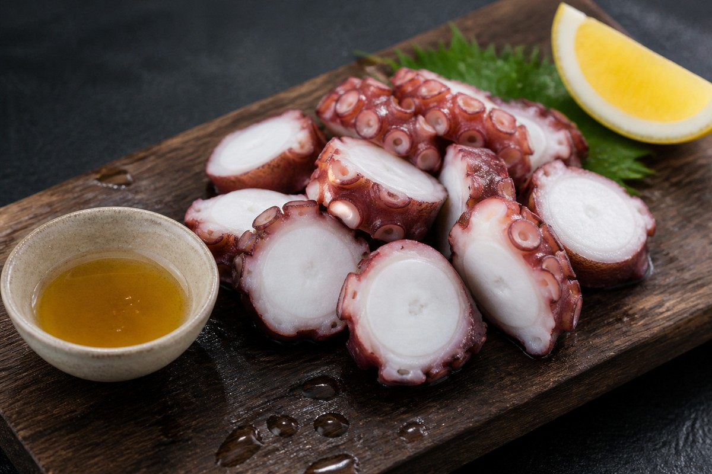

*▲ Raw octopus: 82 kcal, 14.91 g protein, 44.8 µg selenium and 20 µg vitamin B12 per 100 g. Boiled, the same weight reads 164 kcal — because the water left.*

Quick answer <strong>Raw octopus provides 82 calories, 14.91 g protein, 1.04 g fat, 230 mg sodium, 44.8 µg selenium (81% DV) and 20 µg vitamin B12 (833% DV) per 100 g (USDA FDC 174218).</strong> Boiled octopus reads <strong>164 calories, 29.82 g protein and 460 mg sodium</strong> for the same 100 g. Nothing was added: water fell from 80.25 g to 60.5 g, so a 100 g portion of cooked tentacle contains roughly 140 g of raw octopus. That single fact reshapes portion math, and it is the reason a plate of chilled tentacles can carry well over 1,000 mg of sodium once the dipping sauce arrives.

Octopus is one of the few seafoods where the package label almost always says "cooked." In Korea, where I buy it, the chilled tentacle trays sold as *sukhoe* are pre-boiled; whole raw octopus appears mostly at fish counters. People reach for it because it reads as pure protein, and it mostly is — but the numbers shift more between raw and cooked than for almost any other seafood, and the sauces do more damage than the meat.

The questions that come up are practical: how many calories are in a plate of octopus, how long to boil it, whether the taurine claims hold up, and whether it belongs on a gout-restricted table.

---

## 1. Octopus Nutrition Facts (per 100 g, raw)

Values are USDA FoodData Central SR Legacy FDC 174218, "Mollusks, octopus, common, raw," edible portion.

| Nutrient | Per 100 g | U.S. %DV |
| :--- | :--- | :--- |
| Energy | 82 kcal | 4% |
| Water | 80.25 g | No DV¹ |
| Protein | 14.91 g | 30% |
| Total fat | 1.04 g | 1% |
| — Saturated fat | 0.227 g | 1% |
| Total carbohydrate | 2.2 g | 1% |
| — Dietary fiber | 0 g | 0% |
| — Total sugars | 0 g | No DV¹ |
| Calcium | 53 mg | 4% |
| Iron | 5.3 mg | 29% |
| Magnesium | 30 mg | 7% |
| Phosphorus | 186 mg | 15% |
| Potassium | 350 mg | 7% |
| Sodium | 230 mg | 10% |
| Zinc | 1.68 mg | 15% |
| Copper | 0.435 mg | 48% |
| Manganese | 0.025 mg | 1% |
| Selenium | 44.8 µg | 81% |
| Vitamin C | 5 mg | 6% |
| Thiamin (B1) | 0.03 mg | 3% |
| Riboflavin (B2) | 0.04 mg | 3% |
| Niacin (B3) | 2.1 mg | 13% |
| Vitamin B6 | 0.36 mg | 21% |
| Folate | 16 µg DFE | 4% |
| Choline | 65 mg | 12% |
| Vitamin E | 1.2 mg | 8% |
| Vitamin K | 0.1 µg | 0% |
| Cholesterol | 48 mg | 16% |

¹ Water, total sugars and fiber have no established U.S. Daily Value in this form. Percentages use FDA Daily Values for a 2,000 kcal diet. See note¹ for the Korean reference values.

*Note¹: Korea's National Institute of Fisheries Science table for common octopus (*Paroctopus dofleini*) lists 70 kcal, 15.5 g protein, 31 mg calcium, 1.0 mg iron and 435 mg taurine per 100 g, with an edible portion of 82.2%. The iron gap against USDA (5.3 mg) is not an error — the two tables analysed different species, *Octopus vulgaris* in the U.S. data.*

### How to read the table

- **Protein is the whole point.** 14.91 g per 100 g with almost no fat and 2.2 g carbohydrate makes octopus a lean protein, close to skinless chicken thigh but with far more B12, selenium and iron.
- **The B12 number is genuinely unusual.** 20 µg per 100 g is more than eight times the 2.4 µg Daily Value. Water-soluble excess is excreted, so this is not a reason to eat more of it, but it is a meaningful contribution for anyone who eats little meat.
- **Iron 5.3 mg is real but not a solution.** 29% DV sounds strong; a portion is usually 100–150 g, and heme iron from red meat or [beef liver](/en/posts/beef-liver-nutrition-benefits/) is absorbed far more efficiently.
- **Sodium is already there before you season.** 230 mg per 100 g raw is roughly 10% of the Daily Value; cooked octopus doubles it because boiling water is salted and water is lost.

---

## 2. Why Cooking Doubles the Calories per 100 g

| Form | Portion | Calories | Protein | Sodium |
| :--- | :--- | :--- | :--- | :--- |
| Raw octopus | 100 g | 82 kcal | 14.91 g | 230 mg |
| Boiled octopus | 100 g | 164 kcal | 29.82 g | 460 mg |
| A plate of chilled tentacles | 200 g | about 328 kcal | 59.6 g | about 920 mg |
| The same plate with 30 g chili-vinegar sauce | 1 plate | about 400 kcal | 60 g | 1,400 mg+ |

Boiling removes water, and everything else concentrates. USDA's own before-and-after numbers show water dropping from 80.25 g to 60.5 g and protein rising from 14.91 g to 29.82 g — per 100 g, not per animal. The octopus did not gain protein; the portion did.

Do the yield math once and it stays with you. A 300 g raw octopus yields roughly 210–220 g of cooked tentacle. So a 200 g plate of *sukhoe* represents about 280 g of raw octopus, which lands at 196–202 kcal either way the calculation is run. The "164 calories per 100 g" figure is not a warning about octopus; it is a warning about comparing cooked weights to raw weights.

I changed how I portion because of this: weigh the cooked plate, halve it mentally, and treat 150 g of tentacle as a serving rather than 200 g.

Sodium deserves its own line. Korean-style boiled octopus is cooked in salted water, and it is served with *chogochujang*, a vinegar-chili sauce that carries roughly 500 mg sodium per 30 g. A 200 g plate with sauce therefore passes 1,400 mg — 60% of the Daily Value in one appetizer.

---

## 3. Taurine, B12 and Selenium: What the Numbers Support

Octopus is often sold on taurine. Korean tables list 435 mg per 100 g for common octopus; small octopus (*nakji*) comes in near 854 mg, roughly double. Taurine is a sulfur-containing amino acid involved in bile acid conjugation and osmoregulation, and it is conditionally essential rather than required from food.

The claim that taurine "restores energy" is where the evidence thins out. Most human taurine trials used energy drinks — taurine plus caffeine — or small clinical populations. No good trial shows that eating 100 g of octopus reduces fatigue in healthy adults. Honestly, the reason a plate of octopus feels light is simpler: 1 g of fat and 30 g of protein per 100 g cooked.

B12 and selenium are the claims with firm numbers behind them. 20 µg B12 and 44.8 µg selenium per 100 g raw are both well above the Daily Value, and both are nutrients where seafood reliably outperforms plant foods. Whether that matters to you depends on the rest of your diet, not on octopus being a "superfood."

---

## 4. Boiling Octopus Without Ruining It

- **Salt-scrub first.** Octopus skin is covered in mucus. Coarse salt and a few minutes of rubbing, then a rinse, removes most of the fishiness. A dusting of flour works the same way.
- **Dip the tentacles three times.** Hold the head and lower the tips into boiling water, lift, and repeat three times before submerging fully. The tips curl neatly and the surface sets before the interior overcooks. Skipping this is how tentacles end up splayed flat against the plate.
- **Time by size, not by recipe.** Small common octopus: 20–30 minutes at a bare simmer. Large Pacific octopus over 1 kg: 40–60 minutes. A skewer should slide through the thickest part with no resistance.
- **Add a piece of radish.** Radish contains proteases that tenderise the flesh; a 100 g chunk with garlic and a bay leaf also cleans up the smell. I found the difference obvious in the first five minutes of cooking — the aroma turns sweet rather than briny.
- **Rest off the heat.** Ten minutes with the burner off evens out the interior without turning the outside to mush.
- **Buy cooked tentacles by their suckers.** Fresh *sukhoe* has suckers that grip the plate, a glossy surface, and a clean sea smell. Limp, dry tentacles are old.

---

## 5. Cautions

- **Gout and uric acid.** Cephalopods and shellfish are moderate-to-high purine foods. During a flare, skip them; between flares, keep portions near 100 g. The cooking liquid and any broth carry purines too, so drinking the water is the worst version.
- **Cholesterol 48 mg raw, 96 mg cooked** per 100 g. A 200 g cooked plate is close to 200 mg, two-thirds of the 300 mg Daily Value.
- **Sodium is a cooking decision.** Skip the salt in the water, and swap the chili-vinegar sauce for sesame oil, lemon and scallion; sodium drops by more than half.
- **Cook it.** Raw or undercooked octopus is a risk, particularly in pregnancy or with a weakened immune system.
- **Mollusk allergy.** Anyone reactive to squid, clam or mussel may react to octopus. Stop if the mouth itches or the throat tightens.
- **Kidney disease.** 186 mg phosphorus and 350 mg potassium per 100 g; check with your clinician before making it a regular plate.

---

## 6. Frequently Asked Questions

**Q1. How many calories are in a plate of octopus?**  
Boiled octopus is 164 kcal per 100 g, so a typical 200 g plate is about 328 kcal before sauce. Raw octopus is 82 kcal per 100 g, but that figure describes a weight you would not eat — cooking removes about 30% of the water, so 200 g cooked equals roughly 280 g raw.

**Q2. How long should octopus be boiled?**  
20–30 minutes at a bare simmer for small common octopus, 40–60 minutes for large octopus over 1 kg. Test with a skewer at the thickest part rather than trusting the clock. Dip the tentacles into the water three times before submerging to help them curl.

**Q3. Is octopus high in cholesterol?**  
It is moderate: 48 mg per 100 g raw and 96 mg cooked, against a 300 mg Daily Value. A 200 g cooked portion delivers about 190 mg, so portion size matters more than the per-100 g number.

---

## 7. Related reading

- **[Squid](/en/posts/squid-nutrition-benefits/)** — the closest cephalopod comparison, with more fat and cholesterol and a different texture at the table.
- **[Shrimp](/en/posts/shrimp-nutrition-benefits/)** — lean shellfish with a similar sodium profile; useful as a swap when octopus is expensive.
- **[Kelp](/en/posts/kelp-nutrition-benefits/)** — simmer octopus with kelp instead of salt to build umami and cut sodium.
- **[Low-GI foods guide](/en/posts/low-gi-foods-blood-sugar-guide/)** — where lean seafood fits into a blood-sugar-conscious plate.

---

## 8. Bottom line

- Raw octopus: **82 kcal, 14.91 g protein, 230 mg sodium, 44.8 µg selenium, 20 µg B12** per 100 g.
- Boiled octopus: **164 kcal and 460 mg sodium** per 100 g — water loss, not extra food.
- **A 200 g plate of tentacles is about 280 g of raw octopus** and roughly 200–330 kcal depending on how you count.
- **Sauce is the sodium problem.** 200 g with chili-vinegar sauce passes 1,400 mg sodium.
- **Taurine 435 mg** is real; the fatigue claim is not supported by human trials. B12 and selenium are.
- **Boil 20–30 minutes (small) or 40–60 minutes (large)**, dip the tentacles three times, and add radish.
- **Moderate purines and 96 mg cholesterol per 100 g cooked** — portion it, especially with gout.

**Sources:** Nutrient values from USDA FoodData Central FDC 174218 (raw) and FDC 174249 (cooked, moist heat), compared with Korea's National Institute of Fisheries Science composition table for common octopus (70 kcal, 15.5 g protein, 435 mg taurine, 82.2% edible portion). Sodium and cholesterol per 100 g are USDA values because the Korean table does not report them.
