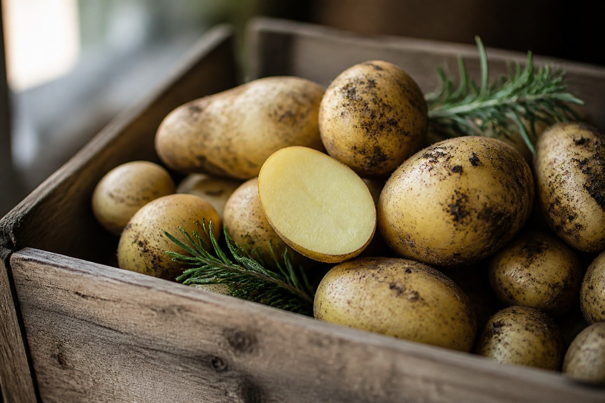

*▲ Raw potato with skin: 77 kcal, 425 mg potassium, 2.1 g fiber and 19.7 mg vitamin C per 100 g. A 100 g portion is about half a medium potato.*

Quick answer <strong>Raw potato with skin provides 77 calories, 2.05 g protein, 17.49 g carbohydrate, 2.1 g fiber, 425 mg potassium and 19.7 mg vitamin C per 100 g (USDA FDC 170026).</strong> Boil it, chill it overnight, and the starch partly retrogrades: resistant starch rises from about 3.3% to 5.2% of total starch, and pooled trial data put chilled potato at a glycemic index near 50 against roughly 78 for freshly boiled. That sounds enormous, and it is real — but the arithmetic is smaller than the headlines imply: <strong>about 0.3 g more resistant starch per 100 g, roughly 1 kcal.</strong> Cooling slows digestion. It does not remove carbohydrate.

Potatoes sit in the vegetable aisle but eat like a grain: 15 g of their 17.5 g carbohydrate per 100 g is starch, and starch decides how fast blood glucose climbs. That is why the same tuber gets called fattening in one article and diet-friendly in the next. What matters is not the potato but what you do to it after it leaves the pot.

The questions people actually type are narrow: how many calories are in a boiled potato, what the glycemic index of potato really is, whether cooling a potato "removes carbs," and whether sprouted potatoes can be salvaged. This article takes them in that order, with the study numbers attached.

---

## 1. Potato Nutrition Facts (per 100 g)

Values below are USDA FoodData Central SR Legacy FDC 170026, "Potatoes, flesh and skin, raw," edible portion.

| Nutrient | Per 100 g | U.S. %DV |
| :--- | :--- | :--- |
| Energy | 77 kcal | 4% |
| Water | 79.25 g | No DV¹ |
| Protein | 2.05 g | 4% |
| Total fat | 0.09 g | 0% |
| Total carbohydrate | 17.49 g | 6% |
| — Dietary fiber | 2.1 g | 8% |
| — Total sugars | 0.82 g | No DV¹ |
| — Starch | 15.29 g | No DV¹ |
| Calcium | 12 mg | 1% |
| Iron | 0.81 mg | 5% |
| Magnesium | 23 mg | 5% |
| Phosphorus | 57 mg | 5% |
| Potassium | 425 mg | 9% |
| Sodium | 6 mg | 0% |
| Zinc | 0.3 mg | 3% |
| Copper | 0.11 mg | 12% |
| Manganese | 0.153 mg | 7% |
| Selenium | 0.4 µg | 1% |
| Vitamin C | 19.7 mg | 22% |
| Thiamin (B1) | 0.081 mg | 7% |
| Riboflavin (B2) | 0.032 mg | 2% |
| Niacin (B3) | 1.061 mg | 7% |
| Vitamin B6 | 0.298 mg | 18% |
| Folate | 15 µg DFE | 4% |
| Choline | 12.1 mg | 2% |
| Vitamin K | 2.0 µg | 2% |
| Vitamin E | 0.01 mg | 0% |
| Cholesterol | 0 mg | 0% |

¹ Water, total sugars and starch have no established U.S. Daily Value. Percentages use FDA Daily Values for a 2,000 kcal diet. See note¹ below on how the Korean table compares.

*Note¹: Korea's national food composition table lists the Sumi cultivar at 70 kcal, 1.93 g protein, 335 mg potassium and 4.47 mg vitamin C per 100 g. The 4-fold gap in vitamin C is mostly a sampling difference — potato vitamin C falls during storage, and the Korean value appears to come from market-sample tubers rather than fresh-dug ones. Neither table makes potato a realistic vitamin C source.*

### How to read the table

- **100 g is half a medium potato**, not one. A medium potato runs 150–200 g, so a whole one served as a side is closer to 120 kcal and 25 g carbohydrate.
- **The fiber is in the skin.** With skin, 100 g carries 2.1 g fiber and 425 mg potassium; peeled and boiled, the same weight drops to 1.8 g and 328 mg. If you peel, you lose the part that slows digestion most.
- **Cooking concentrates everything.** USDA's boiled potato is 86 kcal per 100 g, not because sugar appeared but because water fell from 79.25 g to 77.46 g.
- **Vitamin C does not survive boiling.** Raw potato has 19.7 mg per 100 g; boiled has 7.4 mg, a 62% loss. If vitamin C is the goal, tangerines and strawberries do the job with far less cooking loss.

---

## 2. What Cooling Actually Changes

### The glycemic index gap

Glycemic index compares the blood glucose rise from 50 g of available carbohydrate against glucose (GI 100). Potato as a category lands in the high range, 70–90. A 2026 meta-analysis of 35 human trials in *Starch* breaks that range down by cooking method:

| Preparation | GI (glucose = 100) |
| :--- | :--- |
| Baked potato | 79.2 |
| Fried potato / fries | 83.1 |
| Boiled potato, eaten hot | about 78 (70–90 range) |
| Mashed potato | higher than boiled — cells rupture, enzymes get more surface |
| Chilled potato | 50.3 |
| Cook-chill, refrigerated 12 h+ at ≤4 °C | 44.1 |

The chilled figure is the one that gets quoted. Note what it does and does not say: cooling lowered the *rate* of glucose appearance, and in one randomized crossover trial of 30 women with elevated fasting glucose, chilled potato cut glucose at 15 and 30 minutes by 4.8% and 9.2% and insulin by 25.8% and 22.6%. The same trial found **no significant difference in total glucose response over two hours.** Less spike, same total.

### 0.3 grams: the arithmetic behind the claim

Resistant starch (RS) is the fraction that reaches the colon undigested. When cooked starch cools, amylose and amylopectin reassociate into a crystalline structure — retrogradation — forming RS type 3. In a Lund University study published in the *European Journal of Clinical Nutrition* (2005), boiling then storing potatoes at 8 °C for 24 hours raised resistant starch from **3.3% to 5.2% of total starch.**

Convert that to a plate. Potato starch is 15.29 g per 100 g. At 3.3%, resistant starch is 0.50 g; at 5.2%, it is 0.79 g. **The gain is 0.3 g, worth about 1.2 kcal.**

I sat with that number for a while, because it contradicts a lot of wellness content. If the extra resistant starch were the whole story, cooling would barely register. The glycemic drop is larger than 0.3 g of undigestible starch can explain, so the more defensible reading is that **retrogradation makes the entire starch granule harder to attack**, slowing enzyme access rather than removing a meaningful slice of the carbohydrate.

### Does reheating undo it?

Partly. A 2016 USDA study (PubMed 27132853) compared baked and boiled potatoes served hot (65 °C), chilled (4 °C), and chilled then reheated. Resistant starch ranked **chilled > reheated > hot**, and baked beat boiled at every temperature. Reheating lowers RS but does not return it to the freshly cooked baseline.

---

## 3. In My Kitchen: Buying, Boiling, Chilling

- **Pick by weight, not beauty.** Same-size potatoes that feel heavier and firmer are denser. Skip anything with sprouts, soft spots, or green skin.
- **Green and sprouted potatoes are not salvageable by trimming.** Solanine concentrates in sprouts, eyes and greened skin, and home cooking does not destroy it. Bitterness and a tingling mouth are the warning signs. If more than a patch is green, throw it out — the potato is worth less than the stomach ache.
- **Boil whole and unpeeled, starting from cold water.** Peeling first leaches water-soluble nutrients into the pot. Medium potatoes take 20–25 minutes from a boil; a skewer should slide in with no resistance.
- **Mash is a different food.** The moment you mash, you rupture cells and expose starch, and GI climbs back up. I found that cubed, chilled potato in a salad kept me steadier through the morning than the same weight mashed — same potato, different structure.
- **Chill in a sealed container, 12 hours minimum.** Room-temperature cooling invites bacterial growth. I portion out the next day's serving right after cooking, so it goes straight into the fridge instead of sitting on the counter.
- **Store raw potatoes dark and cool, 7–10 °C.** Refrigerating raw potatoes converts starch to sugar, and sugar plus high heat is the acrylamide pathway. If they ended up in the fridge anyway, boil or steam them rather than fry.
- **Stop frying at pale gold.** Acrylamide forms above 120 °C and climbs as the surface browns. Light gold, not deep brown, is the practical line.

---

## 4. Cautions

- **Chilled potato still carries 17.5 g carbohydrate per 100 g.** If you manage diabetes, cooling changes the slope, not the load. Keep the portion at 100–150 g and pair it with protein and vegetables.
- **Cooling works best inside a mixed meal.** The trial differences were measured within a set meal; vinegar dressing, protein and fiber all blunt the response further. Chilled potato eaten alone is still mostly starch.
- **Potassium matters in kidney disease.** 425 mg per 100 g with skin. Boiling and discarding the water leaches some potassium, and some vitamins too.
- **Solanine poisoning is not fixed by peeling a sprouted potato.** Nausea, abdominal pain and headache can follow; cooking does not neutralise it.
- **Acrylamide is a frying and roasting issue, not a boiling one.** Golden, not brown.

---

## 5. Frequently Asked Questions

**Q1. Does cooling a potato reduce its calories?**  
No. A chilled potato is still about 77 kcal per 100 g. The extra resistant starch is 0.3 g, roughly 1 kcal. Cooling changes how fast the starch is digested, not how much energy it contains.

**Q2. Can I reheat a boiled potato and keep the benefit?**  
Partly. In the 2016 USDA comparison, resistant starch ranked chilled > reheated > freshly cooked, so reheating lowers but does not erase it. Reheat briefly — long boiling breaks the structure down again and pushes the glycemic response back up.

**Q3. Is potato skin worth eating?**  
Yes, for fiber and potassium: 2.1 g fiber and 425 mg potassium per 100 g with skin, versus 1.8 g and 328 mg peeled and boiled. Scrub rather than peel, but discard any green skin for solanine reasons.

---

## 6. Related reading

- **[Sweet Potato](/en/posts/sweet-potato-nutrition-benefits/)** — the same retrogradation logic applies to steamed sweet potato, with a very different fiber and beta-carotene profile.
- **[Chicken Breast](/en/posts/chicken-breast-nutrition-benefits/)** — 150 g potato plus 100 g chicken is a balanced plate, and the protein itself flattens the glucose curve.
- **[Onion](/en/posts/onion-nutrition-benefits/)** — potato has only 6 mg sodium per 100 g, so building flavor from onion and garlic keeps the dish low-salt.
- **[Low-GI foods guide](/en/posts/low-gi-foods-blood-sugar-guide/)** — where potato sits against rice, oats and legumes.

---

## 7. Bottom line

- Raw potato with skin: **77 kcal, 17.49 g carbohydrate, 2.1 g fiber, 425 mg potassium, 19.7 mg vitamin C** per 100 g.
- Boiling concentrates it to 86 kcal per 100 g by water loss, and cuts vitamin C by 62%.
- Chilling boiled potato overnight raises resistant starch from **3.3% to 5.2% of starch** — about **0.3 g per 100 g, 1 kcal**.
- Chilled potato GI sits near **50 against roughly 78 hot**, but two-hour total glucose in trials showed **no significant difference**.
- **Mashing raises GI again.** Cube it, don't mash it.
- **Discard sprouted or greened potatoes.** Trimming is not enough.
- Fry to **pale gold**, not brown.

**Sources:** GI values by cooking method from Liu et al., *Starch* (2026) meta-analysis of 35 human trials; resistant starch 3.3%→5.2% and postprandial effects from Leeman et al., *European Journal of Clinical Nutrition* (2005); cooking method and serving temperature comparisons from Raatz et al. (PubMed 27132853, 2016); chilled-potato crossover trial in Patterson et al. (2019). Nutrient values from USDA FoodData Central FDC 170026 (raw) and FDC 170440 (boiled), cross-checked against Korea's national food composition table.
