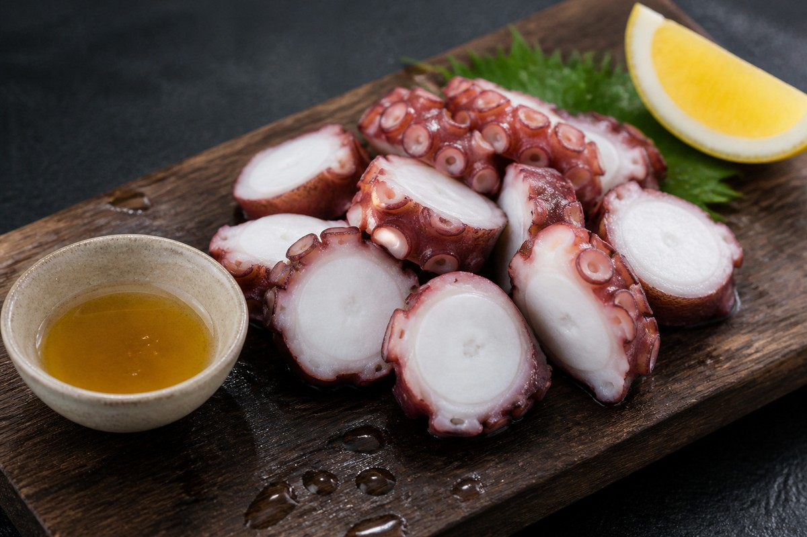

*▲ 생문어 100g은 70kcal·단백질 15.5g입니다. 같은 무게의 숙회는 수분이 빠져 101kcal까지 올라갑니다.*

한 줄 결론 <strong>생문어 100g은 70kcal, 단백질 15.5g, 타우린 435mg입니다(국립수산과학원 표준수산물성분표, 포항 2·5·8·11월 평균).</strong> 그런데 <strong>데쳐서 숙회로 만들면 같은 100g이 101kcal·단백질 21.7g</strong>이 됩니다. 살이 늘어난 게 아니라 <strong>수분이 81.5g에서 60g 안팎으로 빠져 같은 무게에 고형분이 더 들어간 것</strong>입니다. 즉 <strong>숙회 200g은 생문어 280g 안팎을 먹는 것</strong>과 열량이 비슷하고, 데칠 때 넣는 소금과 곁들이는 초고추장이 나트륨을 두 배 이상으로 끌어올립니다.

문어는 겨울에 값이 오르는 재료입니다. 11월부터 12월까지가 대문어·참문어의 제철로 꼽히고, 마트 수산 코너에서도 숙회용 다리가 눈에 띄게 늘어납니다. 저는 보통 회보다 숙회를 사는데, 집에서 삶는 것보다 <strong>이미 데친 숙회를 사서 초고추장에 찍어 먹는 쪽</strong>이 실패가 적기 때문입니다.

문제는 이 숙회가 <strong>"문어니까 고단백 저지방"이라고만 생각하고 양을 재지 않는다는 점</strong>입니다. 실제로 재 보면 접시 한 번에 200g은 가뿐히 넘습니다. 그래서 이 글은 <strong>생문어와 숙회를 같은 100g으로 놓고 숫자를 나란히 비교</strong>하는 데 초점을 맞췄습니다.

많이 검색되는 질문은 <strong>"문어숙회 칼로리"</strong>, <strong>"문어 삶는 시간"</strong>, <strong>"문어 타우린 효능"</strong>, <strong>"통풍에 문어 괜찮나"</strong>입니다.

---

## 1. 생문어 100g 영양성분 (70kcal, 단백질 15.5g)

아래 표는 <strong>국립수산과학원 표준수산물성분표의 '문어, 육, 생것' 가식부 100g</strong> 값입니다. 수산물은 어획 시기와 지역에 따라 지방 함량이 크게 달라서, 연간 평균에 해당하는 포항 2·5·8·11월 평균값을 기준으로 삼았습니다.

| 영양 성분 (Nutrient) | 함량 (100g당) | 1일 기준치 비율 (2,000kcal 기준) |
| :--- | :--- | :--- |
| **열량 (Energy)** | 70 kcal | 3.5% |
| **수분 (Water)** | 81.5 g | 기준치 없음¹ |
| **단백질 (Protein)** | 15.5 g | 28.2% |
| **지방 (Total Fat)** | 0.8 g | 1.5% |
| **탄수화물 (Carbohydrates)** | 0.2 g | 0.1% |
| - 식이섬유 (Dietary Fiber) | 0 g | 0% |
| **회분 (Ash)** | 2.0 g | 기준치 없음¹ |
| **칼슘 (Calcium)** | 31 mg | 4.4% |
| **인 (Phosphorus)** | 188 mg | 26.9% |
| **철분 (Iron)** | 1.0 mg | 8.3% |
| **칼륨 (Potassium)** | 350 mg ※ | 10.0% |
| **나트륨 (Sodium)** | 230 mg ※ | 11.5% |
| **셀레늄 (Selenium)** | 63 µg | 114.5% |
| **나이아신 (Niacin)** | 2.2 mg | 14.7% |
| **비타민C (Vitamin C)** | 0 mg | 0% |
| **콜레스테롤 (Cholesterol)** | 48 mg ※ | 16.0% |
| **타우린 (Taurine)** | 435 mg | 기준치 없음¹ |

¹ 수분·회분·타우린은 1일 기준치가 설정되지 않은 항목입니다. ※ 표시는 국내 성분표에 별도 항목이 없어 USDA FoodData Central FDC 174218(Octopus, common, raw) 값을 병기한 것입니다. 비율은 식품의약품안전처 1일 영양성분 기준치(2,000kcal)와 한국인 영양소 섭취기준 권장섭취량으로 계산했습니다.

*※ 데이터 기준: 국립수산과학원 표준수산물성분표 '문어, 육, 생것'(포항, 2·5·8·11월 평균, 가식부 82.2%). 타우린 435mg은 부산 4월 분석값입니다. 미국 USDA의 같은 이름 문어는 100g당 82 kcal·단백질 14.91 g·철 5.3 mg으로 국내 표와 차이가 큽니다. 국내 표는 참문어(Paroctopus dofleini), USDA는 Octopus vulgaris를 분석한 값이라 종이 다릅니다.*

### 표 읽는 법: 100g은 다리 한 토막, 먹는 양은 82%뿐

- <strong>100g은 삶은 다리 두세 토막</strong>입니다. 숙회 한 접시(200g 전후)면 표의 두 배, 140kcal 안팎입니다.
- <strong>가식부는 82.2%</strong>입니다. 1kg을 사면 실제로 먹는 양은 822g이고, 1kg에 든 단백질은 127g으로 100g당 기준 계산(155g)보다 28g 적습니다.
- <strong>셀레늄 63µg</strong>은 100g으로 하루 기준치를 넘습니다. 넘겼다고 더 좋은 게 아니라, 부족하지 않게 채워진다는 의미입니다.
- <strong>비타민C는 0mg</strong>입니다. 문어로 비타민C를 기대할 이유는 없습니다.

### 국내 표 70kcal와 USDA 82kcal, 철분은 5배 차이

같은 '문어'인데 표마다 숫자가 꽤 다릅니다. 국내 표는 70kcal·철 1.0mg, USDA는 82kcal·철 5.3mg입니다. <strong>철분이 5배 넘게 차이</strong>나는데, 이건 분석 오류가 아니라 <strong>종이 다르기 때문</strong>입니다. 우리가 마트에서 사는 문어는 대부분 참문어이고, USDA 자료는 지중해·대서양에서 잡히는 참문어(Octopus vulgaris)를 분석한 값입니다.

그래서 실용적인 기준은 이렇습니다. <strong>국내에서 사 먹는 문어는 국내 표로 계산하고, 미국 자료와 비교할 때는 종 차이를 감안</strong>해야 합니다. 철분을 목적으로 고른다면 국내 표 100g당 1.0mg이므로 [쇠간](/posts/beef-liver-nutrition-benefits/)(100g에 6mg대)과는 비교가 되지 않습니다.

---

## 2. 데치면 100g 열량이 왜 두 배가 되나

| 섭취 형태 | 1회 분량 | 열량 | 단백질 | 나트륨 |
| :--- | :--- | :--- | :--- | :--- |
| **생문어 (국내 표)** | 100 g | 70 kcal | 15.5 g | 230 mg ※ |
| **문어숙회 (국내 표)** | 100 g | 101 kcal | 21.7 g | 460 mg ※ |
| **숙회 한 접시** | 200 g | 약 202 kcal | 43.4 g | 약 920 mg ※ |
| **숙회 200g + 초고추장 30g** | 1접시 | 약 250 kcal | 44 g | 1,400 mg 이상 |

숙회 100g이 101kcal인 이유는 단순합니다. <strong>삶는 동안 수분이 빠져나가 무게가 줄고, 남은 고형분이 같은 100g 안에 더 촘촘히 들어가기 때문</strong>입니다. USDA의 조리 전후 값을 보면 수분이 80.25g에서 60.5g으로 약 20g 줄고, 그만큼 단백질이 14.91g에서 29.82g으로 두 배가 됩니다.

실제로 재 보면 이해가 쉽습니다. 생문어 300g을 삶으면 대략 210~220g의 숙회가 나옵니다. <strong>숙회 200g은 생문어 280g 안팎</strong>이고, 열량은 생문어 기준 196kcal, 숙회 기준 202kcal로 계산이 맞아떨어집니다. 결국 <strong>"숙회 100g이 살찌는 음식"이 아니라, 숙회로 먹으면 같은 무게에 원래 문어가 더 많이 들어 있다</strong>는 뜻입니다.

막상 이렇게 따져 보니 <strong>양을 정할 때는 접시 무게가 아니라 '생문어 몇 g을 먹는 셈인가'로 바꿔 생각하는 편</strong>이 훨씬 정확했습니다. 저는 숙회 150g을 한 끼 상한으로 두고 나머지는 채소와 밥으로 채웁니다. 이렇게 먹은 날은 다음 날 부기가 덜했습니다.

나트륨은 별개입니다. 데칠 때 넣는 소금에 초고추장이 더해집니다. 초고추장 30g에는 나트륨이 500mg 안팎 들어 있습니다. <strong>숙회 200g에 초고추장을 곁들이면 나트륨만 1,400mg</strong>으로 하루 기준치(2,000mg)의 70%에 이릅니다.

---

## 3. 타우린 435mg, 기대할 수 있는 것과 없는 것

### 타우린 수치는 사실이지만 '피로 회복'은 근거가 약하다

문어 100g의 타우린은 435mg입니다. 같은 두족류인 낙지가 854mg으로 두 배 가까이 높습니다. 타우린은 담즙산 형성과 삼투압 조절에 관여하는 아미노산 유도체로, 몸이 스스로 만들 수 있어 필수 영양소로 분류되지는 않습니다.

문제는 <strong>"타우린이 피로를 풀어 준다"는 식의 효능 담론</strong>입니다. 타우린 보충에 대한 인체 연구는 대부분 <strong>에너지 음료 형태로 카페인과 함께 섭취한 경우</strong>이거나, 특정 질환자를 대상으로 한 소규모 시험입니다. 건강한 사람이 문어 100g을 먹었을 때 피로가 줄었다는 사람 대상 연구는 확인되지 않습니다.

제가 실제로 체감한 건 다른 부분이었습니다. <strong>숙회를 먹은 날 밤 속이 편했다</strong>는 정도이고, 이건 타우린보다 <strong>지방이 1g 안쪽인 담백한 단백질</strong>을 먹었다는 사실로 설명하는 편이 자연스럽습니다.

### 비타민B12와 셀레늄은 수치가 확실하다

타우린보다 근거가 단단한 건 <strong>비타민B12와 셀레늄</strong>입니다. USDA 기준 생문어 100g의 비타민B12는 20µg으로 하루 기준치(2.4µg)의 8배가 넘고, 셀레늄은 44.8µg(국내 표 63µg)입니다. 비타민B12는 신경과 혈액 생성에 관여하는 영양소로, 동물성 식품에만 들어 있습니다.

다만 <strong>"기준치의 몇 배"가 곧 효과</strong>는 아닙니다. 수용성 비타민은 필요량을 넘으면 흡수율이 떨어집니다. 문어를 B12 보충제처럼 생각할 이유는 없고, <strong>육류·생선을 잘 못 먹는 사람에게 반가운 반찬</strong> 정도로 이해하면 충분합니다.

---

## 4. 문어 삶는 실전: 다리부터 세 번, 무를 넣고

- <strong>손질은 소금으로 문질러 씻는 것부터.</strong> 표면 점액을 굵은 소금으로 주물주물 문지른 뒤 헹구면 잡내가 줄어듭니다.
- <strong>다리 끝을 잡고 끓는 물에 세 번 담갔다 빼세요.</strong> 다리를 오므려 담그면 끝이 예쁘게 말리고 겉이 단단해져 속이 퍼지지 않습니다. 이 과정을 건너뛰었을 때 다리가 풀어져 접시에 납작하게 붙어 버렸습니다.
- <strong>참문어 다리는 20~30분, 대문어는 40~60분.</strong> 1kg 이상 대문어를 20분만 삶으면 젓가락이 들어가지 않고, 참문어를 1시간 삶으면 살이 흐물해집니다.
- <strong>무를 함께 넣으면 살이 연해집니다.</strong> 무에 든 단백질 분해효소가 살을 부드럽게 하고, 마늘·월계수 잎을 넣으면 잡내도 잡힙니다.
- <strong>끓인 뒤 불을 끄고 10분 두세요.</strong> 뜸을 들이면 겉만 퍼지고 속이 덜 익는 문제가 줄어듭니다.
- <strong>사서 먹을 때는 빨판으로 판단하세요.</strong> 빨판이 쫀득하게 달라붙고 표면에 윤기가 있으며, 비린내 대신 짠 바다 냄새가 나는 것이 신선한 숙회입니다.

---

## 5. 섭취 시 주의사항

- <strong>통풍·요산 관리 중이라면 양을 정하세요.</strong> 연체동물은 퓨린이 중간~높은 편이고, <strong>삶은 물·국물</strong>에 퓨린이 우러나므로 국물을 많이 마시는 방식은 피하세요.
- <strong>콜레스테롤 48mg(생것), 96mg(삶은 것).</strong> 100g 단위로는 높지 않지만, 숙회 200g이면 190mg 안팎으로 하루 기준치(300mg)의 60%가 넘습니다. 고지혈증으로 약을 먹는 중이라면 한 끼 양을 정해 두세요.
- <strong>나트륨은 조리법이 결정합니다.</strong> 소금을 넣지 않고 데치면 훨씬 낮아집니다. 초고추장 대신 참기름·레몬·쪽파로 먹으면 나트륨을 절반 이하로 줄일 수 있습니다.
- <strong>날것은 피하세요.</strong> 문어는 익혀 먹는 것이 원칙입니다. 임신 중이거나 면역이 저하된 상태라면 특히 생식·덜 익은 숙회를 피해야 합니다.
- <strong>연체동물 알레르기가 있으면 주의하세요.</strong> 오징어·낙지·조개 알레르기가 있는 사람은 문어에도 반응할 수 있습니다. 입 주변이 가렵거나 목이 조이는 증상이 나오면 바로 섭취를 중단하세요.
- <strong>신장질환자는 인과 칼륨을 확인하세요.</strong> 문어 100g에 인 188mg, 칼륨 350mg입니다. 인 제한 식사 중이라면 가공 수산물보다 생물을, 양은 의료진과 상의하세요.

---

## 6. 자주 묻는 질문 (FAQ)

**Q1. 문어숙회 칼로리는 100g에 얼마인가요?**  
국립수산과학원 표준수산물성분표 기준 삶은 문어 100g은 101kcal, 단백질 21.7g입니다. 생문어 100g은 70kcal입니다. 열량이 두 배가 되는 것은 살이 늘어서가 아니라 데치면서 수분이 빠져 같은 무게에 원래 문어가 더 많이 들어 있기 때문입니다.

**Q2. 문어 삶는 시간은 몇 분이 적당한가요?**  
참문어 다리는 끓는 물에서 20~30분, 1kg 이상 대문어는 40~60분입니다. 끓기 시작한 뒤 불을 줄이고, 젓가락이나 꼬치가 힘없이 들어가면 다 익은 것입니다. 불을 끄고 10분 뜸을 들이면 속까지 고르게 익습니다.

**Q3. 통풍이 있으면 문어를 먹으면 안 되나요?**  
완전히 금지할 필요는 없지만 양과 형태를 조절해야 합니다. 연체동물은 퓨린이 중간~높은 편이라 급성 통증기에는 피하고, 안정기에는 100g 안쪽으로 양을 정해 드세요. 특히 삶은 물과 국물은 퓨린이 우러나므로 마시지 않는 편이 좋습니다.

---

## 7. 문어와 함께 먹으면 좋은 음식

- <strong>[오징어 (Squid)](/posts/squid-nutrition-benefits/):</strong> 같은 두족류지만 오징어는 지방과 콜레스테롤이 더 높고 문어는 단백질 비중이 높습니다.
- <strong>[새우 (Shrimp)](/posts/shrimp-nutrition-benefits/):</strong> 문어숙회에 새우를 더하면 단백질은 늘고 나트륨은 그대로입니다. 초고추장 대신 레몬·참기름을 쓰면 한 접시 나트륨을 크게 낮출 수 있습니다.
- <strong>[다시마 (Kelp)](/posts/kelp-nutrition-benefits/):</strong> 문어를 삶을 때 함께 넣으면 감칠맛이 올라가 소금을 줄일 수 있습니다.

  
📌 관련 순위 가이드

  <ul>
    <li><a href="/posts/low-gi-foods-blood-sugar-guide/">혈당을 천천히 올리는 저GI 음식</a></li>
    <li><a href="/posts/antioxidant-anti-aging-foods-guide/">항산화·노화 방지에 좋은 음식</a></li>
  </ul>

---

## 8. 한 줄 정리

- 생문어 100g은 <strong>70kcal·단백질 15.5g·타우린 435mg</strong>, 숙회 100g은 <strong>101kcal·단백질 21.7g</strong>입니다. 차이는 수분 손실입니다.
- <strong>숙회 200g은 생문어 280g 안팎</strong>과 열량이 비슷합니다. 접시 무게가 아니라 원래 문어 양으로 생각하세요.
- <strong>가식부는 82.2%</strong>입니다. 1kg을 사도 822g만 먹습니다.
- <strong>타우린 435mg은 낙지 854mg의 절반</strong>이고, '피로 회복' 근거는 약합니다. B12·셀레늄 쪽이 수치가 확실합니다.
- <strong>나트륨은 조리법이 결정합니다.</strong> 소금 없이 데치고, 초고추장 대신 참기름·레몬을 쓰세요.
- <strong>퓨린은 중간~높은 편</strong>입니다. 통풍이 있다면 100g 안쪽으로, 국물은 피하세요.
- <strong>참문어 20~30분, 대문어 40~60분</strong>이 삶는 시간의 기준입니다. 다리는 세 번 담갔다 빼면 예쁘게 말립니다.

**추가 근거:** 영양 수치는 국립수산과학원 표준수산물성분표 '문어, 육, 생것'(포항 2·5·8·11월 평균, 부산 4월 타우린)과 USDA FoodData Central FDC 174218(생것)·FDC 174249(삶은 것)를 대조했습니다. 나트륨(230/460mg)과 콜레스테롤(48/96mg)은 국내 표에 없어 USDA 값을 병기했습니다.
