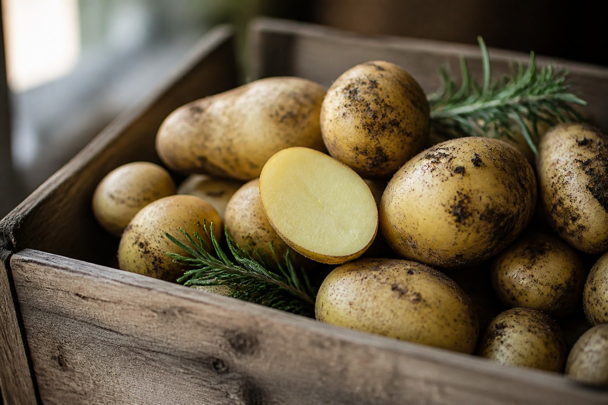

*▲ 감자 생것 100g은 70kcal, 칼륨 335mg, 식이섬유 1.7g입니다. 100g은 중간 크기 감자의 절반 남짓입니다.*

한 줄 결론 <strong>감자 생것 100g은 70kcal, 탄수화물 16.07g, 칼륨 335mg, 식이섬유 1.7g입니다(농촌진흥청 국가표준식품성분표, 수미 품종).</strong> 삶은 감자를 <strong>냉장에서 12~24시간 식히면 전분 일부가 저항전분으로 바뀌고, 삶은 감자 GI 78이 식힌 감자에서 50 안팎까지 내려간다는 보고가 있습니다</strong>. 다만 늘어난 저항전분은 100g당 <strong>0.3g 남짓(약 1kcal)</strong>이라, 혈당이 완만해지는 이유는 '칼로리가 사라져서'가 아니라 <strong>전분이 다시 단단하게 굳어 소화가 느려지기 때문</strong>입니다. 식힌 감자도 탄수화물 16g은 그대로입니다.

감자는 채소 코너에 있지만 영양 구성은 곡물에 가깝습니다. 100g에 탄수화물이 16g, 그중 15g이 전분입니다. 그래서 "감자는 살찐다"는 말과 "감자는 다이어트 식품"이라는 말이 동시에 돌아다니는데, 둘 다 반만 맞습니다.

저는 감자를 고를 때 같은 크기면 무겁고 단단한 것, 싹이 돋거나 껍질이 초록으로 물들지 않은 것을 집습니다. 막상 이렇게 골라 두고도 정작 조리에서 갈렸습니다. 껍질을 벗겨 삶아 바로 먹을 때와, 삶아서 냉장고에 넣었다가 다음 날 감자샐러드로 먹을 때 식후 느낌이 꽤 다르더군요. 개인적으로는 <strong>식힌 감자를 먹은 날이 훨씬 덜 처지는 느낌</strong>이었고, 그 이유를 숫자로 확인해 보는 게 이 글입니다.

많이 검색되는 질문은 <strong>"삶은 감자 칼로리"</strong>, <strong>"감자 혈당지수"</strong>, <strong>"감자 식혀 먹으면 정말 좋은가"</strong>, <strong>"감자 싹 난 부분 도려내면 되나"</strong>입니다.

---

## 1. 감자 영양성분 (생것 100g, 70kcal)

아래 표는 <strong>농촌진흥청 국가표준식품성분표의 '감자, 수미, 생것' 가식부 100g</strong> 값입니다. 국내에 유통되는 감자의 상당 부분이 수미 품종이라 이 값을 기준으로 삼았습니다.

| 영양 성분 (Nutrient) | 함량 (100g당) | 1일 기준치 비율 (2,000kcal 기준) |
| :--- | :--- | :--- |
| **열량 (Energy)** | 70 kcal | 3.5% |
| **수분 (Water)** | 81.1 g | 기준치 없음¹ |
| **탄수화물 (Carbohydrates)** | 16.07 g | 5.0% |
| - 식이섬유 (Dietary Fiber) | 1.7 g | 6.8% |
| - 당류 (Sugars) | 0 g | 기준치 없음¹ |
| **단백질 (Protein)** | 1.93 g | 3.5% |
| **지방 (Total Fat)** | 0.03 g | 0.1% |
| **칼슘 (Calcium)** | 6 mg | 0.9% |
| **인 (Phosphorus)** | 62 mg | 8.9% |
| **철분 (Iron)** | 0.4 mg | 3.3% |
| **칼륨 (Potassium)** | 335 mg | 9.6% |
| **나트륨 (Sodium)** | 1 mg | 0.1% |
| **비타민C (Vitamin C)** | 4.47 mg | 4.5% |
| **티아민 (Thiamin)** | 0.03 mg | 2.5% |
| **리보플라빈 (Riboflavin)** | 0.04 mg | 2.9% |
| **나이아신 (Niacin)** | 0.45 mg | 3.0% |

¹ 수분과 당류는 1일 기준치가 설정되지 않은 항목입니다. 비율은 식품의약품안전처 1일 영양성분 기준치(2,000kcal)와 한국인 영양소 섭취기준 권장섭취량으로 계산했습니다.

*※ 데이터 기준: 농촌진흥청 국가표준식품성분표(식품영양성분 DB 10.4) '감자, 수미, 생것' 2013년 분석값입니다. [USDA FoodData Central FDC 170026](https://fdc.nal.usda.gov/food-details/170026/nutrients) — Potatoes, flesh and skin, raw는 100g당 77 kcal·단백질 2.05 g·칼륨 425 mg·비타민C 19.7 mg으로 차이가 있습니다.*

### 표 읽는 법: 100g은 감자 반 개

- <strong>100g은 중간 크기 감자(150~200g)의 절반 남짓</strong>입니다. 한 개를 통째로 삶아 반찬으로 먹으면 탄수화물 16g 안팎을 먹는 셈입니다.
- <strong>칼륨 335mg</strong>은 100g 기준으로 중간 정도지만, 한 끼에 200g을 먹으면 670mg입니다. 3,500mg 기준의 19%를 감자 하나로 채우는 셈입니다.
- <strong>비타민C 4.47mg</strong>은 국내 표 기준이고 USDA는 19.7mg으로 4배가 넘습니다. 분석 시료(저장 기간) 차이로 보이며, 어느 쪽이든 익히면 열에 절반 이상을 잃어 <strong>비타민C 공급원으로 기대하기는 어렵습니다</strong>.
- <strong>삶으면 열량이 올라가 보이는 건 수분 손실 때문</strong>입니다. USDA 삶은 감자 100g은 86kcal로, 수분이 79.25g에서 77.46g으로 줄어 고형분이 진해진 것입니다.

---

## 2. 식힌 감자가 주목받는 이유: 저항전분과 GI

### 삶은 감자 GI 78, 식히면 50 안팎

<strong>혈당지수(GI)</strong>는 같은 탄수화물 50g을 먹었을 때 혈당이 오르는 속도를 포도당(100) 기준으로 나타낸 값입니다. 감자는 70~90 구간의 고GI 식품으로 분류됩니다. 2026년 조리법별 GI 메타분석(35개 인체 시험, <em>Starch</em>)을 보면 감자 안에서도 편차가 큽니다.

| 조리·섭취 상태 | GI (포도당 100 기준) | 비고 |
| :--- | :--- | :--- |
| **삶은 감자 (바로 먹기)** | 약 78 (70~90 구간) | 국제 혈당지수표·메타분석 공통 고GI |
| **구운 감자** | 79.2 | 수분이 빠져 전분이 더 호화됨 |
| **튀긴 감자** | 83.1 | 기름 + 갈변으로 소화가 더 빠름 |
| **으깬 감자** | 삶은 감자보다 높음 | 조직이 부서져 효소 접촉면이 늘어남 |
| **냉장 후 먹는 감자** | 50.3 (냉장·재가열군 46.3) | 4℃ 이하 12시간 이상 보관 |

같은 감자를 삶아서 바로 먹으면 78, 하룻밤 냉장고에 넣었다가 먹으면 50. 이 메타분석에서 <strong>12시간 이상 4℃ 이하</strong>로 보관한 시험군의 GI는 44.1까지 떨어졌습니다.

### 저항전분은 3.3%에서 5.2%로, 100g당으로 환산하면

변화의 주인공은 <strong>저항전분(RS)</strong>입니다. 소화효소가 분해하지 못해 식이섬유처럼 대장까지 내려가는 전분으로, 익힌 전분이 식으면서 아밀로스·아밀로펙틴이 다시 뭉치는 <strong>노화(재결정화)</strong> 과정에서 생깁니다.

스웨덴 룬드대 연구진이 <em>European Journal of Clinical Nutrition</em>(2005)에 보고한 값을 보겠습니다. 삶은 감자를 8℃에서 24시간 보관했더니 <strong>저항전분이 전분 대비 3.3%에서 5.2%로</strong> 늘었고, 식초 드레싱을 더한 냉장 감자는 혈당 반응이 43%, 인슐린 반응이 31% 낮아졌습니다.

감자 100g의 전분은 USDA 기준 15.29g입니다. 3.3%면 0.50g, 5.2%면 0.79g. <strong>차이는 0.3g, 열량으로 1.2kcal</strong>입니다.

막상 이렇게 계산해 보니 <strong>'식히면 칼로리가 줄어 다이어트에 좋다'는 말은 성립하지 않는다</strong>는 게 분명해졌습니다. 혈당 반응이 완만해지는 건 저항전분 0.3g이 늘어서라기보다, <strong>전분 덩어리가 단단해져 소화효소가 파고들 속도 자체가 느려진 결과</strong>로 보는 편이 맞습니다. 2019년 무작위 교차시험(공복혈당이 높은 여성 30명, 250g 섭취)에서도 식힌 감자는 식후 15분·30분 혈당이 각각 4.8%, 9.2% 낮았을 뿐 <strong>2시간 전체 혈당 반응에서는 유의한 차이가 없었습니다</strong>.

- 식힌 감자는 <strong>혈당이 치솟는 속도를 조금 늦춰 주는</strong> 정도입니다.
- <strong>2시간 혈당 총량을 줄이는 수준이 아닙니다.</strong>
- <strong>탄수화물 16g은 그대로</strong>이므로 섭취량을 줄이는 것과는 다른 문제입니다.

### 다시 데워 먹으면 저항전분은 어떻게 되나

USDA 연구진의 2016년 비교(PubMed 27132853)에서 감자 저항전분은 <strong>삶기보다 구웠을 때, 뜨거울 때보다 차가울 때 많았고, 다시 데우면 그보다 줄었습니다</strong>. 즉 <strong>냉장 > 재가열 > 갓 조리</strong> 순서입니다.

개인적으로는 감자샐러드를 만들 때 <strong>삶아서 하룻밤 식힌 감자를 쓰고, 먹기 직전에만 살짝 데우는 방식</strong>이 가장 만족스러웠습니다. 완전히 차갑게 먹으면 식감이 뻣뻣하고, 오래 끓이면 다시 물러지기 때문입니다. 전자레인지 1분, 속까지 따뜻해지기 직전이 적당했습니다.

---

## 3. 장보기·삶기·보관: 실패를 줄이는 순서

- <strong>고르기:</strong> 같은 크기라면 무겁고 단단한 것. 흠집이 적고, 싹이 돋지 않았고, 초록으로 물들지 않은 것이 기본입니다. 껍질이 얇은 햇감자는 흐르는 물에 문질러 씻으면 껍질째 조리할 수 있습니다.
- <strong>싹과 초록 부분은 도려내도 안전하지 않습니다.</strong> 솔라닌은 싹·초록 껍질·눈 주변에 몰려 있고 <strong>가열해도 잘 파괴되지 않습니다</strong>. 싹이 길거나 껍질 절반 이상이 초록이면 버리세요. 쓴맛과 입안 얼얼함이 신호입니다.
- <strong>삶을 때는 찬물부터, 껍질째 통째로.</strong> 껍질을 벗기면 수용성 성분이 삶은 물로 빠져나갑니다. 중간 크기 기준 끓기 시작해 <strong>20~25분</strong>, 젓가락이 힘없이 들어가면 다 익은 것입니다.
- <strong>으깨는 순간 GI가 올라갑니다.</strong> 조직이 부서져 효소가 닿는 면적이 커지기 때문입니다. 감자샐러드도 으깨지 말고 깍둑썰기로 만들면 훨씬 유리합니다.
- <strong>식힐 때는 밀폐 용기에 담아 냉장 12시간 이상.</strong> 상온에 오래 두면 식중독균 위험이 커집니다. 삶은 뒤 한 김만 빼고 바로 넣고, 다음 날 먹을 양을 미리 덜어 두면 편합니다.
- <strong>보관은 어둡고 서늘한 곳(7~10℃).</strong> 냉장고에 넣으면 전분이 당으로 바뀌어 단맛이 늘고, 그 감자를 튀기면 아크릴아마이드가 더 생깁니다. 냉장 보관했다면 <strong>튀김보다 삶기·찌기</strong>로 조리하세요.
- <strong>아크릴아마이드는 120℃ 이상에서 늘어납니다.</strong> 튀김·구이는 표면이 <strong>연한 금색에서 멈추는 것</strong>이 기준입니다.

---

## 4. 섭취 시 주의사항

- <strong>당뇨·혈당 관리 중이라면 식힌 감자도 탄수화물 16g입니다.</strong> GI가 내려가는 것과 총량이 줄어드는 것은 다릅니다. 한 끼 100~150g으로 정하고 단백질·채소와 함께 드세요.
- <strong>식힌 감자를 단독으로 먹으면 효과가 줄어듭니다.</strong> 연구에서도 차이는 같은 식사 안에서 비교한 값입니다. 식초 드레싱·단백질·식이섬유를 함께 먹을 때 완만해지는 폭이 커집니다.
- <strong>신장질환으로 칼륨을 제한 중이라면 주의하세요.</strong> 감자 100g에 칼륨 335mg입니다. 삶은 물을 버리면 칼륨이 일부 빠지지만 수용성 비타민도 함께 빠지므로 조리법을 의료진과 상의하세요.
- <strong>솔라닌 중독은 '도려내기'로 해결되지 않습니다.</strong> 구역·복통·두통이 나타날 수 있고 가열로 완전히 제거되지 않으니, 싹이 난 감자는 양이 아까워도 버리세요.
- <strong>감자 알레르기는 드물지만 있습니다.</strong> 먹고 입이 가렵거나 두드러기가 나면 섭취를 중단하세요.

---

## 5. 자주 묻는 질문 (FAQ)

**Q1. 감자를 식히면 칼로리가 줄어드나요?**  
아니요. 식힌 감자 100g도 열량은 70kcal 안팎 그대로입니다. 저항전분이 0.3g 늘어 소화되지 않는 부분이 조금 생길 뿐, 열량 차이는 1kcal 수준입니다. 식히는 방법은 혈당이 오르는 속도를 다루는 방법이지 칼로리를 없애는 방법이 아닙니다.

**Q2. 삶은 감자를 다시 데워 먹어도 저항전분이 남아 있나요?**  
일부 남습니다. USDA 연구진의 2016년 비교에서 저항전분은 냉장 감자 > 재가열 감자 > 갓 삶은 감자 순이었습니다. 데우면 줄지만 없어지지는 않습니다. 다만 다시 오래 끓이면 조직이 무너져 GI 상승 폭이 커지므로 살짝 데우는 정도가 실용적입니다.

**Q3. 감자는 껍질째 먹는 게 좋은가요?**  
식이섬유와 칼륨이 껍질 쪽에 더 많아 유리합니다. USDA의 껍질 포함 생감자 100g은 식이섬유 2.1g·칼륨 425mg으로, 껍질을 벗겨 삶은 감자(1.8g·328mg)보다 높습니다. 다만 초록으로 물든 껍질은 솔라닌 문제가 있어 반드시 벗기고, 흙은 솔로 문질러 씻으세요.

---

## 6. 감자와 함께 먹으면 좋은 조합

- <strong>[고구마 (Sweet Potato)](/posts/sweet-potato-nutrition-benefits/):</strong> 같은 뿌리채소지만 구성이 다릅니다. 감자는 칼륨과 전분, 고구마는 식이섬유와 비타민A가 강점입니다. 찐 고구마도 식혀 먹으면 같은 원리로 GI가 내려갑니다.
- <strong>[양파 (Onion)](/posts/onion-nutrition-benefits/):</strong> 감자조림·수프에 넣으면 단맛이 올라와 소금을 줄일 수 있습니다. 감자의 나트륨이 1mg으로 매우 낮아 양파·마늘로 간을 잡는 조합이 잘 맞습니다.
- <strong>[닭가슴살 (Chicken Breast)](/posts/chicken-breast-nutrition-benefits/):</strong> 감자 150g + 닭가슴살 100g이면 균형 잡힌 한 끼가 됩니다. 단백질을 함께 먹는 것 자체가 식후 혈당을 완만하게 만듭니다.

  
📌 관련 순위 가이드

  <ul>
    <li><a href="/posts/low-gi-foods-blood-sugar-guide/">혈당을 천천히 올리는 저GI 음식</a></li>
    <li><a href="/posts/antioxidant-anti-aging-foods-guide/">항산화·노화 방지에 좋은 음식</a></li>
  </ul>

---

## 7. 한 줄 정리

- 감자 생것 100g은 <strong>70kcal, 탄수화물 16.07g, 칼륨 335mg, 식이섬유 1.7g</strong>입니다. 100g은 중간 크기의 절반 남짓입니다.
- 비타민C는 국내 표 4.47mg, USDA 19.7mg으로 차이가 큽니다. 감자를 비타민C 공급원으로 기대하지 않는 편이 현실적입니다.
- 삶은 감자 GI 78이 <strong>냉장 12~24시간 식히면 50 안팎</strong>으로 내려간다는 보고가 있습니다(메타분석 50.3, 12시간 이상 냉장군 44.1).
- 늘어난 저항전분은 <strong>100g당 0.3g(약 1kcal)</strong>입니다. 칼로리가 줄어드는 게 아니라 소화 속도가 느려지는 것입니다.
- <strong>으깨면 GI가 다시 올라갑니다.</strong> 감자샐러드는 으깨지 말고 깍둑썰기로 만드세요.
- <strong>싹이 났거나 초록으로 물든 감자는 버리세요.</strong> 튀김·구이는 연한 금색에서 멈추세요.

**추가 근거:** 조리법별 GI 메타분석(Liu 등, <em>Starch</em>, 2026) — 감자 구이 79.2·튀김 83.1·냉장 50.3, 냉장·재가열군 46.3. 냉장 감자의 저항전분 3.3%→5.2%는 Leeman 등(<em>Eur J Clin Nutr</em>, 2005), 조리법·섭취 온도별 비교는 Raatz 등(PubMed 27132853), 식힌 감자의 식후 혈당 비교는 Patterson 등(2019)입니다. 영양 수치는 농촌진흥청 국가표준식품성분표와 USDA FDC 170026·170440을 대조했습니다.
