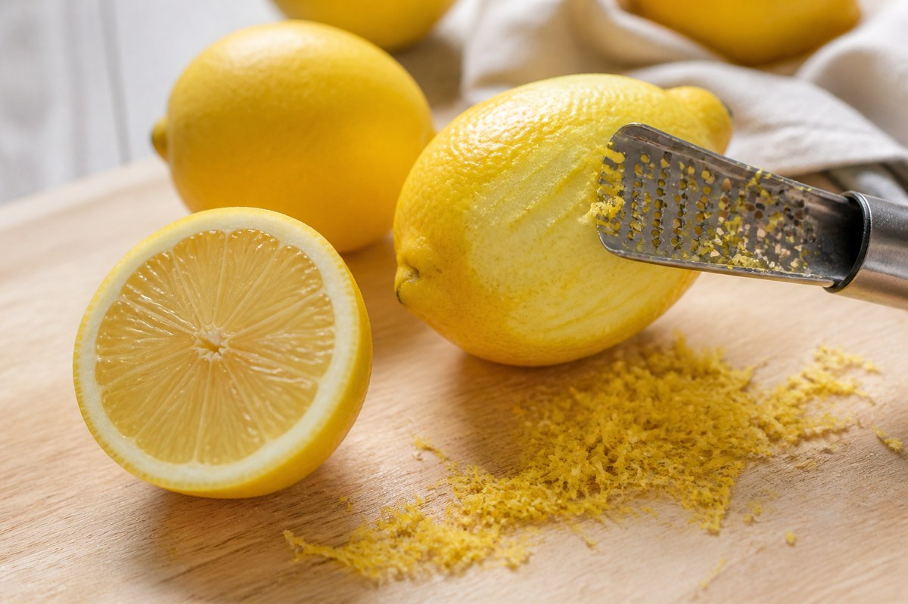

*▲ Lemon flesh without peel: 29 kcal, 53 mg vitamin C, 2.8 g fiber per 100 g. The peel of the same fruit carries 129 mg vitamin C and 10.6 g fiber.*

Quick answer <strong>Lemon flesh without peel provides 29 calories, 1.1 g protein, 9.32 g carbohydrate, 2.8 g fiber and 53 mg vitamin C per 100 g (USDA FDC 167746). The peel, which most kitchens throw away, carries 129 mg vitamin C and 10.6 g fiber per 100 g (FDC 167749).</strong> Juice one lemon and you extract roughly <strong>12–15 mg of vitamin C</strong>, about a seventh of a day's requirement, while the zest holding more than twice the concentration goes in the bin. The catch is quantity: nobody eats 100 g of peel. A tablespoon of zest is about 6 g. Still, using the peel of a lemon you already bought is the cheapest nutrition upgrade in the kitchen — as long as you handle the acid with some care.

Most recipes treat a lemon as a disposable juice packet. You cut, squeeze, and the yellow shell goes straight into the bin. I did that for years, and I never once wondered what I was leaving behind.

What changed my habit was making lemon syrup at home. The peeled rind, packed with sugar for a few days, smelled nothing like the juice — deeper, almost floral. That was the first time it occurred to me that the part I was discarding might be the more concentrated half of the fruit. So I put the official numbers side by side, and the gap turned out to be larger than the smell suggested.

## 1. What "lemon" means in a nutrition table

This matters more than it sounds. The standard entry for lemon in most databases — USDA's "Lemons, raw, without peel," Korea's national table — is <strong>flesh only</strong>. The Korean standard food composition table even lists a 37% refuse rate for lemon, meaning more than a third of the fruit's purchase weight is peel and seed, and it is excluded from the analysis.

So when a label says lemon has 29 or 36 calories per 100 g, it is describing the part you squeeze, not the whole fruit you bought.

| Nutrient | Per 100 g | U.S. %DV |
| :--- | :--- | :--- |
| Energy | 29 kcal | 1% |
| Water | 88.98 g | No DV¹ |
| Protein | 1.1 g | 2% |
| Total fat | 0.3 g | 0% |
| — Saturated fat | 0.04 g | 0% |
| Total carbohydrate | 9.32 g | 3% |
| — Dietary fiber | 2.8 g | 10% |
| — Total sugars | 2.5 g | No DV¹ |
| Calcium | 26 mg | 2% |
| Iron | 0.6 mg | 3% |
| Magnesium | 8 mg | 2% |
| Phosphorus | 16 mg | 1% |
| Potassium | 138 mg | 3% |
| Sodium | 2 mg | 0% |
| Zinc | 0.06 mg | 1% |
| Copper | 0.037 mg | 4% |
| Manganese | 0.03 mg | 1% |
| Selenium | 0.4 µg | 1% |
| Vitamin C | 53 mg | 59% |
| Thiamin (B1) | 0.04 mg | 3% |
| Riboflavin (B2) | 0.02 mg | 2% |
| Niacin (B3) | 0.1 mg | 1% |
| Vitamin B6 | 0.08 mg | 5% |
| Folate | 11 µg DFE | 3% |
| Choline | 5.1 mg | 1% |
| Vitamin A | 1 µg RAE | 0% |
| Vitamin E | 0.15 mg | 1% |
| Vitamin K | 0 µg | 0% |
| Cholesterol | 0 mg | 0% |

¹ Water, total sugars and refuse have no established U.S. Daily Value. Percentages use FDA Daily Values for a 2,000 kcal diet.

*Source: USDA FoodData Central SR Legacy FDC 167746, "Lemons, raw, without peel," per 100 g edible portion. Korea's national food composition table (RDA, 2014) lists 36 kcal, 52.07 mg vitamin C, 122 mg potassium and 1.1 g fiber for the same flesh — close enough that the direction holds, far enough that you should not mix the two sets in one calculation.*

**How to read the table.** One medium lemon weighs 120–150 g, but once peel and seeds are gone the edible part is roughly 80–95 g. So the 53 mg of vitamin C in the table is the figure for eating a whole lemon's flesh — not for squeezing it over a salad.

## 2. What the juice leaves behind

Here is the same fruit, peel against flesh, per 100 g.

| Nutrient (per 100 g) | Flesh | Peel | Peel vs flesh |
| :--- | :--- | :--- | :--- |
| Energy | 29 kcal | 47 kcal | 1.6× |
| Vitamin C | 53 mg | **129 mg** | **2.4×** |
| Dietary fiber | 2.8 g | **10.6 g** | **3.8×** |
| Calcium | 26 mg | 130 mg | 5× |
| Potassium | 138 mg | 160 mg | 1.2× |
| Sugars | 2.5 g | 4.17 g | 1.7× |

*Source: FDC 167746 (flesh) and FDC 167749 (Lemon peel, raw).*

The peel wins every row. Then reality intervenes: a lemon's peel weighs only 30–40 g, and a generous tablespoon of zest is about 6 g — which works out to <strong>7.7 mg of vitamin C and 0.6 g of fiber</strong>. Not a supplement. But paired with the juice of the same lemon, it roughly doubles what one fruit delivers.

I find that framing more useful than "peel is healthy." It is not an argument for eating peel by the bowl; it is an argument for not treating a third of a fruit you paid for as packaging.

### What only the peel has

The smell of lemon is mostly <strong>limonene</strong>. Korea's Ministry of Agriculture food portal notes that the outer peel holds about 6% aromatic oil, roughly 90% of which is limonene. The juice has almost none of it.

Limonene is an aroma compound, not a nutrient you can dose, but it explains something practical: lemon's ability to cut fishiness comes from the oil in the peel as much as from the acid. Squeeze-only cooking uses half of that tool.

## 3. The arithmetic of lemon water

Lemon water is the most common way people try to "get vitamin C" from lemon, and it is the place where expectations run furthest ahead of the numbers.

| Preparation | Juice used | Vitamin C (calculated) |
| :--- | :--- | :--- |
| 250 ml water + a few drops | 5 ml | ~2 mg |
| 250 ml water + 1 tbsp | 15 ml | ~6 mg |
| 250 ml water + half lemon | 20–25 ml | ~8–10 mg |
| 250 ml water + whole lemon | 30–40 ml | 12–15 mg |

*Calculated from lemon juice at 38.7 mg vitamin C per 100 g (USDA), treating 1 ml of juice as 1 g. An estimate, not a measurement.*

A glass with half a lemon gives you about 10% of a day's vitamin C. That is fine — lemon water was never going to be a supplement. What it reliably does is make plain water easier to drink. In my own kitchen, the weeks I keep a cut lemon in the fridge are the weeks I finish two litres a day.

Two things to keep straight:

- **Hot water costs you vitamin C.** The warmer the water and the longer the juice sits, the more ascorbic acid is lost. Room temperature is gentler.
- **Lemon syrup is a sugar product, not a juice product.** Traditional recipes pack peel and sugar at roughly 1:1. A tablespoon carries 8–10 g of sugar — more than the vitamin C is worth if you are drinking it for health.

## 4. In my kitchen: washing, zesting, freezing

If you decide to use the peel, the first obstacle is wax. Imported lemons are often coated to extend shelf life, and that coating ends up on your grater.

- **Baking soda soak, 5 minutes.** One tablespoon of baking soda in a litre of water, then scrub with coarse salt or a brush. The wax goes from slippery to squeaky.
- **A 10-second hot water dip.** Boiling water melts the surface wax so it runs off. You lose a little aroma, which is the trade.
- **Buy organic if you zest often.** Organic fruit still needs washing, but you stop worrying about the coating.

When zesting, stop before you reach the white pith. The yellow layer is fragrant; the white layer is bitter enough to ruin a dish. A microplane naturally stops if you press lightly and rotate the fruit.

Honestly, I switched from a microplane to a vegetable peeler. Thin strips of peel, then a knife, gave me less bitterness and far less wrist ache. Whatever tool you use, <strong>freeze the leftovers</strong>: press zest into a small bag, flatten it, and scrape out what you need. It keeps usable aroma for about three months.

## 5. Cautions worth knowing

- **Enamel first.** Citric acid softens tooth enamel. Sipping lemon water all day, or brushing right after, does more damage than the vitamin C is worth. Use a straw, rinse with plain water, and wait 30 minutes to brush.
- **Skip it on an empty stomach if you have reflux.** Lemon is acidic enough to trigger heartburn in people with GERD or gastritis. With meals is safer.
- **Wash your hands after handling peel.** Citrus peel oil contains furanocoumarins (5-methoxypsoralen among them). Oil left on skin and then exposed to strong sun can cause a red, blotchy phototoxic reaction — berloque dermatitis. Soap and water prevents it.
- **The grapefruit warning does not transfer cleanly.** Grapefruit inhibits CYP3A4 and can raise blood levels of some drugs; lemon has far weaker clinical evidence for that interaction. Still, if you take daily medication and plan to drink lemon juice in quantity, mention it to a pharmacist rather than assuming.
- **Quantity.** One to two lemons a day is plenty. More mostly buys stomach discomfort.

## 6. Frequently asked questions

**Q1. Can I just eat lemon peel?**
You can, but the quantity is self-limiting: peel is bitter and tough, so in practice it goes into zest, preserves or pickles rather than being eaten by the handful. Wash off wax first, and avoid the white pith when zesting.

**Q2. Does lemon water cover my daily vitamin C?**
No. A whole lemon yields 30–40 ml of juice, which is 12–15 mg of vitamin C — roughly 15% of the U.S. Daily Value. Lemon water is a way to drink more water; vitamin C is better sourced from whole fruit and vegetables.

**Q3. Is lemon syrup healthier than lemon juice?**
Not nutritionally. It is made by layering peel with roughly its own weight in sugar, so a tablespoon brings 8–10 g of sugar. You gain the peel's aroma and fiber, and you also gain the sugar — count both.

## 7. What to pair it with

- **[Yuzu](/en/posts/yuzu-nutrition-benefits/):** a citrus with an even more aggressive peel aroma. A little lemon zest in yuzu tea sharpens the top note.
- **[Quince](/en/posts/quince-nutrition-benefits/):** too astringent to eat raw, so it is always cooked. Lemon's acid pulls back quince's tannic edge in preserves.
- **[Mackerel](/en/posts/mackerel-nutrition-benefits/):** fishiness yields to zest plus salt more readily than to juice alone. Grated peel lets you cut the salt and keep the seasoning.
- **[Spinach](/en/posts/spinach-nutrition-benefits/):** the non-heme iron in spinach absorbs better with vitamin C alongside, which is the practical reason a squeeze of lemon over blanched greens works.

  
📌 Related guides

  <ul>
    <li><a href="/en/posts/antioxidant-anti-aging-foods-guide/">Antioxidant and anti-aging foods</a></li>
    <li><a href="/en/posts/low-gi-foods-blood-sugar-guide/">Low-GI foods that raise blood sugar slowly</a></li>
  </ul>

## 8. Bottom line

- Lemon flesh without peel: <strong>29 kcal, 53 mg vitamin C, 2.8 g fiber per 100 g</strong>.
- Lemon peel: <strong>129 mg vitamin C, 10.6 g fiber, 130 mg calcium per 100 g</strong> — 2.4× and 3.8× the flesh.
- A tablespoon of zest (6 g) adds <strong>7.7 mg vitamin C and 0.6 g fiber</strong>. Small, but it doubles what one lemon gives you.
- Lemon water with half a lemon: <strong>8–10 mg vitamin C</strong>. A hydration habit, not a supplement.
- Lemon syrup is a <strong>sugar product</strong>; a tablespoon carries 8–10 g of sugar.
- Acid is the real caution: <strong>straw, rinse, brush later, avoid on an empty stomach with reflux</strong>, and wash peel oil off your hands before sun exposure.

**Sources:** USDA FoodData Central SR Legacy FDC 167746 (lemons, raw, without peel) and FDC 167749 (lemon peel, raw); Korean national food composition table DB 10.4 for the domestic flesh comparison; Korea Ministry of Agriculture's food portal for limonene content in peel oil. Calculations for juice and zest are mine, using USDA's 38.7 mg vitamin C per 100 g for raw lemon juice.
