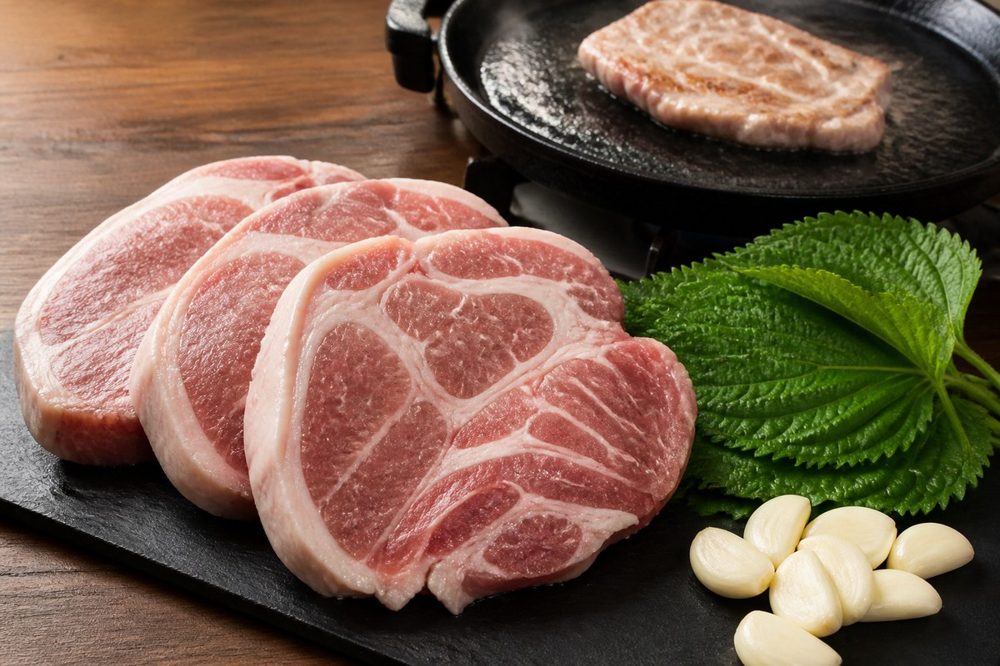

*▲ Raw pork shoulder: 236 kcal, 17.18 g protein, 17.99 g fat per 100 g. Grilled, the same cut reads 264 kcal per 100 g — water loss, not extra meat.*

Quick answer <strong>Raw pork shoulder provides 236 calories, 17.18 g protein, 17.99 g fat and 6.24 g saturated fat per 100 g (USDA FDC 167843).</strong> The same weight of raw pork belly carries about 372 calories and 33.31 g fat in Korea's national table — roughly 1.6 times the calories. Grilled side by side, <strong>150 g of belly delivers 726 kcal and 22.5 g saturated fat, against 396 kcal and 9.6 g for shoulder.</strong> The shoulder also brings slightly more protein. Same grill, same portion, one-third fewer calories: it is the single easiest fat reduction available in a Korean barbecue meal.

Pork belly is the cut that defines a barbecue night, but it is not the cut that fills a Korean home kitchen. That job belongs to shoulder — the marbled, cheaper, more versatile piece sold as <em>moksim</em> or <em>moksal</em>. It goes into stews, stir-fries, boiled pork and curry far more often than belly does.

I started buying both together out of thrift, not nutrition. A shoulder steak was cheaper per 100 g, so half the tray became shoulder. What I noticed after a few weeks was not the price but the morning after: the shoulder nights sat lighter. That is the kind of impression that deserves a calculation rather than a feeling, so I ran the numbers.

## 1. First, the labels

In Korea the cut is registered as <strong>moksim</strong> (목심), with <em>moksimsal</em> as the sub-cut name; <em>moksal</em> is the everyday word butchers and shoppers use. Under US butchery it maps loosely onto the shoulder family — blade, Boston butt, pork shoulder steak. Labels matter because "pork shoulder" in a US supermarket often means a roast for pulling, not a steak for grilling.

Two traps worth knowing:

- **"Ogyeopsal" is not an official cut name** in Korea's meat labelling standard. Shops use it differently, so ask whether skin is attached rather than trusting the word.
- **Fat is trimmed at the shop, not in the table.** Two pieces labelled identically can differ by 20–30 kcal per 100 g depending on how much of the outer fat cap was left on.

## 2. Nutrition facts (per 100 g, raw)

| Nutrient | Per 100 g | U.S. %DV |
| :--- | :--- | :--- |
| Energy | 236 kcal | 12% |
| Water | 64.02 g | No DV¹ |
| Protein | 17.18 g | 34% |
| Total fat | 17.99 g | 23% |
| — Saturated fat | 6.24 g | 31% |
| — Monounsaturated fat | 8.01 g | No DV¹ |
| — Polyunsaturated fat | 1.92 g | No DV¹ |
| Total carbohydrate | 0 g | 0% |
| — Dietary fiber | 0 g | 0% |
| — Total sugars | 0 g | No DV¹ |
| Cholesterol | See note¹ | — |

¹ Water, mono- and polyunsaturated fat and sugars have no established U.S. Daily Value. Percentages use FDA Daily Values for a 2,000 kcal diet. USDA's shoulder record does not report sodium, potassium, iron or cholesterol for this entry, so the Korean national table is quoted for those instead: <strong>sodium 51 mg, potassium 301 mg, iron 0.73 mg, vitamin A 16 µg RAE, vitamin D 0.61 µg, cholesterol not listed for raw</strong>, with 227 kcal and 16.36 g fat per 100 g. The two datasets differ by about 10 kcal — same cut, different sampling year and trim level.

**How to read the table.** A 100 g piece is one thick steak, about 1.5 cm. A restaurant portion of 150–200 g means one and a half to two times these numbers. Note also that protein at 17.18 g per 100 g is higher than pork belly's 13.9 g — leaner meat means the protein is packed more densely.

## 3. The 150 g comparison that actually matters

These are the numbers I keep coming back to. Both are grilled in a pan, both at 150 g, which is a realistic single serving.

| Grilled pork (pan-cooked) | kcal / 100 g | Protein / 100 g | Fat / 100 g | Saturated fat / 100 g | 150 g serving |
| :--- | :--- | :--- | :--- | :--- | :--- |
| **Pork belly** | 484 kcal | 22.78 g | 41.2 g | 15.0 g | **726 kcal** |
| **Pork shoulder (moksim)** | 264 kcal | 24.06 g | 17.23 g | 6.42 g | **396 kcal** |
| **Pork tenderloin** | 172 kcal | 30.23 g | 4.76 g | 1.74 g | **258 kcal** |

*Cooked values from Korea's national food composition table (RDA, DB 10.4); 150 g figures are 1.5× the per-100 g values. Actual cooking loss depends on thickness and heat.*

Three things stand out:

- **330 kcal of difference.** More than a bowl of rice. Not a subtle tweak to a meal but a different meal.
- **More protein from the leaner cut.** 24.06 g against 22.78 g per 100 g. You are not trading protein away for fat.
- **Tenderloin goes further still**, at 258 kcal for 150 g, but it is so lean that people expecting a fatty, juicy bite are usually disappointed. Shoulder is the compromise most people can actually keep eating.

## 4. Why cooked pork reads higher per 100 g

Here is a puzzle that trips up calorie counting. Raw shoulder is 227 kcal per 100 g; grilled, 264; boiled, 282. Cooking does not add energy.

Water leaves. The same 100 g of cooked meat contains more meat than 100 g of raw did.

| Pork shoulder (100 g) | kcal | Protein | Fat |
| :--- | :--- | :--- | :--- |
| Raw | 227 kcal | 17.21 g | 16.36 g |
| Pan-grilled | 264 kcal | 24.06 g | 17.23 g |
| Boiled | 282 kcal | 25.43 g | 18.56 g |

The practical consequence: pick one basis and stay on it. Weigh raw meat at the shop and use raw values. Weigh what lands on the plate and use cooked values. Mixing them inflates or deflates a day's total by a few hundred calories without anyone noticing.

Boiled pork reading highest of all is the same illusion — plus a genuine trade. Boiling renders fat into the liquid, so if you skim it off, actual intake drops below grilling. Korea's National Institute of Animal Science measured firmness too: boiled belly was 71.5% less firm than grilled, boiled shoulder 63.3% less. If chewing is a concern, simmering is the gentler method.

## 5. Buying, grilling, storing

**Buying.** Look at the cross-section, not just the label. Good shoulder has fat threaded through the muscle in thin veins; a thick white cap along one edge means a fattier piece. Colour should be pink-red and the surface should look moist, not pooled with liquid. A 1.2–1.5 cm steak is the sweet spot — thinner dries out, thicker burns outside before the centre is done.

**Grilling.** I flip once per side on high heat. Constant flipping drops the surface temperature, pushes juice out and leaves the centre underdone. About 3–4 minutes per side for a 1.5 cm steak, then 30 seconds standing the fat edge down. USDA's safe minimum for pork is <strong>145°F (63°C) with a 3-minute rest</strong>; slightly blush-pink in the middle is fine and juicier than cooking it bone white.

**Air fryer.** 200°C for 12–14 minutes with one flip gets close, with less splatter and easier cleanup. That has become my weekday default.

**Storing.** Refrigerate 2–3 days. Freeze in portions — a piece thawed and refrozen loses juice and picks up off-flavours. Thaw overnight in the fridge; room-temperature thawing warms only the surface, which is where bacteria grow.

## 6. Cautions

- **Leaner is not free.** Shoulder still carries 16.36 g of fat per 100 g. Portion, not the cut name, decides the total: 100–150 g per meal is realistic.
- **Cured products are a different food.** Shoulder bacon, sausage and smoked shoulder carry far more sodium and fat than the raw cut in this table.
- **Undercooked pork is a real risk.** Cook to temperature, especially with thick pieces. Trichinella and bacterial risk are not hypothetical.
- **Seasoning can undo the swap.** A 330 kcal saving disappears behind salty dipping sauce and rice. Garlic, pepper and herbs carry the flavour with far less sodium.
- **Kidney disease or gout:** 17–24 g protein per 100 g is substantial. Set portions with your clinician.

## 7. Frequently asked questions

**Q1. Are moksal and moksim different cuts?**
No — same cut. Moksim is the official Korean cut name; moksal is the everyday term. The sub-cut label reads moksimsal. If you cannot find "moksal" on a package, look for "moksim."

**Q2. Does shoulder really have more protein than belly?**
Yes, both raw and cooked. Grilled, shoulder has 24.06 g protein per 100 g against belly's 22.78 g; raw, the gap is wider at 17.21 g against 13.9 g. The caveat is that eating more of it to chase protein also adds fat.

**Q3. Is boiled pork lower in calories?**
Per 100 g of cooked meat, boiled shoulder reads 282 kcal against 264 for grilled, because more water is driven out. But boiling renders fat into the broth — skim it and your actual intake can end up lower than grilling.

## 8. What to serve with it

- **[Pork belly](/en/posts/pork-belly-nutrition-benefits/):** the same animal, a different fat profile. Buying both and mixing them keeps flavour high and the total moderate.
- **[Pork tenderloin](/en/posts/pork-tenderloin-nutrition-benefits/):** the leanest option, at 172 kcal per 100 g grilled. Better for a weekday stir-fry than for a grill night.
- **[Cabbage](/en/posts/cabbage-nutrition-benefits/):** lettuce wraps and cabbage leaves add fiber and bulk, which is what actually reduces the amount of meat eaten at one sitting.
- **[Garlic](/en/posts/garlic-nutrition-benefits/):** the classic pairing for a reason — it covers pork's gaminess so you need less salt to season it.

  
📌 Related guides

  <ul>
    <li><a href="/en/posts/high-protein-foods-ranking/">High-protein foods ranked by protein per 100 g</a></li>
    <li><a href="/en/posts/low-calorie-high-satiety-foods/">Low-calorie foods that keep you full</a></li>
  </ul>

## 9. Bottom line

- Raw pork shoulder: <strong>236 kcal, 17.18 g protein, 17.99 g fat, 6.24 g saturated fat per 100 g</strong> (USDA FDC 167843).
- Raw pork belly at the same weight: about <strong>372 kcal and 33.31 g fat</strong> — 1.6× the calories.
- Grilled and compared at <strong>150 g: belly 726 kcal with 22.5 g saturated fat, shoulder 396 kcal with 9.6 g</strong>. A 330 kcal gap.
- Protein favours the shoulder: <strong>24.06 g against 22.78 g</strong> per 100 g cooked.
- Cooked weights read higher because <strong>water leaves</strong> — never mix raw and cooked bases in one total.
- <strong>145°F (63°C) plus a 3-minute rest</strong>; fridge 2–3 days, freeze in portions, never refreeze.

**Sources:** USDA FoodData Central SR Legacy FDC 167843 (pork, fresh, shoulder, whole, separable lean and fat, raw) for the main table; Korea's national food composition table (RDA, DB 10.4) for pork belly, moksim and tenderloin raw, boiled and pan-grilled values and for sodium, potassium, iron and vitamin A. Saturated fat guidance follows the 2025 Korean Dietary Reference Intakes (under 7% of energy). Firmness comparison from Korea's National Institute of Animal Science; cut naming from the Korean Ministry of Food and Drug Safety's pork and beef labelling standard.
